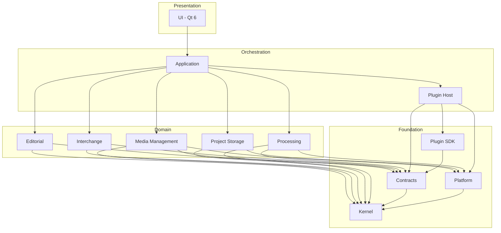
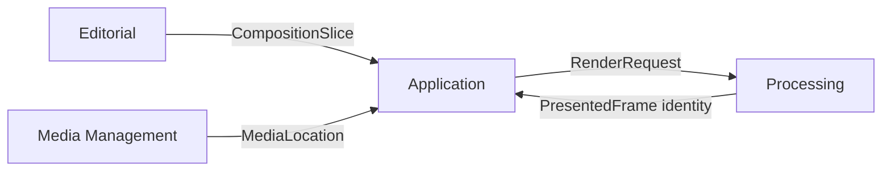
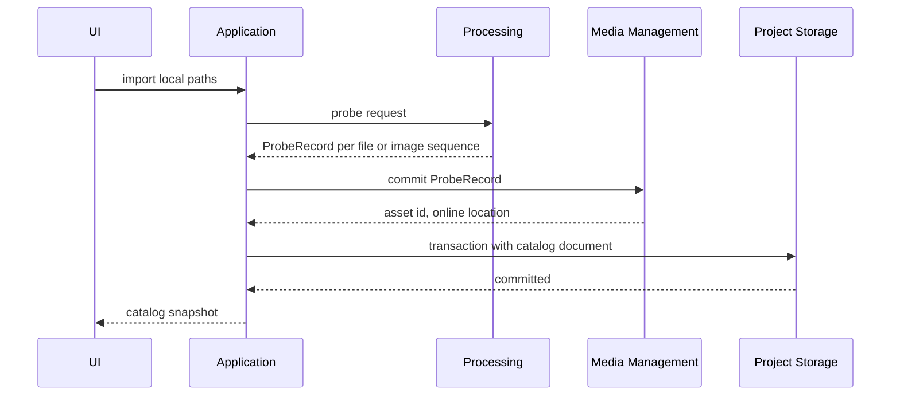
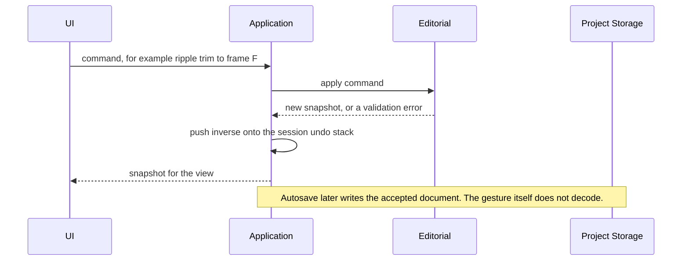
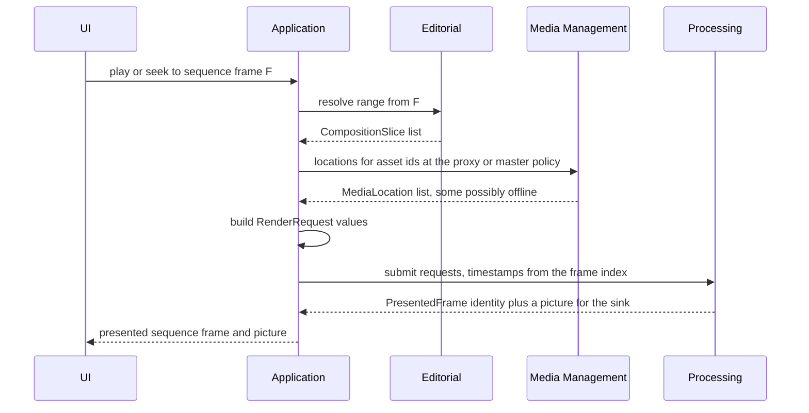
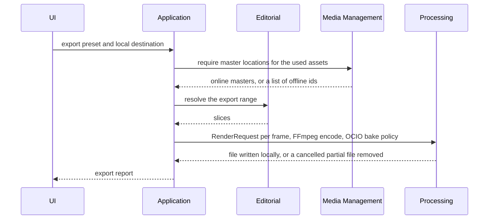
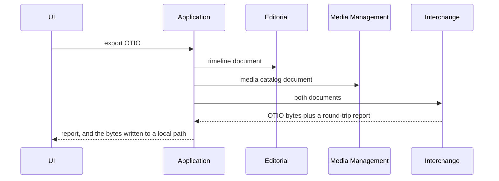

# SISE Editor Architecture

Status: early architecture proposal. No implementation is authorized by this document.

Owner decisions of 2026-11-20 supersede this file where they conflict. The direction is `architecture/decisions/ADR-001-technology-stack.md` (**ACCEPTED WITH CONDITIONS**): C++ , Qt 6, CMake, SQLite, and FFmpeg as the mandatory core media framework, dynamically linked inside the Media Engine only. GStreamer is not a mandatory dependency. One `project.db` plus a manifest is the project store (ADR-003). One Media ID per logical asset (ADR-005). Session-only undo is the Foundation Prototype rule (ADR-009). Licensing stays open (ADR-008). GStreamer playback notes later in this file are an earlier proposal. They describe a request shape. They do not select a framework.

SISE Editor is an open-source, offline-first, professional non-linear editor for cinema, television, documentaries, and long-form film. The product runs on the editor's machine. It does not require an account, a sign-in service, or a network. The first platform is Linux. The design is cross-platform from the start.

This document is the architecture proposal. Module boundaries and the dependency rule are specified in [MODULES.md](MODULES.md). The gated implementation plan is in [DEVELOPMENT_ROADMAP.md](DEVELOPMENT_ROADMAP.md).

The accepted direction is C++ , Qt 6, CMake, FFmpeg as the mandatory core media framework, and SQLite. OpenTimelineIO and OpenColorIO remain candidates for an adapter and for colour. GStreamer is not part of that direction. CMake is the build tool of later implementation phases. It is not introduced by this document set. The root `CMakeLists.txt` stays empty.

## 1. Requirements analysis

Each product requirement is interpreted below as a boundary the design has to keep.

### 1.1 Modular and maintainable

The editor is a set of small modules with one reason to change each. Public behavior crosses a header boundary as plain data or a narrow interface. Private code, including FFmpeg, GStreamer, OpenColorIO, OpenTimelineIO, SQLite, and Qt, stays inside the module that is allowed to use it.

Maintainability follows from four rules:

- A change to codec code does not require a change to trim math.
- A change to the on-disk package does not require a change to the resolver.
- A change to the timeline widget does not require a change to interchange.
- The dependency graph is acyclic and is small enough to review in one sitting. The graph is the matrix in [MODULES.md](MODULES.md).

### 1.2 Editorial logic separate from media processing

Editorial logic answers "which source frame belongs at this sequence frame, under which parameters." Media processing answers "produce pixels and samples for this already-resolved request."

The cut, the trim, the transition, the marker, and the grade parameters are data. Decoding, scaling, resampling, and encoding are processing. The two do not share types beyond the passive contracts they exchange, and processing never calls back into the editorial command API.

### 1.3 Independent media management engine

Media management is a catalog of logical assets. It identifies a master, a proxy, an image sequence, or an offline placeholder, and it can relink them after a path change. It does not know which sequence uses an asset, and it does not decode as part of its own logic. Probe results are handed in as data. The catalog remains meaningful if no timeline exists.

### 1.4 Frame-accurate timeline data model

Sequence positions are integer frame numbers at a declared rational frame rate. Source positions are integer positions at the source rate. Conversions use integer arithmetic and a rounding policy stored on the clip. Floating-point seconds are a display convenience, never the stored representation.

The model covers multiple sequences, multiple video and audio tracks, gaps, clips, transitions, nested sequences, markers, and effect parameters. Nested sequences are part of the data model in the first approved design so later picture-in-picture and stringout workflows do not require a second timeline representation.

### 1.5 Dedicated interchange engine

Import and export of edit data is a module of its own. OpenTimelineIO is the built-in professional interchange format. The interchange module translates between OTIO and the passive timeline and catalog documents. It does not decode media, does not write the project database, and does not mutate the live editorial model. The application accepts a translated document through the editorial and media modules, which enforce their own invariants.

### 1.6 Offline-first project management

A project is a directory on local storage. Open, edit, save, autosave, playback of local media, relink, and export complete with no network. Missing media stays in the timeline as offline assets. The editorial document remains editable. Derived data (thumbnails, waveforms, frame indexes, proxies) is regenerable and is never the authority for the cut.

### 1.7 Extensible plugin architecture

Third-party extension uses a versioned C ABI for probes, effects, interchange adapters, and export targets. The host loads a plugin and adapts it to an internal interface. Domain modules do not link plugins. A second, explicitly unstable tier allows in-tree C++ and Qt panels to ship with the application. That tier is not a promise to external authors.

### 1.8 Cross-platform, Linux first

Linux is the implementation and the acceptance platform. Operating-system details sit behind a platform module whose first implementation is Linux. Domain modules use standard C++17 and the internal contracts. Qt 6 is confined to the user interface. Libraries in the approved stack already exist on more than one operating system, so a later port is a new platform implementation and a packaging effort, not a redesign of the cut.

### 1.9 No mandatory cloud or accounts

The data model has no user account, no organization id, and no remote project pointer. Telemetry, sync, and license checks are outside the product. A machine with the application and the media can open a project copied from another machine. Collaboration, when it exists, is the act of copying a project package or an OTIO file.

### 1.10 Clear interfaces between modules

Modules exchange passive documents and immutable requests. The application is the only module that joins an editorial decision to a media location and hands the result to processing. Each third-party library is a private dependency of one module. Public headers of that module do not expose the library's types.

## 2. Proposed architecture

### 2.1 Layers

The system has four layers. Arrows in the matrix run downward or sideways along the allowed edges. They never run upward.

| Layer | Modules | Role |
| --- | --- | --- |
| Presentation | UI | Qt 6 shell. Issues commands. Displays snapshots and presented frames. |
| Orchestration | Application, Plugin Host | Use cases, undo, joining documents, loading plugins. |
| Domain | Editorial, Media Management, Interchange, Project Storage, Processing | The cut, the catalog, interchange, the package, and pixels. |
| Foundation | Kernel, Contracts, Plugin SDK, Platform | Time, ids, passive documents, the C ABI, and OS services. |

Processing sits in the domain layer beside the editorial model. It is not underneath the timeline, and the timeline is not underneath the codecs. Neither is allowed to call the other. The application sits above both and is the seam.



### 2.2 The seam that keeps the cut and the pixels apart

Three passive types, defined in Contracts, are the whole conversation between editorial decisions, files, and codecs:

| Type | Produced by | Consumed by | Meaning |
| --- | --- | --- | --- |
| `CompositionSlice` | Editorial | Application | At this sequence frame, these layers, source positions, transition weights, effect parameters, and color-decision ids. No paths. |
| `MediaLocation` | Media Management | Application | For this asset id and quality policy, this local path, rate, and color-space name, or an offline flag. |
| `RenderRequest` | Application | Processing | A slice whose asset ids have been replaced with resolved locations. Immutable. |



Editorial can resolve a frame with every asset offline. Processing can render a request built by a test, with no timeline object in the process. Media management can relink a file that no sequence references.

### 2.3 Boundaries around third-party libraries

| Library | Private to | Used for |
| --- | --- | --- |
| Qt 6 | UI | Windows, widgets, input, file dialogs. |
| FFmpeg | Processing | Probe, frame index, stills, waveforms, proxy encode, final encode and mux. |
| GStreamer | Processing | Interactive playback, device audio, presentation timing. |
| OpenColorIO | Processing | Applying color decisions during preview and export. |
| OpenTimelineIO | Interchange | Reading and writing OTIO. |
| SQLite | Project Storage | Transactional local project state. |
| C++17 standard library | Any module | Language baseline. |
| CMake | Build, later phases | Builds the modules. Not a runtime dependency. |

A public header that other modules may include does not include a third-party header. Translation to library types happens in the owning module's private sources.

### 2.4 What each layer is forbidden to know

- The UI does not compute trim results and does not seek a codec.
- The application does not contain frame-mapping arithmetic. It calls Editorial.
- Editorial does not open files, sockets, or devices.
- Media management does not store sequence structure.
- Interchange does not commit a transaction.
- Project storage does not interpret a timeline payload.
- Processing does not move a cut, relink a file, or write the project.
- The kernel and the contracts have no I/O.

## 3. Frame-accurate time model

Time is the shared language of the editorial model. It lives in the kernel so every module names a frame the same way.

### 3.1 Representation

- A `Ratio` is a reduced pair of 64-bit integers, denominator greater than zero.
- A `FrameRate` is a ratio in frames per second. 24/1, 25/1, 24000/1001, 30000/1001, 48/1, 60000/1001 are ordinary values, not special cases in the type.
- A position on a rate is an `int64` frame index. Frame 0 is the origin of that rate's count.
- A `Range` is a half-open interval `[start, end)` of frame indexes at one rate.
- A duration is an end minus a start at that same rate.

Stored project data uses these integers. A seconds value may be formatted for a label. It is not written back as the position.

### 3.2 Two clocks, one mapping

Every clip carries:

- a record range at the sequence frame rate
- a source range at the source rate
- a conform policy: `nearest`, `floor`, or `hold` (stills and generators)

Mapping multiplies and divides in integers and applies the stored policy. The policy is part of the clip, so reopening a project reproduces the same source frame. A rate change is a change of this mapping, recorded as data, not a resample performed inside the timeline.

Nested sequences use the inner sequence's rate as the source rate. The outer clip maps that rate onto the outer sequence with the same conform rules.

### 3.3 Audio

The editorial quantum is the sequence frame. An audio cut falls on a sequence-frame boundary. Sample positions are derived from that boundary with the same integer arithmetic, using the media sample rate, and the rounding remainder is determined by the stored policy. The first design does not offer a subframe slip. Adding one later is a new source-range representation, reviewed on its own, not a silent reinterpretation of existing clips.

### 3.4 Timecode

Timecode is a label: start value, rate, and a drop-frame flag. Drop-frame counting skips numbers in the label for 29.97 and 59.94. It does not skip frames in the model. Reel name, timecode, and file identity belong to the media catalog and are used for relink and for OTIO references.

### 3.5 Playhead

The playhead, the selection, and the timeline zoom are session state. Markers, record ranges, and sequence in and out points are document state. Interchange round-trips document state. A saved project may store the last playhead as a convenience; interchange may ignore it.

Processing reports the sequence frame it actually presented, derived from the frame index of the buffer. The user interface shows that reported frame. A GStreamer clock reading is not the stored playhead.

## 4. How editorial logic stays separate from media processing

### 4.1 Ownership

| Concern | Owner |
| --- | --- |
| Tracks, items, transitions, nesting, markers | Editorial |
| Trim, ripple, roll, slip, slide, lift, extract, overwrite, insert, razor | Editorial |
| Effect parameters and keyframes, in frames | Editorial, as data |
| Color decisions: spaces, display, view, grade parameters, bake policy | Editorial, as data |
| Which source frame a sequence frame resolves to | Editorial resolver |
| Asset identity, paths, online or offline, proxies | Media management |
| Frame index from a file's timestamps | Processing, stored as a regenerable derivative recorded by media management |
| Decode, composite, resample, OCIO application, encode | Processing |
| Choosing proxy or master for a playback or export pass | Application policy, using locations from media management |

An effect on a clip is an id plus typed parameters and keyframes. The id names an implementation that Processing, or a plugin adapted into Processing, provides. Editorial stores the id when the implementation is absent. The clip still trims. Playback substitutes a documented passthrough and the interface reports the missing effect. Export does the same and records it in the export report.

### 4.2 Resolver

`Editorial.resolve(sequence, range)` walks the in-memory model and emits one `CompositionSlice` per sequence frame in the range, or a compact run-length form that expands to the same frames. The slice lists layers from bottom to top:

- asset id, or nested sequence id
- source position at the source rate
- opacity and transition weight
- effect parameter values evaluated at this frame
- color-decision id

The resolver has no file path, no codec context, and no color processor. A unit test can resolve a transition without linking FFmpeg.

### 4.3 Processing

Processing accepts a `RenderRequest` and returns either encoded output, a thumbnail, a probe record, or a presented frame. A presented frame carries the sequence frame, the asset id, and the source frame that were in the request, so a test can check identity without looking at pixels.

Two backends live inside Processing and share the request:

- **FFmpeg** performs non-realtime work: probe, index, thumbnail, waveform, proxy, and export. Export steps one sequence frame at a time, or a small bounded lookahead, driven by successive requests. This is the accuracy path.
- **GStreamer** performs interactive playback. The application supplies the timestamp to seek, computed from the FFmpeg-built frame index. GStreamer presents. It does not decide which editorial frame "should" be current.

OpenColorIO runs on both paths from the color decision copied into the request. Preview uses the display and view. Export bakes color only when the request's bake policy says so. The default export policy leaves the image in the working space and does not bake the monitoring view.

### 4.4 Caches

Decoded frames, thumbnails, waveforms, and frame indexes are caches. The cache key includes the asset identity, the source frame, and a hash of the color configuration. Deleting the cache changes nothing about the cut. Project storage does not read cache payloads to reconstruct a sequence.

## 5. Offline-first project model

### 5.1 Package

A project is a directory with a `.sise` suffix:

```
Title.sise/
  project.sqlite       authoritative structured state
  autosave.sqlite       rotating recovery database
  color/                OCIO config copied into the project when chosen
  cache/                frame indexes, thumbnails, waveforms; safe to delete
  proxies/              optional local proxy media
  interchange/          optional copies of OTIO files the user exported
```

Master media stays where the user placed it. Import records a path. Copying media into the package is an explicit user action, not the default.

The package id is a random local identifier. It is not an account and not a server key.

### 5.2 What is stored

Project storage holds opaque versioned blobs plus a generic secondary index the application maintains for path lookup. Each domain module defines its document, serializes it, and is the only module that validates it on load.

| Blob | Written by | Validated on load by |
| --- | --- | --- |
| Timeline document | Application, from Editorial | Editorial |
| Media catalog document | Application, from Media Management | Media Management |
| Project settings, including the relative path of the embedded OCIO config | Application | Application |

SQLite runs in WAL mode. A save is a transaction. Autosave writes `autosave.sqlite` so a failed autosave cannot truncate `project.sqlite`. A lock file records the local process that has the package open. There is no network lock.

Schema versions are integers. Project storage migrates its own tables. A module migrates its own document when its version is older. The application runs module migrations in a fixed order and writes a new transaction only after they succeed.

### 5.3 Offline media and portable color

An asset has locations with roles `master` and `proxy`. Each location is online or offline. Relink matches a candidate file against recorded identity: duration, rate, resolution, sample rate, reel, timecode start, file size, and a content hash when one has been computed. The previous path is a hint, not the identity.

The OCIO config a project uses is copied under `color/` at the moment the user selects it. Later edits to a system-wide config do not change the film. If the embedded config is missing, Processing uses a documented raw view and the interface marks the picture as untagged. The application does not download a replacement config.

### 5.4 Session versus document

Undo and redo are session state. They are not required to survive a restart. The document that survives is the last successful save or autosave. A crash loses the unsaved gesture and keeps the last package transaction.

## 6. Plugin extension points

### 6.1 Tiers

**Tier A — stable C ABI.** External authors compile against the Plugin SDK. The boundary is `extern "C"` and a table of function pointers. No C++ standard-library type and no exception crosses it. The host checks a major ABI version and refuses to load a mismatch. Tier A capabilities:

| Capability | Contract it satisfies | Domain that receives it |
| --- | --- | --- |
| Media probe | `IMediaProbe` | Media Management, via the application |
| Effect processor | `IEffectProcessor` | Processing |
| Interchange adapter | `IExchangeAdapter` | Interchange |
| Export target | `IExportTarget` | Processing, described to the application |

The built-in OTIO adapter, the FFmpeg probe, and the built-in export path implement the same contracts inside the owning modules. They are not plugins. A project opens with zero third-party plugins installed.

**Tier B — in-tree, unstable.** Timeline tools and Qt panels compiled with the application may use C++ and Qt. They link the application and the UI. They are rebuilt with every application change. The Plugin SDK does not expose Qt and does not expose editorial command headers.

### 6.2 Load path

1. Plugin Host asks Platform to load a shared library from a local directory the user configured, or from the application's local plugin directory.
2. The host reads the ABI version and the capability list.
3. The host wraps each capability in the matching contract interface.
4. The application attaches probes to Media Management, processors to Processing, and adapters to Interchange.

Domain modules do not scan directories and do not call `dlopen`. A plugin does not receive a pointer to the editorial model. An effect processor receives parameter values for one frame and input buffers, and it returns output buffers.

### 6.3 Trust

Tier A plugins run in-process in the first design. They are treated as trusted local code, the same way a user-installed shared library is trusted. Process isolation is a later design, and it is not required for the boundaries in this proposal to hold. Plugins have no network privilege granted by the editor, because the editor has no network channel to grant.

## 7. Cross-platform strategy

### 7.1 Linux as the reference

Development, review, and the first acceptance pass run on Linux. The user interface targets Qt 6 on Wayland and on X11. Audio output is a GStreamer sink selected inside Processing, with PipeWire as the preferred Linux sink and a fallback the GStreamer runtime already provides. Domain tests do not open a display.

### 7.2 Platform module

Platform is the only module that may call operating-system APIs directly. Its first implementation covers:

- UTF-8 paths and directory operations
- atomic file replace
- process-local lock files
- monotonic clocks
- loading and unloading a shared library

Path comparison used by domain logic is byte-wise on the path the platform returns. The Linux implementation is case-sensitive. A later Windows implementation may need a comparison policy at the platform boundary. Domain modules do not call `fork`, do not read `/proc`, and do not assume an installation under `/usr`.

### 7.3 What makes a later port a port

A second operating system needs:

- a Platform implementation
- Qt 6, FFmpeg, GStreamer, OpenColorIO, OpenTimelineIO, and SQLite builds for that system
- a Processing review of the audio sink and the video sink
- the same frame-oracle fixtures, run unchanged

It does not need a second editorial model or a second project format. No second operating system is in the first implementation plan. [DEVELOPMENT_ROADMAP.md](DEVELOPMENT_ROADMAP.md) puts a portability audit at the end of the Linux work, before any port begins.

### 7.4 UI toolkit placement

The shell uses Qt Widgets. The timeline, bins, and monitor are dense editing surfaces, and Widgets keeps that drawing in the UI module without introducing a second UI technology. QML is not part of this proposal.

## 8. Open source only

Every runtime component in this architecture is open source. The editor is itself open source. No proprietary SDK, licensed codec pack, or closed plugin format is required to build, open, edit, play, or export.

| Component | Role | License posture used by this design |
| --- | --- | --- |
| SISE Editor modules | The application | Open source, license chosen by the project owners before the first release build. |
| Qt 6 | UI | LGPL-compatible dynamic linking. Qt stays in the UI module. |
| FFmpeg | Probe, index, export | LGPL build is the reference. GPL-only components are not required for the architecture. |
| GStreamer | Playback | LGPL. |
| OpenTimelineIO | Interchange | Apache-2.0. |
| SQLite | Project database | Public domain. |
| OpenColorIO | Color application | BSD-3-Clause. |
| C++ standard library, CMake | Language and build | Open-source toolchains (GCC or Clang on Linux). |

Patent-encumbered codecs may be present on a user's machine through their own FFmpeg build. The architecture does not require them. The accuracy oracle in the roadmap uses numbered image sequences, which Processing already reaches through FFmpeg, so the frame-identity test does not depend on a patented encoder.

The design introduces no additional third-party library. A test framework, if one is chosen when implementation is approved, is an optional open-source development dependency of that phase and is not part of the runtime architecture.

## 9. Data flow

All five flows below run on the local machine. None of them has a network step.

### 9.1 Import



Import records media. It does not place a clip on a timeline unless the user issues a separate edit command. An image sequence is one asset with a frame range, not one asset per file. If the probe cannot read a file, Media Management stores an offline asset with the path and the failure recorded, and the rest of the import continues.

### 9.2 Edit



A command is a pure mutation of the editorial model: overwrite, insert, lift, extract, razor at a frame, trim, ripple, roll, slip, slide, or a marker edit. The UI sends the frame the user aimed at. Editorial returns the frame the model stored. The view redraws from the snapshot. Playback, if running, is invalidated because the composition hash changed. The trim does not ask GStreamer to move a boundary.

Undo pops the session stack and applies the inverse through Editorial. Redo is the forward command. Save writes the accepted document through Project Storage and does not write the undo stack.

### 9.3 Playback



The session schedules frames. Processing follows. For a long-GOP file, the frame index records keyframe positions so a seek decodes forward to the requested source frame. If the asset is offline, the slice still exists and Processing returns a local slate for that layer, generated in-process, with the same frame identity fields.

Audio monitoring uses the audio device clock inside the GStreamer path. The video frame presented is the frame whose interval contains that clock. On a seek, both streams flush to the same rational time before the presented-frame report is emitted. Dropped preview frames update the reported presented frame and do not rewrite the timeline.

### 9.4 Export



Export uses the FFmpeg path, not the GStreamer clock. The default quality policy uses masters. If a master is offline, the application stops the export and reports the asset. It does not silently substitute a proxy. A preset may explicitly allow proxies; that choice is stored on the export request and printed in the report.

Cancelling an export leaves the project unchanged. The partial output file is removed or truncated by Processing before the command returns.

### 9.5 Interchange



Import reverses the arrows. Interchange parses OTIO into a timeline document, a catalog document of external references, and a round-trip report. The application asks Media Management to create or match assets, including offline assets for missing files, then asks Editorial to validate and accept the timeline document. Only the accepted documents are saved.

The round-trip report lists features that have no OTIO equivalent. Those features are also written into an OTIO metadata namespace so a later import into SISE Editor can recover them. A foreign tool may drop that metadata. The report is how the loss stays visible. A successful SISE-to-OTIO-to-SISE cycle on a fixture is idempotent: a second export matches the first. That property is the acceptance test in the roadmap, not an assumption.

## 10. Concurrency and failure

Editorial, media management, and project transactions mutate on one session thread. Processing has its own threads and receives immutable requests. Results return on a queue the application drains. The UI thread sends commands and paints. It does not call a decode of a whole file.

A command either changes the model completely or leaves it as it was. A project transaction has the same property. A failed probe fails that asset and leaves the package transaction uncommitted until the application decides to store the offline record.

Errors use the kernel result type across module boundaries. Exceptions do not cross a module boundary. A plugin error is returned as a result code at the C ABI and becomes a result type in the host.

## 11. Decisions this proposal locks

Review either accepts these positions or asks for a revision of these documents. Implementation waits either way.

1. Integer rational time is the only stored time base. Timecode is a label.
2. The application is the only joiner of `CompositionSlice` and `MediaLocation` into a `RenderRequest`.
3. FFmpeg, inside the Media Engine, is the core media framework for probe, decode, and export. Interactive playback uses that same engine behind AETHER interfaces. GStreamer is not a selected dependency. The presented frame number comes from the frame index. This item replaces the earlier sentence that split probe and playback across FFmpeg and GStreamer.
4. Project storage is one `project.db` plus a manifest (ADR-003). The earlier opaque per-module `project.sqlite` package is not the authority. Validators stay in the owning modules.
5. Nested sequences are in the first data model.
6. Audio edits align to sequence frames. Subframe slip is out of the first model.
7. Tier A plugins use a C ABI. Tier B UI tools are in-tree and unstable.
8. Qt 6 is linked only by the UI.
9. The OCIO config in use is copied into the project package.
10. The first shell is Qt Widgets.

## 12. Reading the other two documents

[MODULES.md](MODULES.md) names each module's responsibilities, the public operations, and the dependency matrix that keeps the graph acyclic.

[DEVELOPMENT_ROADMAP.md](DEVELOPMENT_ROADMAP.md) orders the work into small reviewable phases. Phase 0 is the review of this document set. No module, library, or build system is created before that review approves the architecture.
