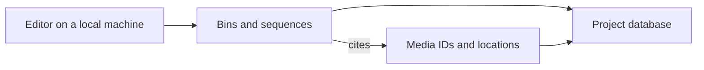

# 01 — Product requirements

Status: architecture preparation. This document authorises no implementation.

Labels: **CONFIRMED** is an observed fact about the repository or about tests that were not run. **PROPOSED** is a requirement taken from the existing specifications and kept for review. **OPEN** is a choice the specifications do not settle. Nothing here is promoted to confirmed.

The product statement lives in `docs/PRODUCT_VISION.md`. The cutting style lives in `docs/EDITORIAL_PHILOSOPHY.md`. This file traces requirements to those texts and to the contracts they depend on. It does not replace them.

## 1. Product

**PROPOSED.** AETHER is an open-source, offline-first nonlinear editor for feature films, television, documentaries, and long-form work, initiated for the Society of Indian Screen Editors. The repository directory is `sise-editor`. The early documents call the same system SISE Editor (`docs/EDITORIAL_PHILOSOPHY.md`). One product, two names, until a review picks the public name. The name choice is **OPEN**. The requirement that it is one product is **PROPOSED**.

**CONFIRMED.** No application exists in this tree. Requirements below are acceptance targets for later code, not claims that a build meets them.

## 2. Requirement list

| ID | Requirement | Label | Contract |
| --- | --- | --- | --- |
| R1 | A person can open a project and cut with no account, sign-in, subscription, activation, or network | **PROPOSED** | `docs/PRODUCT_VISION.md`, `ARCHITECTURE.md` §1.9 |
| R2 | The first implementation target is Linux. Windows and macOS stay behind a platform interface and are not in the first acceptance | **PROPOSED** | `docs/SYSTEM_ARCHITECTURE.md`, `DEVELOPMENT_ROADMAP.md` phase 16 |
| R3 | Editorial decisions and media processing meet only through documents the application joins | **PROPOSED** | `ARCHITECTURE.md` §2.2, `docs/ENGINEERING_INTERFACES.md` |
| R4 | Stored time is rational. Floating-point seconds are display text | **PROPOSED** | `docs/05_TIMEBASE_AND_TIMING_ARCHITECTURE.md` |
| R5 | A bin is an editorial object. A directory is a storage folder | **PROPOSED** | `docs/BIN_ARCHITECTURE.md` |
| R6 | Media ID is stable and is not a path | **PROPOSED** | `docs/MEDIA_IDENTITY_SPECIFICATION.md` |
| R7 | A timeline instance does not mint media identity | **PROPOSED** | `docs/SEQUENCE_AND_BIN_INTEGRATION.md` |
| R8 | Original bytes are never silently modified | **PROPOSED** | `docs/SECURITY_AND_FILE_SAFETY.md` |
| R9 | Missing media leaves the cut editable and the Media ID in place | **PROPOSED** | `docs/MEDIA_RELINK_ENGINE.md` |
| R10 | Relink is a location update. Conform is a verification report. Export is a file plus a report. The three results are not interchangeable | **PROPOSED** | `docs/CONFORM_ENGINE_SPECIFICATION.md` |
| R11 | Undo of an editorial gesture restores the previous composition or leaves the model unchanged | **PROPOSED** | `docs/15_UNDO_RECOVERY_AND_SAFETY.md`. Survival across restart is **OPEN** |
| R12 | Exchange files are translations with a loss report. They are not the project database | **PROPOSED** | `docs/INTERCHANGE_ADAPTER_ARCHITECTURE.md` |
| R13 | No compatibility with Resolve, Media Composer, Premiere Pro, or Pro Tools is claimed | **CONFIRMED** as the evidence gap | `docs/EXTERNAL_APPLICATION_COMPATIBILITY.md` |
| R14 | Codec writers stay unavailable until a named validation suite passes and counsel has reviewed redistribution | **PROPOSED** engineering gate. Legal half is **OPEN** | `docs/NATIVE_MEDIA_ARCHITECTURE.md`, `docs/16_SECURITY_AND_LICENSING.md` |
| R15 | The workstation is dense and timeline-centred. The UI does not perform trim mathematics | **PROPOSED** | `docs/UI_ARCHITECTURE.md`, `docs/TIMELINE_UI_SPECIFICATION.md` |

## 3. Users and workflows

**PROPOSED.** The people named in `docs/PRODUCT_VISION.md` are picture editors, assistant editors, and post staff on a local workstation.

### 3.1 Workflow: start a cut

1. Create a project directory. The working database and the manifest are created together.
2. Ingest or link camera and sound files. Each accepted recording receives one Media ID. The original file is opened for read.
3. A master clip appears in a bin. The bin membership is a row. It is not the creation of `DAY_01/` unless the person also asked for a storage folder.
4. The person places the clip on a sequence. The new row is a timeline instance citing that object and that Media ID.

Failure: if the probe cannot read the file, the ingest records an offline or failed item and does not publish a successful media record (`docs/SYSTEM_ARCHITECTURE.md` failure table). The rest of a batch continues.

### 3.2 Workflow: cut without the volume

1. The volume is absent. Locations are offline. Media IDs remain.
2. Overwrite, trim, ripple, markers, and undo still apply to the editorial model.
3. Playback shows a slate for the missing layer when a playback path exists. The Foundation Prototype does not require that picture (`docs/FIRST_IMPLEMENTATION_MILESTONE.md`).

Failure: a command that would need to invent a path or a new Media ID is rejected. The model stays as it was.

### 3.3 Workflow: move the media and keep the cut

1. Files move or the mount point changes.
2. Relink classifies candidates and, when policy allows, writes a new location for the same Media ID (`docs/MEDIA_RELINK_ENGINE.md`).
3. Instances and record ranges are untouched.
4. A conform, if later requested, reads the editorial revision and the registry and writes a report (`docs/CONFORM_ENGINE_SPECIFICATION.md`). Relink’s success is a log line inside that report, not the verdict.

Failure: a checksum mismatch does not retarget the master clip to a different Media ID.

### 3.4 Workflow: hand picture and sound to other rooms

**PROPOSED** and untested. Picture exchange is an AVX document. Audio composition exchange is the AAF profile. OTIO, FCP XML, FCPXML, and CMX 3600 EDL are further adapters. Each write produces a loss report. A reduced EDL is never the only automatic save.

**CONFIRMED.** No such file was imported by another application in the evidence this repository holds.

## 4. Data contract

The product-level objects are the ones the bin architecture already names. Fields live in `docs/BIN_DATA_MODEL.md` and `docs/MEDIA_IDENTITY_SPECIFICATION.md`.

| Object | Identity | Must hold | Must not hold |
| --- | --- | --- | --- |
| Project | Project id | Settings, registries, lock, revision | An account id |
| Bin | Bin id | Membership of editorial objects | Media bytes |
| Master clip | Object id | One Media ID, source ranges | A path as its key |
| Timeline instance | Instance id | Object id, Media ID, record range, source range | A newly minted Media ID |
| Media | Media ID | Technical metadata with availability, locations | A promise that a codec writer exists |
| Sequence | Sequence object id | Rational rate, tracks, instances | A private second clip table |

## 5. Failure cases

| Case | Required behaviour | Label |
| --- | --- | --- |
| Network removed | Open, edit, save, and relink of local files still complete | **PROPOSED** |
| Original opened for ingest | Bytes and size unchanged after the operation | **PROPOSED** |
| Two files, same name, different checksum | Two Media IDs. Relink does not cross them | **PROPOSED** |
| Exchange omits an effect | The native project still has the effect. The report lists the omission | **PROPOSED** |
| Licence or patent status unknown | The encoder is not offered as available | **OPEN** until counsel writes the status |

## 6. Acceptance criteria

A later build meets this requirements document when all of the following are true. None of them is true of the current tree.

- **CONFIRMED** today: the repository contains no test run that satisfies R1–R15.
- Headless tests cover R4–R11 on a fixture whose expected frame numbers are written in the test.
- A reviewer can see the original file’s size or hash unchanged across ingest.
- The exchange report for any adapter lists preserved, metadata-only, and dropped items, and the UI does not describe an untested vendor as supported.
- `docs/17_TESTING_AND_VALIDATION.md` is the place those tests are named. This file does not invent results.

## 7. Out of scope for the product’s first cut

**PROPOSED**, from `DEVELOPMENT_ROADMAP.md` §19 and `docs/SYSTEM_ARCHITECTURE.md`: a second operating system as a delivered port, subframe audio slip, process-isolated plugins, multi-writer collaboration, a network render farm, and any cloud project pointer.

