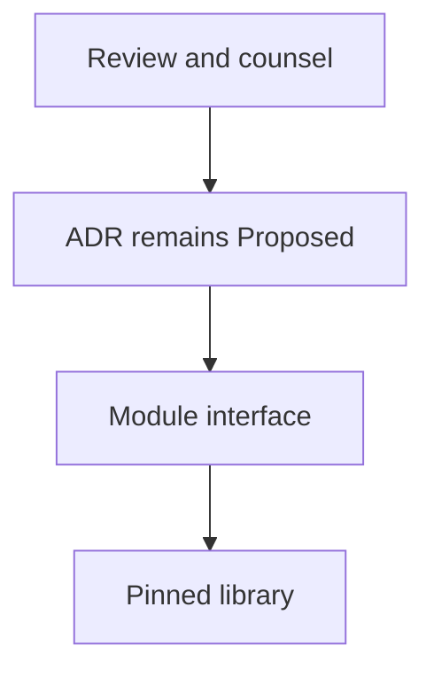

# 03 — Technology decisions

Status: architecture preparation, updated 2026-11-20 to record owner decisions. Listing a library here is not a production validation and not a legal clearance. ADR-001 is **ACCEPTED WITH CONDITIONS**. ADR-008 stays open.

Labels: **PROPOSED** means a leading candidate that is not an owner decision. **OPEN** means unresolved, including every licence question. **CONFIRMED** means observed: nothing is linked, the root `CMakeLists.txt` is empty, and the CLI measurements are the files under `docs/validation/`. Those measurements are not a library link and not a licence clearance.

The decision record is `architecture/decisions/ADR-001-technology-stack.md`, **ACCEPTED WITH CONDITIONS**. GStreamer is not a selected mandatory framework. The conditions and the open licence are not closed by this table.

## 1. Decision table

| Topic | Position in the documents | Label | Record |
| --- | --- | --- | --- |
| Language | C++ is the primary language. Public headers carry no third-party types | **ACCEPTED WITH CONDITIONS** | ADR-001 |
| UI | Qt 6 is the desktop framework. Qt stays in the UI module. Distribution obligations are not cleared | **ACCEPTED WITH CONDITIONS**. Licence **OPEN** | ADR-001, ADR-008 |
| Build | CMake is the build system. The file at the repository root is empty, so there is no product build | **ACCEPTED WITH CONDITIONS**. **CONFIRMED** empty root file | `docs/18_BUILD_AND_RELEASE.md` |
| Working database | SQLite, file `project.db`, one manifest, foreign keys on. PostgreSQL is out of scope | **ACCEPTED**. Not yet measured | ADR-003 |
| Portable bin | `.abin` is interchange, not a second database | **ACCEPTED** as interchange | ADR-004 |
| Picture and sound media | FFmpeg is the mandatory core framework, inside the Media Engine. GStreamer is not a mandatory dependency | **ACCEPTED WITH CONDITIONS**. Library link **BLOCKED** on this machine | ADR-001, `docs/validation/FFMPEG_LIBRARY_INTEGRATION_VALIDATION.md` |
| Sound | AETHER SOUND is a separate module in the later layering. The early architecture folds interactive audio into Processing’s GStreamer path | **PROPOSED** separate. **OPEN** against the early text | ADR-006 |
| Colour | OpenColorIO is a candidate for display and bake. First-prototype scope is **OPEN** (tags and a hook are the recommendation) | **OPEN** | `docs/12_COLOUR_MANAGEMENT.md` |
| Interchange library | OpenTimelineIO is a candidate for one adapter. It must not become the project database. AVX and AAF are specified as documents, not as proven libraries | **PROPOSED** / **OPEN** | ADR-007 |
| Monitoring hardware | DeckLink SDK is a proprietary candidate. Default off | **OPEN**. Legal review | ADR-008 |
| Project licence | Unchosen. `LICENSE` is empty | **OPEN**. Legal review | ADR-008 |

## 2. What “behind an interface” requires

**PROPOSED.** A candidate is acceptable to discuss only when:

- the module that may link it is named in `docs/ENGINEERING_INTERFACES.md`;
- public headers of every other module do not include it;
- a rejected candidate can be removed without changing trim mathematics or Media IDs;
- the licence audit row for the pinned version is filled, which today it is not.

Until the licence row is filled, a prototype must not be described as redistributable (`docs/DEPENDENCY_AND_LICENCE_AUDIT.md`). The Foundation Prototype may use Qt in the UI module and SQLite in infrastructure when the owner authorises that feasibility work. It may link the approved FFmpeg set only inside the Media Engine, and only after the link harness passes. It does not link GStreamer or `libavfilter` (`docs/FIRST_IMPLEMENTATION_MILESTONE.md`).

## 3. Codec and container posture

**PROPOSED** profiles, already written, not validated:

| Profile | Document | Availability |
| --- | --- | --- |
| MXF OP1a as the native working-file proposal | `docs/MXF_CONTAINER_SPECIFICATION.md`, `docs/NATIVE_MEDIA_ARCHITECTURE.md` | Specified. **OPEN** until a suite passes |
| ProRes family names | `docs/PRORES_PROFILE_SPECIFICATION.md` | Specified. Patent and trademark **OPEN** |
| DNxHR / VC-3 names | `docs/DNXHR_PROFILE_SPECIFICATION.md` | Specified. Patent and trademark **OPEN** |
| OP-Atom as an optional export | `docs/AVID_MEDIA_COMPATIBILITY.md` | Not available. Prior study: optional only. No Media Composer test |

**CONFIRMED.** This preparation did not re-run the FFmpeg 9.0.2 study. Limits to reconcile before any writer is offered: PCM profile, missing MXF channel layout, incomplete ProRes 4444 alpha descriptor, 29.97 sample-count mismatch, OP-Atom optional.

Playback of a file the user already has is a different legal question from redistributing an encoder. Both are **OPEN**.

## 4. Workflow: choosing a dependency later

1. Pin a version. Record source, licence names on that tag, and build flags that change the licence.
2. Counsel reviews the combination with AETHER’s still-unchosen project licence.
3. QA records a behaviour pass on the validation suite, or the capability stays hidden.
4. An ADR is updated. It is not marked accepted inside this preparation.

Failure: a build that enables FFmpeg `--enable-nonfree` or a GPL-only component and still describes itself as an LGPL-only binary is a licence defect. The defect is **OPEN** because no binary exists to inspect. The rule is **PROPOSED**.

## 5. Data contract

A dependency record, when the audit eventually exists, holds: name, pin, licence text location, patent note, platforms actually built, module allowed to link it, dynamic or static, and the validation-suite id. No such record exists in this tree. **CONFIRMED.**

## 6. Acceptance criteria

- A reviewer can point at every runtime library from a licence inventory, and each row’s audit status is no longer “not started”.
- The headless editorial tests link only the C++ standard library and the test harness.
- The UI target is the only target that links Qt, after the Qt review.
- Processing is the only target that links a picture backend, after that backend is chosen.
- SQLite types do not appear in editorial public headers.
- No document in this set is edited to say “approved” until the review that accepts ADR-001 is written by a person. This file will still say **PROPOSED** until then.

