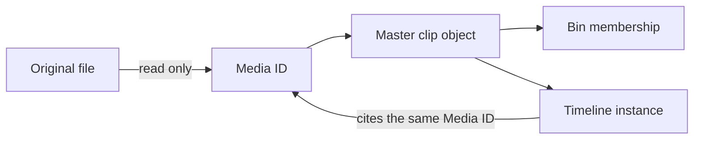

# 04 — Core data model

Status: architecture preparation. This document authorises no schema migration and no code.

Labels: **PROPOSED** unless marked **CONFIRMED** or **OPEN**. Field-level tables already exist. This file is the map between them. It does not copy `docs/BIN_DATA_MODEL.md`, `docs/BIN_DATABASE_SCHEMA.md`, `docs/MEDIA_REGISTRY_SCHEMA.md`, or `docs/TIMELINE_ENGINE_ARCHITECTURE.md`.

## 1. Authority

| Question | Read |
| --- | --- |
| Object types and their fields | `docs/BIN_DATA_MODEL.md` |
| Working-store tables | `docs/BIN_DATABASE_SCHEMA.md` (later) and `docs/PROJECT_DATABASE_SCHEMA.md` (earlier). Merge is **OPEN**. See `docs/PROJECT_STORAGE_AND_DATABASE.md` |
| Media columns and availability | `docs/MEDIA_IDENTITY_SPECIFICATION.md`, `docs/MEDIA_REGISTRY_SCHEMA.md` |
| How a sequence cites a bin object | `docs/SEQUENCE_AND_BIN_INTEGRATION.md` |
| Identity decision | `architecture/decisions/ADR-005-media-identity.md` (**ACCEPTED**) |

**CONFIRMED.** No table was created. No row was inserted.

## 2. Five identities

**PROPOSED.** These stay in different rows. A display name is none of them. A path is none of them.

| Identity | Minted when | Survives | Changes when |
| --- | --- | --- | --- |
| Project id | Project creation | Folder rename | Never, for the life of that project |
| Bin id | Bin creation | Moving the `.abin` file | Never, for the life of that bin |
| Object id | Object creation or an explicit duplicate | Rename, move between bins, relink, metadata edits | A duplicate creates a new object id |
| Media ID | First acceptance of a logical recording | Rename, move, relink, proxy regeneration, bin import | A new recording is registered. A retired id is not reused |
| Timeline instance id | A placement on a sequence | Trims that keep the same placement | A new placement, including the same object on a second sequence |

**PROPOSED.** Membership is a relationship between a bin id and an object id. Removing membership is not deleting the object if something else still cites it (`docs/BIN_OBJECT_LIFECYCLE.md`).

**ACCEPTED.** Asset id in `docs/MEDIA_IDENTITY_AND_METADATA.md` and `MODULES.md` is the Media ID. Do not add a second editorial key for the same handle.

Origin id, where the metadata document still stores one, is not the timeline’s foreign key and is not a second Media ID. A proxy’s Representation ID is not a Media ID.

## 3. Data contract

Minimum fields the Foundation Prototype must round-trip. Types follow the timebase document: ratios are two integers, ranges are half-open.

| Record | Fields |
| --- | --- |
| `Project` | `project_id`, name, `schema_version` |
| `Bin` | `bin_id`, `project_id`, display name |
| `Membership` | `bin_id`, `object_id` |
| `MasterClip` | `object_id`, `media_id`, display name |
| `Sequence` | `object_id`, `rate_n`, `rate_d`, start frame |
| `Track` | `track_id`, sequence object id, kind (`picture` or `audio`), ordinal |
| `TimelineInstance` | `instance_id`, sequence object id, `track_id`, source object id, `media_id`, record `[start, end)`, source `[start, end)`, conform policy |
| `Marker` | `marker_id`, owner id, frame index |
| `Gap` | Record range on a track with no instance. Stored as structure, not as a missing row that later code invents |
| `Media` | `media_id`, availability of technical fields, checksum state |
| `Location` | `location_id`, `media_id`, role, path hint, online flag |
| `Proxy` | `proxy_id`, `media_id`, validation state. **OPEN** if conflict C4 chooses a different shape |

A still uses conform policy `hold`. A nested sequence, when stored, uses the inner sequence’s rate as the source rate of the outer instance. Nesting is in the early data model (**PROPOSED**). Maximum depth is **OPEN** (`docs/SYSTEM_ARCHITECTURE.md` unresolved 19).

Effect rows, automation points, and colour decisions are specified in the effects and colour documents. The prototype may omit their evaluation. It may not replace them with a second identity.

### 3.1 What a timeline instance is forbidden to store as identity

- A filesystem path.
- A proxy path.
- A checksum.
- A fresh Media ID generated because the instance was copied, slipped, or nested.

The instance may store a playback-selection preference only as a separate row, as `docs/PROXY_AND_ORIGINAL_MEDIA_RELATIONSHIP.md` describes. That preference is not identity.

## 4. Workflows

### 4.1 Ingest to instance

1. Allocate `media_id` before the file is considered imported (`docs/MEDIA_INGESTION_SPECIFICATION.md`).
2. Create one master clip for that id.
3. Add membership to the bin the person named.
4. On edit, create an instance that cites the object id and the same `media_id`.

Failure: probe failure does not mark the ingest successful. A partial copy, if the person asked for a copy, is quarantined. The original is left as it was.

### 4.2 Duplicate and second sequence

An explicit duplicate of a master clip may create a new object id that keeps the same Media ID (`docs/BIN_ARCHITECTURE.md` requirement 7). A second placement creates a new instance id. Neither event mints a Media ID.

### 4.3 Relink

Relink writes `Location` for an existing `media_id`. The instance rows are not in the write set (`docs/MEDIA_RELINK_ENGINE.md`).

## 5. Failure cases

| Case | Result |
| --- | --- |
| Delete a media row that an instance still cites | Refused. Foreign key or equivalent check. The cut remains |
| Import a package that contains an unknown object type | Retained in an opaque payload and listed, or the whole import rolls back if the person declines (`docs/BIN_FILE_FORMAT_SPECIFICATION.md`) |
| Two checksums differ for one path over time | `checksum_state = mismatch`. Same Media ID. Not a new take |
| Directory named `DAY_01` created by the operating system | No bin row appears |
| Bin named `DAY_01` created in the project | A bin id appears. A directory is optional and is not the id |

## 6. Acceptance criteria

- A fixture creates one Media ID, one master clip, and two instances on two sequences. The stored `media_id` values are equal. The instance ids differ.
- Renaming the file and updating the location leaves object id, Media ID, and both instance ids unchanged.
- A command that would write a path into the instance identity fields is rejected, and the composition hash is unchanged.
- Round-trip through the working database preserves rational ranges exactly: `rate_n`, `rate_d`, and frame indexes, with no float column.
- **CONFIRMED** for the current tree: no fixture has been run.

## 7. Composition hash

**PROPOSED.** The hash covers sequence rate, track order, instance identity fields, ranges, conform policy, and marker frames. It does not cover playhead, zoom, scroll, or cache files. It does not cover a path. A location change that leaves the cut identical leaves the hash identical. A proxy switch that does not change ranges leaves the hash identical. The early architecture already uses a composition hash as the reopen oracle (`DEVELOPMENT_ROADMAP.md` phase 4). The exact byte canonicalisation is **OPEN** and must be fixed in the first tests so two machines can compare it. Until that canonicalisation is written down beside the test, the hash algorithm name is stored with the hash.
