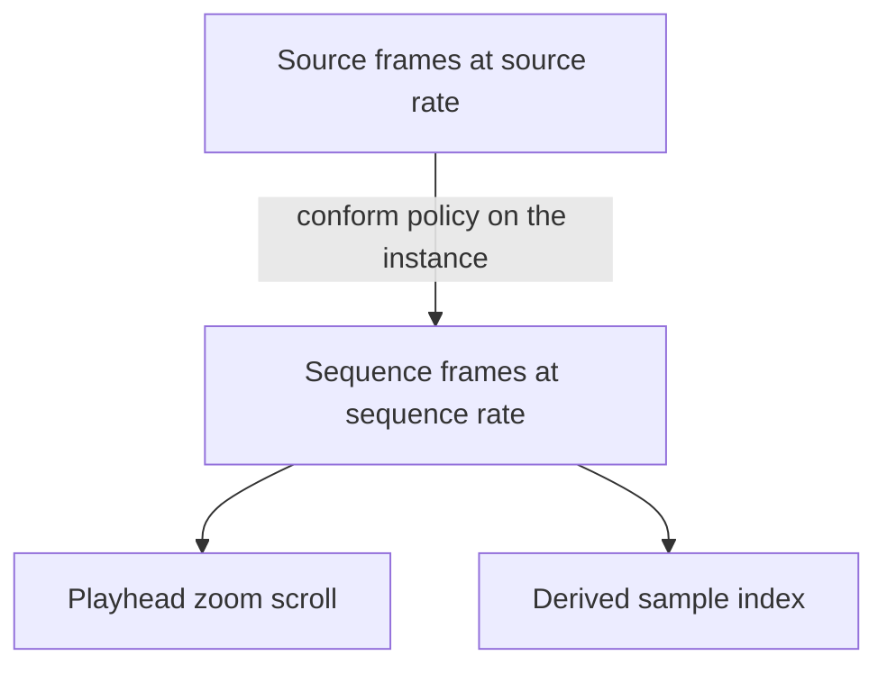

# 05 — Timebase and timing architecture

Status: architecture preparation. This document authorises no implementation.

On 2026-11-21 the project owner accepted ADR-002 as the initial editorial time authority (`architecture/decisions/ADR-002-rational-time.md`). This file points at that decision. It does not restate it, and it does not authorise a sequence, a timeline, or playback. **SLICE 0A COMPLETE — DEVELOPMENT FROZEN PENDING NEXT AUTHORISATION.**

The stored-time rules are already written. Read them there:

- `docs/TIMEBASE_AND_FRAME_ACCURACY.md` — ratios, source time, sequence time, timeline position, conform policies, drop-frame labels.
- `docs/AUDIO_TIMEBASE_AND_SYNC.md` — `sampleIndex`, mix rate, fades stored as frames. The 30000/1001 origin span stays 12812 samples (`docs/validation/AUDIO_FRAME_SAMPLE_BOUNDARY_VALIDATION.md`).
- `docs/SOURCE_TIMECODE_AND_FRAME_ACCURACY.md` and `docs/SEQUENCE_SOURCE_MAPPING.md` — source mapping used by conform.
- `ARCHITECTURE.md` §3 — the earlier statement of the same integer model.
- `architecture/decisions/ADR-002-rational-time.md` — **ACCEPTED — INITIAL EDITORIAL TIME AUTHORITY** on 2026-11-21. The pre-decision review did not grant it.

This file records the contract the rest of the preparation relies on, the workflows, and the failures. It does not replace the mapping formulae in the timebase document.

## 1. Contract

The stored-clock rows below are the accepted initial authority. Session and device rows stay what they were. This section does not open a new implementation.

| Term | Stored form | Authority |
| --- | --- | --- |
| `Ratio` | Reduced `int64` numerator and denominator. Denominator greater than zero | Kernel |
| `FrameRate` | A ratio in frames per second. 24/1, 25/1, 24000/1001, 30000/1001, 48/1, 60000/1001 are ordinary values | Kernel |
| Position | `int64` frame index. Frame 0 is the origin of that rate | The rate named on the value |
| `Range` | Half-open `[start, end)` at one rate | The rate named on the range |
| Timecode | Start label, rate, drop-frame flag | A label. Not a frame index |
| Playhead, zoom, scroll | Session or presentation | Not the film. A saved playhead is a convenience the early architecture allows. Interchange may ignore it |
| Mix sample position | Derived: `sampleIndex(F) = floor(F * R * D / N)` with exact integer arithmetic | Not stored as the cut |
| Device clock | Samples at the device | Not the playhead |

Floating-point seconds may be formatted for a person. They are not a stored clock. A fade typed as milliseconds is converted to a frame count with the integer rule in `docs/AUDIO_TIMEBASE_AND_SYNC.md` before any command sees it, or the parser rejects it. The string is not stored. That parse is not picture selection and is not `sample_boundary`.

Audio edits in the initial model fall on sequence-frame boundaries. A subframe position is refused or reported unsupported. It is not silently rounded. The curve inside a fade may be evaluated per sample. The fade’s stored duration is still a frame count. Phase is anchored at sequence frame 0, as ADR-002 states.

**OPEN.** Speed-ramp resampling policy and mixed-rate conformance beyond the stored `nearest`, `floor`, and `hold` policies (`docs/SYSTEM_ARCHITECTURE.md` unresolved 19). The model may store a speed map as rationals where `docs/SEQUENCE_SOURCE_MAPPING.md` already specifies one. Playback of that map is not a Foundation Prototype requirement.

## 2. Two clocks and one session view

Each sequence has one rate. A project may hold sequences at different rates. There is no project-wide rate that overrides a sequence (`docs/TIMEBASE_AND_FRAME_ACCURACY.md` §2.2).

On one track, record ranges do not overlap, except a transition that names the two neighbouring items and occupies the cut. Gaps are record ranges too.

## 3. Workflows

### 3.1 Map a sequence frame to a source frame

The editorial resolver performs the mapping in `docs/TIMEBASE_AND_FRAME_ACCURACY.md` §3. The application does not reimplement it in the widget. Processing receives the source position already chosen.

Failure: a zero denominator, a negative denominator, or `end < start` is rejected at the type boundary. The document is unchanged.

### 3.2 Drop-frame display

The label printer skips timecode numbers according to the drop-frame flag for the rates where that flag has meaning. The frame index is the same number it was before printing. A test stores the index and the printed string as separate expected values.

### 3.3 Seek

The playhead becomes the sequence frame the person aimed at, after hit-testing converts a pixel to a frame with the integer rule in the timebase document. When a playback engine exists, the playhead becomes the sequence frame reported in the presented-frame record, not a reading of the device clock.

## 4. Failure cases

| Case | Result |
| --- | --- |
| Position stored as `29.97` IEEE seconds | Rejected at the document boundary. Not coerced |
| Drop-frame flag inferred because the rate is 30000/1001 and the file omitted it | Not inferred. Availability stays `unknown` or `absent` (`docs/MEDIA_IDENTITY_SPECIFICATION.md`) |
| Start timecode invented as `00:00:00:00` | Not invented |
| A source offset or an operation that the frame-only model cannot represent | Refused or reported unsupported. A sync warning is only this case. A fractional-sample mapping is not an error. The MXF 12813-against-12812 result stays a failed encoder test in its own log. This row does not rewrite that log |
| Conversion product overflows the integer width in use | The conversion fails. It does not saturate silently |

## 5. Acceptance criteria

- Tests at 24/1, 25/1, 24000/1001, 30000/1001, and 60000/1001 compare integer frame indexes written in the fixture.
- A drop-frame case changes the printed label and leaves the frame index unchanged.
- A zero denominator is a failed test of the negative path.
- At 24/1 and mix rate 48000, `sampleIndex(F) = F * 2000`. The expected sample numbers are integers in the test.
- Reopen reads the stored source range and the stored sequence range. Picture selection, when a sequence frame must name a source frame, is the nearest valid source timestamp, and an exact tie selects the earlier frame.
- **CONFIRMED** when this preparation section was written: no such test existed in this tree, and `tests/` was empty. Slice 0A later added the floor-boundary tests recorded in `docs/validation/SLICE_0A_PROJECT_CORE_VALIDATION.md`. That report is the evidence. This sentence does not replace it. No mixed-rate picture-selection test has been added.

## 6. Relationship to playback and conform

Playback presents the sequence frame the request named (`docs/10_PLAYBACK_AND_RENDERING.md`). Conform compares stored integers with the original’s frame count and timecode label (`docs/CONFORM_ENGINE_SPECIFICATION.md`). Neither component is allowed to replace the stored range with a float duration it computed while decoding.
