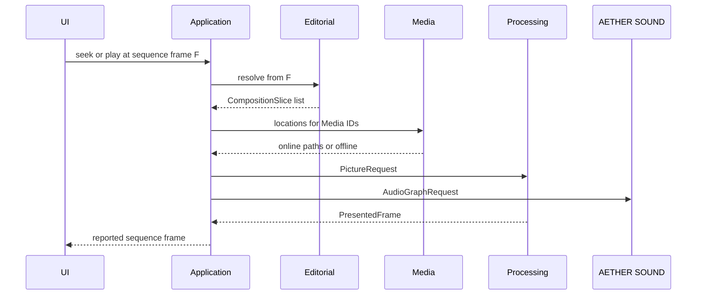

# 10 — Playback and rendering

Status: architecture preparation. This document authorises no playback graph and no encoder.

Picture and sound presentation are specified at the seam. The cut remains the editorial model. Read:

- `ARCHITECTURE.md` §4 and §9.3–9.4 for `CompositionSlice`, `RenderRequest`, FFmpeg-versus-GStreamer as an early proposal, and the export sequence.
- `docs/AUDIO_ENGINE_ARCHITECTURE.md`, `docs/AUDIO_PROCESSING_GRAPH.md`, and `docs/AUDIO_PERFORMANCE.md` for AETHER SOUND.
- `docs/PROXY_AND_ORIGINAL_MEDIA_RELATIONSHIP.md` for representation switching.
- `architecture/decisions/ADR-006-application-joiner.md` — **PROPOSED**.
- `docs/NATIVE_MEDIA_ARCHITECTURE.md` for profiles that are not validated.

FFmpeg is the mandatory core media framework (ADR-001). GStreamer is not a mandatory dependency. Decode still sits behind the Media Engine boundary. The 9.0.2 CLI sessions are not a playback pass and not a library link. The 30000/1001 audio contract remains **Failed**.

## 1. Contract

**PROPOSED.** The application is the only module that joins a slice to locations.

| Record | Producer | Consumer | Carries | Does not carry |
| --- | --- | --- | --- | --- |
| `CompositionSlice` | Editorial | Application | Sequence frame, ordered layers, source positions, transition weight, evaluated parameters, Media IDs, colour-decision id | Paths |
| `MediaLocation` | Media management | Application | Media ID, role, path or offline, rate, colour-space name if known | A right to delete or to retarget the cut |
| `PictureRequest` | Application | Processing | The slice with locations substituted, bake policy, destination when exporting | Undo |
| `AudioGraphRequest` | Application | AETHER SOUND | Gains, automation, routing, paths or an explicit silence for offline media | Widget state |
| `PresentedFrame` | Processing | Application | Sequence frame, Media ID, source frame, slate flag if offline | A new playhead invented from the device clock |

**PROPOSED.** Quality policy (`master`, `proxy_if_available`, or the selection modes in the proxy document) is chosen by the application. A switch of representation does not write the instance’s source range. A representation whose validation state is not `passed` is skipped. No representation is `passed` today. **CONFIRMED.**

**PROPOSED.** Export uses the non-realtime path. The default quality policy uses masters or originals as the project’s master role defines them. If that file is offline, export stops and reports the Media ID. It does not silently substitute a proxy. A preset may allow proxies. That choice is stored on the request and printed in the report. The report is not a conform verdict (`architecture/decisions/ADR-007-relink-conform-exchange.md`).

**OPEN.** The Phase 11 sync tolerance in `DEVELOPMENT_ROADMAP.md`. That roadmap says the tolerance is written down at the start of the phase. This document does not invent a millisecond number. Device buffer bounds of 64 to 4096 samples are a recommendation in the audio documents, and the default inside the range is also unchosen.

## 2. Workflows

### 2.1 Seek and play

The UI paints the reported frame. A dropped preview picture updates the reported frame and does not rewrite the timeline. An audio underrun is counted. It is not a moved cut (`docs/AUDIO_PERFORMANCE.md`).

Failure: the audio callback does not take the database lock, does not allocate as its steady-state contract, and does not read the disk. Those rules are **PROPOSED** and unmeasured.

### 2.2 Offline layer

The slice still exists. Processing returns a slate generated in process, with the same identity fields and the slate flag set. Editorial is not asked to delete the instance.

### 2.3 Export

1. Require the master role for every used Media ID, unless the preset explicitly allows another role.
2. Resolve the export range.
3. Write frames through the non-realtime path. Colour bake follows the request. The default in the early architecture leaves the image in the working space and does not bake the monitoring view. How much of that exists before OpenColorIO is adopted is **OPEN** (`docs/12_COLOUR_MANAGEMENT.md`).
4. Cancel removes or truncates the partial output and leaves the project hash unchanged.

Failure: a codec the capability query has not marked available is not offered. The FFmpeg 9.0.2 notes (PCM limits, MXF layout, ProRes 4444 alpha, 29.97 sample count, optional OP-Atom) are reasons to keep those writers hidden. They are not a new test.

### 2.4 Scrub

Scrub uses the playback path at lower priority than play. It does not start a transcode (`docs/PERFORMANCE_REQUIREMENTS.md`).

## 3. Failure cases

| Case | Result |
| --- | --- |
| Long-GOP seek | The frame index, when one exists, names the keyframe to decode from. The presented source frame is the requested one, or the seek fails visibly |
| Proxy failed validation | That file is not selected. The master or a slate is used according to policy |
| Audio device lost | Silence on that output. Picture may continue. Automation data remains (`docs/SYSTEM_ARCHITECTURE.md`) |
| Export destination is the original file | Refused (`docs/SECURITY_AND_FILE_SAFETY.md`) |
| GStreamer clock and the frame index disagree | The reported frame stays the index in the request. If a later comparison against a non-realtime oracle fails, playback stops for review, as `DEVELOPMENT_ROADMAP.md` phase 10 already says. No oracle has been run |

## 4. Acceptance criteria

These belong to later phases, not to the Foundation Prototype.

- A non-realtime render of a fixture with a cut, a transition, and a mixed-rate clip writes image N from the source frame the fixture names. Identity comes from the resolver expectation. A pixel spot-check confirms the image. **PROPOSED** test. **CONFIRMED** not run.
- Seek and a short play report the same sequence frame, Media ID, and source frame as that render.
- Picture and sound flush to the same rational frame before the presented frame is reported. The sample index matches `sampleIndex` in `docs/05_TIMEBASE_AND_TIMING_ARCHITECTURE.md`.
- Cancelled export leaves the composition hash unchanged and does not leave a partial file as a successful output.
- No acceptance text claims a frame rate, a latency, or vendor playback.

## 5. Foundation boundary

The Foundation Prototype does not link a decoder and does not open a window (`docs/FIRST_IMPLEMENTATION_MILESTONE.md`). It may resolve a slice for an offline Media ID. That resolution is an editorial test, not a playback test.
