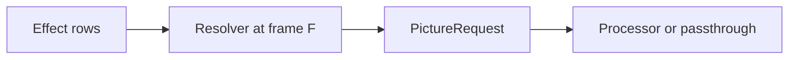

# 11 — Effects and compositing

Status: architecture preparation. This document authorises no effect renderer.

Effects are data on the editorial model until a processor evaluates them for one frame. The timeline and bin documents already name effect instances, transitions, and parameters. This file states the seam. It does not restate trim mathematics (`docs/TRIM_ENGINE_SPECIFICATION.md`) or the conform effect check (`docs/CONFORM_ENGINE_SPECIFICATION.md`).

## 1. Contract

**PROPOSED.**

| Record | Owner | Contents |
| --- | --- | --- |
| Effect definition | Editorial, as data. A reusable `effect_clip` is a bin object (`docs/BIN_DATA_MODEL.md`) | Stable effect id, parameter schema version |
| Effect instance | Editorial, attached to an instance, a transition, or a track as the timeline document specifies | Effect id, typed parameters, keyframes at frame indexes |
| Transition | Editorial | The two neighbouring items, a record range on the cut, a weight curve stored as rationals or as keyframes at frames |
| Evaluated parameter | Resolver, inside a `CompositionSlice` | Values at one sequence frame |
| Processor | Processing, or a Tier A plugin adapted into processing (`docs/14_PLUGIN_ARCHITECTURE.md`) | One frame in, one frame out. No timeline pointer |

**PROPOSED.** Absent processors do not block the cut. The instance still trims. Playback and export substitute a documented passthrough and name the missing effect in the result. Export’s report lists it. Conform compares the stored definition with a capability table and does not rasterise an effect to decide that it “looks right” (`docs/CONFORM_ENGINE_SPECIFICATION.md`).

**PROPOSED.** Compositing order is the layer order the resolver already emits, bottom to top, with opacity and transition weight as rationals. A float pixel coordinate is not stored as time.

**OPEN.** The set of built-in effects for the first picture path. None is selected. A speed change stored as a rational map is an editorial parameter (`docs/SEQUENCE_SOURCE_MAPPING.md`). Real-time optical flow is a non-target in `docs/PERFORMANCE_REQUIREMENTS.md`.

**OPEN.** Plugin process isolation. In-process Tier A code is the early proposal and is treated as trusted local code (`ARCHITECTURE.md` §6.3). That trust model is not accepted.

## 2. Data contract

Parameter values that cross the processor boundary:

| Kind | Stored as |
| --- | --- |
| Rational | Numerator, denominator |
| Frame | `int64` at a named rate |
| Integer | `int64` |
| Boolean | Integer 0 or 1 |
| Colour parameter | Named channels and rationals, or a reference to a colour decision. Not a display-referred bake |
| Unknown type from a newer build | Opaque payload, retained, listed. Not dropped (`docs/BIN_FILE_FORMAT_SPECIFICATION.md`) |

Keyframes sit on frame indexes. Interpolation coefficients, if stored, are rationals. A Bézier evaluated in floating point is a processor detail. The stored controls are not IEEE seconds.

## 3. Workflows

### 3.1 Edit a parameter

1. The UI sends a command with the effect instance id and the new value at a frame.
2. Editorial validates the schema. On failure the model is unchanged.
3. The session undo stack records the inverse (**OPEN** across restart, ADR-009).
4. The composition hash changes because evaluated parameters are part of the slice.

No decode runs as part of the gesture.

### 3.2 Preview

The processor receives buffers and evaluated parameters. It does not receive a database connection.

### 3.3 Exchange

An adapter that cannot map an effect lists it as unsupported or as a rendered fallback. It does not drop the native parameter (`docs/SYSTEM_ARCHITECTURE.md` failure table). AVX stores rationals as strings so a speed of `-1/1` is not a binary float (`docs/AVX_FORMAT_SPECIFICATION.md`). That rule is **PROPOSED**. No AVX file was written.

## 4. Failure cases

| Case | Result |
| --- | --- |
| Unknown effect id | Passthrough, named in the result. Cut remains |
| Parameter out of schema | Command rejected. Hash unchanged |
| Transition range does not lie on the cut | Rejected by editorial validation |
| Plugin aborts | Result code at the ABI. The frame fails visibly. The project file is not deleted |
| Effect used as proof of conform | Forbidden. Conform stays symbolic |

## 5. Acceptance criteria

- A fixture with a missing effect id trims and reopens with the same id and the same parameters.
- A transition centered on a cut resolves to weights the fixture lists, as the editorial roadmap phase already requires (`DEVELOPMENT_ROADMAP.md` phase 3).
- A processor test runs from a hand-built request with no editorial library linked, once a processor exists.
- **CONFIRMED.** No effect code and no plugin binary exist. `plugins/` is empty.

The Foundation Prototype stores and round-trips effect ids and rational parameters if they are part of the document it saves, and it does not rasterise them (`docs/FIRST_IMPLEMENTATION_MILESTONE.md`).
