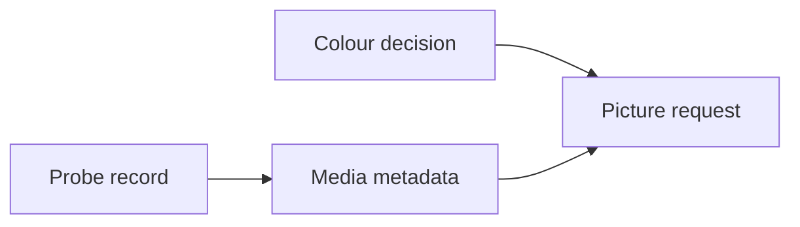

# 12 — Colour management

Status: architecture preparation. This document authorises no colour transform in a build.

Colour is data on the media record and on the sequence, applied only when a request asks a processor to apply it. Read `ARCHITECTURE.md` §4.3 and §5.3, `docs/MEDIA_IDENTITY_SPECIFICATION.md` (colour tags and availability), and `docs/SYSTEM_ARCHITECTURE.md` unresolved item 12. OpenColorIO is a candidate (`docs/DEPENDENCY_AND_LICENCE_AUDIT.md`). Adoption is **OPEN**.

## 1. Contract

**PROPOSED.**

| Field | Where it lives | Rule |
| --- | --- | --- |
| Primaries, transfer, matrix, range | Media technical metadata | Stored with availability. Absent tags stay `unknown` or `absent`. Rec.709 is not invented to fill a gap (`docs/MEDIA_IDENTITY_SPECIFICATION.md`) |
| Alpha state | Media metadata | `unverified` when a descriptor is incomplete. The prior ProRes 4444 note is why “alpha preserved” is not implied. That note was not re-tested here |
| Colour decision | Editorial document | Input space, working space, display, view, grade parameters, bake policy, and the relative path of a config if one was copied |
| Bake policy | On the picture request | Preview may use display and view. Export bakes only when the request says so. The early default does not bake the monitoring view |

**PROPOSED.** If a project uses an OpenColorIO config, the config is copied into the project at the moment the person selects it, so a later edit to a system-wide config does not change the film (`ARCHITECTURE.md` §5.3). If the embedded config is missing, processing uses a documented raw view and the interface marks the picture untagged. The application does not download a replacement.

**OPEN.** Whether the first code includes OpenColorIO at all. The system architecture recommends tags and a display-transform hook only, until a review says otherwise. The Foundation Prototype excludes baking and does not link OpenColorIO.

**OPEN.** The licence review for OpenColorIO on a pin. The commonly published BSD-3-Clause lead is not a clearance.

## 2. Data contract

A colour decision that crosses modules:

```text
color_decision_id
config_relative_path    empty when no config is embedded
input_space             text or unknown
working_space           text or unknown
display                 text or unknown
view                    text or unknown
grade_parameters        rationals and frame keyframes, same rules as effects
bake_policy             none | working_space | display_view
```

Grade parameters follow `docs/11_EFFECTS_AND_COMPOSITING.md`. They are not a baked image in the timeline.

A cache key for a decoded frame, when caches exist, includes the Media ID, the source frame, and a hash of the colour configuration (`ARCHITECTURE.md` §4.4). Deleting the cache does not change the cut.

## 3. Workflows

### 3.1 Tag on ingest

The probe result’s colour fields are copied with their availability. A reader that did not see a field writes `unknown` or `absent`.



### 3.2 Preview and export

Preview and export call the same decision. They differ by bake policy and by which representation was selected. They do not differ by a hidden extra grade in the viewer.

Failure: a missing config yields the raw view and an untagged flag. It does not yield a silent Rec.709 conversion.

### 3.3 Conform

Conform records the stored tags and whether they were present. It does not treat a preview LUT as evidence that the original matches (`docs/CONFORM_VALIDATION_AND_REPORTING.md`).

## 4. Failure cases

| Case | Result |
| --- | --- |
| File omits colour metadata | Fields stay unknown. Playback, when it exists, is marked untagged |
| Two locations of one Media ID disagree on primaries | Availability `conflict` on that field. The Media ID is unchanged |
| Export asked to bake a display view and no config is embedded | Export stops with a report, or writes raw and says so. It does not invent a config. Which of those two failures a review prefers is **OPEN** |
| Cache holds a graded tile and the decision changes | The old tile misses the cache key. It is not served as current |

## 5. Acceptance criteria

- A fixture with all colour fields `unknown` reopens with those fields still `unknown`.
- When a later phase links OpenColorIO, one fixture produces the same transformed sample through the non-realtime path and through the playback sink, within a tolerance written down at the start of that phase. This document does not invent the tolerance. **CONFIRMED** that no such run exists.
- Removing an embedded config does not attempt a network fetch.
- No acceptance text says a display matches a reference monitor. Optional monitoring hardware is a separate, default-off candidate (`docs/SYSTEM_ARCHITECTURE.md` unresolved 13).
