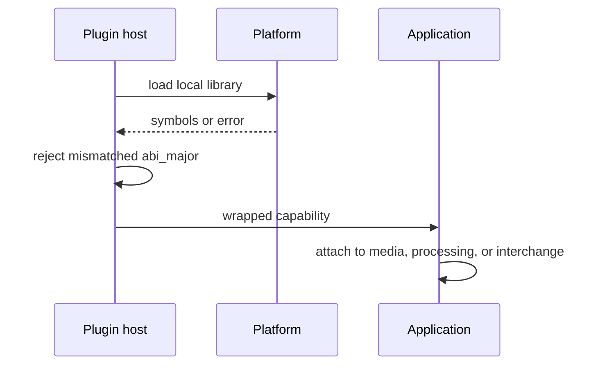

# 14 — Plugin architecture

Status: architecture preparation. This document authorises no plugin ABI in code.

The early design is `ARCHITECTURE.md` §6. The system architecture restates extension points as versioned and explicit (`docs/SYSTEM_ARCHITECTURE.md` §extensibility) and leaves the ABI and process isolation unresolved (item 14). `plugins/` is an empty directory. **CONFIRMED.**

## 1. Contract

**PROPOSED** tiers, awaiting review:

| Tier | Boundary | May use | Must not use |
| --- | --- | --- | --- |
| A, stable | `extern "C"` function table. Major version checked. Mismatch refuses to load | The Plugin SDK types: plain integers, buffers, result codes | C++ standard-library types, exceptions, Qt types, the editorial command API, a path to `project.db` |
| B, in-tree | Compiled with the application. Unstable. Rebuilt with every application change | What the UI module may use | A promise to external authors |

**PROPOSED** Tier A capabilities from the early architecture: media probe, effect processor, interchange adapter, export target. The built-in adapters, if they exist later, implement the same contracts inside the owning modules. They are not plugins. A project opens with zero third-party plugins.

**PROPOSED.** Domain modules do not call `dlopen`. The plugin host asks the platform module to load a library from a directory the person configured or from the application’s local plugin directory. An effect processor receives parameters for one frame and input buffers and returns output buffers (`docs/11_EFFECTS_AND_COMPOSITING.md`).

**OPEN.** Process isolation. The early text treats Tier A as trusted in-process code and says isolation is a later design. That is not a decision to ship in-process plugins. It is a recorded proposal.

**OPEN.** Whether the first code includes any plugin host. `DEVELOPMENT_ROADMAP.md` places the ABI at phase 14, after playback, colour, and OTIO. The seven-phase roadmap keeps plugins in phase 7. The Foundation Prototype excludes them.

## 2. Data contract

A host manifest, conceptual:

```text
abi_major
abi_minor
capabilities          probe | effect | exchange | export
effect_id             when capability is effect
schema_version        parameter schema
```

The host returns a result code. Exceptions do not cross the boundary (`ARCHITECTURE.md` §10).

Plugins receive documents and return documents. They do not receive a writable path to the SQLite file (`docs/SYSTEM_ARCHITECTURE.md`).

## 3. Workflow



Failure: a mismatched major version does not load. The clip falls back to passthrough and the missing effect is named. A plugin error does not delete project files.

## 4. Failure cases

| Case | Result |
| --- | --- |
| Library path points at a media original | Not opened as a plugin. Originals are not executable inputs |
| Plugin writes beside the database by guessing a path | Out of contract. The host does not hand over the path. Enforcement beyond that is **OPEN** with isolation |
| Capability query from a plugin claims a codec is legal to ship | Ignored. Availability is the application’s capability list plus the licence review |
| No plugins installed | Open, edit, and save still work |

## 5. Acceptance criteria

When a later phase builds the ABI, and not before:

- One in-tree sample effect, open source, built as a separate shared library against the SDK header, runs on a hand-built frame request.
- A copy built with a different major version does not load.
- Review of the SDK header finds no C++ standard-library types and no Qt types in the C API.
- Domain libraries still do not link the sample.

**CONFIRMED.** None of those binaries exist. This preparation does not add them.
