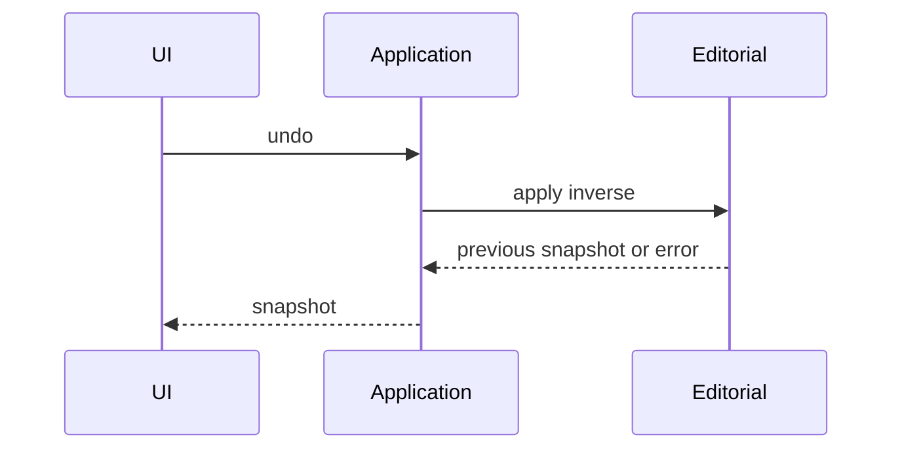

# 15 — Undo, recovery, and safety

Status: architecture preparation. This document authorises no recovery code.

Read the existing specifications. This file joins them and records the conflict. It does not replace them.

- Session undo versus a durable document: `ARCHITECTURE.md` §5.4 and §9.2.
- Operation history and snapshots: `docs/RECOVERY_AND_BACKUP.md`, `docs/PROJECT_DATABASE_SCHEMA.md`, `docs/BIN_REVISION_AND_RECOVERY.md`.
- The open decision: `architecture/decisions/ADR-009-undo-durability.md`.
- File safety: `docs/SECURITY_AND_FILE_SAFETY.md` and `docs/16_SECURITY_AND_LICENSING.md`.
- Bin package replace: `docs/BIN_FILE_FORMAT_SPECIFICATION.md`.

## 1. Contract

**PROPOSED.** An editorial command either changes the model completely or leaves it as it was. The application pushes the inverse onto the session undo stack after Editorial accepts the command. Redo is the forward command. The UI does not keep a private copy of the cut.

**ACCEPTED FOR FOUNDATION PROTOTYPE.** The stack is session-only (ADR-009). It need not survive close and reopen. Autosave, crash recovery, snapshots, and journals are not that stack. A completed edit still has to be safe in `project.db`. Persistent undo is future work.

**PROPOSED.** The durable document is the last successful database transaction, cross-checked against `project_manifest.json`. Autosave flushes transactions. It does not copy media. A snapshot under `BACKUP/` copies the database, the manifest, and settings. It does not include originals unless the person runs an explicit archive command (`docs/RECOVERY_AND_BACKUP.md`).

**PROPOSED.** Interrupted `.abin` writing does not replace the previous good package. Write a partial file on the same volume, fsync, verify hashes, then rename.

**PROPOSED.** Originals are outside undo. Undo never restores a cut by rewriting camera bytes, and it never deletes an original to “clean up” a failed ingest.

## 2. Data contract

| Store | Contents | Lifetime |
| --- | --- | --- |
| Session stack | Inverse commands or equivalent editorial deltas, composition hash before and after | This process. Restart behaviour **OPEN** |
| `project.db` transaction | Accepted bins, objects, instances, media rows | Until a later transaction |
| Manifest | `project_id`, `schema_version`, database hash | Updated with the transaction |
| `OperationHistory` | Specified in `docs/BIN_DATABASE_SCHEMA.md` | **OPEN** whether it is the undo stack or an audit log |
| `BACKUP/` snapshot | Database, manifest, settings | Count and age limits are recommendations and **OPEN** (last 20 or 14 days is unmeasured) |
| `.abin` revision | Revision id, parent id, member hashes | The portable checkpoint |

Cache, thumbnails, and waveforms are not in the undo contract. Deleting them changes no composition hash.

## 3. Workflows

### 3.1 Undo a trim

Failure: if the inverse fails validation, the model stays on the current state and the stack is unchanged. A failed undo is not a partial trim.

### 3.2 Open after a crash

1. If the lock is stale or the manifest hash disagrees, do not start playback.
2. Integrity-check the database if the engine is SQLite. The check is specified. **CONFIRMED** it was not run.
3. If the database opens and the hash is merely one autosave behind, offer to continue and rewrite the manifest. Do not do it silently.
4. If the database does not open, offer the newest snapshot that passes integrity.
5. Restore writes to a new folder or replaces the database only after a confirmed swap. Restore does not delete originals.

The conflict rule beyond “do not continue silently” is **OPEN** (`docs/SYSTEM_ARCHITECTURE.md` unresolved 18).

### 3.3 Failed ingest

A failed item does not become a successful media record. Partial outputs go to quarantine. The project transaction for the successful items of the batch, if any, is explicit. Originals stay in place (`docs/MEDIA_INGESTION_SPECIFICATION.md`).

## 4. Failure cases

| Case | Result |
| --- | --- |
| Autosave crash mid-write | The previous good `project.db` still opens. The early architecture’s separate `autosave.sqlite` is one proposed mechanism. The later documents use engine transactions plus snapshots. Which mechanism ships is **OPEN** with ADR-003 |
| Undo across a schema migration | Not required. Migration takes a backup first |
| Recovery deletes `MEDIA/ORIGINALS` | Forbidden |
| Person confirms a destructive delete | Dialog names path, Media ID, sequence usage count, and whether a snapshot exists. Confirm is not the default button (`docs/SECURITY_AND_FILE_SAFETY.md`) |
| Decoder crash during recovery | Must not auto-delete project files. Isolation of decoders is **OPEN** |

## 5. Acceptance criteria

- Headless: apply trim, undo, redo. Hashes match the fixture’s before and after values.
- Kill an autosave in a test double. The last committed database opens and its hash matches the pre-autosave commit.
- A second process does not become a writer while the lock is held (`docs/BIN_ARCHITECTURE.md` one-writer rule).
- A restore rehearsal uses a copy. The source project’s originals are byte-identical afterwards.
- **CONFIRMED.** No crash was induced and no restore was run for the existing recovery document, and this preparation did not run one either.
