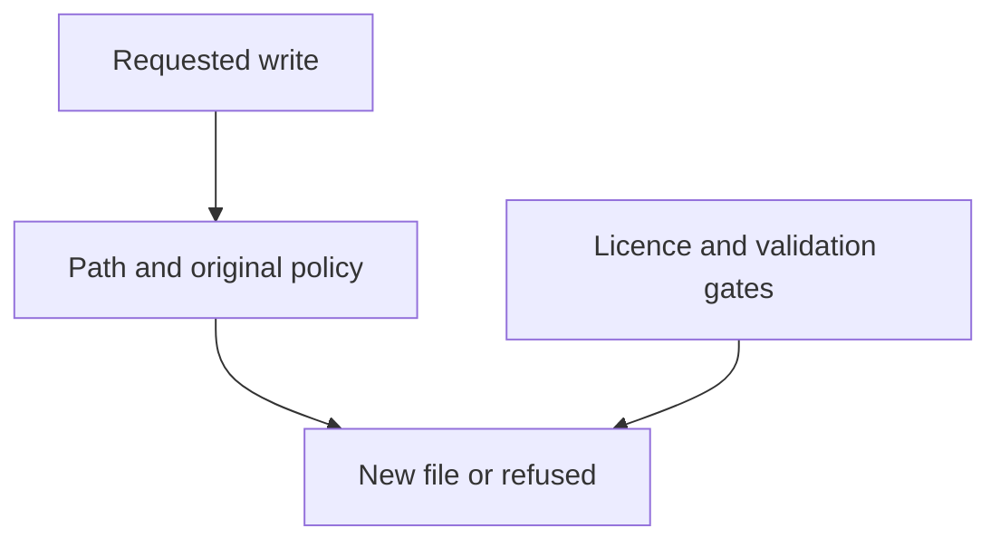

# 16 — Security and licensing

Status: architecture preparation. This document is not a legal opinion and not a penetration test.

File-safety behaviour is specified in `docs/SECURITY_AND_FILE_SAFETY.md`. The checklist that has not been performed is `docs/DEPENDENCY_AND_LICENCE_AUDIT.md`. The open decision is `architecture/decisions/ADR-008-licensing-and-originals.md`. `LICENSE` is empty and is not filled by this preparation. **CONFIRMED.**

## 1. Safety contract

**PROPOSED.**

| Rule | Source |
| --- | --- |
| No mandatory cloud, account, subscription, or activation | `docs/PRODUCT_VISION.md` |
| Originals are not silently deleted, overwritten, renamed, or moved | `docs/SECURITY_AND_FILE_SAFETY.md` |
| A proxy does not replace original bytes | `docs/PROXY_AND_ORIGINAL_MEDIA_RELATIONSHIP.md` |
| Paths from media headers and from exchange files are untrusted | `docs/SECURITY_AND_FILE_SAFETY.md` |
| Export destination equal to a source original is refused | Same |
| Another application’s project or database is not edited. Avid media databases are not edited | `docs/AVID_MEDIA_COMPATIBILITY.md` |
| Plugins do not receive a writable database path | `docs/14_PLUGIN_ARCHITECTURE.md` |
| Default builds have no phone-home channel | `docs/DEPENDENCY_AND_LICENCE_AUDIT.md` |

**CONFIRMED.** No file-safety test and no penetration test was run.

## 2. Licensing flags

These items are **OPEN**. They are flagged for counsel. This document does not decide them.

| Topic | Why it is open | Engineering consequence until review |
| --- | --- | --- |
| AETHER project licence | `LICENSE` is empty. Copyleft and permissive options are listed, not chosen | Do not combine dependencies as if a licence existed |
| Qt 6 | LGPL-3.0 and commercial terms are widely published. Modules and static linking change the obligations. Not fetched | Do not ship a Qt build. The milestone does not link Qt |
| FFmpeg | LGPL or GPL depending on components. `--enable-nonfree` is a separate flag. Patents on codecs are separate from copyright | Do not enable a writer. Do not describe a build as LGPL-only without an inventory |
| GStreamer plugin sets | base, good, ugly, bad, and libav differ. Some are GPL or patent-sensitive | Do not enable ugly or bad by default. Whether they are forbidden entirely is **OPEN** |
| ProRes and DNxHR / VC-3 | Vendor technologies and patents. Trademarks may restrict UI wording | Profiles stay specified and `not_validated`. UI wording waits on counsel |
| AAF SDK or a project-written AAF writer | Licences are not interchangeable. A new writer still needs a licence | No AAF binary |
| OpenColorIO, OpenTimelineIO, SQLite | Commonly published as BSD-3-Clause, Apache-2.0, and public domain. Confirm on the pin | Leads only. Not clearance |
| DeckLink SDK | Proprietary | Default off. Not cleared |
| Fonts | Unchosen | No font file added |
| Cryptography and export control | Only if a later network or update check appears. Default is no network | No update check in this design |

**CONFIRMED.** The prior FFmpeg 9.0.2 study is not a licence finding. Behaviour limits and legal permission are both required before a muxer is offered (`docs/DEPENDENCY_AND_LICENCE_AUDIT.md`).

## 3. Workflow: a destructive command

1. Name the path, the Media ID, the number of sequence uses, and the snapshot that exists or the statement that none exists.
2. Default button is cancel.
3. On confirm, perform the named action on the named path only.
4. Write an operation log line. The log is not a licence to touch a second file.

Failure: a checksum that never completed blocks a purge of that media record (`docs/SECURITY_AND_FILE_SAFETY.md`).

## 4. Data contract

A safety event:

```text
event_id
action              refused | confirmed
path
media_id            when the target is media
project_id
snapshot_id         or none
```

A licence inventory row, when the audit exists: pin, licence name, text location, patent note, link type, module allowed to link. No row is complete. **CONFIRMED.**

## 5. Failure cases

| Case | Result |
| --- | --- |
| Exchange path traversal | Resolved inside the path policy or refused. No write outside the destination the person named |
| Crash handler deletes the project to recover | Forbidden (`docs/15_UNDO_RECOVERY_AND_SAFETY.md`) |
| Build turns on a patent-encumbered encoder because the library can | Hidden until both gates pass |
| Document says “approved stack” | Read as a proposal. ADR-001 is not accepted |



## 6. Acceptance criteria

- A test opens an original, runs ingest, and compares size and hash with the pre-image.
- A test points an export at that original and expects refusal.
- A release candidate includes a licence inventory with no “not started” rows for libraries it actually links. There is no release candidate now.
- Counsel’s written note is the only way a patent row moves. An engineering document does not move it.
