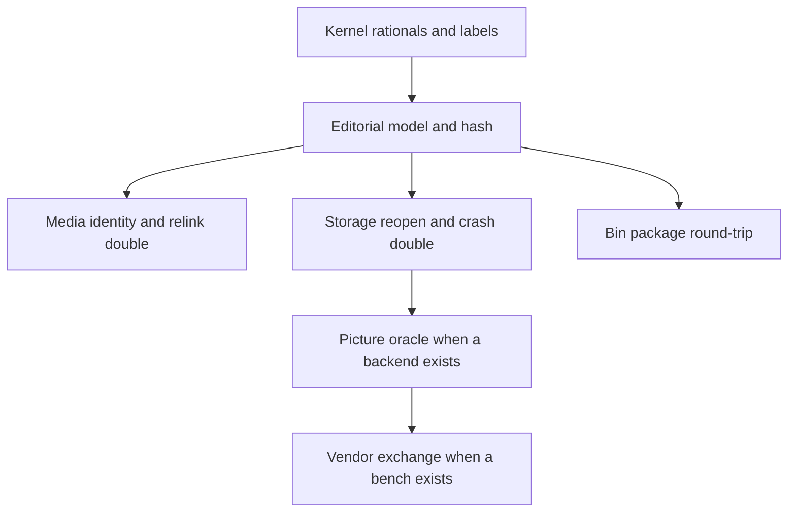

# 17 — Testing and validation

Status: architecture preparation. No test was executed for this document. `tests/` is empty. **CONFIRMED.**

Specified tests already live beside the features. This file says what kind of evidence counts, and it points at those plans. It does not convert a specified test into a pass.

| Plan | What it covers |
| --- | --- |
| `docs/BIN_ARCHITECTURE_TEST_PLAN.md` | Bins, identity, package, recovery of editorial objects |
| `docs/MEDIA_INTEROPERABILITY_TESTS.md` | MXF profiles. Specified, not run. Vendor applications not run |
| `docs/OFFLINE_ONLINE_INTEROPERABILITY_TEST_PLAN.md` | Offline and online cases |
| `docs/CONFORM_VALIDATION_AND_REPORTING.md` | Conform report contents |
| `DEVELOPMENT_ROADMAP.md` phases 1–16 | Exit tests for the earlier phase list |
| `docs/FIRST_IMPLEMENTATION_MILESTONE.md` | The first code slice, still not started |
| `docs/PERFORMANCE_REQUIREMENTS.md` | Budgets. Not measurements |

## 1. Evidence rules

**PROPOSED.**

- A test name, a fixture id, and expected integers are written before the run.
- A pass is a log that names the git revision or, while this directory is not a git repository, the file hashes of the sources under test. **CONFIRMED** there is no git repository today, so there is also no revision to cite.
- “Specified” and “executed” stay different words. This matrix and the exchange matrix use them that way.
- A prior local study of FFmpeg 9.0.2 is evidence only of that study, and only as the media documents recorded it. It is not an AETHER test and it is not re-certified here.
- A file that opens in FFmpeg is not evidence that Resolve, Media Composer, or Premiere Pro will open it.
- QA owns the suite. A codec profile becomes available only when QA records a pass and the licence row is no longer open (`docs/SOFTWARE_MODULES.md`, `docs/16_SECURITY_AND_LICENSING.md`).

## 2. Layers of tests



The Foundation Prototype stops before P and V. Later phases add them. Vendor layer V is **OPEN** until a bench and counsel exist. It is not implied by writing adapters.

## 3. Data contract

A validation record:

```text
suite_id
fixture_id
expected          integers and ids written in the test
result            specified | passed | failed | blocked
backend_pin       or none
application       or "not tested"
log_path          or none
```

Every suite in the current repository has `result = specified` and `log_path = none`. **CONFIRMED.**

## 4. Workflow

1. Add a fixture with expected frame numbers, ids, and hashes.
2. Run it headless on Linux.
3. Store the record beside the suite, not as an edit to a specification that would erase the “not run” history. A spec can gain a pointer. It does not change a historical “no test was run” sentence into a pass.
4. If the result is failed, the phase stops. A review may revise the spec. It may not mark the cell passed.

Failure: a flaky pixel compare without an identity assert is not the oracle. The early roadmap’s export oracle checks source-frame identity first and uses a pixel spot-check as confirmation (`DEVELOPMENT_ROADMAP.md` phase 8).

## 5. Failure cases

| Case | Result |
| --- | --- |
| Backend missing for a picture test | `blocked`, not `passed` |
| Licence row open for an encoder test | `blocked` |
| Fixture uses float seconds as expected time | The fixture is wrong. Expected values are integers |
| Test deletes the only original | The test is wrong. Originals in fixtures are copies or generated files, and the test still asserts it did not write the source path |

## 6. Acceptance criteria

- `tests/` contains the Foundation Prototype suite described in `docs/FIRST_IMPLEMENTATION_MILESTONE.md`, all green on Linux, with logs stored.
- Picture, vendor, plugin, and colour-bake suites are absent or `blocked` until their phases. Their absence is not a Foundation failure.
- A reviewer can list every `passed` record and open the log. Today that list is empty. **CONFIRMED.**
