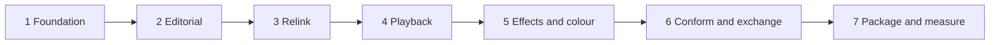

# 19 — Development roadmap

Status: previously proposed seven phases, kept below. No dates. Slice 0A is a later and narrower milestone. It is not Phase 1 of this list and it is not a phase of the root roadmap.

**SLICE 1I COMPLETE — LIFT EDITING IMPLEMENTED AND VALIDATED.**

**SLICE 1H COMPLETE — SPLIT EDITING IMPLEMENTED AND VALIDATED.**

**SLICE 1G COMPLETE — SAME-RATE OVERWRITE IMPLEMENTED AND VALIDATED.**

**SLICE 1F COMPLETE — SOURCE AND RECORD MARKS IMPLEMENTED AND VALIDATED.**

**SLICE 1E COMPLETE — FFMPEG 9.1 DEVELOPMENT-ONLY DYNAMIC INTEGRATION AND MEDIA METADATA PROBING VALIDATED — DISTRIBUTION LEGAL REVIEW PENDING.**

Slice 0A, Slice 0B, Slice 1A, Slice 1B, Slice 1C, and Slice 1D remain complete. Slice 1F is complete on this Fedora machine only. Slice 1E is complete as a development-only dynamic link to `/opt/aether-ffmpeg-9.1` and a local media probe. ADR-008 stays **OPEN — PENDING LEGAL COUNSEL**. That link is not distribution approval. The evidence is `docs/validation/SLICE_1E_FFMPEG_9_1_DEVELOPMENT_INTEGRATION.md`. The root `DEVELOPMENT_ROADMAP.md` records the same result. Not cross-platform and not production-ready. Marks stay session points. The overwrite command reads a mark pair as `[In, Out + 1)`. The stored points and the readout are unchanged, and ADR-002 was not edited. Same-rate overwrite is complete on this Fedora machine only. The evidence is `docs/validation/SLICE_1G_SAME_RATE_OVERWRITE.md`. The root `DEVELOPMENT_ROADMAP.md` records the same result. Split is complete on this Fedora machine only. The evidence is `docs/validation/SLICE_1H_SPLIT_EDITING.md`. The root `DEVELOPMENT_ROADMAP.md` records the same result. A split is refused unless the stored source duration equals the stored record duration and the rates match after reduction. Lift is complete on this Fedora machine only. The evidence is `docs/validation/SLICE_1I_LIFT_EDITING.md`. The root `DEVELOPMENT_ROADMAP.md` records the same result. A lift removes one selected instance and leaves that record interval empty. Extract, ripple, and playback are **NOT STARTED**. Slice 1J is **NOT STARTED**.

The editing shell and project dialog are done as a presentation of the existing commands. The note is `docs/validation/UI_SHELL_AND_PROJECT_DIALOG.md`. Playback is not implemented. Later slices stay **NOT AUTHORISED**. The root roadmap records the same shell status.

Native interface integration is done. The same shell now drives the existing project, bin, import, sequence, and timeline commands. The note is `docs/validation/NATIVE_INTERFACE_INTEGRATION.md`. Playback is not implemented. Later slices stay **NOT STARTED** and **NOT AUTHORISED**. The root roadmap records the same integration status.

Slice 1D places a registered bin reference on a sequence through that same workspace. The note is `docs/validation/SLICE_1D_TIMELINE_CLIP_PLACEMENT.md`. The window title uses the product name Aether. Playback was not started. The root roadmap records the same placement status.

The earlier plan is `DEVELOPMENT_ROADMAP.md` at the repository root: Phase 0 review, then Phases 1–16 from the kernel through a Linux portability audit. That file stays. Its exit tests are still the right kind of evidence. This document restates the work as seven phases because the later bin, identity, and conform specifications have to land before a playback or exchange prototype invents a second media identity. The compression is a **PROPOSED** order. It is not a claim that the root roadmap was rejected. Both files record the same Slice 1I result. Slice 1J is not started. Extract, ripple, and playback were not started.

`docs/DEVELOPMENT_ROADMAP.md` is a zero-byte stub. It was not filled. It is not a second plan.

Silence is not approval. Phase 1 of this list, the Foundation Prototype, has not started. Slice 0A does not start it. The sentence in Phase 4 that a backend stays open until ADR-001 moves is the earlier proposal. ADR-001 has since been **ACCEPTED WITH CONDITIONS**: FFmpeg is the mandatory framework, GStreamer is not a dependency, and the library link is still blocked. That phase body is kept as proposed text.

## Completed Milestones

### Slice 1E — FFmpeg 9.1 development probe

Complete on this Fedora machine only, as a development-only dynamic link. The source of truth is `docs/validation/SLICE_1E_FFMPEG_9_1_DEVELOPMENT_INTEGRATION.md`. The root roadmap records the same result. `ldd` of `build-slice1e-ffmpeg91/src/aether` resolves the five FFmpeg libraries only under `/opt/aether-ffmpeg-9.1/lib`. Probe metadata is not editorial timing. ADR-008 stays **OPEN**. Playback was not started.

### Slice 1F — source and record marks

Complete on this Fedora machine only. The source of truth is `docs/validation/SLICE_1F_SOURCE_RECORD_MARKS.md`. The root roadmap records the same result. Marks are session points in source frames or sequence frames. A pair is not a half-open edit range. Schema version stays 2. Slice 1F did not implement overwrite.

### Slice 1G — same-rate overwrite

Complete on this Fedora machine only. The source of truth is `docs/validation/SLICE_1G_SAME_RATE_OVERWRITE.md`. The root roadmap records the same result. The command reads session marks as `[In, Out + 1)`, requires equal integer-frame durations at the same reduced rate, and refuses a record end past the destination track's current maximum. Leftover pieces keep the source frames that sat on the surviving sequence frames. One transaction, one undo entry. Schema version stays 2. `kPrototypeVersion` stays `slice-0a`. Slice 1G did not start insert, split, lift, ripple, playback, or Slice 1H.

### Slice 1H — split editing

Complete on this Fedora machine only. The source of truth is `docs/validation/SLICE_1H_SPLIT_EDITING.md`. The root roadmap records the same result. One selected instance and one typed sequence frame. The record partition is `[r0, f)` and `[f, r1)`, valid only when `r0 < f < r1`. The source cut is `s0 + (f - r0)` only when the source duration equals the record duration and the rates match after reduction. The piece that still starts at the original record start keeps the id. The piece that starts at the cut is minted with `makeStableId()`. One transaction, one undo entry. Schema version stays 2. `kPrototypeVersion` stays `slice-0a`. Insert, lift, ripple, playback, and Slice 1I were not started.

### Slice 1I — lift editing

Complete on this Fedora machine only. The source of truth is `docs/validation/SLICE_1I_LIFT_EDITING.md`. The root roadmap records the same result. One selected timeline instance. The command deletes that row and leaves the record interval `[r0, r1)` empty. No gap item is written. Other instances, other tracks, and the sequence rate stay. One transaction, one undo entry. Undo restores the original id. Schema version stays 2. `kPrototypeVersion` stays `slice-0a`. Extract, ripple, playback, and Slice 1J were not started.

### Slice 1D — timeline clip placement

Complete on this Fedora machine only. The source of truth is `docs/validation/SLICE_1D_TIMELINE_CLIP_PLACEMENT.md`. The same facts are in the root `DEVELOPMENT_ROADMAP.md`. A registered reference can be dragged onto a track, or inserted by the same command. An unprobed file needs an explicit source rate and source span. A different rate is refused. Playback is not implemented.

### Slice 1C — media import and project bin

Complete on this Fedora machine only. The source of truth is `docs/validation/SLICE_1C_MEDIA_IMPORT_AND_PROJECT_BIN.md`. The same facts are in the root `DEVELOPMENT_ROADMAP.md`. This is not playback, not a probe, and not production-ready.

Scope: the window has a Root bin, an asset list, an empty state, selection, and an inspector. Import Media opens the native file dialog and registers existing files as references. The file is not copied. A Media ID stays stable when the recorded path changes. An exact recorded path that is already registered is reported and writes nothing. A failed batch writes nothing. An offline file stays in the bin with the same IDs. Schema version stays 2. No second database.

- There is no git repository, branch, or HEAD. `git init` was not run.
- Configure and the Debug build in `build-slice1c/` **PASSED** after one include fix, both exit 0. The configure log has no `CMake Warning` line. The successful build log has no compiler warning line. `build/`, `build-slice0b/`, `build-slice1a/`, and `build-slice1b/` were left in place. The link remains `SQLite3::SQLite3` and `/usr/lib64/libsqlite3.so.3.53.4`.
- CTest: 1 discovered, 1 passed. Qt Test inside that one test: TimingTests 7, ProjectTests 11, SequenceTests 10, TimelineWorkspaceTests 10, and MediaImportTests 10, 48 cases, 0 failed. That is not 48 CTest tests.
- On the running XCB window, Import Media opened the native file chooser and registered `validation-fixtures/slice-1c/live-media/picture.mov`. Close and Open Project kept the same Media ID, Representation ID, and object id. Renaming that fixture file aside, without deleting user media, left the row offline with those ids. A Wayland file dialog was not opened.
- `QT_QPA_PLATFORM=wayland --shutdown-now` and `QT_QPA_PLATFORM=xcb --shutdown-now` each logged start and stop and exited 0. The XCB probe listed `0x01200007  0 fedora AETHER` and closed with exit 0. `wmctrl` did not list a Wayland window. The XCB result is not a native Wayland result.
- ADR-006 and ADR-007 stay **PROPOSED**. ADR-002 stays **ACCEPTED — INITIAL EDITORIAL TIME AUTHORITY**. Refinements A, B, and C were not accepted. C++17 stays prototype-only. FFmpeg is not linked.

### Slice 1B — timeline workspace

Complete on this Fedora machine only. The source of truth is `docs/validation/SLICE_1B_TIMELINE_WORKSPACE.md`. The same facts are in the root `DEVELOPMENT_ROADMAP.md`. This is not a playback engine, not production-ready, and not cross-platform.

Scope: the existing window shows a Sequence list, Tracks in stored order, and clip blocks from persisted half-open record ranges. Selection and the inspector do not edit. Move and trim call the Slice 1A session commands. A rejected command leaves the cut unchanged. Session undo covers a successful edit and does not survive close. The ruler's timecode is a label. Pixels are used only while painting. No schema change.

- There is no git repository, branch, or HEAD. `git init` was not run.
- Configure and the Debug build in `build-slice1b/` **PASSED**, both exit 0. The configure log has no `CMake Warning` line. The build log has no compiler warning line. `build/`, `build-slice0b/`, and `build-slice1a/` were left in place. The link remains `SQLite3::SQLite3` and `/usr/lib64/libsqlite3.so`.
- CTest: 1 discovered, 1 passed. Qt Test inside that one test: TimingTests 7, ProjectTests 11, SequenceTests 10, and TimelineWorkspaceTests 10, 38 cases, 0 failed. That is not 38 CTest tests.
- Apply move and Apply trim were activated in Qt Test through the button clicked signal. Painted clip coordinates were not used. The smoke process did not click a control.
- `QT_QPA_PLATFORM=wayland --shutdown-now` and `QT_QPA_PLATFORM=xcb --shutdown-now` each logged start and stop and exited 0. The XCB probe listed a window titled AETHER and closed with exit 0. `wmctrl` did not list a Wayland window. The XCB result is not a native Wayland result.
- ADR-006 and ADR-007 stay **PROPOSED**. ADR-002 stays **ACCEPTED — INITIAL EDITORIAL TIME AUTHORITY**. Refinements A, B, and C were not accepted. C++17 stays prototype-only. FFmpeg is not linked.

### Slice 1A — editorial sequence foundation

Complete on this Fedora machine only. The source of truth is `docs/validation/SLICE_1A_EDITORIAL_SEQUENCE_FOUNDATION.md`. The same facts are in the root `DEVELOPMENT_ROADMAP.md`. This is not a playback engine, not production-ready, and not cross-platform.

Scope: one Sequence with a stable ID, a display name, and one reduced frame rate; ordered Tracks; Timeline instances of an existing Master Clip with a distinct instance ID, the Master Clip's Media ID, and separate half-open source and record ranges. Schema version 2 adds `sequences`, `tracks`, and `timeline_instances` to the one `project.db`. A version-1 project migrates in one transaction. Session undo covers these commands and does not survive close. The last committed edit does. The window can list sequences, tracks, and instances. That list is inspection, not playback.

- There is no git repository, branch, or HEAD. `git init` was not run.
- Configure and the Debug build in `build-slice1a/` **PASSED**, both exit 0. The configure log has no `CMake Warning` line. The build log has no compiler warning line. `build/` and `build-slice0b/` were left in place. The link remains `SQLite3::SQLite3` and `/usr/lib64/libsqlite3.so`.
- CTest: 1 discovered, 1 passed. Qt Test inside that one test: TimingTests 7, ProjectTests 11, and SequenceTests 10, 28 cases, 0 failed. That is not 28 CTest tests.
- `QT_QPA_PLATFORM=wayland --shutdown-now` and `QT_QPA_PLATFORM=xcb --shutdown-now` each logged start and stop and exited 0. The XCB probe listed a window titled AETHER and closed with exit 0. `wmctrl` did not list a Wayland window. Buttons were not clicked. The XCB result is not a native Wayland result.
- ADR-006 and ADR-007 stay **PROPOSED**. ADR-002 stays **ACCEPTED — INITIAL EDITORIAL TIME AUTHORITY**. The published counts 12812, 12813, and 320320000 still pass. The MXF 12813-against-12812 result stays a failed encoder test. Refinements A, B, and C were not accepted. C++17 stays prototype-only. FFmpeg is not linked.

### Slice 0B — build-system hardening and foundation validation

Complete on this Fedora machine only. The source of truth is `docs/validation/SLICE_0B_BUILD_SYSTEM_HARDENING.md`. The same facts are in the root `DEVELOPMENT_ROADMAP.md`. This is not production-ready and not cross-platform.

Scope: the product link uses the imported target `SQLite3::SQLite3`, which CMake 4.3's `FindSQLite3` exports. The deprecated name `SQLite::SQLite3` is not linked and was not aliased. The link library remains `/usr/lib64/libsqlite3.so`. No package was installed. The Slice 0A `build/` directory was left in place. The new tree is `build-slice0b/`.

- There is no git repository, branch, or HEAD. `git init` was not run.
- Configure and the Debug build **PASSED**, both exit 0. The configure log has no `CMake Warning` line. The build log has no compiler warning line.
- CTest: 1 discovered, 1 passed. Qt Test inside that one test: TimingTests 7 and ProjectTests 11, 18 cases, 0 failed. That is not 18 CTest tests.
- `QT_QPA_PLATFORM=wayland --shutdown-now` and `QT_QPA_PLATFORM=xcb --shutdown-now` each logged start and stop and exited 0. The XCB probe listed a window titled AETHER and closed with exit 0. `wmctrl` did not list a Wayland window. Buttons were not clicked. The XCB result is not a native Wayland result.
- ADR-006 and ADR-007 stay **PROPOSED**. ADR-002 stays **ACCEPTED — INITIAL EDITORIAL TIME AUTHORITY**. Refinements A, B, and C were not accepted. C++17 stays prototype-only. No schema, persistence, FFmpeg, playback, or audio change.

### Slice 0A — project core and persistence feasibility

This remains a completed implementation milestone. It is not the Foundation Prototype in `docs/FIRST_IMPLEMENTATION_MILESTONE.md`, and it is not Phase 1 below. The source of truth is `docs/validation/SLICE_0A_PROJECT_CORE_VALIDATION.md`. The same facts are in the root `DEVELOPMENT_ROADMAP.md`.

Scope that was built and accepted on the tested Fedora machine: one project package (`project.db` plus a manifest), bins, one Media ID with separate representation IDs, master clips, a pure integer timing function, session-only undo, a documented autosave, an interrupted-transaction path, a minimal Qt window, and Qt Test. No sequence schema. No FFmpeg link.

- Fedora. `qt6-qtbase-devel` 6.11.2. `sqlite-devel` 3.53.4. 14 packages installed, 0 removed. The transitive packages are DNF requirements, not AETHER runtime dependencies. No FFmpeg package. No system upgrade.
- CMake Debug **PASSED**. Build **PASSED**, exit 0. Executable `build/aether`. Qt and SQLite linked. 18 developer warnings for deprecated `SQLite::SQLite3`. The replacement named by CMake is `SQLite3::SQLite3`. Debt, not a failure, and not fixed.
- Default Wayland: window not confirmed. `QT_QPA_PLATFORM=xcb`: window titled AETHER, close exit 0. Buttons not clicked.
- CTest: 1 discovered, 1 passed. Inside it, TimingTests 7 and ProjectTests 11: 18 Qt Test cases, 0 failed. Not 18 CTest tests.
- Timing uses the floor rule. `[0, 8)` at 30000/1001 is 12812. `[8, 16)` is 12813. The 200000-frame walk is 320320000. Negative positions and overflow fail closed. Adjacent spans that differ are expected. The earlier FFmpeg MXF failure is unchanged.

## Current Status

**SLICE 1I COMPLETE — LIFT EDITING IMPLEMENTED AND VALIDATED.**

**SLICE 1H COMPLETE — SPLIT EDITING IMPLEMENTED AND VALIDATED.**

**SLICE 1G COMPLETE — SAME-RATE OVERWRITE IMPLEMENTED AND VALIDATED.**

**SLICE 1F COMPLETE — SOURCE AND RECORD MARKS IMPLEMENTED AND VALIDATED.**

Accepted as a completed slice on this Fedora machine only. Playback is not implemented. Lift is complete on this Fedora machine only. Extract, ripple, and playback are not started. Slice 1J is not started. C++17 stays prototype-only. ADR-001 stays **ACCEPTED WITH CONDITIONS**. ADR-002 stays **ACCEPTED — INITIAL EDITORIAL TIME AUTHORITY**. ADR-003, ADR-004, and ADR-005 stay **ACCEPTED**. ADR-006 and ADR-007 stay **PROPOSED**. ADR-009 stays **ACCEPTED FOR FOUNDATION PROTOTYPE**. ADR-008 stays **OPEN — PENDING LEGAL COUNSEL**. Apache-2.0 stays a proposal. `libavfilter` is not approved. GStreamer is not a dependency. Refinements A, B, and C are not accepted.

## Future Milestones — Not Yet Authorised

The seven phases below stay the previously proposed order. None of them is started by Slice 0A, Slice 0B, Slice 1A, Slice 1B, Slice 1C, Slice 1D, Slice 1F, Slice 1G, Slice 1H, or Slice 1I. Slice 1J is **NOT STARTED**. Extract, ripple, and playback were not started. Lift is the Slice 1I command and does not start these phases. No dates. For every row, implementation is **NOT STARTED** and authorisation is **NOT GRANTED**.

| Proposed stage | Prerequisites | ADR-002, ADR-006, ADR-007 | Blockers |
| --- | --- | --- | --- |
| Phase 1 — Foundation Prototype | The review named in the readiness documents, and `docs/FIRST_IMPLEMENTATION_MILESTONE.md` | ADR-002 is **ACCEPTED — INITIAL EDITORIAL TIME AUTHORITY**. The application joiner depends on ADR-006, which is **PROPOSED** | Slice 1A stores a sequence foundation. It does not complete the Foundation Prototype, playback, or a timeline editor |
| Phase 2 — Editorial completeness | Phase 1 | ADR-002 for the persisted time model | Not authorised. Slice 1H records one split command. Slice 1I records one lift command. Roll, slip, slide, extract, and transitions were not started |
| Phase 3 — Locations, relink, and safe media records | Phases 1–2, and ADR-005, which is already **ACCEPTED** | ADR-007 is **PROPOSED**. Relink must not be treated as conform | FFmpeg probe is blocked. External relink and conform were not tested. Originals are not to be written |
| Phase 4 — Playback and monitoring | Phases 1–3 and a linked, reviewed media engine | ADR-002 for `sampleIndex`, ADR-006 for the playback join | FFmpeg library integration is **BLOCKED**. The 29.97 MXF discrepancy remains a failure. GStreamer is not a dependency. Playback was not built |
| Phase 5 — Colour, effects, and compositing | Phase 4, and a separate acceptance of any colour or effect library | ADR-006 if effects enter the joiner | `libavfilter` is not approved. OpenColorIO is not accepted |
| Phase 6 — Conform reports and exchange documents | A native project that reopens, and a decision on which adapter is first | ADR-007 is **PROPOSED** | Interchange was not built. External NLE behaviour was not tested. AVX and AAF stay out of Slice 0A |
| Phase 7 — Recovery hardening, plugins, performance, packaging | The earlier exits | None of the three proposed ADRs is closed by a packaging note. Persistent undo stays deferred under ADR-009, which is already accepted for session-only undo | The Slice 0A autosave test is not a power-loss proof. ADR-008 is **OPEN**. Cross-platform validation was not run |

## 1. How a phase ends

**PROPOSED.**

- One purpose and one exit test.
- The dependency rule in `docs/ENGINEERING_INTERFACES.md` still holds.
- Previous exit tests still pass.
- The phase does not start the next phase’s feature.
- A review of the diff accepts the exit test. The next phase waits.

## 2. Phases

### Phase 1 — Foundation Prototype

Purpose. Prove identity, rational time, a bin that is not a folder, a sequence of instances, session undo, and a durable project file. Headless. No picture.

Work and acceptance. `docs/FIRST_IMPLEMENTATION_MILESTONE.md`.

Depends on. The review named above. Not on a codec library.

This phase is wider than the root roadmap’s Phase 1, which is kernel-only, and narrower than a usable editor. The widening is deliberate: Media ID and bins are the contracts later code would otherwise invent. The current scope is the Foundation Prototype in `docs/FIRST_IMPLEMENTATION_MILESTONE.md`, not a complete NLE. FFmpeg stays behind the Media Engine and is blocked until the link harness runs. GStreamer is not a dependency of this phase.

### Phase 2 — Editorial completeness

Purpose. The rest of the command set on the same model: roll, slip, slide, lift, extract, razor, transitions, nested sequences as data, multi-track sync plans.

Exit. The fixture list in `DEVELOPMENT_ROADMAP.md` phase 3, plus the bin lifecycle rules for delete and duplicate, with the composition hash unchanged when an invariant fails.

Risk addressed. Frame accuracy of the model before any codec.

### Phase 3 — Locations, relink, and safe media records

Purpose. A probe interface with a test double, location rows, the relink classifier, and the rule that originals are not written.

Exit. The relink fixtures in `docs/MEDIA_RELINK_ENGINE.md` and `docs/BIN_ARCHITECTURE_TEST_PLAN.md`: a matching identity links, a mismatched rate stays offline, a timeline still resolves when every file is offline. A hash of the fixture original is unchanged. No conform `verified` state is set by relink.

Real FFmpeg probe and a frame index follow the root roadmap’s phase 7 and stay behind the capability query. Unvalidated writers stay hidden. The FFmpeg 9.0.2 notes are inputs to that later suite, not a pass.

### Phase 4 — Playback and monitoring

Purpose. A non-realtime picture oracle, then interactive presentation compared with it, and audio aligned by `sampleIndex`.

Exit. `docs/10_PLAYBACK_AND_RENDERING.md` acceptance. The sync tolerance is written down at the start of this phase. It is not copied from a guess in an earlier document. If the interactive path cannot match the oracle, the phase stops for review.

Depends on. Phases 1–3. A backend selection is still **OPEN** until ADR-001 moves. The phase may use one pinned candidate behind the processing interface after the licence row for that pin is filled. If the row is still open, the phase is blocked. It does not vendor the library anyway.

### Phase 5 — Colour, effects, and compositing

Purpose. Effect parameters evaluate at a frame. A missing effect passes through. Colour tags round-trip. A display transform runs only if OpenColorIO’s adoption is accepted for this phase.

Exit. `docs/11_EFFECTS_AND_COMPOSITING.md` and `docs/12_COLOUR_MANAGEMENT.md`. Baking the monitoring view is off unless the request asks. No optical-flow requirement.

### Phase 6 — Conform reports and exchange documents

Purpose. Conform writes a report. Adapters write AVX, the AAF profile, OTIO, FCP XML, FCPXML, and EDL only as far as review includes them, each with a loss report. The native database remains the project.

Exit. `docs/EXCHANGE_COMPATIBILITY_MATRIX.md` acceptance for AETHER-to-AETHER cycles. Vendor cells stay Not executed unless a separate bench is recorded. Relink and export still do not set `verified`.

**OPEN.** Which adapter is first. The phase can ship the report machinery and one adapter. It should not start with an EDL as the project format.

### Phase 7 — Recovery hardening, plugins, performance, packaging

Purpose. Crash and restore rehearsals, the plugin ABI if still wanted, a large-project measurement, and a Linux packaging note.

Exit. `docs/15_UNDO_RECOVERY_AND_SAFETY.md` restore rehearsal. Plugin exit in `docs/14_PLUGIN_ARCHITECTURE.md` if the ABI is in scope; otherwise that exit is explicitly deferred and stays deferred. Performance numbers from `docs/PERFORMANCE_AND_SCALABILITY.md` are written down on a named machine. They are not promised here. The portability audit lists platform operations. It does not build a second operating system.

## 3. Order relative to the root roadmap

| This phase | Draws on root phases | Revision and why |
| --- | --- | --- |
| 1 | 0–6, the identity portion of later bin work | Bins and Media ID join the kernel. Playback stays out |
| 2 | 3 | Commands that the milestone does not require |
| 3 | 5 and 7 | Probe after identity, writers still gated |
| 4 | 8, 10, 11 | Oracle before interactive playback. Audio with picture, because `sampleIndex` is defined |
| 5 | 12 and part of 14’s effect idea, without the ABI | Effects as data before plugins |
| 6 | 13, plus conform and AVX documents the root plan did not yet include | Exchange after the native model |
| 7 | 14, 15, 16, recovery | Packaging last |

The revision is the audit’s recommendation. Subhajit can restore the root order. If he does, the milestone’s exclusions still apply: no second media identity, no float time, no silent write to originals, no vendor claim.

## 4. Out of these seven phases

**PROPOSED** out of scope, from the root roadmap §19: a shipped port to another operating system, subframe slip, plugin process isolation, multi-writer collaboration, a render farm, and any account or cloud pointer.

## 5. Acceptance of the roadmap itself

This text is accepted when a review says so. Until then it is **PROPOSED**. The Foundation Prototype may not start on the strength of this file alone.

