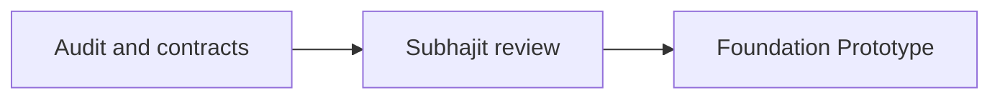

# AETHER pre-build readiness report

Status: architecture preparation. This report authorises no implementation.

Labels follow `docs/ARCHITECTURE_AUDIT.md`. **CONFIRMED** is what was observed. **PROPOSED** is written design awaiting review. **OPEN** is unresolved or legal. No proposal is promoted.

The audit headline is repeated here because this report is the decision page.

The repository is a large specification set and an empty source scaffold. There is no editor and no product build. Owner decisions of 2026-11-20 are recorded in the ADRs and in `docs/PREBUILD_DECISION_PACKAGE.md`. The gate is **CONDITIONALLY READY**. This report does not start the prototype and does not mark the stack production-validated.

## A. Repository and inventory

**CONFIRMED.** `/home/editry/development/sise-editor` is not a git repository. `README.md` was empty at the start of this preparation and is updated as the index. `LICENSE` is empty and was not rewritten. `CMakeLists.txt` is empty. `src/`, `tests/`, `plugins/`, `resources/`, and `third_party/` are empty directories. About seventy substantive specifications exist under `docs/` and at the repository root. Five `docs/` files are zero-byte stubs and were left empty: `ARCHITECTURE.md`, `DEVELOPMENT_ROADMAP.md`, `MODULES.md`, `MEDIA_PIPELINE.md`, `PROJECT_FORMAT.md`.

**CONFIRMED.** This preparation did not run FFmpeg, did not create a database, and did not execute a test. The prior FFmpeg 9.0.2 notes remain a local study to reconcile, cited by the media documents, not a new result.

Detail: `docs/ARCHITECTURE_AUDIT.md`.

## B. Product requirements

**PROPOSED.** Offline-first feature editor, Linux first, rational time, stable Media ID, bins as objects, originals untouched, no account. Requirements are traced in `docs/01_PRODUCT_REQUIREMENTS.md`.

**CONFIRMED.** No build meets them. Vendor compatibility is not claimed.

## C. Data contracts

**ACCEPTED** for the package and the identity, and still unimplemented:

- Working store SQLite as `project.db` with a manifest (ADR-003). The earlier `Title.sise/project.sqlite` package is not the authority.
- `.abin` as interchange, not a second database (ADR-004).
- One editorial Media ID. Proxies and other files are representations (ADR-005).
- Rational time (ADR-002, **PROPOSED**).
- Two logical schemas that have not been merged (`docs/PROJECT_STORAGE_AND_DATABASE.md`).

Owners stay the bin, registry, timeline, and timebase specifications. The numbered files point at them.

## D. Technology

**ACCEPTED WITH CONDITIONS.** ADR-001 records C++, Qt 6, CMake, SQLite, and FFmpeg as the mandatory core media framework. GStreamer is not mandatory. Nothing is linked. The library harness is **BLOCKED**. Legal flags remain open in ADR-008.

## E. Interfaces

**PROPOSED.** The application is the only joiner (ADR-006). Two module catalogues are mapped in `docs/ENGINEERING_INTERFACES.md`. Forbidden edges are specified and unenforced, because there is no link line.

Whether AETHER SOUND is a separate library remains open (audit C6). Undo for the prototype does not survive a restart (ADR-009, **ACCEPTED FOR FOUNDATION PROTOTYPE**).

## F. Safety, recovery, exchange

**PROPOSED.** Originals are never silently modified. Relink is not conform. Export is not a verified conform (ADR-007).

**CONFIRMED.** The exchange matrix has no executed vendor cell. No conform report was generated. No crash was induced.

## G. Evidence

**CONFIRMED.** `tests/` is empty. Every existing test plan is specified, not executed. Performance numbers are not measurements. `docs/17_TESTING_AND_VALIDATION.md` says what a future pass must look like.

## H. Plan and milestone

**PROPOSED.** Seven phases in `docs/19_DEVELOPMENT_ROADMAP.md`, revising order relative to the root roadmap’s phases 0–16 so identity and bins precede playback and exchange. The root roadmap is kept.

**ACCEPTED** as a scope description, not as implemented work. The Foundation Prototype is the seventeen items in `docs/FIRST_IMPLEMENTATION_MILESTONE.md`. It is not a complete NLE. AVX stays out until its schema is judged stable. `.abin` is interchange, not a prerequisite database.

## I. Risks and recommendation

The register is `docs/ARCHITECTURE_RISK_REGISTER.md`. The highest risks before any code are a second media identity, a false stack approval, an empty licence, and a codec or vendor claim without evidence.

### What is complete

- A readable specification of bins, media identity, timeline operations, rational time, audio derivation, MXF profiles as proposals, relink, conform, recovery, and exchange, each marked as a proposal and each stating that its tests were not run.
- This preparation set: audit, requirements, technology decisions, ADRs, data and time maps, playback, effects, colour, plugins, undo, storage, exchange matrix, security, testing, build, roadmap, integration, interfaces, performance, milestone, risk register, and this report.
- An empty scaffold preserved, not filled in.

### What is open

- Legal review (ADR-008). Apache-2.0 is not adopted.
- FFmpeg pin, ABI, and a link that actually configures. Currently **BLOCKED**.
- Qt and SQLite feasibility measurements.
- Cross-platform validation.
- The 30000/1001 writer, which **Failed** the 12812-sample contract.
- OP-Atom stereo on this build (**Not supported**) and external NLE relink (**Not tested**).
- Sound as its own library (C6).
- Which interchange adapter is first after the native model.
- Colour scope for the first code.
- Whether the AVX schema is stable enough for milestone item 17. Not judged here.
- Sync tolerance, memory cap, and performance machine.
- Every vendor cell.

### What still needs the owner

1. Send the counsel questions. Engineering does not close ADR-008.
2. Authorise any isolated prototype start. The gate does not start it. See `docs/FOUNDATION_PROTOTYPE_READINESS_GATE.md` for what can proceed and what stays blocked.
3. `libavfilter` only if a later effects decision requires it. It is not approved.
4. No decision is required to keep 12812. The boundary validation found no conflict that forces a change.

The five items that were awaiting an owner decision on the stack, the database, Media ID, undo, and licensing are no longer unanswered. Licensing remains open. The other four are accepted to the extent the ADRs say, with the technology conditions still open.

### What a later prototype may contain

The scope is `docs/FIRST_IMPLEMENTATION_MILESTONE.md`. It is not a headless ban on Qt, and it is not a permission to link FFmpeg before the harness runs. It is not a complete NLE.

### Whether the Foundation Prototype may start

Not as a whole. Isolated editorial and storage work can be authorised while the FFmpeg link, the 29.97 writer, OP-Atom stereo, external relink, and licensing stay blocked. Recommendation: **CONDITIONALLY READY**. Do not treat that word as approval.

