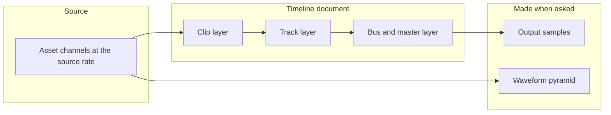

# AETHER SOUND — Editing Philosophy

Status: proposal, awaiting review. No implementation is authorized by this document.

AETHER SOUND is the sound of the editorial timeline. It is waveform-first audio inside the sequence the editor is already cutting. It is a film soundtrack being shaped on picture, dialogue, music, and ambience tracks. It is not a separate arrangement view, and it is not a mixer that the editor must live in.

This document states how that work is done. It elaborates section 3.3 of [ARCHITECTURE.md](../ARCHITECTURE.md) and the audio rules in [TIMEBASE_AND_FRAME_ACCURACY.md](TIMEBASE_AND_FRAME_ACCURACY.md). It does not amend those documents, [EDITORIAL_PHILOSOPHY.md](EDITORIAL_PHILOSOPHY.md), or the timeline specifications beside it. Engines are placed in [AUDIO_ENGINE_ARCHITECTURE.md](AUDIO_ENGINE_ARCHITECTURE.md). The surface is specified in [AUDIO_TIMELINE_UI_SPECIFICATION.md](AUDIO_TIMELINE_UI_SPECIFICATION.md). Gestures are specified in [AUDIO_INTERACTION_MODEL.md](AUDIO_INTERACTION_MODEL.md).

## 1. Who the sound is for

The person at the machine is cutting a feature. Dialogue was recorded on a mixer or a recorder with many channels. Music arrives as a stem. Ambience and effects sit on their own tracks. The cut is hours long, the picture and the dialogue must stay in step, and the same sequence must reopen months later on the same frame and the same sample boundary.

The timeline remains the centre, as [EDITORIAL_PHILOSOPHY.md](EDITORIAL_PHILOSOPHY.md) requires. Viewers, bins, and meters exist so a cut can be heard accurately. AETHER SOUND adds no second timeline and no account.

The editorial quantum stays the sequence frame. An audio cut, trim, slip, or slide falls on a sequence-frame boundary. Sample positions are derived from that boundary. The derivation is specified in [AUDIO_TIMEBASE_AND_SYNC.md](AUDIO_TIMEBASE_AND_SYNC.md). Subframe slip of an edit point stays outside the first model, as the architecture already decided.

## 2. Research basis

The asset id in this document is the Media ID (ADR-005). Undo of one successful command is one session undo step (ADR-009). That stack is not autosave and not crash recovery. The workflow was taken from publicly documented behaviour of Lightworks and of Adobe Premiere Pro. No proprietary source, private build, visual design, or undocumented internal was used. Published keyboard tables, colours, console hardware, and panel layouts are evidence of which jobs a film editor has to finish from the timeline. They are not AETHER's key map and they are not AETHER's chrome.

From the public Lightworks editing model, the jobs taken up here are: cutting sound from the waveform on the timeline; aiming an edit at audio tracks alone; fades and crossfades on the clip; more than one fade law; level nodes drawn on the clip and moved directly; grouping tracks and treating a stereo pair as one object; seeing monitor state and sync on the track; trimming, slipping, and sliding audio; keeping the track header compact; doing the work in the timeline.

From the public Premiere Pro audio model, the jobs taken up here are: a clip gain distinct from a track fader; clip pan and balance; a waveform that redraws when the clip's own level changes; automation on the clip and on the track; one adjustment applied to many clips; source layouts that include mono, stereo, adaptive channel counts, and named multichannel layouts; an ordered effect chain; the ideas of a track mixer (fader, pan, mute, solo, automation mode) available without leaving the sequence; automation that records during playback and plays back later; meters on the track and on the master.

AETHER specifies its own commands, curve formulas, colours, and module boundaries for those jobs. Where a published product offers two behaviours, the choice is written in this set and collected for review at the end of [AUDIO_ENGINE_ARCHITECTURE.md](AUDIO_ENGINE_ARCHITECTURE.md).

## 3. Sound lives on the sequence

A soundtrack is three stored things and one view.

| Name | What it is | Where it lives |
| --- | --- | --- |
| Source samples | The asset's channels at the asset's sample rate. | The media file. The catalog records the rate and the channel count. The editorial document stores an asset id and a source range in source frames. |
| Mix decision | Gain, pan, fades, automation, effects, routing, mute, and layout. | The timeline document, as data on the clip, the track, the bus, or the master. |
| Output samples | The sequence mix at the sequence mix rate, starting at `sampleIndex` of a sequence frame. | Produced by Processing when it is asked. Never stored as the cut. |
| Waveform | A pyramid of min and max peaks for drawing. | A regenerable file under the project's `cache/`. |

Import does not place a clip and does not bake a gain. A clip exists on a sequence only after an editorial command. Deleting the cache changes no level and no edit point.

The three layers multiply. They do not replace one another. Changing the clip gain leaves the track fader and the file alone. Changing the track fader leaves every clip gain alone. Changing the master leaves both. Playback and export read the same three layers. The device clock and the encoder are destinations, specified in [AUDIO_PROCESSING_GRAPH.md](AUDIO_PROCESSING_GRAPH.md).

## 4. The three control layers

### 4.1 Layer A — the clip

The clip is one item on one audio track. It owns:

- a static clip gain, in millibels
- a static clip pan or balance
- a fade in and a fade out, each a duration in sequence frames and a curve id
- clip automation nodes for level and for pan
- an ordered effect chain
- a channel map from the source layout onto the track layout

The clip's record range and source range stay the ranges [EDITORIAL_PHILOSOPHY.md](EDITORIAL_PHILOSOPHY.md) already defines. Layer A does not move them. Trim, slip, and slide move them through the existing trim engine, and the layer A data travels with the item by the rules in [AUDIO_INTERACTION_MODEL.md](AUDIO_INTERACTION_MODEL.md).

### 4.2 Layer B — the track

The track is the editorial track of kind `audio` already in the timeline model, plus a mix strip stored on that track:

- a static fader, in millibels
- a static pan or balance
- mute
- solo, as session monitoring, specified below
- track automation nodes
- an automation mode
- an ordered effect chain
- a route to a bus or to the master
- a channel layout
- membership in a track group or a stereo pair
- sync protection

Enable, lock, and sync lock keep the meanings [EDITORIAL_PHILOSOPHY.md](EDITORIAL_PHILOSOPHY.md) already gave them. Mute is a mix silence inside the graph. Enable omits the track from the resolved composition. Lock blocks a time edit and leaves the mix strip writable. Those three distinctions are review items in the engine architecture.

### 4.3 Layer C — the bus and the master

A bus is a named submix. A track routes to one bus or straight to the master. A bus has a fader, mute, an effect chain, automation, and a meter. The master is the sequence's delivery mix: master gain, master automation, a delivery channel layout, and the meters the Audio Monitoring Area already reserves. There is no hidden limiter and no hidden loudness correction. What the master sums is what export writes, apart from session solo, which export ignores.

The first graph is still a film mix, not a studio console. The default sequence has a master and no bus until the editor creates one. Buses are document data so a dialogue submix can exist. They are specified in [AUDIO_PROCESSING_GRAPH.md](AUDIO_PROCESSING_GRAPH.md).

## 5. Waveform-first, timeline-native

The editor judges a cut by seeing the waveform in the lane and hearing the frame under the playhead. The waveform is the source, drawn through the clip's own level, fades, and clip automation, so a gain change redraws the envelope without a new decode. The track fader is a mix control and does not repaint that envelope. The level line lies on the waveform and is edited there.

Operations that change time use the command set in [EDITORIAL_PHILOSOPHY.md](EDITORIAL_PHILOSOPHY.md): insert, replace, remove, delete, split, trim, ripple trim, roll, slip, and slide. Audio-only means the aim is audio tracks. It is the same command with a narrower target set, or with isolate, and it is not a second insert. Fades, nodes, gain, routing, and grouping are additional commands. They do not sneak into a trim.

Track headers stay compact. The header shows identity, aim, mute, solo, the pair or group, and sync. The fader the hand actually moves is the line in the lane. Master meters stay in the Audio Monitoring Area [UI_ARCHITECTURE.md](../UI_ARCHITECTURE.md) already places on the right. AETHER SOUND does not open a mixer workspace to do ordinary work.

## 6. Hearing, sync, and protection

Audio tracks are heard together, as the editorial philosophy already says. The mix order is the processing graph: clips sum into the track, tracks sum into the bus or the master, the master feeds the device and the export.

Sync is still a property of the tail of the film. A duration-changing command still asks the track synchronisation engine for a plan. Slip, slide, and roll still do not ask other tracks to pad or close. Linked picture and dialogue still travel together unless the gesture isolates one item.

Sync protection is the audio-specific refusal. A protected track rejects a command whose plan would leave it drifted. The editor hears the refusal and the limiting track before anything is written. The flag is document state. The plan it consults is the plan the timeline engine already returns.

A stereo pair is a track group of two mono tracks that receive the same time edit and the same fader unless the gesture isolates one side. A stereo track is one track with two channels. Both are specified, because production sound arrives both ways. An item link group remains the editorial object that binds picture to dialogue. A pair is not a link group, and a link group is not a bus.

## 7. What is stored, and what is only heard

| Stored in the timeline document | Session only | Regenerable |
| --- | --- | --- |
| Clip gain, pan, fades, clip nodes, clip effects, channel map | Solo | Waveform pyramids |
| Track fader, pan, mute, track nodes, track effects, route, layout, group, pair, sync protection | Automation mode while a pass is armed, and the open pass | Meter readings |
| Bus and master gain, mute, effects, nodes, delivery layout | Device choice, buffer size, monitor source | Proxy audio, if a later phase makes one |
| Sequence mix rate | | |

Undo follows the editorial rule. One successful command is one undo step. A nudge inside an open preview is not a step. An automation record pass is one step when the pass commits, not one step per sample. The Application owns the stack. The stack is session state.

Offline media stays in the cut. The clip keeps its gain. The lane keeps its edges. Playback contributes silence for that layer and the meter shows silence. Relink does not move a node.

## 8. What the engines owe this philosophy

- A gesture becomes one command, or one preview and then one command. The view does not invent a second mix.
- Clip, track, and master stay independent. No command writes a rendered file back over the source in order to remember a fade.
- Time edits stay on sequence frames. Sample indexes are a pure function of the sequence rate and the mix rate.
- The picture path and the sound path consume the same resolved span. Processing does not move a cut to repair a drift.
- The UI paints envelopes, lines, and meters it has been given. It does not decode, and it does not run the effect chain to decide what to draw.
- A long reel stays editable while peaks are still arriving and while the device is playing.

## 9. Choices that keep AETHER SOUND independent

- The curve ids are AETHER's: Linear, Equal Power, and Exponential, with the formulas in [AUDIO_AUTOMATION_SPECIFICATION.md](AUDIO_AUTOMATION_SPECIFICATION.md). The names name the job. The formulas are written here so they are not borrowed from another product's implementation.
- The header, the level line, the fade handles, and the meter marks follow the AETHER roles in [UI_ARCHITECTURE.md](../UI_ARCHITECTURE.md). They are original components.
- Track count, bus count, and channel count are whatever the performance plan can keep real-time. A copied product cap is not a requirement. The first document does name a maximum adaptive width so a project file stays bounded. That maximum is a review item.
- The key map will name these actions when the shell binds it. This set lists the actions and assigns no product's keys.
- No MIDI, no clip launcher, no piano roll, and no arranger grid. Those are other instruments. They are outside this soundtrack.
