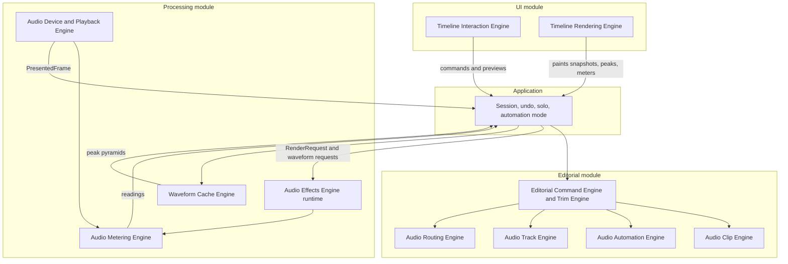
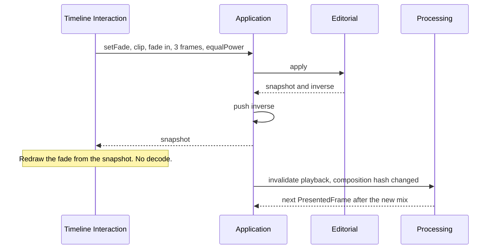

# AETHER SOUND — Engine Architecture

Status: proposal, awaiting review. No implementation is authorized by this document.

The device-engine sentences that name GStreamer are an earlier proposal. GStreamer is not a mandatory dependency (ADR-001). FFmpeg is the core media framework and stays behind the Media Engine. `sampleIndex`, the eight engines, and the rule that a device clock is not the playhead stay in force. A later device sink needs its own decision. It is not implied by this file.

This document places eight audio engines inside the modules [MODULES.md](../MODULES.md) already defines. It adds no row to the dependency matrix and no edge between domain modules. The Application remains the only joiner of an editorial decision and a media location. The UI remains the only Qt user. Processing remains the only component that touches samples.

Read [AUDIO_EDITING_PHILOSOPHY.md](AUDIO_EDITING_PHILOSOPHY.md) for the three layers these engines serve. Read [TIMELINE_ENGINE_ARCHITECTURE.md](TIMELINE_ENGINE_ARCHITECTURE.md) for the timeline engines they must not fork. Time edits still go through the editorial command engine and the trim engine. Sync plans still come from the track synchronisation engine.

## 1. The eight engines

The names are responsibilities inside modules that already exist. They are not new link targets. A later split follows section 16 of [MODULES.md](../MODULES.md) and revises that document first.

| Engine | Lives in | Responsibility |
| --- | --- | --- |
| Audio Clip Engine | Editorial | Clip gain, clip pan, fades, channel map, and the clip effect chain as data. How that data moves when a clip is split, trimmed, slipped, or slid. |
| Audio Automation Engine | Editorial | Node lists for every lane, evaluation of a lane at a sequence frame for the snapshot, the record-pass description, copy and paste of nodes. |
| Audio Track Engine | Editorial | Track fader, pan, mute, layout, group, stereo pair, sync protection, and the track effect chain as data. Session solo and automation mode are stored by the Application and validated here when a command must see them. |
| Audio Routing Engine | Editorial for the graph as data. Processing for the sum. | Buses, routes, master, delivery layout, mix rate. The routing engine in Editorial rejects a cycle. Processing never invents a route. |
| Audio Effects Engine | Editorial stores the chain. Processing runs it. | Ordered slots, bypass, parameters, parameter nodes. Built-in processors and Tier A processors behind the existing effect contract. |
| Waveform Cache Engine | Processing, recorded by Media Management as a derivative | Asynchronous multiresolution peaks. Cancellation. Cache keys. No path back into the cut. |
| Audio Metering Engine | Processing measures. The Application forwards. The UI paints. | Peak, hold input, and clip flags at the taps the processing graph names. |
| Audio Device and Playback Engine | Processing | The GStreamer playback graph, the device clock, buffer size, underruns, and the join of picture and sound at one rational time. |

The effect chain's stored form is Editorial data, drawn on the diagram as the clip, track, and routing engines because those engines own the slots on their objects. The box labelled Audio Effects Engine runtime is the only place a sample buffer and an effect implementation meet.

Forbidden calls:

- The UI does not call Editorial or Processing, and it does not decode.
- Editorial does not open a device, a file, or a plugin.
- Processing does not move a cut, write a node, or change a route because a meter clipped.
- Media Management records the waveform artifact's path and identity. It does not read samples.
- The waveform cache is not an input to the mix. The mix decodes the source range the resolver named.

## 2. Documents and snapshots

The passive timeline document gains the fields in section 3 when Contracts are next reviewed. This proposal does not edit [MODULES.md](../MODULES.md). Until that review, the fields are specified here and are not a schema.

`CompositionSlice` gains an audio section beside the picture layers it already carries: for each contributing audio clip, the asset id, the source position, the channel map, the evaluated clip millibels and pan at that frame, the fade amplitude law and rational fade position, the ordered effect parameters evaluated at that frame, the track id, and the route id. Evaluated numbers on the slice are the frame-resolution view and the values a frame-stepped export may use. Interactive playback may refine them to samples inside the frame with the formulas in [AUDIO_AUTOMATION_SPECIFICATION.md](AUDIO_AUTOMATION_SPECIFICATION.md), starting from the same node records. The two paths agree at every `sampleIndex(F)`.

A disabled track contributes no audio entry. A muted track contributes its entry with mute set, so export can silence it in the graph and a meter tap can still be reasoned about. Session solo is not a field of the slice. The Application applies solo when it builds the monitor request, and it leaves solo off the export request.

`compositionHash` includes the audio fields that change the heard samples. A gain change invalidates playback the same way a trim does. A waveform completion does not change the hash.

## 3. Proposed document fields

These elaborate the timeline document. They freeze only when Contracts are reviewed.

| Object | Fields this proposal adds |
| --- | --- |
| Sequence | Mix rate as a positive integer sample rate. Master: gain, mute, node lanes, effect chain, delivery layout. Buses: id, name, gain, mute, node lanes, effect chain, layout. |
| Audio track | Layout id, channel count, fader, pan, mute, route id, effect chain, node lanes, group id, sync protection. |
| Track group | Id, kind (`group` or `stereoPair`), ordered member track ids, a shared fader flag. |
| Audio clip item | Clip gain, clip pan, fade in, fade out, node lanes, effect chain, channel map. The item's record range, source range, and link group stay as they are. |
| Fade | Duration in frames, curve id. Absent when the duration is zero. |
| Node | Id, frame, value, `toNext`. |
| Effect slot | Slot index, effect id, bypass, parameter values, optional parameter node lanes. |
| Channel map | Pairs of source channel index to track channel index. Unmapped source channels are stored as an explicit list so a later remap can restore them. |

Solo, automation mode, the open record pass, device id, and buffer size are session fields on the Application. Track targets and patches stay the session fields the timeline engine already owns.

## 4. Commands

Time commands keep their existing ids. Audio-only aim is a target set on that command, plus the isolate modifier the timeline engine already defines. This proposal adds the following ids. No existing id is reused for a different effect.

| Spoken name | Id | Engine |
| --- | --- | --- |
| Set clip gain | `setClipGain` | Clip |
| Adjust clip gain on a set | `adjustClipGain` | Clip |
| Set clip pan | `setClipPan` | Clip |
| Set fade | `setFade` | Clip |
| Set transition curve | `setTransitionCurve` | Clip, on an audio transition |
| Add audio crossfade | `addAudioTransition` | Clip. Writes a transition on an audio cut. Duration and handles follow the trim engine. |
| Add, move, remove nodes | `addAutomationNode`, `moveAutomationNode`, `removeAutomationNode` | Automation |
| Replace a node span | `setAutomationNodes` | Automation. Paste and a committed record pass both use this. |
| Set track fader, pan, mute | `setTrackFader`, `setTrackPan`, `setTrackMute` | Track |
| Set group, make or clear a pair | `setTrackGroup`, `makeStereoPair`, `clearStereoPair` | Track |
| Set channel map | `setChannelMap` | Clip |
| Set sync protection | `setSyncProtect` | Track |
| Set route, bus gain, master gain | `setRoute`, `setBusGain`, `setMasterGain` | Routing |
| Set mix rate | `setMixRate` | Routing |
| Set effect slot | `setEffectSlot` | Effects, stored on the owning object |

Solo is `setTrackSolo` on the Application. It pushes a session inverse and does not modify the timeline document. Automation mode is `setAutomationMode` on the Application. A committed pass becomes `setAutomationNodes` through Editorial, and that step is the undoable document change.

`preview` is used for a fade drag, a node drag, and a trim, and it is the same preview operation the timeline engine proposes: a snapshot and a legal range, no inverse. Join applies once.

Every successful document command returns an inverse. A failure leaves every layer as it was. The error names the item, track, or bus that limited it.

## 5. How the engines share one edit

A slip of a dialogue clip is still the trim engine's slip. The clip engine's rule on success is: the record range is unchanged, the source range moves, and gain, pan, fades, nodes, map, and effects stay on the same item id. Nodes are in sequence frames, so a slip does not move them. The waveform request changes because the source window changed. The cache key does not.

A split is still `razor`. The clip engine's rule on success is specified with the other edge cases in [AUDIO_INTERACTION_MODEL.md](AUDIO_INTERACTION_MODEL.md): the left piece keeps the item id and the link, the right piece is new, fades that the cut intersects are truncated onto the piece that keeps the outer edge, and nodes are partitioned by frame.

Sync protection is a question the track engine answers inside the command, using the sync plan the synchronisation engine already produced. The plan is not recomputed by a private audio rule. If the plan would write a drift anchor on a protected track, the command fails and names that track.

## 6. Waveform Cache Engine

Processing builds the pyramid. The shape matches [TIMELINE_PERFORMANCE.md](TIMELINE_PERFORMANCE.md): per channel, min and max, under `cache/`, keyed by asset id, channel count, sample rate, and content hash when the catalog has one. This proposal adds the duties that audio navigation needs.

- Levels are powers of two in samples per bin, from a coarse level that can summarise a two-hour file in a small table up to a fine level fit to draw at the maximum zoom. The concrete set of levels remains the open number the timeline performance document already lists.
- A request names an asset, a source-sample span, and a level. The engine reads only the audio packets required for that span at that level, or reads a coarser level it already has. It does not decode the picture stream. It does not decode the whole file to answer a scroll.
- The Application cancels a request whose span has left the prefetch window. A finished write may stay in the cache.
- The pyramid stores source peaks. Clip gain is not baked in. A gain command does not invalidate the cache.
- The first paint may use a coarser level. The lane stays editable.

Media Management's `recordDerivative` notes the artifact. Deleting it changes no composition hash.

## 7. Metering Engine and Device Engine

The metering engine runs on the playback thread and on the export path. It reduces each tap to a peak for the block, a clip flag if a sample reached full scale, and it posts one reading per presented frame to the Application. The UI thread never waits on the device.

The device engine is the GStreamer playback backend behind `IPlayback`. Linux uses the PipeWire sink the architecture already prefers, with the fallback the GStreamer runtime already provides. The device clock is the clock section 9.3 of [ARCHITECTURE.md](../ARCHITECTURE.md) already assigns to audio monitoring. Seek flushes picture and sound to one rational time, which is `sampleIndex` of the destination frame. The presented frame is the frame whose sample span contains the clock, reported through `PresentedFrame`. A GStreamer clock reading is not stored as the playhead.

Export does not use this clock. Export runs the same graph on the FFmpeg path, frame by frame, at the sequence mix rate.

Buffer size, underrun behaviour, and the Phase 11 sync tolerance are review items below. The roadmap owns the tolerance. This document does not invent one.

## 8. Effects runtime

An effect slot names an implementation Processing, or a Tier A plugin adapted into Processing, provides. Editorial stores the id when the implementation is absent. Playback and export pass the audio through that slot and the result names the missing effect, which is the rule the architecture already gives picture effects.

Built-in runtime calls may receive a device block. The block carries the mix rate, the channel count, the sequence frame of the first sample, and the sample offset inside that frame. The Tier A contract stays a single sequence frame until a revision of the plugin ABI says otherwise. That split is a review item. Domain modules still do not load plugins. The host still adapts the C ABI.

A slot may declare a tail length in samples. The first model runs the tail only to the end of the clip, track segment, or bus activity that feeds the slot, and then feeds silence into the slot until the tail ends or the segment ends, whichever comes first. The tail does not enter the next clip.

## 9. Module boundaries this proposal refuses to cross

- No ninth link target and no audio module that Editorial and Processing both call.
- No sample index stored on a clip as its private copy of the cut.
- No waveform in the timeline document.
- No Qt type in a node record.
- No device handle in Editorial.
- No second playhead for audio.

## 10. Unresolved technical decisions for review

The documents in this set specify a single recommended behaviour for each item below. Acceptance of this proposal accepts the recommendations, or sends back the items that should change. Implementation stays stopped either way. None of these items edits the locked decisions in section 11 of [ARCHITECTURE.md](../ARCHITECTURE.md). In particular, audio edit points stay on sequence frames, and subframe slip stays outside the first model.

1. **Node time.** Recommended: a node stores a sequence frame, and Processing evaluates the segment at each output sample. The alternative is a node that also stores a sample offset inside that frame's sample span, still as integers, without moving the clip's source range. Confirm frame-only nodes. Sample-offset nodes would be a new stored time and need their own fixtures.

2. **Gain unit.** Recommended: `int32` millibels, silence at −9600, maximum boost +2400, amplitude `10^(m / 2000)` above the floor. The alternative is a rational linear amplitude. Confirm millibels so the document stays integer and the dB readout is exact at 0.01 dB.

3. **Interpolation domain.** Recommended: level segments interpolate in millibels with the nearest-remainder rule in the automation specification. The alternative is linear interpolation in amplitude. Confirm millibel ramps.

4. **Solo.** Recommended: solo is session state, undoable in the session stack, omitted from the timeline document and from export. Export while any solo is lit warns and writes the unsoloed document mix. The alternative is document solo that export honors. Confirm session solo, because a monitoring solo that survives into a delivery is a standing hazard on a feature.

5. **Mute and enable.** Recommended: enable omits the track from the slice; mute keeps the track in the slice and forces silence in the graph; both are document state; both are undoable. Confirm they stay distinct.

6. **Lock and the mix.** Recommended: track lock blocks insert, replace, remove, delete, split, and every trim kind, and it leaves gain, mute, nodes, and routing writable. The alternative is a lock that freezes the mix strip as well. Confirm the narrower lock, matching the timeline engine's definition of lock as a block on edits.

7. **Buses.** Recommended: the document can hold named buses, the default sequence has only a master, and a track routes to one bus or to the master. The alternative is a master-only graph until a later phase. Confirm buses in the first audio document so a dialogue submix has a place to live.

8. **Crossfade representation.** Recommended: an audio crossfade is a transition item with a curve id, under the existing rule that a transition lies on its cut and keeps its handles. The alternative is a pair of overlapping fades with no transition object. Confirm the transition.

9. **Split through a fade.** Recommended: the fade truncates onto the piece that keeps its outer edge, the inner edge becomes a butt join, and one undo restores the original fade and both pieces. The alternative is to refuse the split until the fade is cleared. Confirm truncation so razor stays available on a faded clip.

10. **Sync protection.** Recommended: a document flag; a command whose sync plan would drift a protected track fails unchanged and names the track. The alternative is a warning that still applies the plan. Confirm the refusal.

11. **Mix rate and pull-up.** Recommended: the sequence stores one integer mix rate, default 48000. `sampleIndex` uses it. Device-rate conversion happens at the device edge and is not stored in the cut. The first model has no 0.1% pull-up and no pull-down. `setMixRate` does not move a record range. Confirm the default, the single rate, and the absence of pull-up.

12. **Nested audio.** Recommended: a nested sequence contributes its master mix as the outer clip's source channels. Inner tracks are edited by opening the nest. The alternative is to explode the inner audio tracks onto the outer sequence. Confirm the master-mix nest.

13. **Effect tails.** Recommended: a declared tail runs only until the feeding segment ends, and it does not enter the next clip. The alternative is a tail that spills across the cut and must be part of the composition hash. Confirm no spill.

14. **Record-pass undo.** Recommended: one `setAutomationNodes` for the whole pass. A structural command during the pass commits the pass first and then applies, as two undo steps. The alternative is to refuse structural commands while a pass is open. Confirm the two-step behaviour.

15. **Waveform scale.** Recommended: the drawn envelope is source peaks times clip gain, fades, and clip automation. The track fader does not scale the clip envelope. The alternative is to include the track fader in the drawing. Confirm clip-only scaling so a track ride does not repaint every clip.

16. **Meter tap.** Recommended: track meters and the master meter are post-fader and post-mute. A muted track meters silence. The alternative is a pre-fader tap. Confirm the post-fader tap.

17. **Channel layouts.** Recommended first set: mono, stereo, 5.1, and adaptive with a stored channel count from 1 through 32. Further named layouts wait. Confirm the set and the maximum of 32.

18. **Stereo track and stereo pair.** Recommended: both exist. A stereo track is one track with two channels. A stereo pair is a group of two mono tracks with a shared fader unless isolate is held. Confirm both, rather than forcing production sound into only one of those shapes.

19. **Underrun.** Recommended: the device engine inserts silence for the missing block, counts the underrun, and does not move the playhead or the document to hide it. The alternative is to slip playback time. Confirm silence-and-count.

20. **Device buffer.** Recommended range: 64 to 4096 frames of the device, in samples, as a session setting. The default inside that range is chosen when playback is implemented, beside the Phase 11 tolerance the roadmap already says will be written down at the start of that phase. This document does not pick the tolerance and does not pick the default. Confirm the range.

21. **Clip automation record.** Recommended: clip nodes are drawn and typed, and a pass records track, bus, and master lanes only. The alternative is Write mode on a clip. Confirm drawn clip nodes.

22. **Node selection and paste.** Recommended: a node selection is one lane; a horizontal move that would collide or leave the span fails whole; paste keeps frame offsets, drops nodes that fall outside the span, and fails if none remain. Confirm.

23. **Effect block and the plugin ABI.** Recommended: built-in effects inside Processing may run on a device block annotated with a frame and a sample offset. Tier A plugins still receive one sequence frame until the plugin ABI is revised. Confirm that split so the C ABI does not grow inside this proposal.

24. **Curve formulas.** Recommended: Linear `u` and `1−u`, Equal Power `sin(π/2·u)` and `cos(π/2·u)`, Exponential `u²` and `(1−u)²`, with `u` the rational position in the fade's sample span. Confirm these three formulas as AETHER's laws.

25. **Cue mix.** Recommended: the first graph has no separate headphone cue. The Audio Monitoring Area shows the master. Header meters show each track. The alternative is a cue bus. Confirm the smaller graph.

26. **Pyramid strides.** Recommended: leave the concrete bin sizes and the prefetch length as the open numbers [TIMELINE_PERFORMANCE.md](TIMELINE_PERFORMANCE.md) and the timeline engine already list. This set requires only that levels are powers of two, that generation is ranged and cancellable, and that a two-hour source is never resident as raw samples. Confirm that this audio set does not freeze those numbers early.
