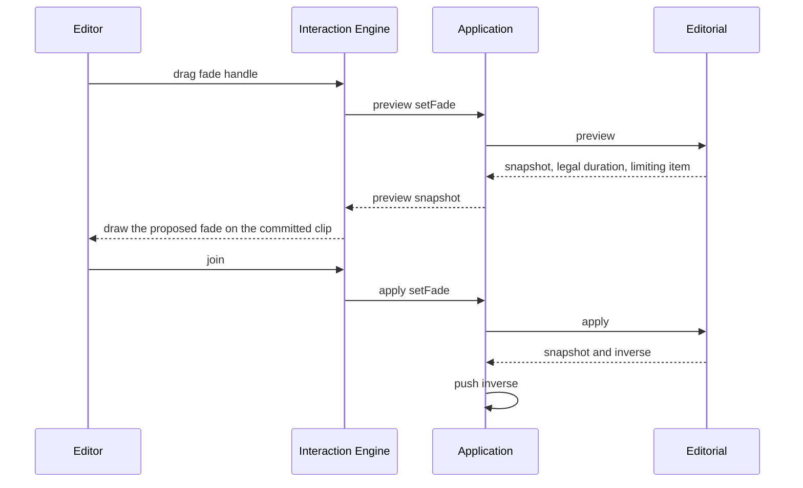

# AETHER SOUND — Interaction Model

Status: proposal, awaiting review. No implementation is authorized by this document.

This document specifies how a gesture becomes one audio command, what the command changes, what one undo restores, and which edges refuse. Time commands are the commands in [EDITORIAL_OPERATIONS.md](EDITORIAL_OPERATIONS.md) and [TRIM_ENGINE_SPECIFICATION.md](TRIM_ENGINE_SPECIFICATION.md). This document adds the audio aim and the layer A, B, and C commands. It does not give those time commands a second meaning.

The interaction engine lives in the UI. It sends frames, item ids, and values. Editorial decides. The drawing of handles and lines is [AUDIO_TIMELINE_UI_SPECIFICATION.md](AUDIO_TIMELINE_UI_SPECIFICATION.md).

Every command below has a keyboard path and a menu item. Bindings are the later AETHER key map. No command exists only as a drag. A drag is a preview. Join commits it. Abandon drops it. Undo of a joined command is one step.

## 1. Aim

| Gesture | Aim |
| --- | --- |
| Targets lit | Those tracks, if they are unlocked. |
| No targets lit | The default aim in the editorial philosophy: every unlocked track the patch maps onto. |
| Isolate held | The item under the pointer or under the playhead on the focused track. Link members are not included. A pair member is not included. |
| Audio targets only | The command is the audio-only form of insert, replace, remove, delete, or split. Picture tracks are outside the aim. |

A locked track in the aim is held and reported. If every aimed track is locked, the command fails. Sync protection is then applied to the plan, as [AUDIO_TIMEBASE_AND_SYNC.md](AUDIO_TIMEBASE_AND_SYNC.md) specifies. Group and pair members are added to the aim before the plan is built, unless isolate is held.

## 2. Shared preview

Fade handles, node caps, and trim terminals use one preview path.

The committed edges stay visible in secondary hairline during the preview, as an open trim already does. A typed value that is past the legal range is an apply that fails. The document stays. The status line names the limit.

Hit zones, measured in view pixels: the outer few pixels of a clip edge are the trim terminal; the fade handle sits inset from that edge on the level line and owns a few pixels around the cap; the level line owns a few pixels of vertical slack for adding and moving nodes; the rest of the clip body selects. When the clip is narrower than those zones, the keyboard commands in this document are the path. The pointer is not required.

## 3. Operations

The reel used in the examples is Reel 1 at 24/1, mix rate 48000, so `sampleIndex(F) = F * 2000`. Tracks V1, A1 dialogue, A2 room tone, A3 music. A1 is linked to V1 with expected difference 0. A1 is sync-protected. A3 has sync lock off. No targets are lit unless an example says so. Clip gains start at 0 millibels.

### 3.1 Audio cut

**Command.** `razor`, with audio aim or with isolate.

**Changes.** A cut at the playhead frame on each aimed audio item. The left piece keeps its id. The right piece is new and unlinked, which is the split rule already specified. Nodes with frame greater than or equal to the cut move to the right piece with the same sequence frames. Fade-in stays on the left piece. Fade-out stays on the right piece. A fade whose interior contains the cut truncates to the piece that keeps the outer edge, and the new inner edge has no fade.

**Undo.** Restores the original item, its fades, and its nodes, and retires the new id.

**Edges.** A cut on a gap fails. A cut on a locked track is held. Isolate on A1 at frame 48 splits the dialogue and leaves the picture whole. The link stays on the left dialogue piece. The right dialogue piece is unlinked. Duration is unchanged, so protection does not fire. The boundary is sample 96000.

**Example.** Dialogue [0, 200) with a 4-frame fade-in. Razor at frame 2, inside the fade. The left piece [0, 2) keeps a 2-frame fade-in. The right piece [2, 200) has no fade-in. One undo restores the 4-frame fade.

### 3.2 Audio trim, slip, and slide

**Commands.** `trim`, `ripple`, `roll`, `slip`, `slide`, through the trim engine.

**Changes.** Record and source ranges change exactly as the trim specification says. Gain, pan, map, and effects stay on the item. Clip nodes follow the keyframe rule in section 9 of [TRIM_ENGINE_SPECIFICATION.md](TRIM_ENGINE_SPECIFICATION.md): a node strictly after a boundary that moves with the tail shifts by that tail's delta, a node whose frame the trim removes is removed in the same step, and nodes are not resampled. Slip leaves record ranges and nodes where they are. Slide is the case where the whole record range moves by one delta: each node on that item shifts once, by that delta, and keeps its offset from the head. Track nodes do not move. A fade that would be longer than the resulting clip fails the command unchanged. The preview's legal delta stops at that fade as it stops at a handle. The editor shortens the fade or trims less.

**Undo.** The trim inverse, including any nodes removed or shifted with the item.

**Edges.** Slip does not move the record range, so the waveform slides inside the same rectangle and the level line stays put. An isolated ripple on protected A1 that would drift V1 fails. A slip of the whole link group succeeds.

**Example.** Slip A1 by +4 source frames while isolate is off and the link includes V1. The trim engine slips every member's source window. If V1 has no source handle left, the command fails and names V1. Protection does not need to fire when the command fails for handles. If the group slip succeeds, no drift is written.

### 3.3 Audio-only insert and replace

**Commands.** `insert` and `overwrite`, aimed at audio tracks.

**Changes.** The structural change is the one the operations document specifies. New items receive unity clip gain, centre pan, no fades, no nodes, an empty effect chain, and the channel map derived from the patch at the moment of the command. That map is stored on the item. Sync follows the plan. Protection can refuse the insert when a protected track would hold.

**Undo.** The structural inverse. The new ids retire. The map and unity gain leave with them.

**Edges.** Insert of dialogue at frame 48 with only A1 targeted, protection on, and V1 sync-locked and not targeted: the plan pads or holds V1. Holding V1 drifts the link if A1 already contains a linked item that splits. The command fails and names the protected drift. Replace on A1 across a span, protection on, does not change duration, so protection allows it if the link difference of surviving items is preserved. A replace that covers a whole linked dialogue item and leaves the picture is an isolated replace: the new item is unlinked, the picture remains, and protection fails the command because the link would be broken on a protected track. The editor turns protection off or includes V1.

**Example.** Source room tone [0, 24) replaced onto A2 at record frame 100. A2 is not linked and not protected. The picture and A1 stay. A3 stays. Duration stays. The new item's map is mono to A2. Undo lifts that item back out by the inverse of overwrite.

### 3.4 Clip gain and multi-clip gain

**Commands.** `setClipGain` stores an absolute millibel value on one item. `adjustClipGain` adds a delta to each item in a set.

**Changes.** The static clip gain. Nodes are unchanged. The envelope redraws from the same peaks.

**Undo.** The previous millibel value on each item in the set.

**Edges.** A result below −9600 stores −9600. A result above +2400 fails the whole set unchanged. A video item in the set fails the whole set. A locked track does not block this command. An empty set fails.

**Example.** A1 at −300 and A2 at −300. Adjust by −100. Both store −400. One undo restores both. The heard change is 1.0 dB down on each clip. The track faders stay 0.

### 3.5 Clip pan

**Command.** `setClipPan`, absolute integer from −1000 to +1000.

**Undo.** The previous pan.

**Edges.** A value outside the range fails. On a stereo pair with a shared fader, pan is still per item unless the gesture targets the pair balance, which writes the left item toward negative and the right item toward positive by the same magnitude in one command. Isolate writes one side.

### 3.6 Fade in and fade out

**Command.** `setFade` with a side, a frame duration, and a curve id.

**Changes.** That side's fade. The other side stays. Duration 0 clears the side.

**Undo.** The previous fade record, including its absence.

**Edges.** A duration longer than the clip fails. A duration that would overlap the other fade fails, so a fade-in and a fade-out meet at most at a boundary. Unknown curve ids fail. The three legal ids are `linear`, `equalPower`, and `exponential`.

**Example.** `setFade` fade-in, 3 frames, `equalPower` on A1. The fade multiplies samples `[0, 6000)`. At sample 3000, `u = 1/2` and the amplitude is `sin(π/4)`. Join is one undo step. Dragging the handle previews the duration and does not push a step per pixel.

### 3.7 Crossfade

**Command.** `addAudioTransition` writes an audio transition on the cut, duration 2 frames, curve `equalPower`, when both neighbours have the source handles that overlap needs. The record range is `[cut − 1, cut + 1)` and lies on the cut, which is the transition invariant in the trim specification. `setTransitionCurve` changes the curve id. Dragging either end of the transition previews a new duration through the trim engine. The transition must still lie on the cut. Preview stops at the last duration both handles can cover.

**Changes.** One transition item. The neighbouring clips keep their ids. Their fade-in and fade-out records are unchanged. The crossfade is the transition, not a pair of clip fades.

**Undo.** Removes the transition or restores the previous duration and curve.

**Edges.** Missing handles fail unchanged. A video cut is not given an audio curve. Curve ids are the same three. A crossfade and a clip fade-out on the same edge can both exist; the graph multiplies them. If that product is not what the editor wanted, clearing the clip fade is a separate command.

**Example.** Two dialogue items meet at frame 48, and each has at least one frame of source handle. `addAudioTransition` writes a transition on [47, 49). The crossfade multiplies samples `[sampleIndex(47), sampleIndex(49))`, which is 4000 samples, with Equal Power. If the left clip has no handle, the command fails and names the left clip. A later drag that asks for a longer overlap stops at the handles that exist.

### 3.8 Automation nodes

**Commands.** `addAutomationNode` at a frame, value equal to the current automation component so the line does not jump. `moveAutomationNode` sets frame and value. `removeAutomationNode` removes one id or a selected set.

**Undo.** Each of these is one step. A drag previews and joins once. Multi-node vertical move adds one delta to every selected node. Multi-node horizontal move adds one frame delta and fails whole if any node would leave the span or land on a node outside the selection.

**Edges.** Clip nodes must lie in the clip's record range. One node per frame; a landing on an occupied frame replaces that frame's value inside the same command and the inverse restores both. A gap has no clip lane. Track lanes accept a node on a frame the track covers, including a frame where the clip is a gap. Selection does not cross lanes. Read mode refuses a live write during playback and still allows these commands while stopped.

**Example.** Add a node on A1 at frame 48, then move it to −600 millibels. Two undo steps if the add was joined before the move. One step if the editor added it and then joined a single move from the preview. The heard value at the first sample of frame 48 is the static gain plus −600, clamped.

### 3.9 Automation copy and paste

**Commands.** Copy places node offsets on the session clipboard. Paste is `setAutomationNodes` on one destination lane at the playhead.

**Undo.** Restores the destination span the paste replaced. The clipboard remains.

**Edges.** Nodes that fall outside the destination are dropped. If none remain, paste fails and the destination is unchanged. Paste onto a video lane fails. Paste keeps the copied frame offsets and does not scale them to the destination length.

### 3.10 Track automation recording

**Commands.** `setAutomationMode` is session state. The pass commits `setAutomationNodes` for the written span.

**Undo.** One step restores every node the span held before the pass. Mode changes are their own session undos.

**Edges.** Off and Read do not write. Write replaces from the pass start. Touch returns to the previous envelope across one sequence frame after release. Latch holds the last value until stop. A structural command during the pass commits the pass and then applies the structural command, two steps. Stopping playback commits. An empty pass, where the deadband never tripped and the value equals what was already stored, pushes no document undo.

**Example.** A3 in Touch. Playback from frame 100. The editor holds the track line from frame 110 to frame 130 and pulls it to −1200, then releases. The pass writes nodes through the return frame, one frame after release. Stop. One undo restores A3's track lane across that span. Clips on A3 keep their clip gains.

### 3.11 Stereo grouping and ungrouping

**Commands.** `makeStereoPair` and `clearStereoPair`. `setTrackGroup` for a named group that is not a pair.

**Undo.** Restores membership and the shared-fader flag. Clearing a pair leaves the current faders where they are and does not bake a sum back into a stereo file.

**Edges.** A pair is exactly two mono tracks. A track already in a pair fails the make. Isolate during a later fader move clears the shared-fader flag in that same command. Time edits still hit both members unless isolate is held. A group that would include a video track fails.

**Example.** A1 and A2 become a pair. The shared fader becomes A1's fader. A later `setTrackFader` to −200 moves both. Undo of the fader restores both. Undo of the pair removes the group and leaves −200 on both if the fader undo is not also applied. Each undo is one step, in order.

### 3.12 Channel mapping

**Command.** `setChannelMap` replaces the map and the explicit unmapped list on one item.

**Undo.** The previous map.

**Edges.** A destination channel outside the track layout fails. A source channel outside the asset's probed count fails when the count is known, and is stored if the asset is offline and the count is unknown, so a map can be prepared before relink. Duplicate pairs that sum into one channel are legal. An empty map is legal and silences the item without changing its gain. The command does not rewrite the file.

**Example.** A stereo source on a mono A2, map left to A2, right listed as unmapped. The mix hears the left channel. Undo restores the previous map, which for a new item is the patch that landed with the insert.

### 3.13 Mute and solo

**Commands.** `setTrackMute` is document state. `setTrackSolo` is session state.

**Undo.** Mute restores the boolean on the track. Solo restores the session set of soloed tracks.

**Edges.** Mute on a locked track succeeds. Mute does not clear enable. Solo does not write the timeline document and does not change export samples. The export report warns when any solo is lit at export time. Solo of every track is legal and hears every track. Solo of none is the normal mix. A muted and soloed track is silent, because mute still forces zeros.

**Example.** Mute A3. The music meters drop to the floor. Picture and dialogue stay. Undo restores the music fader's contribution. Solo A1. The monitor drops A2 and A3. The document's mute flags are unchanged. Export during that solo warns and still includes A2 and A3, and excludes A3 only if mute is still set.

### 3.14 Sync protection

**Command.** `setSyncProtect` sets the flag on a track.

**Undo.** The previous flag.

**Edges.** The flag itself never moves a clip. Later commands consult it. A refused command has no inverse. The editor can clear the flag and repeat the command; those are two gestures and, if both succeed, two undos.

### 3.15 Routing, bus, and master

**Commands.** `setRoute`, `setBusGain`, `setMasterGain`, and `setMixRate`.

**Undo.** Each is one document step. `setMixRate` restores the previous integer rate and moves no clip.

**Edges.** A route that would cycle fails. A route to an unknown id fails. Master gain uses the same millibel limits as a fader. Mix rate must be a positive integer. The default is 48000.

## 4. Keyboard actions this model adds

These join the timeline's action list. They need bindings in the later key map, and menu items.

| Group | Actions |
| --- | --- |
| Aim | Target all audio, clear audio targets, isolate, toggle sync protection on the focused track. |
| Clip | Set gain, nudge gain by 10 and by 100 millibels, set pan, nudge pan, set fade in, set fade out, clear fades, choose curve, make crossfade. |
| Nodes | Add node at the playhead, nudge node value, nudge node frame, select next node, delete selected nodes, copy nodes, paste nodes. |
| Track | Mute, solo, nudge track fader, cycle automation mode, cycle the lane overlay between clip and track. |
| Layout | Make pair, clear pair, group, ungroup. |

Typed millibels parse to integers. A string that does not parse shows the error in the status line and does not change the document.

## 5. Failure and offline media

A failed command leaves gain, nodes, fades, routes, ranges, and anchors as they were. The status line names the limiting item or track in one clause.

Offline media accepts every command in this document. The envelope stays empty until peaks exist. Playback contributes silence for that layer. Meters read silence. Relink does not move a fade. Load keeps a channel map even when the probed channel count is shorter. The mix uses the pairs whose source channels exist and lists the missing pairs once in the status line. The clip stays in the cut.

## 6. What the interaction engine does not decide

- It does not compute `sampleIndex`. It sends frames.
- It does not thin a record pass. The automation engine thins on commit.
- It does not choose a resampler.
- It does not keep a private copy of the mix to feel responsive. The preview snapshot is the responsive path.
