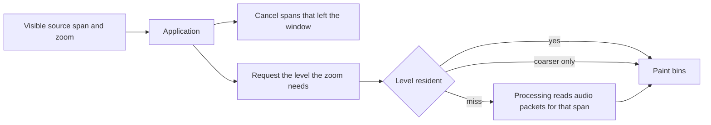

# AETHER SOUND — Performance

Status: proposal, awaiting review. No implementation is authorized by this document.

This document states the performance constraints for sound on a feature-length sequence. It does not promise a latency number and it does not freeze the pyramid strides. Phase 11 of [DEVELOPMENT_ROADMAP.md](../DEVELOPMENT_ROADMAP.md) measures alignment. Phase 15 measures a large fixture. The numbers those phases write down have to be able to exercise the constraints here.

Read [TIMELINE_PERFORMANCE.md](TIMELINE_PERFORMANCE.md) for the timeline bounds this document extends. A two-hour sequence at 24/1 is 172800 frames. At a mix rate of 48000 that is 345600000 output samples per channel. A documentary stringout can add many more audio items. A music bed can be one item across the whole duration. Production sound can be dozens of channels on an adaptive source. The design stays inside those sizes without decoding them on the UI thread.

## 1. What must stay interactive

The UI thread sends commands and paints. It does not decode, resample, or run an effect. The session thread mutates the document. Processing threads receive immutable requests. Those are the module rules, applied to audio.

| Work | Bound |
| --- | --- |
| Paint one view of the timeline | Proportional to visible items, visible tracks, and peak bins already in memory. Independent of the sequence duration and of the raw sample count. |
| Apply a gain, a fade, a node move, or a mute | One document transaction on the session thread. No cache rebuild. No device call inside the command. |
| Start hearing a seek | Flush to `sampleIndex` of the destination frame. The cost is the decode seek plus the device flush, not a walk of every clip in the reel. |
| Scroll across a music bed | A new peak request for the window that entered. The bed is one item. The request is a sample span, not a per-frame job. |
| Play while the editor trims | The open preview does not rebuild the mix. Join invalidates the composition hash. Playback restarts from the presented frame's identity or continues from the next queued request. The gesture does not wait for the device. |

Ordinary navigation is scrolling, zooming, stepping, and selecting. None of those decode a source. They read the document and the peak cache. A cache miss paints an empty envelope and issues a request.

## 2. Waveform cache

The artifact is the pyramid [TIMELINE_PERFORMANCE.md](TIMELINE_PERFORMANCE.md) already requires: min and max per channel per bin, under `cache/`, keyed by asset id, channel count, sample rate, and content hash. This document binds the access pattern.

- Generation is asynchronous and ranged. A request names a source-sample span and a power-of-two level. Processing reads the audio stream for that span. It does not demux the picture in order to draw a waveform, and it does not decode the file from the start when the span sits at the end, except for the packet seek the container requires.
- The coarse level of a long asset may be built in one sequential pass and kept. Finer levels are built for the prefetch window. A two-hour stereo bed is never resident as raw samples. A 32-channel adaptive source stores peaks per channel and is still a pyramid, not a decoded mix.
- The first paint uses the finest resident level that covers the span, however coarse. The finer level replaces it when it arrives. Replacement is a paint. It is not a document edit.
- Gain, fades, and clip automation scale bins in the painter from the snapshot. They do not invalidate the pyramid. Track fader moves do not invalidate it either, because they are not part of the envelope.
- Cancelling a request that has left the window is normal. A write that finishes after cancel may remain on disk. The process drops in-memory bins that have left the window, plus a small recently-used set. The disk cache may keep them.
- Deleting `cache/` changes no edit point and no composition hash. The next view rebuilds what it needs.

The concrete level set and the prefetch length stay the open numbers listed in the timeline engine. Review item 26 of [AUDIO_ENGINE_ARCHITECTURE.md](AUDIO_ENGINE_ARCHITECTURE.md) asks to keep them open.

## 3. Automation

Node lists are ordered by frame. Evaluation of a buffer finds the node in force at the first sample by a binary search, then walks forward only across nodes the buffer covers. A two-hour music ride with a few hundred nodes does not scan those nodes per sample from the start of the file.

The record pass thins to a node when the value has moved by the deadband in the automation specification, plus a node at the stop frame. A pass does not allocate a node per sample. Commit is one transaction that replaces one span.

The painter evaluates the visible line at frame resolution, from values the snapshot already carries or from a binary search on the visible span. It does not evaluate every output sample in order to draw.

## 4. The real-time mix

The device callback runs the graph in [AUDIO_PROCESSING_GRAPH.md](AUDIO_PROCESSING_GRAPH.md) for one buffer. The buffer length is a session setting in the range 64 to 4096 device samples. The default inside that range is chosen when playback is implemented, together with the Phase 11 tolerance. This document does not set either number.

Inside the callback the allowed work is: read the queued request, decode or take the already-decoded block for that span, resample at the clip edge if the rates differ, apply maps, gains, fades, pans, and effects, sum, meter, and write the device. The forbidden work is: locking the session thread for a document edit, allocating a pyramid, querying the widget, or building a `RenderRequest` from scratch by walking the whole sequence.

The Application keeps a short queue of resolved spans ahead of the playhead. A composition-hash change drops the queue. The drop is the point at which a join becomes audible. Until the drop, the device plays the previous span. It does not block the UI thread while it drains.

Underrun inserts silence for the missing samples and increments a count the session thread will read. The playhead reported afterwards is still the frame identity of the samples that were supposed to play. The document does not slip to absorb the gap. Overrun drops the duplicate callback and counts it. Neither count is an editorial command.

Many tracks sum in the callback in proportion to the tracks that contribute at that frame, not in proportion to the tracks that exist. A disabled track is absent. A track of gaps is a zero add the router can skip. Effect chains run only on slots that are present and not bypassed.

## 5. Meters and the UI

Meter readings post at most once per presented frame per tap. The UI paints the latest reading on the next observer call. A late paint shows the previous mark. It does not query the device. Master meters in the monitoring column and the thin header meters share that feed. There is no per-pixel timer animating a needle.

Playback does not stop so a meter, a peak, or a thumbnail can catch up. The lane stays editable during playback. A command during playback is a session-thread transaction. If an automation pass is open, the structural command commits the pass first, as the automation specification requires, and both steps return before the painter draws them. The device learns of the new hash after the commands publish.

## 6. Memory

| Resident | Bound |
| --- | --- |
| Document | Items, nodes, and routes. No samples. |
| Peak memory | The prefetch window and a small recent set, per channel that has been shown. |
| Device queue | A few buffers of the mix, fixed by the session buffer size. |
| Undo | Inverses of commands. A node-span inverse stores the replaced span, not a copy of the whole reel's samples. |
| Decode | The packets needed for the current buffer and the seek index. The frame index remains the regenerable derivative Processing already owns. |

A 32-channel clip at the maximum adaptive width multiplies the peak bins and the mix buffer by the channel count. It does not multiply the UI by the file duration. Channels the compact lane does not draw are still in the mix if the map includes them. The painter requests peaks for the channels it draws.

## 7. Sync under load

Picture and sound flush to the same `sampleIndex` on a seek, before the presented frame is reported. Dropped preview pictures update the reported frame and do not rewrite the timeline, which is the architecture's existing rule. Dropped audio buffers are underruns, not dropped frames in the document. The Phase 11 fixture is a visible and audible mark at a known frame. The tolerance around that mark is written down at the start of that phase. Device latency that exceeds it is mitigated by the sink and by a measured delay inside Processing, as the roadmap already says. It is not mitigated by moving the cut.

## 8. Failure

A cancelled peak request paints an empty or coarse envelope. A failed decode of one asset silences that layer and names it. The other tracks continue. A plugin that fails a block is reported as a missing effect for that block and passed through, so one effect cannot stall the device thread indefinitely. The host still treats a Tier A plugin as trusted local code, as the architecture requires. A hang inside a plugin is a defect in that trust boundary, not a reason for Editorial to call the plugin itself.

The session remains able to save. Save writes the document. It does not write peaks, meter readings, or the device buffer.
