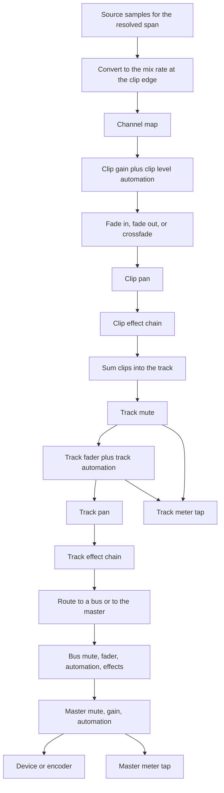

# AETHER SOUND — Processing Graph

Status: proposal, awaiting review. No implementation is authorized by this document.

This document specifies the signal path Processing runs for monitoring and for export. The path is a reading of the timeline document. It does not write back. Ownership of each stage is in [AUDIO_ENGINE_ARCHITECTURE.md](AUDIO_ENGINE_ARCHITECTURE.md). Curve formulas are in [AUDIO_AUTOMATION_SPECIFICATION.md](AUDIO_AUTOMATION_SPECIFICATION.md).

The Application builds a `RenderRequest` from a `CompositionSlice` and from `MediaLocation` values, as [ARCHITECTURE.md](../ARCHITECTURE.md) requires. Processing receives locations, evaluated parameters, and a destination. It does not receive a timeline object.

## 1. One graph, two destinations

Monitoring and export use the same order of operations. They differ in clock and in destination.

| | Monitoring | Export |
| --- | --- | --- |
| Driver | Audio Device and Playback Engine, GStreamer, device clock | FFmpeg path, stepped by sequence frame |
| Rate | Sequence mix rate inside the graph. A final conversion only if the device rate differs | Sequence mix rate, unless the export preset names another integer rate. The report names that conversion |
| Solo | Applied by the Application on the monitor request | Omitted. A lit solo produces a warning on the export report |
| Underrun | Silence for the missing block, counted | Not applicable. Export waits for the decode or fails the asset |
| Partial result | The presented frame stays the frame that was requested | A cancelled export removes the partial file, as the architecture already requires |

The meter taps are observers. They are not gains. A tap cannot change a sample.

## 2. Source span

For a sequence frame `F`, the output samples that belong to the frame are the half-open index span `[sampleIndex(F), sampleIndex(F + 1))` at the mix rate. The resolver names the clip and the source frame. Processing converts that source frame to a source-sample span with the same function at the source rate, as [AUDIO_TIMEBASE_AND_SYNC.md](AUDIO_TIMEBASE_AND_SYNC.md) specifies.

A device buffer may cover part of a frame or several frames. The graph still knows, for every output sample, which sequence frame it belongs to, because `sampleIndex` is monotonic. Automation and fades use that identity. The buffer size does not become a second timebase.

If the asset is offline, the layer contributes zeros for its channel count and the result names the offline asset, in the same spirit as a picture slate. The other layers still mix. The document is unchanged.

A nested sequence contributes the channels of its master mix, already specified as the nest rule. Processing obtains that mix by running this same graph on the inner sequence for the outer clip's source range. It does not open the inner tracks as extra lanes on the outer timeline.

## 3. Rate at the clip edge

When the source sample rate equals the mix rate, samples are copied into the mapped channels. When the rates differ, Processing resamples at the clip edge so that source sample `sampleIndex_source(sourceFrame)` lines up with output sample `sampleIndex(recordFrame)` at every frame boundary the clip crosses. The resampler's interior is an implementation choice inside Processing. Its contract is the boundary alignment, not a named filter. The editorial document does not store filter state.

A later pull-up is a different rate relationship. It is outside this graph until review item 11 in the engine architecture is reopened.

## 4. Channel map

The map is a list of pairs and an explicit list of unmapped source channels. Processing places each mapped source channel into the named track channel. Two source channels mapped to one track channel sum. A track channel with no source stays silent. Unmapped source channels are not copied in "just in case." Adaptive layouts use the same map. The layout id tells the UI how to draw and tells the pan law which channels form the left and right groups. It does not invent mappings the document omitted.

The first layouts are mono, stereo, 5.1, and adaptive up to 32 channels. A 5.1 track uses the channel order left, right, centre, LFE, left surround, right surround. That order is AETHER's stored order. Interchange may translate it, and a translation is reported. This document does not claim the order matches any one broadcaster's file.

## 5. Clip stage

For each output sample in the clip's span:

1. Convert the summed clip-gain and clip-level-automation millibels to a linear amplitude. The sum is clamped to −9600 and +2400 after addition.
2. Multiply by the fade amplitude. A crossfade uses the outgoing law on the left clip and the incoming law on the right clip across the transition's sample span. Outside a fade, the amplitude is 1.
3. Apply clip pan.
4. Run the clip effect chain in slot order. A bypassed slot is the identity. A missing effect id is the identity, and the result names the id.

The fade multiplies the automated clip amplitude. It does not add in millibels. A −6 dB node and a linear fade at `u = 1/2` are a further halving of amplitude, not a further −6 dB unless the curve says so. Linear at `u = 1/2` happens to be another −6 dB. Equal Power at `u = 1/2` is not.

## 6. Track stage

Clips on one track sum into the track's channel count. Overlapping clips are legal only where a transition names them. Outside a transition the track has at most one clip at a frame, which is the editorial overlap rule. The sum is still the operation, so a transition has a defined combine.

Mute replaces the track buffer with zeros after the sum and before the fader. The track meter reads the post-mute, post-fader buffer, so a muted track shows silence and a pulled-down fader shows the reduced peak. Enable is not a stage. A disabled track never arrives.

Track fader and track automation use the same millibel sum as the clip. Track pan follows. The track effect chain follows the pan, so a dynamics effect on the track sees the fader. That order is deliberate: the fader is the editor's ride, and a track effect sits on the ridden signal. A clip effect sits on the clip, before the ride.

## 7. Bus and master

Each track buffer is added to the destination its route names. A route to a missing bus fails at command time in Editorial, so Processing does not receive a dangling route. Buses sum, then apply mute, fader, automation, and the bus effect chain, in that order. Bus-to-bus routes are legal only when Editorial has rejected a cycle. The recommended check is a topological order computed when the route command runs. Processing consumes that order and does not search for cycles itself.

The master sums every bus and every track routed directly to it, then applies master mute, master gain, and master automation. There is no bus effect after the master in the first graph, and there is no hidden limiter. Delivery layout is a map from the master channels to the channels written to the device or the file. An unmapped delivery channel is silence. A master channel the delivery map drops is not written.

Full scale is the sample value of greatest magnitude the destination format can store. The clip flag on a meter is set when a sample in the block reaches that magnitude. The graph does not saturate "gently" and does not hide the flag. Integer export formats clip in the encoder, and the export report includes the master peak and the clip flag so the editor can see it.

## 8. Effects

A chain is an ordered list of slots. Each slot has an effect id, a bypass flag, parameter values, and optional parameter automation evaluated at the frame. Parameters are the passive values Editorial already stores for picture effects: an id and a typed value. Audio adds no second parameter system.

The first built-in ids, so the chain can be reviewed without a plugin, are:

| Id | Behaviour |
| --- | --- |
| `audio.gain` | One millibel parameter, summed onto the buffer's amplitude. |
| `audio.delay` | One delay parameter in whole samples of the mix rate, clamped to a non-negative value the slot declares as its maximum. |
| `audio.polarity` | A boolean. When set, multiplies the buffer by −1. |

Anything else is a later processor behind the same slot. A compressor, an equaliser, or a denoiser is an effect id with parameters. It is not a special case in the graph. Its tail, if it declares one, follows the no-spill rule in the engine architecture.

Processing may run a built-in on a device block. A Tier A processor is called once per sequence frame with the samples of that frame until the plugin ABI says otherwise. Block edges and frame edges agree because the frame's sample span is known.

## 9. Meters

| Tap | Reads | Shown |
| --- | --- | --- |
| Track | Post-mute, post-fader, pre track effects | Header meter |
| Bus | Post-mute, post-fader | Bus row in the Audio Monitoring Area |
| Master | Post-mute, post master gain | Audio Monitoring Area |

Each reading carries the peak absolute amplitude of the block, converted to millibels for display, the channel index, and a clip flag. The Application keeps the latest reading per channel and a sticky clip flag for the session. Clearing the sticky flag is a session command. It does not change the document. Peak hold on screen is a UI decay of the latest peaks. The decay is presentation and is not a ballistics standard baked into the file.

The posting rate is at most one reading per presented frame per tap. A burst of device callbacks coalesces. Export records the maximum master peak over the export range in the export report and does not animate the shell.

## 10. Real-time duty

The playback thread runs the graph for the next buffer from requests the Application has already queued. It does not call Editorial, does not take the session lock to read a widget, and does not allocate a peak pyramid. If the next request is late, the device engine underruns as specified: silence, a count, the same playhead identity. The UI learns about the count on the session thread.

Automation evaluation for a buffer is a walk of the nodes that cover that buffer, not a walk of every node on a two-hour track. The node list is ordered, so the walk starts at the node in force at the buffer's first frame. Effect processors receive only their parameter values and their buffers.

## 11. What the graph does not do

- It does not bake a fade into the source file.
- It does not change a record range when a resampler has internal delay. Any algorithmic delay is compensated inside Processing or reported as latency. It is not a trim.
- It does not read the waveform cache in order to mix.
- It does not treat a meter overload as a command to pull down the master.
