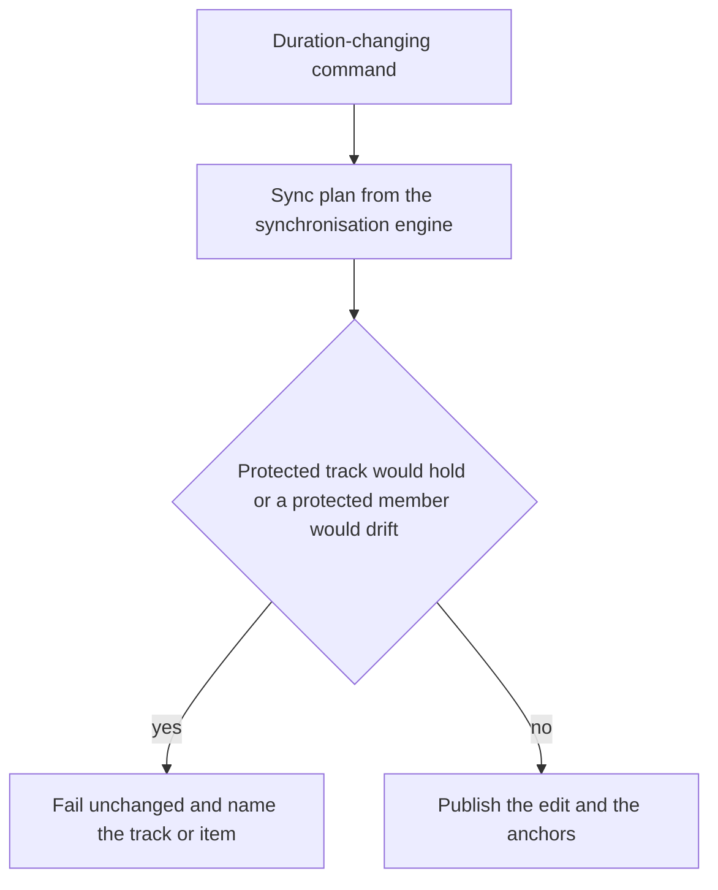

# AETHER SOUND — Timebase and Sync

Status: audio detail of the accepted initial time authority. Picture selection, phase, and the sync-warning limit are ADR-002 (`architecture/decisions/ADR-002-rational-time.md`), accepted 2026-11-21. This document authorises no implementation. **SLICE 0A COMPLETE — DEVELOPMENT FROZEN PENDING NEXT AUTHORISATION.**

This document expands the audio rules in [TIMEBASE_AND_FRAME_ACCURACY.md](TIMEBASE_AND_FRAME_ACCURACY.md). It does not replace them and it does not change `sampleIndex`. The editorial quantum remains the sequence frame. Subframe slip remains outside the first model. Sync plans remain the plans of the track synchronisation engine in [TIMELINE_ENGINE_ARCHITECTURE.md](TIMELINE_ENGINE_ARCHITECTURE.md).

## 1. The clocks sound uses

| Clock | Unit | Stored |
| --- | --- | --- |
| Sequence time | Frame index at the sequence rate | Yes, on every record range, node, and fade edge |
| Source time | Frame index at the source rate | Yes, on the clip's source range |
| Mix time | Sample index at the sequence mix rate | No. Derived by `sampleIndex` |
| Source samples | Sample index at the asset's sample rate | No. Derived by the same function at the source rate |
| Device time | Samples at the device rate | No. A final conversion at the device edge |

Floating-point seconds remain a display convenience. A fade duration typed as "40 ms" parses to a frame count at the sequence rate by the integer rule below, or the parser rejects it. The document receives frames.

## 2. The sequence sample boundary

Let the sequence rate be `N/D` frames per second and the mix rate `R` be the positive integer stored on the sequence. For a sequence frame `F ≥ 0`:

```
sampleIndex(F) = floor(F * R * D / N)
```

The floor is integer division of the exact product, in a width that can hold the product, or the conversion fails. This is the function [TIMEBASE_AND_FRAME_ACCURACY.md](TIMEBASE_AND_FRAME_ACCURACY.md) already specifies. It is a property of the sequence, identical for every clip, every track, and the master. Two clips cannot disagree about the sample at which frame `F` starts. Phase is anchored at sequence frame 0. A clip boundary, an edit, a timecode origin, and an export in-point do not reset it. Display timecode `01:00:00:00` does not reset it. There is no stored sample-time domain. A fractional sample in this floor is not an error. A sync warning is raised only when a source offset or an operation cannot be represented in the frame-only model. Ceiling is not this function.

The samples that belong to frame `F` are `[sampleIndex(F), sampleIndex(F + 1))`. A span `[start, end)` contains `sampleIndex(end) - sampleIndex(start)` samples. The count is constant when `R * D` is divisible by `N`, and it alternates between two adjacent integers otherwise. At 30000/1001 the origin span of eight frames remains 12812 samples (`docs/validation/AUDIO_FRAME_SAMPLE_BOUNDARY_VALIDATION.md`). The alternation is determined by the remainder and is the same on every reopen. The worked 30000/1001 table in the timebase document is the fixture for the alternating case. This document uses the 24/1 case for its own examples because the product is exact:

At 24/1 and `R = 48000`, `sampleIndex(F) = F * 2000`. Frame 48 starts at sample 96000. A roll that moves a cut from frame 48 to frame 52 moves the audio boundary from sample 96000 to sample 104000. Both numbers are exact. The roll command carries frames. The samples are a consequence.

### 2.1 Source samples

A source frame boundary uses the same function with the source rate and the asset sample rate. Picture selection is not an audio rounding policy. When the source rate equals the sequence rate and the asset sample rate equals the mix rate, a sequence offset of `k` frames is a source offset of `k` frames and of `k * samplesPerFrame` samples, and the identity is exact.

When the rates differ, the source frame comes from the integer mapping in the timebase document, and the source sample comes from `sampleIndex` at the source. Playback aligns those two results at the frame boundary. Interior samples follow the resampler contract in [AUDIO_PROCESSING_GRAPH.md](AUDIO_PROCESSING_GRAPH.md).

### 2.2 A typed millisecond duration

A duration typed in milliseconds converts to frames before any command sees it.

```
frames = nearest(milliseconds * N / (D * 1000))
```

This parse quantises a typed duration to a whole frame count. An exact halfway remainder selects the earlier frame count, the same tie direction as picture selection. It is not picture selection and it is not `sample_boundary`. A minimum of one frame applies when the typed duration is greater than zero and the quotient is zero. Zero stays zero and clears a fade. The command stores `frames`. Reopening the project does not re-parse the typed string, because the string was never stored.

At 24/1, 40 ms becomes `nearest(40 * 24 / 1000) = nearest(0.96) = 1` frame. A one-frame fade at 48000 is 2000 samples. That is the finest fade the first model can store, and it is sample-accurate across those 2000 samples because the curve is evaluated per sample inside the frame.

## 3. Mix rate changes

`setMixRate` replaces `R`. It does not move a record range, a node frame, or a fade duration. The next playback derives new sample indexes. The composition hash changes because the heard samples change. Undo restores the previous rate. A rate that is not a positive integer is rejected. The default for a new sequence is 48000.

Device playback may run at a different rate. The conversion sits after the master, in the device engine, and it is not written into the timeline document. Export at a preset rate is the same kind of edge conversion, named in the export report.

## 4. Sync, links, and protection

Duration changes still ask the track synchronisation engine for a plan: edit, pad, close, or hold, with a sync anchor where the plan holds. Audio tracks are not a special case of that plan. A music track with sync lock off holds and shows drift. A dialogue track with sync lock on pads or closes with the picture.

Slip, slide, and roll do not pad and do not close. They can still drift a link group if the gesture isolates one member. The link stores the expected difference of record starts. Picture and its dialogue are a link group. Isolating the dialogue and slipping it by four frames updates the stored difference, marks the member drifted, and shows the signed count on the rail. The samples under the dialogue move because the source range moved. The picture's record range stays.

Sync protection is a flag on the track. After the plan is built and before the command publishes:

- If the plan assigns `hold` to a protected track, and the command changes duration, the command fails and names the track.
- If the command would mark a link member on a protected track as drifted, the command fails and names the item.
- A plan that edits, pads, or closes the protected track together with its linked picture, and preserves the expected difference, succeeds. Protection keeps the track in step. It does not freeze the track against a cut that carries the whole link.
- Slip and slide of a whole link group succeed, because the difference is preserved and the sequence duration is unchanged.
- Mute, gain, nodes, and fades do not consult the plan. They cannot drift a track.

Protection is how an assistant keeps production sound from walking away from the slate during an audio-only delete. The refusal is the feature. A warning that still drifts is the alternative listed for review.



## 5. Groups, pairs, and aim

A track group is a set of audio tracks that share aim. Targeting one member targets the others for insert, replace, remove, delete, and split. A trim opened on one member opens the same side on the others. Isolate restricts the gesture to one track and one item.

A stereo pair is a group of exactly two mono tracks, ordered left then right, with one shared fader. `setTrackFader` on either member writes the shared value. Isolate allows `setTrackFader` to write only the member under the gesture, and it clears the shared-fader flag so the pair remains a group for time edits while the levels diverge. `clearStereoPair` removes the group and leaves each track's current fader where it is. `makeStereoPair` requires two mono tracks, fails if either is already in a pair, and adopts the left member's fader as the shared value.

A stereo track is not a pair. It is one track with layout stereo. Its two channels slip together because they are one item. Splitting it into a pair is `makeStereoPair` after a command that copies the item onto a new mono track and sets the channel maps to left and right. That command is one undo step: two tracks, one pair, two items, linked as a pair group, with the original stereo item retired. The inverse restores the stereo item and retires the two mono tracks.

Item link groups stay flat and non-overlapping, as the timeline engine recommends. A pair group is a track group. An item may still belong to one link group. The dialogue pair can be linked to the picture as two members of one link group, and also be a stereo pair. Those are different records and both may exist.

## 6. Audio-only aim

Audio-only insert, replace, remove, delete, and split are the existing commands with an aim that contains audio tracks and no video tracks. With no targets lit, the default aim remains the default the timeline engine recommends: every unlocked track the patch maps onto, picture included. Audio-only is what the editor gets by lighting audio targets, or by isolate on an audio item.

A patch from a stereo source to a mono track uses the clip's channel map on the item that lands. The patch itself stays a session mapping from a source channel group to a record track, as the timeline specification's patch provision already describes. The map stored on the clip is the document's copy of the decision that landed with that item, so a later session with a different patch does not rewrite old clips.

## 7. Worked sync example

Sequence Reel 1 at 24/1, mix rate 48000, start frame 0. All tracks unlocked. Sync lock on for V1 and A1. Sync lock off for A3, the music bed. Sync protection on for A1.

| Item | Track | Record range |
| --- | --- | --- |
| Picture | V1 | [0, 200) |
| Dialogue | A1 | [0, 200), linked to the picture, expected difference 0 |
| Music | A3 | [0, 1000) |

An isolated extract of A1 across [48, 72) asks the synchronisation engine for a plan. A1 is edited and closed. V1 holds, because it was not in the aim, so the link's expected difference of 0 would no longer hold and the dialogue member would be marked drifted. A3 holds because its sync lock is off. Sync protection is on for A1, and the command would drift the link member that lives on that track. The command fails. Reel 1 is unchanged. The status line names A1.

The same extract with protection off succeeds: A1 loses 24 frames at frame 48, V1 holds, a sync anchor records the drift, the link difference updates, and the chain mark takes the warning hue. Music stays. `sampleIndex(48) = 96000` and `sampleIndex(72) = 144000`. The dialogue samples that leave the mix are that half-open span. The picture frame 48 is still picture frame 48.

A fade of 2 frames on the dialogue at its head does not change these indexes. The fade multiplies samples `[0, 4000)`. The cut, if one is later made at frame 48, still falls at sample 96000.

## 8. Invariants

- `sampleIndex` is pure. Monitoring latency, device buffer size, and resampler delay do not change it.
- A command stores frames and millibels. It does not store the sample index it caused.
- A protected track is unchanged after a refused command, including its anchors.
- Pair membership and link membership are independent records. Undo restores both.
- `setMixRate` is one undo step and moves no edit point.
