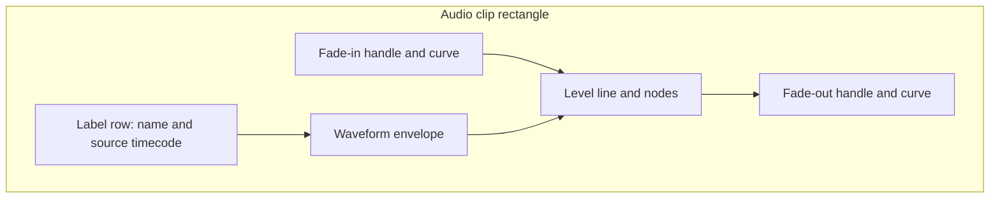

# AETHER SOUND — Timeline UI Specification

Status: proposal, awaiting review. No implementation is authorized by this document.

This document specifies how sound is drawn on the timeline surface [TIMELINE_UI_SPECIFICATION.md](TIMELINE_UI_SPECIFICATION.md) already defines. It does not move a panel, does not add a workspace, and does not authorise a widget. The workstation around the timeline, including the Audio Monitoring Area, stays as [UI_ARCHITECTURE.md](../UI_ARCHITECTURE.md) placed it.

The rendering engine paints. The interaction engine interprets gestures, as [AUDIO_INTERACTION_MODEL.md](AUDIO_INTERACTION_MODEL.md) specifies. Neither engine computes a mix. Levels drawn on a clip are a view of document values the Application has already evaluated at frame resolution. Sample-accurate evaluation belongs to Processing.

## 1. Identity

The audio lane uses the same matte, square-cornered surface as the rest of the timeline. Colour roles are the roles already named: ground, panel, chrome, hairline, primary text, secondary text, one accent, the picture-lane and sound-lane lightness step, and one warning hue.

Sound-specific drawing uses those roles and no second accent:

| Mark | Role |
| --- | --- |
| Clip boundary | Hairline. The selected clip adds the accent outline. |
| Waveform | Primary text at low intensity, so the envelope reads and the background stays quiet. |
| Level line | Primary text, one pixel, brighter than the waveform so the hand can find it. |
| Fade handle | A short square cap, distinct from a trim terminal by sitting inset from the clip edge along the level line. |
| Crossfade | A pair of complementary envelopes inside the transition's record range, with the curve id in secondary text when the lane is tall enough. |
| Mute | Secondary text on the header word. The lane stays visible. |
| Solo | Accent on the header word. Tracks excluded by solo dim their envelopes. |
| Clip or overload | Warning hue, one tick. |
| Sync drift | The warning hue and the signed frame count already specified for the rail. |

There is no gradient fill on a waveform, no glossy meter, and no borrowed control shape. Type stays compact. Gain readouts use tabular figures and a unit, for example `−3.0 dB`.

## 2. Where audio sits

Video lanes stay above the group gap. Audio lanes stay below it. One audio lane is one audio track. A bus has no lane in the timeline. Bus and master controls live in the Audio Monitoring Area as a short stack under the master meters: one row per bus the sequence actually has, plus the master. Creating a bus adds a row there. It does not add a lane and it does not open another panel.

The sequence overview paints audio occupancy the same way it paints picture occupancy: occupied against gap. It does not paint waveforms.

## 3. Lane heights

Compact is the default, as the timeline specification requires, so a feature stack of dialogue, effects, and music fits the band.

| Preset | What the lane shows |
| --- | --- |
| Compact | Clip name, a single waveform envelope, the level line if clip automation is the overlay, fade handles when a fade exists. Stereo sums to one envelope. |
| Medium | Split stereo channels, one envelope in each half of the lane. The level line spans the full lane height. The header gains a gain readout. |
| Tall | Split channels, the level line, node caps, and the curve id of a fade. A per-track override may go taller than the preset. |

A per-track height override is presentation state. It is not a document field. Raising one dialogue track to read a waveform leaves the other tracks compact. The keyboard can cycle the focused track's height. The pointer can drag the boundary between two rail rows, and the result is that same override.

The vertical axis of the level line is a presentation window, default −48 dB at the bottom of the lane and +12 dB at the top. A stored value outside the window draws the line against the edge and a small warning tick. The stored millibel value is unchanged. The window is not a gain change.

## 4. Anatomy of an audio clip

The rectangle's left edge is `pixelStart(recordStart)` and its right edge is `pixelStart(recordEnd)`, using the integer pixel rule in [TIMEBASE_AND_FRAME_ACCURACY.md](TIMEBASE_AND_FRAME_ACCURACY.md). Those edges are the document. A missing waveform does not move them.

Inside the rectangle, from top to bottom in a compact lane:

- The label row: clip name, source-timecode hint, and a chain mark when the item is in a link group. Offline is the word Offline in the warning hue, in that row.
- The envelope fills the rest. It is the cached min and max for the visible source range, multiplied by the clip gain, the fades, and the clip automation at each visible frame. The multiplication uses values on the snapshot. The painter does not open the asset.
- The level line is the clip automation overlay, or the track automation overlay, according to the lane's overlay choice. The choice is presentation state, cycled from the header and from the keyboard. One overlay is visible at a time so two lines are never confused. The static clip gain is the vertical home of a clip line that has no nodes.
- Fade-in occupies the head of the clip for its stored duration. Fade-out occupies the tail. The handle is a square cap on the level line at the inner edge of the fade. The curve is drawn as the envelope's amplitude through that span, so Equal Power, Linear, and Exponential look different before the editor plays them.
- A gap is an empty lane ground with a hairline and no envelope, as the timeline specification already draws gaps. A gap has no level line.

A pending pyramid paints the label and an empty envelope. A coarser pyramid level may paint first and be replaced when the finer level arrives. Neither paint blocks the lane.

### 4.1 Stereo and multichannel drawing

| Layout | Compact | Medium and tall |
| --- | --- | --- |
| Mono | One envelope. | One envelope. |
| Stereo track | Summed envelope. | Left in the upper half, right in the lower half, a hairline between them. |
| Stereo pair | Each member is its own lane. A bracket in the rail joins the two rows. | The same, with each lane able to grow on its own. |
| 5.1 and adaptive | Summed envelope, and the channel count in the label row. | The lane splits into one band per channel up to the channels that fit. Channels that do not fit remain in the count and in the inspector. |

Selection of a stereo track outlines the one rectangle. Selection of a pair outlines both member rectangles. Isolate, while held, outlines only the member under the pointer.

### 4.2 Crossfades

An audio crossfade is the transition item the timeline model already draws, centred on the cut, with a diagonal hairline. Inside it, the outgoing envelope follows the fade-out law and the incoming envelope follows the fade-in law of the transition's curve id. The two outlines cross. The handles are the two ends of the transition range, and they are fade handles, drawn in addition to the trim terminals of the neighbouring clips. Dragging a fade handle proposes a new transition duration. Dragging a trim terminal proposes a trim. The hit zones are specified in the interaction model so the two gestures do not share a pixel by accident.

## 5. Compact track header

The rail row keeps every provision [TIMELINE_UI_SPECIFICATION.md](TIMELINE_UI_SPECIFICATION.md) already lists: name, A mark, target, patch, enable, lock, sync lock. Audio rows add a compact mix cluster. Each control is a keyboard stop and a square of the row height.

| Control | Always in the row | Meaning when lit |
| --- | --- | --- |
| Mute | Yes | The word M in secondary text. The lane envelope dims. Document state. |
| Solo | Yes | The word S in the accent. Document-excluded tracks dim. Session state. |
| Pair or group | Yes, when a member | A bracket glyph and a short group name if the row is wide enough. |
| Sync protection | Yes, when set | A small shield mark in primary text. Drift, if a command were to cause it, is still the warning hue. |
| Overlay | Yes | A single letter, C or T, for clip line or track line. |
| Meter | Yes | A column a few pixels wide at the row's inner edge. Post-fader level, one mark for peak, the warning hue if the clip flag is set. |
| Gain readout | Medium height and above | The static fader in dB. |
| Automation mode | Medium height and above | A short word: Read, Write, Touch, Latch, Off. |

The fader is the level line in the lane when the overlay is the track line. The header does not carry a second slider in the compact row. Pan is a readout and a keyboard value. A horizontal drag on the readout is available at medium height. At compact height, pan is edited from the keyboard or the inspector, and the inspector is the existing inspector panel, showing the selected track's mix fields.

Master meters stay in the Audio Monitoring Area: a dB scale, one bar per delivery channel, a peak-hold mark, and the channel count. Bus rows in that area repeat mute and a short peak mark. They use the same meter drawing at a smaller width. The area remains the narrow instrument the workstation specification describes.

## 6. Selection

Clip selection is the accent outline already specified. Track selection is the accent hairline on the rail row, which is also focus. Node selection is a small accent cap on each selected node, drawn only while the level line is the overlay. A fade handle under the pointer takes the accent before the click, the same way a trim terminal previews.

Multi-clip selection outlines every selected audio item. A multi-clip gain command edits that set. Node selection does not jump the outline to a second clip. The lane shows one selection of nodes, on one clip or on one track line.

Locked, disabled, muted, and solo-excluded states stack visually and stay distinguishable:

| State | Drawing |
| --- | --- |
| Disabled | Lane dimmed, name in secondary text, as enable already requires. Envelope still drawn. |
| Muted | Header M, envelope dimmed, meter at the floor. |
| Solo-excluded | Envelope dimmed, header S unlit, while some other track is soloed. |
| Protected | Shield mark. |
| Drifted | Signed frame count on the rail, warning chain mark on the clip. |
| Offline | Word Offline. Empty envelope. Edges from the record range. |
| Recording automation | Accent on the mode word for the duration of the pass. The line draws the pass on top of the previous line in secondary hairline, so the editor can see the replacement. |

## 7. Playhead and scrubbing

The playhead is the one accent line the timeline specification already draws. During playback it follows the presented sequence frame. The renderer does not interpolate a sample position into a second playhead.

Scrubbing and shuttling stay transport gestures. The timeline draws the frame they land on. Hearing the scrub is a playback request from the Application. The painter does not pull samples out of the peak file to make sound. Peaks are a picture.

## 8. Comfort and density

Compact rows keep mute, solo, and the meter inside the row height so a dialogue editor can silence a track without raising the lane. Hit targets stay a full row-square, as the timeline specification requires for a long session. Node caps and fade handles have a fixed pixel size. When a clip is narrower than that size, the keyboard still moves the node at the playhead and still changes the fade by a typed frame count.

The status line carries one audio clause when the last result was an audio command: the limiting item, the millibel value just stored, or the sync refusal. It does not stack a toast and it does not speak dB over the top of an unrelated error.

## 9. What this surface refuses to draw

- A mixer panel that replaces the timeline.
- A waveform computed in the widget from decoded samples.
- A level line whose position is stored only in pixels.
- A meter driven by a timer inside the widget. Meters move when the Application delivers a reading.
- Sample clips, demo peaks, or a bouncing meter in the inactive shell. The inactive shell draws empty audio lanes, inactive mute and solo provisions, and a silent master scale, consistent with the workstation's empty-state rule.
- Another product's icons, track colours, or rubber-band styling.
