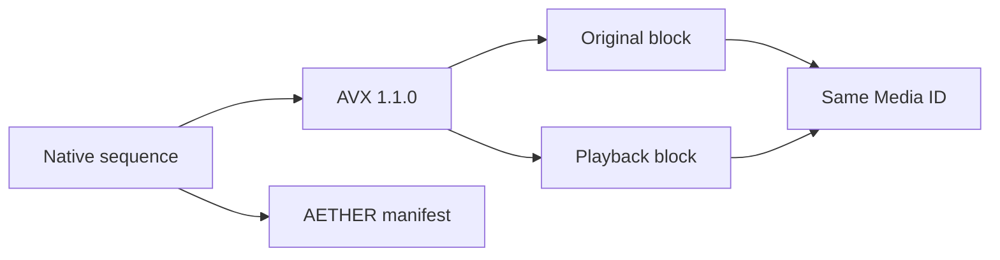

# AETHER AVX offline and online exchange

Status: proposal for review. Specification only. No `.avx.json` file was written or read. No other application is known to read AVX (`docs/AVX_FORMAT_SPECIFICATION.md`).

## Verified facts

- AVX 1.0.0 is specified as UTF-8 JSON, rationals as strings, media id plus checksum, and a loss report. Unknown newer versions are refused by older readers (`docs/AVX_FORMAT_SPECIFICATION.md`).
- The native project remains the authority. AVX is an exchange document (`docs/INTERCHANGE_ADAPTER_ARCHITECTURE.md`).
- This set needs AVX to describe both the playback representation and the original camera media, and to avoid writing a proxy filename as the camera original.

## Engineering recommendations

- Add an explicit original block and a playback block that share one Media ID.
- Propose the addition as AVX `1.1.0` so a 1.0.0 reader refuses it instead of ignoring original media. Adopting that version in the master AVX specification is architecture decision 15.
- Keep essence out of the JSON. Paths are hints. Checksums and the Media ID are the identity.

## Proposed behaviour

### Scope

This document is the offline/online profile for AVX. It does not replace `docs/AVX_FORMAT_SPECIFICATION.md`. It specifies the additional media object required for conform and relink. Tracks, effects, and preservation states remain as in the master AVX specification.

### Requirements

- A media entry carries `media_id` once.
- It carries `original` and `playback`.
- `original.role` is `original`. `playback.role` is `original`, `proxy`, `editorial_transcode`, or `consolidated`.
- When playback is a proxy or a transcode, `original.file_name` is the camera original’s historical filename. `playback.file_name` is the derivative’s filename. The two names may differ. The original block’s file name is never replaced by the proxy’s file name (integrity rule 11).
- Both blocks carry path hint, relative path, volume hint, checksum state, rate, duration in frames, start timecode, reel, roll, and clip id, each with availability.
- The package also contains the AETHER manifest fields required for foreign tools: filename, reel, roll, clip id, timecode, duration, rate, path, relative path, checksum. AVX is the structured copy of those fields for AETHER. The manifest is still written beside it because a non-AETHER tool will not read AVX.
- Path strategies, chosen per export and recorded in the file: `absolute`, `relative`, `volume_relative`, `roll_and_clip_id`, `media_id`, `consolidated`. One export uses one primary strategy and may include the others as hints.
- Speed maps are written in full (`SEQUENCE_SOURCE_MAPPING.md`). A loss is an entry in `loss_report`, not a rewritten map.
- Rationals are strings `"n/d"`.
- The export event is not a conform verdict. The package may include the latest conform report’s state as information, copied from a real run. If no run exists, the field is `not_run`.

### Data model

Illustrative. Not an exported sequence.

```json
{
  "avx": "1.1.0",
  "kind": "sequence",
  "illustrative": true,
  "media": [
    {
      "media_id": "00000000-0000-4000-8000-000000000001",
      "original": {
        "role": "original",
        "file_name": "A001C001.mov",
        "path_strategy": "media_id",
        "path_hint": "/volumes/cam/A001C001.mov",
        "relative_path": "cam/A001C001.mov",
        "checksum": { "algo": "sha256", "state": "pending", "value": null },
        "rate": "24/1",
        "duration_frames": 1000,
        "start_timecode": "01:00:00:00",
        "drop_frame": false,
        "reel": { "value": "A001", "availability": "present" },
        "clip_id": { "value": null, "availability": "absent" }
      },
      "playback": {
        "role": "proxy",
        "file_name": "A001C001.proxy.mov",
        "proxy_id": "00000000-0000-4000-8000-0000000000p1",
        "path_hint": "/volumes/proxy/A001C001.proxy.mov",
        "rate": "24/1",
        "validation_state": "passed"
      }
    }
  ],
  "loss_report": []
}
```

`proxy_id` in the playback block is the representation id. Readers must not bind a timeline instance’s source to `proxy_id`.



### APIs

| Operation | Contract |
| --- | --- |
| `AVX.exportOffline(sequence_id, strategy)` | Reads a snapshot. Writes JSON plus manifest plus compatibility notes. Does not modify the sequence. |
| `AVX.importOffline(document)` | Returns a proposed native document and a loss report. Application commits only after confirmation. |
| `AVX.bindMedia(entry)` | Uses match rules. The original block is the conform target. The playback block may satisfy a proxy location. |

Import refuses `avx` values it does not know. A 1.1.0 exporter is therefore invisible to a strict 1.0.0 reader, which is the master rule and the reason the version bump is explicit.

### Workflow

1. The user exports an offline package and chooses a path strategy.
2. The writer fills original from the registry’s original role and playback from the current passed selection.
3. If the original is offline, the original block still carries the last known hint, checksum state, and Media ID, and `online` is false. The export succeeds as a document. It does not claim `verified` conform.
4. On another AETHER workstation, import proposes instances. Relink runs if paths differ. Conform is a separate command.
5. A non-AETHER facility uses the manifest and whatever standard files the interchange set also wrote (AAF, OTIO, XML, or EDL). Those writers are specified in their own documents. They also receive the original filename, not the proxy filename, in the camera-original slot.

### Validation

- `original.media` identity and `playback` share `media_id`.
- `original.file_name` differs from a proxy file name when both exist and the proxy was not generated under the camera’s own name. If a preset happens to reuse the display name, the role fields still distinguish them, and the path hints must differ.
- `playback.validation_state` of `failed` is not written as the selected playback. The block is omitted or marked failed, and the loss report says playback was not included.
- Speed maps in the sequence half of the file match the native maps or appear in `loss_report`.
- `illustrative: true` is forbidden in a file the application writes for a user. It is allowed in this specification’s example only.

### Errors

| Error | File |
| --- | --- |
| Snapshot revision changed during write | Abort. No partial package is marked complete. |
| Original filename unknown and availability `unknown` | Write `availability: unknown`. Do not copy the proxy name into the gap. |
| Strategy `consolidated` with no consolidation record | Refuse that strategy and ask for another. |
| Import of 1.1.0 by a reader limited to 1.0.0 | Reader refuses the file. The specification accepts that outcome. |

### Recovery

A failed export leaves the project unchanged. A partial directory is deleted or marked `incomplete` in `EXCHANGE/AVX/`. The previous successful package, if any, stays. Re-export is safe because export does not mint Media IDs.

### Performance

Export streams JSON from the snapshot. It does not copy essence unless the user also asked for consolidation. No file size was measured. Checksums already stored are copied into the document. Pending checksums stay pending in the file.

### Tests

Test H, specified and not executed. Cases: playback proxy filename absent from `original.file_name`; shared Media ID; each path strategy named in the file; a ramp either present or listed in `loss_report`; version field `1.1.0`; import does not mark conform `verified`.

### Acceptance

- Original and playback are both specified.
- The proxy-as-original failure is a validation error.
- The document does not claim a second implementation of AVX.
- The version bump is identified as a decision the master AVX specification still has to adopt.

## Unresolved questions

- Decision 15: freeze 1.1.0 or fold fields into 1.0.0 before any real file exists. Recommendation: 1.1.0, because 1.0.0 readers are specified to refuse unknown versions rather than skip fields.
- Whether one AVX file may hold a whole feature with many reels. The master spec says one sequence per file in version 1, plus an index. This profile keeps that limit.
- Binary or XML projection. Still out of AVX version 1, per the master specification.
