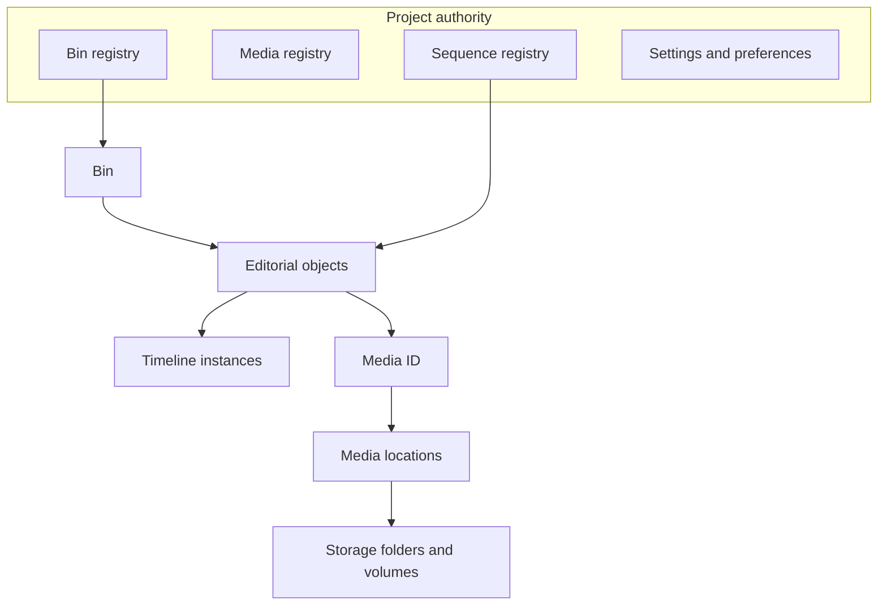
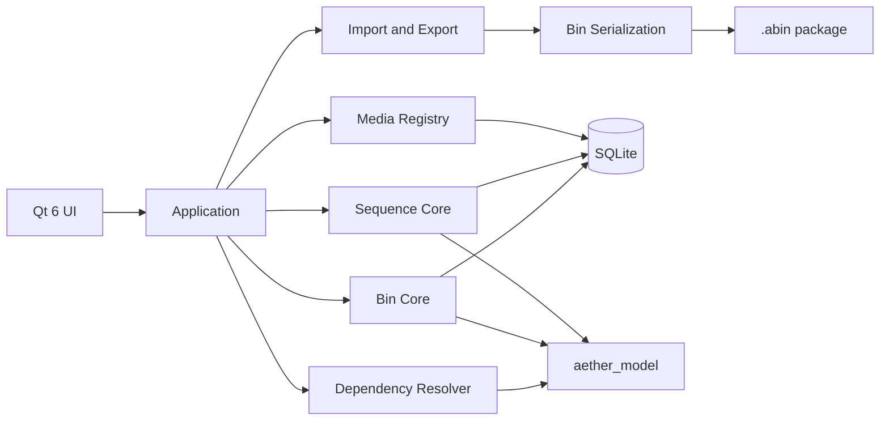

# AETHER bin architecture

Status: proposal for review. Documentation only. No bin code, package, database, or test was implemented. No test in this set was executed.

AETHER is the Society of Indian Screen Editors’ offline-first feature-film editor. The bin is the editorial container the cutting room works in. This document is the architecture of that container. The other twelve documents in this folder specify the data, lifecycle, package, import, sharing, dependencies, recovery, interface, database, media relationship, sequence integration, and tests.

## Purpose

Define how Project, Bin, and Storage Folder divide responsibility, how every other AETHER surface uses that division, and which package format a portable bin uses. Give engineering a single object model so the timeline never grows a second clip identity.

## Scope

In scope:

- Identity and authority of projects, bins, editorial objects, media, timeline instances, and files.
- Module boundaries for a C++ bin core, a Qt 6 user interface, a SQLite project database, and a portable `.abin` package.
- The behaviour Media Pool, Source Monitor, Timeline, Sequence Manager, Media Management, Search, Import/Export, and Collaboration must share.
- The choice between a SQLite package and a structured package.
- Implementation order after this documentation.
- Acceptance criteria 1–16.

Out of scope:

- Writing source, schemas as runnable migrations, or user-interface code.
- Changing `docs/PROJECT_ARCHITECTURE.md`, `docs/PROJECT_FOLDER_SPECIFICATION.md`, `docs/MEDIA_IDENTITY_AND_METADATA.md`, `docs/TIMELINE_ENGINE_ARCHITECTURE.md`, or any other existing master file.
- Avid source, Avid internals, and Avid screen layout. The workflow of a named bin that holds clips and sequences is the inspiration. The design below is AETHER’s.
- Multi-writer collaboration in the first release. The hooks are specified. The feature is later.

## Requirements

1. Project, Bin, and Storage Folder are three different things. A directory is a storage folder. A bin has a bin id and membership. Creating a directory does not create a bin. Creating a bin does not require a particular directory to exist.
2. A bin stores editorial objects and relationships. It does not store media bytes and it does not perform filesystem operations on media.
3. Every editorial object has a persistent object id. A media path is never that id. A display name is never that id.
4. While a project is open, the project is the authority for project id, project metadata, project settings, the bin registry, the media registry, the sequence registry, relationships, storage roles, dependencies, preferences, revision, and recovery.
5. A bin package can be imported into another project when the source project is absent. The project database is the working store. It is not the only store.
6. Bins reference media ids. Media management owns registration, ingest, paths, volumes, proxies, transcodes, checksums, duplicates, relink, consolidate, verify, and missing media.
7. Ingest of one camera original creates one media id and one master clip, which any number of subclips, selects, and timeline instances may cite. An explicit duplicate may add another object that keeps that media id. A proxy or a transcode hangs off that media id. It is a representation of the same asset, not a second source.
8. A sequence is a bin object. The timeline edits that object. Saving the sequence updates the object, its revision, its dependency edges, and recovery. The timeline does not read or write media paths.
9. Move, reference, duplicate, and delete follow `BIN_OBJECT_LIFECYCLE.md`. Delete from a bin leaves media in place. Deleting a bin leaves media in place and leaves objects that are still referenced elsewhere in place.
10. Import, share, and recovery never treat a partial or unverified result as success, and never drop editorial data because a build does not understand it.
11. The bin core links neither Qt nor FFmpeg nor GStreamer. Tests exercise it without the desktop application.
12. The first release assumes more than one workstation can hold a copy. It allows one writer for a given bin. It does not assume a single machine is the world.

## Verified facts

- The product vision in `docs/PRODUCT_VISION.md` defines AETHER as an offline-first SISE feature-film editor. No network, account, or activation is required to open and cut.
- `docs/PROJECT_ARCHITECTURE.md` gives a project a permanent project id independent of the folder name, and names SQLite as the candidate working database (`project.db`) with `project_manifest.json` as a cross-check.
- `docs/PROJECT_FOLDER_SPECIFICATION.md` specifies the project tree and calls bins views. It does not list `BINS/` or `LOGS/BIN_OPERATIONS`. This document set does not edit that file. The bin model below is the proposed amendment.
- `docs/MEDIA_MANAGEMENT_PHILOSOPHY.md` tells media management to keep virtual bins as queries and forbids silent moves and deletes of originals.
- `docs/MEDIA_IDENTITY_AND_METADATA.md` defines a permanent media id that survives filename and path changes. A proxy is a representation of that same Media ID (ADR-005). It does not receive a second media id.
- `docs/TIMELINE_ENGINE_ARCHITECTURE.md` stores rational time, identifies a sequence by `sequence_id`, and identifies a timeline clip by `clip_id` carrying a `media_id`. No path is part of that clip.
- `docs/SYSTEM_ARCHITECTURE.md` separates the editorial model, media management, and infrastructure. Qt stays in the user interface. Codec libraries stay in processing. The product-level choice of C++ and Qt 6 is still marked unresolved there. This bin design specifies C++ and Qt 6 because the bin assignment fixes that stack for this subsystem.
- No AETHER bin implementation was available to inspect. No package was written. No test was run.

## Engineering recommendations

- Keep plain data structures in a small C++ library, `aether_model`, with no SQLite, no Qt, and no codec types. Bin core, sequence core, the dependency resolver, and the serializer share those structs and do not call each other.
- Let the application be the only joiner. It asks the bin core for objects, the media registry for locations, and the sequence core for timeline mathematics.
- Use the project SQLite database as the working index. Use the `.abin` package as the portable checkpoint and the share unit. Do not query the package for every keystroke.
- Treat a saved search as a Filter. A Filter is a stored query over objects. It is not a Bin and it has no membership of its own.
- Record bin operations in the database. Also append a human-readable line under `LOGS/BIN_OPERATIONS/`. The log is an aid. The database history is the record.
- Prefer SHA-256, named in the manifest, for package member hashes.

## Proposed behaviour

### Three things

| Thing | What it is | Identity | What it holds |
| --- | --- | --- | --- |
| Project | The open cutting-room authority | Project id | Registries, settings, preferences, storage roles, revision, recovery |
| Bin | A portable set of editorial objects and relationships | Bin id | Master clips, subclips, sequences, and the other object types below |
| Storage folder | A directory on a volume | Path plus volume id | Files. Originals, proxies, cache, exports, or the optional place a package file is saved |

A folder named `DAY_01` is a storage folder. A bin named `DAY_01` is a bin. They may be created together as a convenience and they remain different if one is renamed.



### What a bin holds

Object types, each with its own fields in `BIN_DATA_MODEL.md`:

| Type | Role |
| --- | --- |
| `master_clip` | The editorial object for one media id. Essence kind is picture, sound, picture and sound, still, or graphic |
| `subclip` | Own object id, parent master, source in and out. A select is a subclip the editor marked as a select |
| `sequence` | First-class bin object. Rational timebase, raster, audio configuration, tracks, instances, transitions, effects, automation, markers |
| `group_clip` | Members with sync offsets. Members keep their own object ids |
| `multicam_clip` | Angles. Each angle is an object id plus an offset |
| `sync_clip` | Picture and sound object ids bound by an offset |
| `title` | Generator parameters and an optional rendered media id |
| `effect_clip` | A reusable effect definition with typed parameters |
| `generated_media_ref` | Points at a generated media id and at the objects that produced it |

Future types are allowed. A file names the types it supports. A type it does not support is reported and retained, as `BIN_FILE_FORMAT_SPECIFICATION.md` requires.

### Identity

Five identities stay distinct. The database document defines the keys. The rule is:

| Identity | Changes when |
| --- | --- |
| Object id | The object is duplicated or newly created. Rename, move, relink, and metadata edits keep it |
| Bin membership | The object is moved, referenced, or removed from a bin. Membership is not the object |
| Media id | Media management registers a logical asset once. A path change keeps it. A proxy receives a Representation ID and cites this Media ID. It does not receive its own media id |
| Timeline instance id | A placement is created on a sequence. The same object on two sequences has two instance ids. This is the timeline specification’s clip id |
| Physical file | The bytes live at a path on a volume. Relink updates location rows |

### How the rest of AETHER uses the model

| Surface | Uses | Leaves alone |
| --- | --- | --- |
| Media Pool | Bins, filters, object ids, media ids, availability | Paths as identity; creating a bin from a dropped folder |
| Source Monitor | The open object id, its source range, the media id | A private clip record |
| Timeline | Instances that cite object id and media id | Filesystem paths; a second clip-identity table |
| Sequence Manager | Sequence object ids registered in the project | A sequence that exists only inside a timeline document |
| Media Management | Media ids cited by objects | Bin membership and editorial names as file operations |
| Search | Indexed object, metadata, and media-id fields | A private catalogue |
| Import/Export | Packages, object ids, media ids, reports | Name-matched replacement |
| Collaboration, later | Bin id, revision id, lock owner | Simultaneous writers of one package |

Resolution of a picture or a sample goes through media management. The application asks for a location by media id and a quality policy (`master`, `proxy_if_available`). If the file has moved and relink has written the new location, bins and sequences open because they still hold the same ids.

### Default directories

These directories are added to the project tree as organisation. They are not a required physical layout. Originals, proxies, cache, and exports may live on other volumes, as the folder specification already allows. The bin registry does not read the bin id from the path.

```text
ProjectRoot/
  BINS/
    MASTER/
    DAY_01/
    DAY_02/
    SOUND/
    MUSIC/
    SELECTS/
    SEQUENCES/
    IMPORTED/
  LOGS/
    BIN_OPERATIONS/
```

The default checkpoint path for a bin is `BINS/<safe-display-name>/<safe-display-name>.abin`. `safe-display-name` is a filesystem-safe rendering of the display name. The registry stores that path as a hint. A different path, or a missing file, does not change the bin id.

### Package choice

Two options were judged for the `.abin` itself.

| Criterion | Option A. SQLite file as the package | Option B. Structured package |
| --- | --- | --- |
| Integrity | Transactions and a rollback journal | Member hashes in a manifest, plus an atomic file replace |
| Portability | One file. A reader needs SQLite | One ZIP of versioned documents. A reader needs the public schema |
| Performance | Strong if the package is queried in place | Strong once imported into the project database. The package is streamed in and out |
| Concurrent access | One writer and several readers. WAL on shared film servers is a known hazard | One writer by lock. Readers take a copy or a read-only snapshot. The format has no live multi-writer mode |
| Revisions | Page-level binary history | A revision document and hashed members |
| Atomic saves | The database commit | Write a temporary file on the same volume, fsync, verify, rename |
| Recovery | `integrity_check`. A torn commit usually rolls back | The previous package remains until rename succeeds. Member hashes locate damage |
| Long-term compatibility | The SQLite file format is stable. An undocumented table set still becomes an application dump | Format version, schema version, and a published member list |
| Future collaboration | A shared SQLite file invites two writers | Exchange of packages, with lock and revision id, matches one-writer bins |
| Separation from the project | Only if a second schema is policed forever | The package cannot be a dump of project tables, because it has a different shape |

**Choice: Option B.** The `.abin` is a versioned ZIP of UTF-8 JSON members with a public schema, specified in `BIN_FILE_FORMAT_SPECIFICATION.md`. SQLite remains the project working database. Opening a bin for editing loads it into that database. Saving writes a new package and records the package hash in the same revision. The package is valid without the project. The project is valid when a checkpoint package is missing, and it reports that the portable copy is missing.

Option A is rejected for the package. A second SQLite file drifts into a dump of whatever tables the application had open, and it is too easy to place on a server and open from two workstations. SQLite is the right working store and the wrong interchange file.

### Modules

| Interface | Module | May use | Must not use |
| --- | --- | --- | --- |
| Bin Core | `aether_bin` | `aether_model`, `aether_db`, platform | Qt, FFmpeg, GStreamer, file moves of media |
| Project Core | application façade over `aether_db` | Registries | Codec calls |
| Media Registry | `aether_media` | `aether_db`, filesystem, jobs | Bin membership edits, timeline commands |
| Sequence/Timeline Core | `aether_editorial` | `aether_model`, `aether_db`, platform | Qt, codecs, paths |
| Dependency Resolver | `aether_depend` | `aether_model` | Filesystem copies, Qt |
| Bin Serialization | `aether_abin` | `aether_model`, filesystem | Qt, codecs, project-table dumps |
| Import/Export | application use case | Serialization, bin core, media registry, resolver | Silent partial success |
| UI | `aether_ui` in Qt 6 | Application commands | Direct SQL, direct codec calls |

`aether_bin`, `aether_editorial`, `aether_depend`, and `aether_abin` are testable in a process that never starts Qt.



### Authority when the two stores disagree

While a project is open, the database is the working authority and the package is a checkpoint. On open, the recorded package hash is compared with the file. A mismatch is a conflict report. The application does not pick a winner silently.

A package imported into a project that does not already contain that bin id is the source of that import. The import is one transaction.

A package alone, with no project, is a complete editorial bin for the objects it contains. The supported first-release way to work on it is to import it into a project. The serializer can still read it in tests with no user interface.

### Revision and writers

The first release writes a bin from one holder. A lock names the station and the process. A second writer is refused. A stale lock is shown and is cleared only after a person confirms that the holder is gone. Collaboration features that are specified and not in the first release: editable versus read-only handover, concurrent-edit detection across workstations, conflict resolution, and change history beyond the local revision chain. Schema columns for lock owner and revision id exist so those features do not require a new identity model.

### Implementation order

This documentation is the current step. Implementation is later, in this order:

| Phase | Builds | Leaves for later |
| --- | --- | --- |
| 1 | Identifiers, registries, master clip, subclip, schema, migrations. Core tests without Qt | Packages, UI |
| 2 | Create, open, close, rename, move, reference, duplicate, delete, metadata | Sequence body |
| 3 | Sequence as a bin object. Timeline instances cite object id and media id. Save updates revision and dependencies | Sharing |
| 4 | `.abin` writer and reader, atomic replace, compatibility header, opaque retention | Media bytes |
| 5 | Transactional import and export, dependency closure, share folders, relink handoff | Collaboration |
| 6 | Autosave, crash recovery, import rollback, backup classes, single-writer lock | Multi-writer |
| 7 | Qt 6 bin UI, virtualized views, search index, asynchronous thumbnails | Remote collaboration |

### Data structures

The canonical structs live in `BIN_DATA_MODEL.md` and the tables in `BIN_DATABASE_SCHEMA.md`. The architecture-level objects are Project, Bin, EditorialObject, BinMembership, MediaId, TimelineInstance, and StorageLocation.

### Interfaces

Operations return a status, a value, and a report. They do not throw across the module boundary. The report lists conflicts, missing media, unsupported types, and warnings. An empty report with a success status means the operation finished and verified.

Command names the UI eventually calls, specified here so the core can exist first:

| Command | Core |
| --- | --- |
| `bin.create`, `bin.open`, `bin.close`, `bin.rename` | Bin |
| `bin.moveObjects`, `bin.referenceObjects`, `bin.duplicateObjects`, `bin.removeObjects` | Bin |
| `bin.delete` | Bin, with reference checks |
| `sequence.save` | Sequence core, then bin revision |
| `package.export`, `package.import` | Import/Export |
| `media.relink`, `media.deletePhysical` | Media registry |

### Operations

Creating a project creates the registries and the organisational directories, including empty `BINS/` children and `LOGS/BIN_OPERATIONS/`. It creates one empty sequence bin object, consistent with the project architecture’s initial sequence. It does not copy media.

Creating a bin allocates a bin id, a revision, and a registry row, then writes the first package on the first successful save. Importing a package is specified in `BIN_IMPORT_EXPORT_SPECIFICATION.md`.

### Failure scenarios

| Failure | Result |
| --- | --- |
| Process dies during package rename | The previous package is still the file at the checkpoint path, or the new file is complete. A half-written temporary file is ignored |
| Process dies during a database transaction | SQLite rolls the transaction back |
| Database revision and package hash disagree on open | Conflict report. No silent overwrite |
| Disk full | The operation fails. The previous revision stays current |
| Two processes save one bin | The second fails to take the write lock |
| Drop a folder on the bin view | Import of media into a chosen bin. A bin is not created from the folder |
| Unsupported object in a newer package | Report, and either retain opaquely with explicit acceptance or roll back |
| Delete a bin that holds a sequence used as a nest | The sequence object remains because it is referenced. The bin membership ends |

### Recovery

Project backup, bin revision, database backup, media backup, and cache are separate. Cache holds thumbnails, waveforms, and the search index. Deleting cache rebuilds those aids. Editorial objects remain in the database and in the latest good package. Recovery steps are in `BIN_REVISION_AND_RECOVERY.md`.

### Performance

The design target, not a measurement, is a bin of 10,000 objects and a project of 50,000 objects. List views request a window. Search uses a derived index. Thumbnails are asynchronous. Package read and write stream one member at a time. Dependency closure uses indexes on object id and media id. No operation copies media bytes unless the user started a media-management command.

### Compatibility

Every package and every share manifest states format version, schema version, minimum AETHER version, originating AETHER version, supported object types, unsupported object types, and required dependencies. A newer feature an older build cannot apply is reported. Editorial bytes are retained or the whole import is refused. They are not discarded quietly. Details are in the file-format specification.

### Sample structure

A bin registry row and the checkpoint it points at:

```json
{
  "bin_id": "bin_3b1c0d01-7a10-4e21-9c01-d0a100000001",
  "display_name": "DAY_01",
  "origin_project_id": "prj_8f1c2a40-6b0e-4a1d-9c33-0a11b2c3d4e5",
  "parent_bin_id": null,
  "revision_id": "rev_10000000-0000-4000-8000-000000000001",
  "package_path_hint": "BINS/DAY_01/DAY_01.abin",
  "package_hash": "sha256:pending-until-first-save",
  "schema_version": 1
}
```

The path hint is organisation. `bin_id` is the bin.

## Rationale

| Decision | Rationale |
| --- | --- |
| Three-way split | Folders, clips, and projects get mixed in cutting rooms and then media moves when a bin is renamed. Separate identities make rename, relink, and share ordinary |
| Project authority while open | One working store has to own transactions, search, and recovery. A package cannot be that store and also be safe on a file server |
| Option B package | Long-term reading and an explicit public contract matter for a film archive. The working database already provides SQL |
| Sequence is a bin object | Sequence Manager and the timeline then share the registry instead of keeping a private sequence list |
| Instance cites object and media | The timeline specification already stores a media id on the clip. Adding the object id joins that clip to the bin without a second model |
| Core free of Qt and codecs | The assignment requires tests without the desktop application. Codec types in the bin header would make that impossible |
| Filters are not bins | Saved searches are useful and they must not become a second membership model |

## Acceptance criteria

These are specified. They are not executed.

1. A storage folder, a bin, and a project can be identified separately in the model. A folder path is never accepted as a bin id.
2. Every editorial object the bin stores has an object id. No object uses a media path or a display name as its identity.
3. With a project open, bin, media, and sequence registries, relationships, storage roles, dependencies, preferences, and revisions are read and written through the project authority.
4. A `.abin` written in one project imports into a second project when the first project is not present. Object ids that do not collide are preserved.
5. A bin operation never creates, moves, renames, or deletes a media file. Media commands do those jobs and are separate.
6. Ingest and import create one master clip for a media id. Many subclips and timeline instances may cite it. A proxy media id is linked to that media id and does not itself create a master clip. An explicit duplicate may create a further master that keeps the media id.
7. Renaming a subclip leaves the parent object id, the media id, and the file unchanged.
8. A sequence save updates that sequence’s object, revision, and dependency edges. The stored instance contains an object id and a media id and contains no filesystem path.
9. Move keeps the object id and the media id and changes membership. Duplicate creates a new object id, keeps the media id, copies metadata, and does not copy the file. A duplicated sequence has a new object id and its own timeline state.
10. Removing an object from a bin leaves the media file in place. Deleting a bin leaves media files in place and leaves objects that still have another membership or a dependency in place.
11. Import matches media by media id. An equal display name does not replace an existing object. The import is one transaction. Missing media, incompatible objects, and id conflicts appear in the report.
12. A package header carries format version, schema version, minimum AETHER version, originating version, supported types, unsupported types, and required dependencies. An older build reports types it cannot apply and either retains them with an explicit acceptance or rolls the import back.
13. Share computes the dependency closure. Editorial-only, dependency-package, and reference-only modes are distinct. A package whose manifest lists a missing file is a failed package.
14. After a file moves and media management relinks it, the media id is unchanged and the bin and the sequence resolve through the new location.
15. An interrupted save or import leaves the last good bin readable. Deleting cache leaves editorial data in the database and in the last good package. Project backup, bin revision, database backup, media backup, and cache are separate stores.
16. Media Pool, Source Monitor, Timeline, Sequence Manager, Media Management, Search, Import/Export, and the collaboration hooks read and write this model. The timeline has one instance identity. Bin core tests run without Qt, FFmpeg, and GStreamer.

## Unresolved decisions

The package approach is decided: Option B, with SQLite as the project working store. The following are not decided. Recommendations are recommendations.

1. UUID version and spelling. Recommendation: UUID version 4, stored as a type prefix, an underscore, and the canonical lowercase UUID (`bin_`, `obj_`, `med_`, `inst_`, `prj_`, `rev_`). The prefix is checked against the record kind.
2. How often a dirty bin rewrites its `.abin`. Recommendation: the database autosaves continuously; the package is rewritten on explicit save and on a checkpoint interval. The interval is unset.
3. ZIP method. Recommendation: store (method 0) in format version 1, so recovery does not depend on a deflate stream.
4. Canonical JSON used for member hashes. Recommendation: UTF-8, Unicode NFC, object keys sorted lexicographically, no insignificant whitespace, rationals as strings `n/d`.
5. Default handle length for a consolidated share. Recommendation: the dialog requires a value. It may show 48 frames at the source rate as a suggestion. Success without a confirmed value is forbidden.
6. Scale numbers. Recommendation: design for 10,000 objects in one bin and 50,000 in one project. These are not measurements.
7. Search index implementation. Recommendation: SQLite FTS5, derived, rebuildable, and never the only copy of a name or a comment.
8. What display state travels in the package. Recommendation: view mode, column order, column widths, sort, and saved filters travel. Scroll position and selection stay on the workstation.
9. Bin parent depth. Recommendation: `parent_bin_id` with a limit of 16, aligned in magnitude with the timeline nest limit. The number 16 is open.
10. Public name of a timeline instance. Recommendation: the column is `instance_id`. The timeline API may keep the name `clip_id` for the same value until `docs/TIMELINE_ENGINE_ARCHITECTURE.md` is revised. This set does not revise it.
11. Amendment of the existing folder specification and of the sentences that call bins views. This set defines a Bin as membership and a Filter as a saved query. The older files are unchanged until a later edit.
12. Transport for later collaboration. The first release is a local single writer and package exchange. A shared service, a lock file on a file server, or package-only exchange is open.
13. Exploded directories as legal packages. Recommendation: only the ZIP `.abin` is interchangeable. An exploded tree is a debug dump and fails import.
14. Same media id arriving with a different checksum. Recommendation: do not merge the media rows. Import the editorial objects, mark those references unresolved, and require an explicit relink choice.
15. How package-asserted technical metadata is shown before a local probe. Recommendation: show it with an unverified label. The media registry replaces it when a probe completes.
16. Station identity for locks. Recommendation: a station name the user sets in preferences. No account system.
17. Thumbnail bytes inside the package. Recommendation: optional JPEG companions under `thumbnails/`, listed in the manifest. A missing thumbnail still opens the bin.
18. Size quota for opaque unsupported payloads. Recommendation: format version 1 retains and reports them with no silent cutoff. A product quota is open.
19. Last membership removed. Recommendation: the object stays in the project, unassigned, until an explicit delete of an unassigned object. That delete still leaves media bytes alone. A remaining dependency blocks the delete.
20. Hash agility. Recommendation: SHA-256 in format version 1, with the algorithm name stored beside the digest.
21. C++ standard for the core. The language is C++. Recommendation: C++20. `docs/SYSTEM_ARCHITECTURE.md` still lists the language as a product-level open point.
22. Standalone package viewer outside a project. Recommendation: first release imports into a project. The reader library still runs in tests without a project window.
