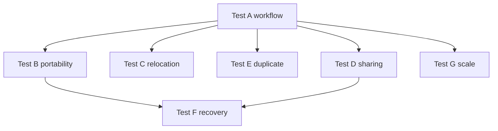

# AETHER bin architecture test plan

Status: specified, not executed. No test in this plan was run. No fixture was created. When implementation exists, these tests are the acceptance suite for the bin model. Until then they are a specification of the suite.

## Purpose

Define the tests that prove the bin architecture: basic editorial workflow, portability, media relocation, sequence sharing, copy versus duplicate, failure recovery, and scale. Map them to acceptance criteria 1–16.

## Scope

In scope: tests A through G from the bin assignment, the conditions under which each passes, and the harness boundaries.

Out of scope: running the tests, performance numbers, and codec conformance. A test that needs a picture uses a tiny generated file or a fake media registry. It does not need a camera original to prove identity rules.

## Requirements

- Tests A through G are named and specified below. Each is marked specified, not executed.
- Domain tests run without Qt, without FFmpeg, and without GStreamer.
- UI tests, when a UI exists, drive commands. They do not assert on another product’s pixels.
- A test that deletes or moves a file uses a temporary directory. It never uses a project’s only copy of a real original. This plan uses synthetic files only.
- Partial success is a failed test. A share or an import that returns success with a missing listed file fails the assertion.
- Tests do not weaken a check to make a run pass. A mismatch is a product defect or a specification defect, and the specification is the one in this folder.

## Verified facts

- No AETHER bin module exists in this workspace to link against.
- The acceptance criteria in `BIN_ARCHITECTURE.md` are the product checks. This plan does not replace them with a smaller set.
- The timeline specification already requires tests of editorial operations without a window. Sequence tests here stay inside that rule.

## Engineering recommendations

- Build the harness as ordinary test binaries over `aether_model`, `aether_bin`, `aether_editorial`, `aether_depend`, `aether_abin`, and a filesystem double.
- Inject crashes with a writer double that stops at named steps: after database commit, during partial write, after rename, before revision insert, during import commit. The double is a test tool.
- Use deterministic UUIDs in fixtures so reports diff cleanly. Production code continues to mint random UUID version 4 values. The core accepts ids the caller provides in tests.
- Record, next to each future run, the build identity and the word `executed`. This document’s status stays `specified` until those runs exist. Do not edit this plan’s status in advance of a run.

## Proposed behaviour

### Harness

| Layer | Tests use |
| --- | --- |
| Model and resolver | In-memory structs |
| Database | Temporary SQLite file with foreign keys on |
| Package | Temporary directory |
| Media | A fake registry plus a few small files when byte checksums matter |
| UI | Later, command invocations. Not required for A through F except where a rule is about a dialog choice, which the test supplies as a choice structure |
| Scale | A generated bin of synthetic rows. No requirement to decode frames for the index test |

Pass means every assertion in the test holds. Fail means any assertion does not hold, or the operation returns success when the specification says it must fail.

### Test A. Basic workflow

Status: specified, not executed.

Purpose: create a project, a bin, a master, a subclip, and a sequence, and edit without touching media bytes.

Steps:

1. Create a project. Assert a project id, a bin registry, a media registry, and one empty sequence object. Assert `BINS/` exists as directories and that no directory path equals a bin id.
2. Create a bin `DAY_01`. Assert a bin id distinct from the path hint.
3. Register a synthetic media file through the media interface. Create a master in `DAY_01`. Assert one media id, one master object id, and a checksum unchanged by the create.
4. Rename the master. Assert the object id and media id are unchanged.
5. Create a select subclip with its own object id and a source range. Rename the subclip. Assert the parent object id, the parent name, the media id, and the file bytes are unchanged.
6. Edit the sequence by inserting the subclip. Assert the instance `source_object_id` and `media_id`, and assert the instance record has no path field.
7. Save. Assert the sequence revision incremented and the dependency closure contains the subclip, the master, and the media id.
8. Remove the master from the bin while the instance remains. Assert the file remains and the object remains because it is referenced.

Maps to acceptance criteria 1, 2, 3, 5, 6, 7, 8, 10, and 16.

### Test B. Portability

Status: specified, not executed.

Purpose: a bin moves to another project without the source project.

Steps:

1. From the project in test A, export an editorial-only `.abin`. Assert the header contains format version, schema version, minimum version, originating version, supported types, unsupported types, and required dependencies.
2. Delete or never copy `project.db` to the destination. Create a new project.
3. Import the package. Assert the same bin id, object ids, and media ids. Assert media is unresolved or blocked, not online, if the file was not copied.
4. Create a local object whose display name equals the imported master and whose object id differs. Import again. Assert the local object’s fields are unchanged.
5. Introduce an object-id collision with a different comment. Choose `keep_destination`. Assert the destination comment remains. Choose `duplicate_incoming` on a second fixture. Assert a new object id and a map in the report.
6. Corrupt one byte of the package. Assert import fails and the destination object count is unchanged.
7. Assert the package is a ZIP with format `aether-abin`, not a SQLite dump of `project.db`.

Maps to acceptance criteria 4, 11, and 12.

### Test C. Media relocation

Status: specified, not executed.

Purpose: a moved file does not change identity.

Steps:

1. Move the synthetic file to a new path. Assert the bin and the sequence still open and the media status is offline. Assert object id, media id, and instance id are unchanged.
2. Relink to the new path. Assert the location row changed and the three ids did not. Assert playback resolution, through the fake locator, returns the new path.
3. Offer a second file with the same filename and a different checksum. Assert the bind is refused and the master still cites the original media id.
4. Register a proxy under a new media id linked to the original. Assert the master still cites the original. Assert a quality policy can return the proxy location.
5. Delete the proxy. Assert the original file remains and the instance media id is the original.
6. Assert no bin operation in the log performed a filesystem move.

Maps to acceptance criteria 6, 14, and 5.

### Test D. Sequence sharing

Status: specified, not executed.

Purpose: a shared sequence carries its closure and rejects a partial folder.

Steps:

1. Build a sequence that uses a subclip, a nest, a multicam with two angles, a graphic, and an unknown effect type.
2. Export `editorial_only`. Assert the closure lists those objects and media ids. Assert no essence file is in the share. Assert the unknown effect is classified and its parameters are in the package.
3. Export `reference_only`. Assert ready-state `offline_reference` on import and assert no essence copy.
4. Export `dependency_package` with a confirmed handle length. Assert consolidated files are listed with checksums. Assert the source file is unchanged. Assert the manifest `complete` flag is true.
5. Delete one listed file from the folder. Assert validation fails and import creates no rows.
6. Set `complete` to false. Assert validation fails.
7. Add an unlisted file. Assert validation fails.
8. Include a reference video. Assert timeline instances still cite the original media ids.
9. Import the valid editorial package into a second project. Assert the nest child object id survived.

Maps to acceptance criteria 8, 12, and 13.

### Test E. Copy versus duplicate

Status: specified, not executed.

Purpose: reference, duplicate, and move are different.

Steps:

1. Reference a master into a second bin. Edit the comment. Assert both memberships show the new comment and one object id.
2. Duplicate the master. Assert a new object id, the same media id, copied metadata, and a file size unchanged. Edit the duplicate’s comment. Assert the original comment is unchanged.
3. Duplicate a sequence that has two instances and a nest. Assert a new sequence object id, new instance ids, the same media ids, and the same child sequence id. Run deep duplicate. Assert the child sequence object id changes only in the deep result.
4. Move the original master to a third bin. Assert the object id, metadata, and media id remain, the resident membership changes, and the sequence instance still cites the object id.
5. Assert there is no successful core call named `copy` that completes without a choice of reference or duplicate.
6. Remove the object from one bin. Assert the other memberships and the file remain.

Maps to acceptance criteria 9 and 10.

### Test F. Failure recovery

Status: specified, not executed.

Purpose: interrupted save and import do not corrupt a bin, and cache is not a backup.

Steps:

1. Save once. Record the package hash.
2. Start a second save and stop the writer during the partial write. Assert the published hash is unchanged and the bin loads.
3. Stop the writer after a verified rename and before the revision insert. Assert open produces a mismatch report and does not enter a normal writable session until a choice is made. Assert both the old revision and the new file are still readable.
4. Start an import and stop the writer inside the database transaction. Assert the destination counts match the pre-import counts.
5. Delete thumbnails and the search index. Assert names, comments, memberships, and instances remain. Rebuild the index. Assert search finds the master.
6. Assert the recovery report names project backup, bin revision, database backup, media backup, and cache as separate stores.
7. Restore an older revision. Assert a new revision id whose content hash equals the old package, and assert the old package file still exists.
8. Attempt a save without the write lock. Assert refusal.
9. Feed a package with an unknown object type. Decline retention. Assert rollback. Accept retention on a fresh project. Assert a later export contains the payload.

Maps to acceptance criteria 12 and 15.

### Test G. Scale

Status: specified, not executed.

Purpose: the design target is an engineering test, not a marketing number. The target is 10,000 objects in one bin and a sequence window query that does not require loading every instance to paint a bin list.

Steps:

1. Generate 10,000 master rows and memberships in one bin, citing a small set of media ids. Assert the bin list query for a window of 100 rows returns 100 headers and does not require loading timeline instance bodies.
2. Change a filter. Assert the query uses the index plan that the database test prints for `display_name` or the chosen column. The assertion is “the planned index is used”, not a millisecond budget. A millisecond budget is unresolved until a machine is chosen.
3. Generate a sequence with 2,000 instances. Assert a range query for a visible window returns only the overlapping instances.
4. Run a dependency closure on that sequence. Assert it finishes in the test process without starting Qt, and that the result contains each cited media id once.
5. Write and read the `.abin`. Assert member hashes validate. This test may be slow. It has no pass threshold in milliseconds in this plan.
6. Repeat the window query with the search index dropped. Assert results are marked rebuilding or that the fallback scan still returns correct ids. Correctness is the assertion.

Maps to acceptance criteria 16 and to the performance sections of the UI, database, and architecture documents. It does not claim a frame rate.

### Criteria coverage

| Criterion | Tests |
| --- | --- |
| 1 Project, bin, and folder are distinct | A |
| 2 Object id, not path or name | A, B |
| 3 Project authority | A |
| 4 Import without the source project | B |
| 5 Bins do not touch media files | A, C, E |
| 6 One original, many descendants, proxy link | A, C |
| 7 Subclip rename | A |
| 8 Sequence save and instance identity | A, D |
| 9 Move, reference, duplicate | E |
| 10 Delete leaves media and shared objects | A, E |
| 11 Import matching and transactions | B, F |
| 12 Version header and retention | B, D, F |
| 13 Share closure and partial failure | D |
| 14 Relink keeps media id | C |
| 15 Recovery and backup classes | F |
| 16 One model, core without the desktop app | A, G, and the harness rule for every test |

### Interfaces under test

The public functions named in the other documents are the test surface: bin commands, `abin.read` and `abin.write`, `import.validate` and `import.commit`, `share.validate`, `depend.project` and `depend.inverse`, `revision.save` and `recovery.open`, `media.locate` and `media.deletePhysical`, `sequence.apply` and `sequence.save`.

A test that reaches into a private widget or a private SQL string is not a substitute. Schema tests may use SQL to assert foreign keys, because the schema is a public contract.

### Failure scenarios the suite must include

Each letter already contains its negative cases. The suite fails if any of these are skipped:

- Success returned for a share with `complete: false`.
- Success returned for an import when a member hash mismatches.
- A display-name match overwriting an object.
- A bin delete or a membership remove deleting a media file.
- A timeline instance gaining a path field.
- A proxy id replacing the master’s media id.
- A crash step leaving a bin that opens writable and silent about a mismatch.
- Cache deletion removing a comment or an instance.

### Recovery checks

Test F is the recovery specification in executable form. Additional assertion for every test: the fixture’s temporary directory is the only disk the test may delete, and the teardown checks that the synthetic original still exists unless the test was the physical-delete test, which uses its own file and still does not call physical delete from `bin.removeObjects`.

### Performance checks

Test G is the only scale test. It asserts query shape and correctness at the design target. It does not record a pass as a speed claim. A later plan may add budgets after a measurement on a named machine. That measurement is not this document.

### Compatibility checks

Included in B, D, and F:

- Header fields present.
- Unknown object type retained only after acceptance, and round-tripped.
- Unknown object type declined means no commit.
- Effect parameters of an unknown type survive sequence save and editorial export.
- A newer format version is refused without modifying the destination.

### Sample fixture

The smallest A/B/C fixture, illustrated so future authors do not invent a second id scheme:

```json
{
  "project_id": "prj_8f1c2a40-6b0e-4a1d-9c33-0a11b2c3d4e5",
  "bin_id": "bin_3b1c0d01-7a10-4e21-9c01-d0a100000001",
  "master_object_id": "obj_4c2e8a10-22b1-4f03-9d55-18e0a77c0101",
  "subclip_object_id": "obj_4c2e8a10-22b1-4f03-9d55-18e0a77c0102",
  "sequence_object_id": "obj_4c2e8a10-22b1-4f03-9d55-18e0a77c0901",
  "instance_id": "inst_77c0aa01-88d2-4c19-b001-09aa77110001",
  "media_id": "med_6f0e2c44-91ab-4d10-8e77-2a9c0b11d001",
  "proxy_media_id": "med_6f0e2c44-91ab-4d10-8e77-2a9c0b11d002"
}
```

### Diagram



Tests may share a fixture builder. They do not share mutable state. Each test gets a new temporary project.

## Rationale

| Decision | Rationale |
| --- | --- |
| Specified before any run | The assignment asks for the plan now and for implementation later. Marking a test executed would be false |
| Fake media registry | Identity rules are about ids. A codec in the loop would make the bin suite depend on FFmpeg, which the core is not allowed to do |
| Crash doubles | Pulling the power cord is not repeatable. Named stop points are |
| No millisecond gate in test G | A number from an unspecified machine becomes a false specification. Index use and correctness are the gates that can be written honestly today |
| Criteria map | A criterion with no test would survive as prose. The map shows the holes, and the holes are none of the sixteen |

## Acceptance criteria

Specified, not executed.

- Tests A through G exist in this plan with the status specified, not executed.
- Each acceptance criterion 1–16 appears in the coverage table.
- The harness statement forbids Qt, FFmpeg, and GStreamer for domain tests.
- Each test names the failure it must reject, not only the happy path.
- The fixture ids match the samples in the rest of this document set.

## Unresolved questions

- Millisecond budgets for test G, after a reference machine exists.
- Whether UI tests of the ambiguous-drop dialog belong in a later UI plan. The choice structure is testable now without a widget. The dialog wording should be tested when phase 7 exists.
- Crash-double placement in the eventual tree. Recommendation: a test-only writer interface, not a production environment variable.
- Continuous integration. Out of scope until source exists. The plan does not assume a CI vendor.
