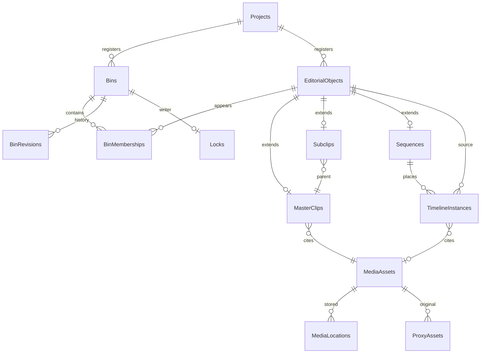

# AETHER bin database schema

Status: proposal for review. The tables below are the specified project working store. No migration was generated and no database was created.

## Purpose

Specify the SQLite entities that hold a project’s bins, editorial objects, media registry, relationships, metadata, revisions, history, and locks, with stable ids and referential integrity.

## Scope

In scope: the project database. The `.abin` member list is a different schema and is not these tables written out as JSON.

Out of scope: thumbnail pixels, waveform samples, and the full-text index, except for the rule that those stores are derived.

## Requirements

- Entities: Projects, Bins, EditorialObjects, MasterClips, Subclips, Sequences, TimelineInstances, MediaAssets, MediaLocations, ProxyAssets, TranscodeAssets, ObjectRelationships, BinMemberships, Dependencies, MetadataDefinitions, MetadataValues, BinRevisions, OperationHistory, Locks.
- Also, because a sequence is typed: Tracks, Transitions, EffectInstances, EffectParameters, Markers, AutomationPoints, and the group, multicam, sync, title, effect-clip, and generated-media tables that the data model names.
- Primary keys are the stable ids from the data model.
- Foreign keys are enforced.
- Media technical metadata is stored on media rows. Master clips and instances store media ids.
- Deleting a media row that is still cited is refused by the foreign key.
- Schema version lives in the database. Migrations are ordered and forward-only.
- The five identities stay in different tables: object, membership, media, instance, location.

## Verified facts

- `docs/PROJECT_ARCHITECTURE.md` already places the working database at `project.db` and stores a schema version.
- `docs/SYSTEM_ARCHITECTURE.md` recommends SQLite for the local store and rejects a shared database service for the current product.
- SQLite foreign keys are off unless the connection enables them. This schema requires `PRAGMA foreign_keys = ON` on every connection.
- No migration was run.

## Engineering recommendations

- Enable WAL mode for the project database on a local disk. Do not place `project.db` on a camera card or on a casually shared network folder. The project architecture already prefers a local project directory.
- Keep one transaction per bin operation and per sequence save.
- Rebuild `Dependencies` inside that transaction from structural rows and instances.
- Put FTS5 in a separate virtual table named as derived. Rebuilding it from editorial rows must be possible after deleting the virtual table.
- Ship migrations as ordered SQL scripts identified by integer schema version. The application refuses to open a database newer than it knows.

## Proposed behaviour

### Identity map

| Identity | Table | Column | What else may change |
| --- | --- | --- | --- |
| Project | `Projects` | `project_id` | Folder name, in the manifest, not in this column |
| Bin | `Bins` | `bin_id` | `display_name`, `package_path_hint` |
| Object | `EditorialObjects` | `object_id` | Name, comment, membership |
| Membership | `BinMemberships` | `(bin_id, object_id)` | Kind, ordinal |
| Media | `MediaAssets` | `media_id` | Locations, checksum state, proxy links |
| Instance | `TimelineInstances` | `instance_id` | Record range, source range, speed |
| File | `MediaLocations` | `location_id` | Path, online flag |

### Tables

The column lists are the schema. Types are SQLite types. Ids are `TEXT`. Flags are `INTEGER` 0 or 1. Times are `TEXT` UTC.

`Projects`

- `project_id` primary key
- `display_name`, `schema_version`, `created_at`, `modified_at`

`Bins`

- `bin_id` primary key
- `project_id` not null references `Projects`
- `display_name` not null
- `origin_project_id` not null
- `parent_bin_id` references `Bins`
- `revision_id` not null
- `schema_version` not null
- `comment`
- `package_path_hint`
- `package_hash`
- `created_at`, `modified_at`, `deleted_at`

`EditorialObjects`

- `object_id` primary key
- `project_id` not null references `Projects`
- `object_type` not null
- `display_name` not null
- `comment`
- `origin_project_id` not null
- `revision` not null
- `created_at`, `modified_at`, `deleted_at`

`MasterClips`

- `object_id` primary key references `EditorialObjects`
- `media_id` not null references `MediaAssets`
- `essence_kind` not null
- `source_filename` not null
- `duration_frames`
- `timecode_start`, `drop_frame`
- `frame_rate`
- `source_in` not null, `source_out` not null
- `reel`, `camera`
- `audio_channel_count`

`Subclips`

- `object_id` primary key references `EditorialObjects`
- `parent_object_id` not null references `MasterClips`
- `media_id` not null references `MediaAssets`
- `source_in` not null, `source_out` not null
- `select_flag` not null

`Sequences`

- `object_id` primary key references `EditorialObjects`
- `timebase` not null
- `raster_width` not null, `raster_height` not null
- `pixel_aspect` not null
- `audio_sample_rate` not null
- `audio_layout` not null
- `nest_depth_limit` not null

`Tracks`

- `track_id` primary key
- `sequence_object_id` not null references `Sequences`
- `kind` not null, `order_index` not null
- `enabled`, `locked`, `targeted`
- `name`

`TimelineInstances`

- `instance_id` primary key
- `sequence_object_id` not null references `Sequences`
- `source_object_id` not null references `EditorialObjects`
- `media_id` references `MediaAssets`
- `track_id` not null references `Tracks`
- `record_in`, `record_out`, `source_in` not null
- `source_rate`, `sequence_rate`, `speed` not null
- `rounding` not null
- `link_id`
- `active_angle_object_id` references `EditorialObjects`

`MediaAssets`

- `media_id` primary key
- `role` not null: `original`, `proxy`, `transcode`, `generated`, `unresolved`
- `checksum`, `checksum_state` not null
- `size_bytes`
- `frame_rate`, `duration_frames`
- `raster_width`, `raster_height`, `pixel_aspect`
- `video_codec`, `audio_codec`, `audio_sample_rate`, `audio_bit_depth`, `audio_channels`, `audio_layout`
- `colour_tags`
- `status` not null
- `created_at`

An imported media id that has no file yet is a row with `role` `unresolved`, `status` `unresolved`, and null checksum. It is the same id the package named. It is not a second kind of identity.

`MediaLocations`

- `location_id` primary key
- `media_id` not null references `MediaAssets`
- `volume_id` not null
- `path` not null
- `path_role` not null: `original_hint`, `managed`, `proxy`, `transcode`, `current`
- `online` not null

`ProxyAssets`

- `proxy_media_id` primary key references `MediaAssets`
- `original_media_id` not null references `MediaAssets`
- Unique pair. A proxy row’s `MediaAssets.role` is `proxy`

`TranscodeAssets`

- `transcode_media_id` primary key references `MediaAssets`
- `original_media_id` not null references `MediaAssets`
- `purpose` not null

`ObjectRelationships`

- `relationship_id` primary key
- `kind` not null
- `from_object_id` not null references `EditorialObjects`
- `to_object_id` not null references `EditorialObjects`
- `ordinal`
- `offset_frames`, `offset_rate`

`BinMemberships`

- Primary key `(bin_id, object_id)`
- `bin_id` references `Bins`
- `object_id` references `EditorialObjects`
- `kind` not null
- `ordinal` not null
- `added_at` not null

`Dependencies`

- `dependency_id` primary key
- `from_object_id` not null references `EditorialObjects`
- `to_object_id` references `EditorialObjects`
- `to_media_id` references `MediaAssets`
- `kind` not null
- `required_flag` not null
- Check: exactly one of `to_object_id` and `to_media_id` is non-null

`MetadataDefinitions`

- `definition_id` primary key
- `scope` not null, `scope_id` not null
- `key` not null, `label` not null, `value_type` not null
- `enum_json`, `column_visible` not null
- Unique `(scope, scope_id, key)`

`MetadataValues`

- Primary key `(object_id, definition_id)`
- Both columns are foreign keys
- `value_text` not null

`BinRevisions`

- `revision_id` primary key
- `bin_id` not null references `Bins`
- `parent_revision_id` references `BinRevisions`
- `package_hash`
- `created_at` not null
- `station`, `note`

`OperationHistory`

- `operation_id` primary key
- `bin_id` references `Bins`
- `kind` not null
- `payload_json` not null
- `base_revision_id`, `result_revision_id`
- `created_at` not null

`payload_json` is the inverse record for history. It is not the storage of clips. Clips live in the typed tables. The payload names ids and previous field values.

`Locks`

- `lock_id` primary key
- `target_kind` not null, `target_id` not null
- `owner_station` not null
- `mode` not null
- `acquired_at` not null
- `heartbeat_at` not null
- Unique `(target_kind, target_id)` so one lock row exists per bin

Supporting typed tables follow the data model with `object_id` primary keys referencing `EditorialObjects`: `GroupClips` and `GroupMembers`, `MulticamClips` and `MulticamAngles`, `SyncClips`, `Titles`, `EffectClips`, `GeneratedMediaRefs`. `Transitions`, `EffectInstances`, `EffectParameters`, `Markers`, and `AutomationPoints` use their own ids and reference the sequence or the instance.

### Indexes

- `EditorialObjects (project_id, object_type)`
- `EditorialObjects (display_name)`
- `BinMemberships (bin_id, ordinal)`
- `BinMemberships (object_id)`
- `MasterClips (media_id)`
- `Subclips (parent_object_id)`
- `TimelineInstances (sequence_object_id, record_in)`
- `TimelineInstances (source_object_id)`
- `TimelineInstances (media_id)`
- `MediaLocations (media_id)`
- `Dependencies (from_object_id)`
- `Dependencies (to_media_id)`
- `MetadataValues (definition_id)`

### Invariants the core enforces inside the transaction

Foreign keys do not express all of the editorial rules. The bin core checks, and aborts the transaction on failure:

- A subclip’s `media_id` equals its parent’s `media_id`.
- A subclip range is inside the parent range.
- An essence-backed instance’s `media_id` equals the source object’s media id.
- A nest instance’s `media_id` is null and its source type is `sequence`.
- At most one resident membership per object.
- No cycles in `parent_bin_id` or in nest relationships.
- `Dependencies` rows equal the rebuilt projection.

### Migrations

`schema_migrations` stores `version` integer primary key and `applied_at`. Version 1 is the table set in this document. A later version is a new script that runs inside a transaction, then inserts its version. A failed script rolls back. The application does not edit tables ad hoc.

Downgrade is unsupported. Recovery from a newer file is the compatibility report, not a guessed down migration.

### Diagram



### Sample rows

One original, one proxy, one master. The master cites the original only.

```json
{
  "MediaAssets": [
    {
      "media_id": "med_6f0e2c44-91ab-4d10-8e77-2a9c0b11d001",
      "role": "original",
      "checksum_state": "pending",
      "status": "online"
    },
    {
      "media_id": "med_6f0e2c44-91ab-4d10-8e77-2a9c0b11d002",
      "role": "proxy",
      "checksum_state": "pending",
      "status": "online"
    }
  ],
  "ProxyAssets": [
    {
      "proxy_media_id": "med_6f0e2c44-91ab-4d10-8e77-2a9c0b11d002",
      "original_media_id": "med_6f0e2c44-91ab-4d10-8e77-2a9c0b11d001"
    }
  ],
  "MasterClips": [
    {
      "object_id": "obj_4c2e8a10-22b1-4f03-9d55-18e0a77c0101",
      "media_id": "med_6f0e2c44-91ab-4d10-8e77-2a9c0b11d001"
    }
  ]
}
```

### Interfaces

`aether_db` opens the file, enables foreign keys, runs pending migrations, and exposes transactions. `aether_bin` and `aether_editorial` pass statements or a small repository interface. They do not embed SQL strings in the UI. `aether_media` owns inserts into `MediaAssets`, `MediaLocations`, `ProxyAssets`, and `TranscodeAssets`. The bin core inserts object rows that reference media ids the media registry has already inserted, including unresolved rows the importer asked the registry to create.

### Operations

Open, migrate, begin, commit, rollback, and the repository methods that correspond to lifecycle commands. A query for a bin window returns headers joined to membership and to media status. It does not return every instance in the project.

### Failure scenarios

| Failure | Database result |
| --- | --- |
| Foreign keys disabled | Open refuses the connection |
| Delete media that a master cites | Commit fails. Media remains |
| Schema version newer than the build | Open refuses. File unchanged |
| Migration script error | Transaction rolls back. Version row absent |
| Two resident memberships | Core aborts the transaction |
| Process kill mid-transaction | WAL or rollback journal restores the last commit |

### Recovery

`project.db` is copied by the database backup path, not by copying the live file while a writer is mid-transaction. The backup uses the SQLite backup API or a checkpointed copy. Bin package hashes in `BinRevisions` point at package files under the backup role. Restoring a database without restoring the matching packages produces a hash mismatch report on open. Restoring packages without the database is an import, not a silent overwrite of `project.db`.

### Performance

The indexes above serve bin windows, media-usage checks, and dependency closure. A sequence load is a query by `sequence_object_id`. Availability is a join from master to media status and proxy status, cached only in memory for the open view. The design target matches the architecture document and is not a benchmark.

### Compatibility

`schema_version` on the project and `schema_migrations.version` are the same number after a successful open. A package schema version and the database schema version can differ by one migration step during import: the serializer migrates the package document to the current model, then the database insert uses the current tables. The import report records both versions.

### Sample structure

Migration bookkeeping:

```json
{
  "schema_migrations": [
    { "version": 1, "applied_at": "2026-11-20T08:00:00Z" }
  ]
}
```

## Rationale

| Decision | Rationale |
| --- | --- |
| Supertype table plus type tables | Referential integrity can point at any object, and list views need no union of every type |
| Unresolved media rows | A foreign key can stay on even when the file is in another city. The id is still the package’s media id |
| Generated dependency table | Closure and usage checks are queries. Rebuilding them in the transaction keeps them honest |
| History payload is not the clip store | A JSON blob for history is an audit record. A JSON blob for the cut would violate the typed-sequence rule |
| One lock row per target | The database, not a convention, prevents two lock rows for one bin |

## Acceptance criteria

Specified, not executed.

- Inserting a master clip with an unknown media id fails until an unresolved or online media row exists.
- Deleting that media row while the master exists fails.
- Two membership rows may cite one object id. Two resident rows for one object id are rejected by the core.
- A timeline instance row can be inserted only with a source object id. A path column does not exist on `TimelineInstances`.
- A proxy is a media row linked in `ProxyAssets`. The master clip’s `media_id` remains the original.
- Opening a database with foreign keys disabled is a failed open.
- A migration failure leaves the previous schema version and the previous rows.
- Search-index deletion is recoverable by a rebuild from `EditorialObjects` and `MetadataValues`.

## Unresolved questions

- FTS5 tokenizer for Indian language names and mixed Devanagari and Latin titles. Recommendation: Unicode61 for version 1, with a later tokenizer if editors report missed matches. Not evaluated here.
- Whether `payload_json` in history should be normalised into typed history tables. Recommendation: typed tables if history becomes large; JSON payload is acceptable for version 1 because it is audit, and the size should be watched.
- Partial indexes for `deleted_at IS NULL`. Recommendation: add them in version 1 so bin lists do not filter in memory.
