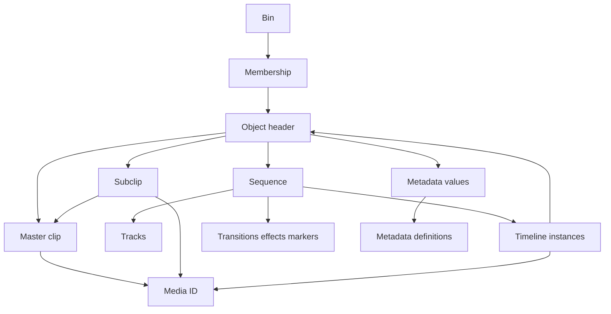

# AETHER bin data model

Status: proposal for review. Specification only. No schema was compiled and no fixture was loaded.

## Purpose

Define the typed records a bin stores, the identifiers that connect them, and the shapes the serializer, the database, and the timeline share.

## Scope

In scope: field-level records for bins, editorial objects, relationships, metadata, and the derived availability view.

Out of scope: SQL column types (`BIN_DATABASE_SCHEMA.md`), the ZIP layout (`BIN_FILE_FORMAT_SPECIFICATION.md`), and the command steps (`BIN_OBJECT_LIFECYCLE.md`). Those documents use the names defined here and do not invent a second set.

## Requirements

- Every editorial object has an `object_id` allocated at creation and kept for the life of that object.
- A sequence is an editorial object. Its sequence identity is its `object_id`.
- A timeline instance has its own `instance_id` and cites `source_object_id` plus `media_id` when the source is essence-backed.
- Technical file metadata lives on the media record. Editorial records store a media id and the editorial fields the assignment requires.
- Selects are subclips. Picture, sound, stills, and graphics are master clips with an essence kind.
- User metadata uses definitions and values, not an untyped blob on the object.
- Sequence tracks, instances, transitions, effects, automation, and markers are separate typed lists.

## Verified facts

- `docs/TIMELINE_ENGINE_ARCHITECTURE.md` stores time as rationals, uses half-open record ranges, and puts `media_id` on the timeline clip. It does not store a filesystem path on the clip.
- `docs/MEDIA_IDENTITY_AND_METADATA.md` already defines the media record: media id, names, paths, checksum, raster, rates, colour, channels, proxy ids, and status. This model cites that record. It does not copy it onto every clip.
- `docs/EDITORIAL_PHILOSOPHY.md` treats a nest as a clip that references a sequence, and markers as records with position, colour, and text.
- No sample bin from a production was available. The JSON below is illustrative.

## Engineering recommendations

- Store rationals as strings `numerator/denominator` with a positive denominator, matching the timeline specification.
- Store timestamps as UTC in RFC 3339 with a `Z` suffix.
- Keep derived fields (`availability`, usage counts, package-asserted probe data) out of the authoritative object write. The application may cache them with a generation id.
- Represent an unknown future object as a typed envelope: `object_type` string, `object_id`, and `retained_payload`. Known types use their tables. The envelope is how an older build keeps data it cannot edit.

## Proposed behaviour

### Shared value types

| Type | Form |
| --- | --- |
| Id | Prefix, underscore, UUID version 4. Prefixes: `prj`, `bin`, `obj`, `med`, `inst`, `trk`, `rev`, `rel`, `dep`, `meta`, `lock`, `vol`, `loc` |
| Rational | String `n/d`, `d > 0` |
| Timecode | `hh:mm:ss:ff` or `hh:mm:ss;ff` when drop-frame is true, plus the rate rational |
| Range | Integers `in` and `out`, half-open `[in, out)`, in a named rate |
| Timestamp | UTC RFC 3339 |

### Bin

| Field | Meaning |
| --- | --- |
| `bin_id` | Permanent |
| `display_name` | Editable label |
| `origin_project_id` | Project that created the bin. Kept after import |
| `parent_bin_id` | Another bin, or null. Editorial nesting. Not a directory |
| `schema_version` | Integer |
| `revision_id` | Current revision |
| `created_at`, `modified_at` | UTC |
| `comment` | Bin-level comment |
| `package_path_hint` | Last checkpoint path. Not an identity |
| `package_hash` | Hash of the last successful package |

### Editorial object header

Every object has this header. Type-specific fields live beside it, joined by `object_id`.

| Field | Meaning |
| --- | --- |
| `object_id` | Permanent |
| `object_type` | One of the type names in the architecture document |
| `display_name` | Editable. Not unique |
| `comment` | Editorial comment |
| `origin_project_id` | Project that minted the id |
| `revision` | Integer, incremented when this object’s stored fields change |
| `created_at`, `modified_at` | UTC |
| `deleted_at` | Null while the object is live. Set when an explicit unassigned-object delete is accepted. Media bytes stay |

### Master clip

| Field | Meaning |
| --- | --- |
| `object_id` | Header |
| `media_id` | The original asset. Required |
| `essence_kind` | `picture`, `sound`, `picture_and_sound`, `still`, `graphic` |
| `display_name` | Header field, repeated here in samples for reading |
| `source_filename` | Filename recorded when the object was created. A later rename of the file does not rewrite identity. The live filename is on the media location |
| `duration_frames` | Integer at `frame_rate`, or null for a still that has no intrinsic movie length |
| `timecode_start` | Start timecode and drop-frame flag if known |
| `frame_rate` | Rational, or null for sound with no picture rate |
| `source_in`, `source_out` | Usable range in source frames. Often `0` and `duration_frames` |
| `reel` | Editorial reel label. May differ from a label on the file |
| `camera` | Editorial camera label |
| `audio_channel_count` | Editorial note of channels the editor uses. The registry channel layout remains the technical record |
| `comment` | Header |
| `availability` | Derived: `online`, `proxy_only`, `offline`, `unresolved`, `error` |

Video and audio technical metadata (codec, raster, colour, sample rate, bit depth, layout, checksum) are read from the media record through `media_id`. The master clip does not keep a second copy.

A still uses `duration_frames` null and a sequence instance supplies the record length. A graphic is a still-or-movie master with `essence_kind` `graphic`.

### Subclip

| Field | Meaning |
| --- | --- |
| `object_id` | Own id. Distinct from the parent |
| `parent_object_id` | The master clip |
| `media_id` | The parent’s media id. The core rejects a write where these differ |
| `source_in`, `source_out` | Range inside the parent, source frames, half-open, inside the parent’s usable range |
| `select` | Boolean. True when the editor marked this subclip as a select |

Renaming the subclip changes `display_name` on this object only.

### Sequence

| Field | Meaning |
| --- | --- |
| `object_id` | This is the sequence id |
| `timebase` | Rational |
| `raster_width`, `raster_height` | Integers |
| `pixel_aspect` | Rational |
| `audio_sample_rate` | Integer |
| `audio_layout` | Named layout or `unknown` |
| `nest_depth_limit` | Integer stored with the sequence. The timeline specification recommends 16 |

Tracks:

| Field | Meaning |
| --- | --- |
| `track_id` | Permanent inside the sequence |
| `sequence_object_id` | Owner |
| `kind` | `picture` or `audio` |
| `order_index` | Integer |
| `enabled`, `locked`, `targeted` | Flags |
| `name` | Label such as `V1` |

Timeline instance. This is the timeline specification’s clip. One model, one id.

| Field | Meaning |
| --- | --- |
| `instance_id` | Permanent placement id |
| `sequence_object_id` | The sequence that owns the placement |
| `source_object_id` | Master, subclip, sequence, title, multicam, group, sync clip, or generated-media ref |
| `media_id` | Required when the source is essence-backed. Null when the source is a sequence nest. For a multicam instance, the media id of the active angle at save, which must match the angle table |
| `track_id` | Track |
| `record_in`, `record_out` | Sequence frames, half-open |
| `source_in` | Source frames at the source rate |
| `source_rate`, `sequence_rate` | Rationals |
| `speed` | Rational. Negative is reverse |
| Picture selection | ADR-002. Not a stored `nearest` / `floor` / `ceil` field. Ceiling is not the general policy. |
| `link_id` | Optional link shared with other instances |
| `active_angle_object_id` | Set when the source is a multicam clip |

Transition, effect instance, marker, and automation point:

| Record | Fields |
| --- | --- |
| Transition | `transition_id`, `sequence_object_id`, `incoming_instance_id`, `outgoing_instance_id`, `type_id`, `duration_frames`, `alignment` |
| Effect instance | `effect_instance_id`, owner instance or track or sequence, `effect_type_id`, ordered typed parameters |
| Marker | `marker_id`, owner object id, position frame, colour, name, comment |
| Automation point | `point_id`, owner track or instance, parameter id, frame, value rational |

Parameters are typed: rational, integer, bool, colour, or a media-id reference. They are not a single JSON blob column. The database stores one row per parameter. The package stores one array per effect, with a declared parameter schema version.

### Group, multicam, and sync

| Type | Fields |
| --- | --- |
| Group | `object_id`, members: `member_object_id`, `offset_frames`, `offset_rate` |
| Multicam | `object_id`, angles: `angle_index`, `member_object_id`, `offset_frames`, `offset_rate`, `name` |
| Sync | `object_id`, `picture_object_id`, `sound_object_id`, `offset_frames`, `offset_rate` |

Members remain independent objects. Deleting the group does not delete the members.

### Title, effect clip, generated media

| Type | Fields |
| --- | --- |
| Title | `object_id`, `generator_id`, typed parameters, optional `rendered_media_id` |
| Effect clip | `object_id`, `effect_type_id`, typed default parameters |
| Generated media ref | `object_id`, `media_id` of the generated file, `producer_object_ids` |

The rendered file is registered by media management. The title object cites the media id when a render exists. The title parameters remain the editorial source.

### Relationships and dependencies

A relationship is structural:

| Field | Meaning |
| --- | --- |
| `relationship_id` | Permanent |
| `kind` | `parent_master`, `group_member`, `multicam_angle`, `sync_member`, `nest_source`, `generated_from`, `effect_uses` |
| `from_object_id`, `to_object_id` | Endpoints |
| `ordinal` | Order where the kind needs it |
| `offset_frames`, `offset_rate` | Optional |

A dependency is a generated edge used for closure and for share manifests. The structural records and the timeline instances are authoritative. The dependency rows are rebuilt in the same transaction. A package whose dependency list disagrees with its structural records fails validation.

| Field | Meaning |
| --- | --- |
| `dependency_id` | Id inside the revision |
| `from_object_id` | The object that needs something |
| `to_object_id` | Set when the need is another object |
| `to_media_id` | Set when the need is essence |
| `kind` | `master`, `subclip_parent`, `nest`, `angle`, `group_member`, `sync_member`, `title_render`, `graphic`, `effect`, `transition`, `external`, `generated`, `proxy_hint` |
| `required` | Boolean. A proxy hint is not required |

`proxy_hint` records that a proxy media id was known at save. Playback may use it. The original media id remains the required edge.

### Metadata

| Definition field | Meaning |
| --- | --- |
| `definition_id` | Permanent |
| `scope` | `project` or `bin` |
| `scope_id` | Project id or bin id |
| `key` | Stable key, unique in the scope |
| `label` | Column title |
| `value_type` | `string`, `integer`, `rational`, `bool`, `timecode`, `enum`, `date` |
| `enum_values` | List when the type is `enum` |
| `column_visible` | Whether the bin view shows it by default |

| Value field | Meaning |
| --- | --- |
| `object_id`, `definition_id` | Joint key |
| `value_text` | Canonical text for the type |

Definitions travel with a bin when any object in the package has a value for them.

### Membership

| Field | Meaning |
| --- | --- |
| `bin_id`, `object_id` | Joint key |
| `kind` | `resident` or `reference` |
| `ordinal` | Order in that bin |
| `added_at` | UTC |

`resident` means this bin is the home recorded at creation or at a move. `reference` means another bin also lists the same object id, and the metadata is the object’s metadata. An object has at most one `resident` membership. It may have many `reference` memberships. Duplicate creates a new object with a new resident membership and copied values.

### Filter

A filter is not a bin.

| Field | Meaning |
| --- | --- |
| `filter_id` | Permanent |
| `display_name` | Label |
| `query` | Typed predicate list: field, operator, value |
| `owner` | `project` or `workstation` |

Workstation filters do not enter the package unless the user saves them into the bin display config.

### Display config

Stored with the bin: `view_mode` (`text`, `thumbnail`, `frame`), column keys in order, widths, sort key, sort direction, and the ids of filters saved with the bin.

### Interfaces

Readers in every module accept these records as plain values. Writers in the bin core accept a change set: objects added, objects updated, memberships added or removed, and a base revision id. The sequence core submits sequence-owned rows through the same change set. The application builds the change set. Modules do not update another module’s rows by reaching into them.

### Operations

The model itself is inert. Lifecycle operations interpret it. The invariants the core checks before a commit:

- Subclip `media_id` equals the parent master `media_id`.
- Subclip range lies inside the parent range.
- Instance `media_id` equals the essence media id of `source_object_id`, or is null for a sequence nest.
- A nest `source_object_id` names a sequence, and the graph has no cycle.
- Nest depth does not exceed the stored limit.
- Names are not looked up as keys.
- A membership insert of `reference` is a different command from a duplicate.

### Failure scenarios

| Situation | Model result |
| --- | --- |
| Two objects with the same display name | Both valid |
| Subclip range outside the parent | Write refused |
| Instance with a path field | Not representable. There is no field to fill |
| Sequence saved as one undifferentiated document | Not representable. Tracks and instances are separate lists |
| Type the writer does not know | Envelope with `retained_payload`, if the user accepted retention |

### Recovery

Objects carry `revision` and `deleted_at`. A revision snapshot stores the header and the type record together. Recovery reloads a snapshot. It does not reconstruct an object from a thumbnail or from a search index.

### Performance

Headers are small. Sequence bodies are addressed by `sequence_object_id` so opening a bin list does not load every instance of every sequence. A list query returns headers, membership ordinals, display names, media ids, and derived availability. The instance body loads when that sequence is opened.

### Compatibility

`object_type` is a string. Readers that know the string use the typed record. Readers that do not know it keep `object_id`, `display_name`, and `retained_payload`. Writers of format version 1 emit the types listed in this document and emit an empty unsupported list when they understand everything they write.

Adding a field requires a schema version bump. Readers of an older schema accept missing optional fields at their documented defaults. Readers refuse a schema version they do not know, and they still report the header so the person can see the originating version.

### Diagram



### Sample structures

Master clip and a select made from it. Both cite one media id.

```json
{
  "object_id": "obj_4c2e8a10-22b1-4f03-9d55-18e0a77c0101",
  "object_type": "master_clip",
  "display_name": "A001C001",
  "media_id": "med_6f0e2c44-91ab-4d10-8e77-2a9c0b11d001",
  "essence_kind": "picture_and_sound",
  "source_filename": "A001C001.mov",
  "duration_frames": 2400,
  "timecode_start": "01:00:00:00",
  "drop_frame": false,
  "frame_rate": "24/1",
  "source_in": 0,
  "source_out": 2400,
  "reel": "A001",
  "camera": "A",
  "comment": "Gate",
  "origin_project_id": "prj_8f1c2a40-6b0e-4a1d-9c33-0a11b2c3d4e5",
  "revision": 3
}
```

```json
{
  "object_id": "obj_4c2e8a10-22b1-4f03-9d55-18e0a77c0102",
  "object_type": "subclip",
  "display_name": "A001C001_select",
  "parent_object_id": "obj_4c2e8a10-22b1-4f03-9d55-18e0a77c0101",
  "media_id": "med_6f0e2c44-91ab-4d10-8e77-2a9c0b11d001",
  "source_in": 120,
  "source_out": 360,
  "select": true,
  "revision": 1
}
```

One timeline instance of that select:

```json
{
  "instance_id": "inst_77c0aa01-88d2-4c19-b001-09aa77110001",
  "sequence_object_id": "obj_4c2e8a10-22b1-4f03-9d55-18e0a77c0901",
  "source_object_id": "obj_4c2e8a10-22b1-4f03-9d55-18e0a77c0102",
  "media_id": "med_6f0e2c44-91ab-4d10-8e77-2a9c0b11d001",
  "track_id": "trk_00000001-0000-4000-8000-0000000000v1",
  "record_in": 86400,
  "record_out": 86640,
  "source_in": 120,
  "source_rate": "24/1",
  "sequence_rate": "24/1",
  "speed": "1/1"
}
```

## Rationale

| Decision | Rationale |
| --- | --- |
| Header plus type record | Search and membership can list objects without loading sequence bodies |
| Select is a subclip flag | A separate select type would fork identity for the same in-out relationship |
| Essence kind on the master | Picture, sound, stills, and graphics share one media-id rule |
| Dependency list is generated | Two hand-edited graphs drift. The structural records stay the source |
| One resident membership | Move has a clear home. References stay explicit, so shared metadata is a choice the editor sees |

## Acceptance criteria

Specified, not executed.

- A master clip record can be stored with the fields in the master-clip table, and its codec, path, and checksum are read from the media id.
- A subclip record carries its own object id and a parent id. A rename fixture changes only the subclip display name.
- A sequence record includes separate track, instance, transition, effect, marker, and automation lists. A test that looks for a single undifferentiated sequence document finds none.
- An instance record contains `source_object_id` and `media_id` and has no path field.
- Two objects may share a display name and keep different object ids.
- A metadata value cites a definition. A free-form blob is not the stored form.
- A group or multicam member keeps its own object id after the group is removed from a bin.

## Unresolved questions

- UUID spelling and the `clip_id` alias are decisions 1 and 10 in `BIN_ARCHITECTURE.md`.
- Whether `audio_channel_count` on the master should be omitted entirely and always joined from the media record. Recommendation: keep it as an editorial override that export must label as editorial when it differs from the probed layout.
- Marker colour encoding. Recommendation: a small named set (`amber`, `green`, `blue`, `red`, `violet`, `neutral`) rather than a raw theme colour.
- Effect parameter schema versions per effect type. Open until the effects specification names the types. The row shape above is the carrier.
