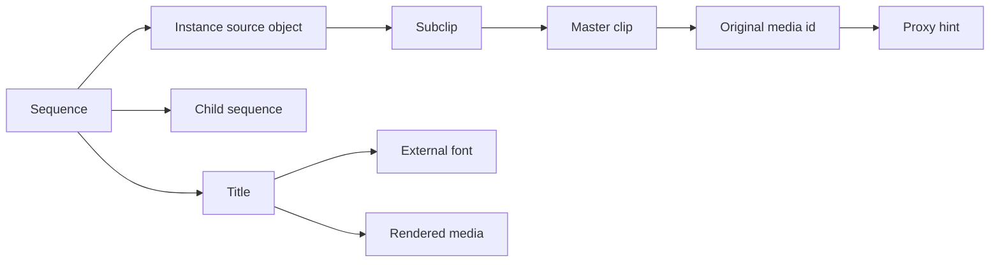

# AETHER bin dependency graph

Status: proposal for review. The graph is specified. No closure was computed on a real bin.

## Purpose

Define the directed graph of editorial needs inside a bin, how a share computes the closure, and how the report classifies resolved, missing, unsupported, and offline items.

## Scope

In scope: nodes, edges, closure, and the report a share or an open uses.

Out of scope: copying files. The resolver returns ids and classifications. Import/export and media management perform byte operations.

## Requirements

- The graph includes master clips, subclips, source media, audio, nests, multicam, group clips, titles, graphics, effects, transitions, external references, generated media, and proxies.
- Edges come from structural relationships and from timeline instances. The stored dependency table is a projection rebuilt with the edit.
- A share computes the closure of the selection before it writes files.
- The report separates resolved, missing, unsupported effects, missing graphics, offline media, required transcodes, and warnings.
- A proxy edge is a hint. The original media id is the required media edge for an essence-backed object.
- The resolver does not invent objects and does not drop edges it dislikes. An edge it cannot classify is an unsupported or external item in the report.

## Verified facts

- Timeline nests already cite a child sequence id in `docs/TIMELINE_ENGINE_ARCHITECTURE.md`, with a depth limit and a cycle refusal.
- Proxies already hang off the master media id in `docs/PROXY_AND_TRANSCODE_SYSTEM.md`.
- No graph was materialised.

## Engineering recommendations

- Represent the in-memory graph in `aether_depend` as plain structs: nodes and edges with ids and kinds. No database handle inside the resolver. The caller loads rows and passes them in. That keeps the resolver testable without SQLite and without Qt.
- Detect cycles with the same depth limit the sequence stores. A cycle is a hard error in the report. Closure stops at the cycle and does not loop.
- Treat generated media as a dependency of the objects that produce it, and also as replaceable output. The report marks it `regenerable` when the producer objects are in the closure and a recipe is stored. It marks it `required` when the recipe is absent and instances cite the generated media id directly.

## Proposed behaviour

### Nodes

| Node | Id |
| --- | --- |
| Editorial object | `object_id` |
| Media asset | `media_id` |
| External reference | An object id of a retained or explicit external ref, plus a locator string that is not a media path identity |

External references are links to items the project does not own, such as a font name on a title or a plug-in effect type id. The locator is a typed string (`font:Name`, `effect:type-id`). It is not a filesystem path used as an object id.

### Edges

| Kind | From | To | Required |
| --- | --- | --- | --- |
| `subclip_parent` | Subclip | Master clip | Yes |
| `master` | Master, still, graphic, or sound object | Original media id | Yes |
| `instance_source` | Sequence | Source object | Yes |
| `instance_media` | Instance’s sequence | Media id | Yes when the instance has a media id |
| `nest` | Parent sequence | Child sequence | Yes |
| `angle` | Multicam | Member object | Yes |
| `group_member` | Group | Member object | Yes |
| `sync_member` | Sync clip | Picture and sound objects | Yes |
| `title_render` | Title | Rendered media id | No when parameters are present. Yes when parameters are absent and the render is the only picture |
| `graphic` | Sequence or title | Graphic object or its media id | Yes |
| `effect` | Instance or effect clip | Effect type id | Yes |
| `transition` | Sequence | Transition type id | Yes |
| `generated` | Generated-media ref | Media id and producer objects | As classified above |
| `external` | Object | External locator | Yes if the object cannot draw or sound without it |
| `proxy_hint` | Original media id | Proxy media id | No |

Audio is not a side path. A sound master uses `master`. A sync clip uses `sync_member`. An audio track instance uses `instance_source` and `instance_media`.

### Closure

Input: a set of root object ids, the edge list, and a mode.

| Mode | Closure contents |
| --- | --- |
| `editorial_only` | All required object edges and the media ids they name. No proxy edges unless the caller sets `include_proxy_hints` |
| `dependency_package` | The editorial closure plus required media ids, plus generated media the caller did not mark regenerable, plus proxies if requested |
| `reference_only` | The same object closure as editorial-only. Media ids are reported and not marked for copy |

The algorithm is a walk from the roots along required edges, plus optional edges the caller included. Visited ids are recorded. Depth above the nest limit adds an error and does not continue down that path. The result is an ordered list of object ids, media ids, external locators, and errors.



### Report

Each item has `id`, `kind`, `classification`, and `detail`.

| Classification | Meaning |
| --- | --- |
| `resolved` | The id exists in the set being saved or in the destination registry, and media is online when a file is required for this mode |
| `missing` | The id is cited and neither the package nor the destination contains it |
| `unsupported_effect` | The effect type id is unknown to this build |
| `missing_graphic` | A graphic object or its media id is cited and absent |
| `offline_media` | The media row exists and no location is online |
| `required_transcode` | The destination’s sequence settings cannot use the asserted codec and the sender marked a transcode as required for interchange. The first release lists this when the package says so. It does not invent a transcode |
| `warning` | A non-blocking note: proxy absent, checksum pending, package-asserted metadata unverified, thumbnail absent |
| `excluded` | The user left the id out of scope |
| `cycle` | Hard error |
| `regenerable` | Generated media whose producers and recipe are in the closure |

A share whose report contains `missing`, `cycle`, or `unsupported_effect` for a required edge still writes an editorial package only if the person accepts that the receiver will see the same report. The acceptance is stored in `compatibility_report.json`. A `dependency_package` that is missing a media file the mode promised to include does not get that acceptance. The file had to be in the folder. The acceptance path is for editorial items the sender does not have, such as an effect type no build can embed. It is not a way to publish a short file copy.

Unsupported effects are retained on the instance as effect rows. The report classifies them. The picture may not render. The row stays.

### Open and usage

Opening a bin runs the resolver against the registry and attaches classifications to the visible rows: offline, proxy only, missing graphic, unsupported effect. The bin still opens. Search can filter on classification.

Before physical media delete, media management requests the inverse closure: every object and sequence that reaches that media id. A non-empty inverse blocks the delete pending the media confirmation rules.

### Interfaces

| Call | Result |
| --- | --- |
| `depend.project(edges, roots, options)` | Closure and report |
| `depend.inverse(edges, media_id)` | Object ids that require that media |
| `depend.diff(before, after)` | Edges added and removed, used by a revision note |

`options` carries mode, include-proxy flag, and the nest limit.

### Operations

Build edges from a row snapshot, close over roots, classify against a registry snapshot, format the report. The resolver does not write the database. The bin core writes the projection after it asks the resolver to confirm the projection matches a fresh walk. A mismatch is a failed transaction.

### Failure scenarios

| Failure | Report |
| --- | --- |
| Subclip whose parent id is absent | `missing` on the parent. The subclip stays in the bin |
| Nest cycle | `cycle`. The save that would create the cycle is already refused by the sequence core. A corrupt import surfaces it here and blocks publish of a dependency package |
| Proxy file absent, original online | `resolved` for the original, `warning` for the proxy |
| Original absent, proxy online | `offline_media` for the original, `warning` that a proxy can play. The instance media id stays the original |
| Unknown effect type | `unsupported_effect`. Parameters retained |
| Graphic media id with no row | `missing_graphic` |
| Depth limit exceeded | Error on that edge. Partial walk is not returned as a successful closure |

### Recovery

The projection can be deleted and rebuilt from structural rows and instances. Recovery after a crash does that when the stored projection’s hash, recorded on the revision, disagrees with a fresh walk. The walk is the authority. A failed rebuild leaves the bin open and marks dependency status `stale` so share is refused until a person runs rebuild. Share refuses a stale graph rather than publishing an old one.

### Performance

The walk is linear in the number of edges in the component it touches. Indexes on `from_object_id` and `to_media_id` load the candidate edges. A feature sequence with a few thousand instances is one walk per save and per share, not per timeline frame. The design target is the project scale in the architecture document. Memoisation is by object id inside one walk. No measurement is claimed.

### Compatibility

Edge `kind` is a string. An unknown kind in a package is retained on the relationship or dependency row and classified `warning` with the raw kind. It is not dropped. A later build that understands the kind uses it. Closure treats an unknown required edge as required and includes the endpoint ids if present.

Effect type ids and transition type ids are strings allocated by the effects specification. Until that specification exists, the graph stores the id and the parameters and classifies unknown ids as unsupported. It does not substitute a default dissolve or a default generator.

### Sample structure

Closure report for a sequence that uses one select, one missing graphic, and a proxy:

```json
{
  "roots": ["obj_4c2e8a10-22b1-4f03-9d55-18e0a77c0901"],
  "mode": "editorial_only",
  "items": [
    {
      "id": "obj_4c2e8a10-22b1-4f03-9d55-18e0a77c0102",
      "kind": "subclip",
      "classification": "resolved"
    },
    {
      "id": "med_6f0e2c44-91ab-4d10-8e77-2a9c0b11d001",
      "kind": "master",
      "classification": "offline_media"
    },
    {
      "id": "med_6f0e2c44-91ab-4d10-8e77-2a9c0b11d002",
      "kind": "proxy_hint",
      "classification": "warning",
      "detail": "proxy online, original offline"
    },
    {
      "id": "obj_00000000-0000-4000-8000-00000000c0de",
      "kind": "graphic",
      "classification": "missing_graphic"
    }
  ]
}
```

## Rationale

| Decision | Rationale |
| --- | --- |
| Resolver is pure | Closure is the part most likely to be wrong in a share. It has to be testable with a table of edges and no disks |
| Proxy edges are hints | Playing a proxy must not make the proxy the thing the sequence depends on, or a later online will target the wrong file |
| Unknown effects stay on the instance | Dropping them would violate the retention rule and would change the cut |
| Stale projection blocks share | An old dependency list is how a travel disk leaves with yesterday’s nests |
| External locators are typed strings | Fonts and effect types are real dependencies and they are not media paths |

## Acceptance criteria

Specified, not executed.

- Given a sequence, a subclip, a master, and a media id, the closure lists all four.
- A nest closure includes the child sequence and the child’s media ids.
- A multicam closure includes every angle’s object and media id, not only the active angle.
- A proxy-only online state classifies the original as `offline_media` and the proxy as a warning. The master clip’s media id in the result is the original.
- An unknown effect type is `unsupported_effect` and the effect row is still in the package.
- A missing graphic is `missing_graphic`.
- A cycle is an error and `dependency_package` publish is refused.
- Inverse closure of a media id lists every master, subclip, and sequence instance that cites it.
- Deleting the dependency table and rebuilding yields the same required edges.

## Unresolved questions

- The catalogue of external locator types beyond `font:` and `effect:`. Recommendation: those two in version 1, and unknown prefixes retained as raw locators.
- Whether a warning-level proxy absence should be omitted from editorial-only shares to keep reports short. Recommendation: include it. Short reports that hide offline originals are how the wrong drive gets on the plane.
- Transcode requirement rules for a destination that cannot decode a codec. Recommendation: leave `required_transcode` as a sender-marked flag until the processing capability query exists. The resolver does not guess codecs.
