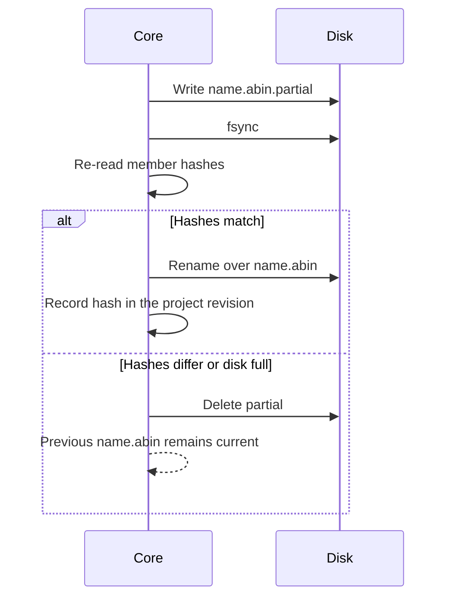

# AETHER bin file format specification

Status: proposal for review. Format version 1 is specified. No writer was built and no file was produced.

## Purpose

Specify the portable `.abin` package: its container, its public members, its version header, and the rule that an older AETHER keeps editorial data it does not understand.

## Scope

In scope: the package that represents one bin. The share folder that wraps a package with media is specified in `BIN_PORTABILITY_AND_SHARING.md` and uses this file unchanged.

Out of scope: the project database schema, and any dump of that schema into the package.

## Requirements

- A `.abin` is a single file. Its contents are a structured package with a published member list.
- The file states format version, schema version, minimum AETHER version, and originating AETHER version.
- The file states supported object types, unsupported object types, and required dependencies.
- The package contains or references bin identity, origin project id, display name, object registry, typed objects, sequence records, media references, dependency manifest, custom metadata, display config, thumbnail references, revision, and compatibility.
- A package is not a copy of the project tables.
- A writer never omits an object it loaded because the object’s type is old or new. Unknown types are retained in an opaque payload and listed.
- A reader that cannot apply a type reports it. If the person accepts retention, those payloads round-trip on the next save. If the person declines, the import transaction rolls back.
- Interrupted writing does not replace the previous good file.

## Verified facts

- The bin architecture chooses Option B for this file and keeps SQLite for the open project.
- ZIP is a widely specified archive format. This document uses the ZIP container and does not depend on a proprietary archive.
- No `.abin` sample from a running AETHER existed to inspect. The member list is a specification.

## Engineering recommendations

- Use ZIP method 0 (store) for format version 1. See unresolved decision 3 in `BIN_ARCHITECTURE.md`.
- Hash each member with SHA-256 over the uncompressed member bytes, and hash the package as SHA-256 over the finished file after rename.
- Write `name.abin.partial` on the same volume, fsync the file, verify the hashes, then rename over `name.abin`.
- Keep JSON as UTF-8. Use the canonicalisation recommended in the architecture document when computing member hashes, and store both the canonical hash and the algorithm name.
- Put the compatibility header in `abin.json` at the start of the archive so a tool can read it without parsing every object.

## Proposed behaviour

### Option judgment

Option A, a SQLite database as the `.abin`, scores well on transactions and in-place queries. It scores poorly on long-term public contracts, on the temptation to share one file between two writers, and on the requirement that a package not be a dump of project tables.

Option B, a structured package, scores well on a public member list, on archive readability, on revision hashes, and on making multi-writer use structurally absent. It needs a careful atomic replace, which this specification requires. Query performance belongs to the project database after import.

The chosen format is Option B.

### Container

| Property | Format version 1 |
| --- | --- |
| Filename | Ends in `.abin` |
| Container | ZIP, method 0 unless a later format version says otherwise |
| Encoding | UTF-8 JSON members |
| One bin | One package. A project of many bins is many packages plus the project database |

### Member list

| Member | Required | Contents |
| --- | --- | --- |
| `abin.json` | Yes | Header, identity, versions, type lists |
| `revision.json` | Yes | Revision id, parent revision id, time, writer station, package note |
| `registry.json` | Yes | Every object id, type, display name, revision, deleted flag |
| `master_clips.json` | Yes, array may be empty | Typed master clips |
| `subclips.json` | Yes | Typed subclips |
| `sequences.json` | Yes | Sequence headers |
| `tracks.json` | Yes | Tracks |
| `timeline_instances.json` | Yes | Instances |
| `transitions.json` | Yes | Transitions |
| `effect_instances.json` | Yes | Effect instances and typed parameters |
| `markers.json` | Yes | Markers |
| `automation.json` | Yes | Automation points |
| `groups.json` | Yes | Group, multicam, and sync records, discriminated by `object_type` |
| `titles.json` | Yes | Titles |
| `effect_clips.json` | Yes | Effect clips |
| `generated_media_refs.json` | Yes | Generated-media references |
| `retained_objects.json` | Yes | Opaque payloads for types this writer does not edit |
| `relationships.json` | Yes | Structural relationships |
| `dependencies.json` | Yes | Generated dependency list for this bin |
| `media_refs.json` | Yes | Media ids and package-asserted hints. Paths are hints |
| `metadata_definitions.json` | Yes | Definitions used by contained values |
| `metadata_values.json` | Yes | Values |
| `membership.json` | Yes | Membership rows for this bin |
| `display.json` | Yes | View mode, columns, sort, saved filters |
| `thumbnails/manifest.json` | Yes | Refs. The image files are optional |
| `compatibility.json` | Yes | Human-readable report of what this writer supports |

A missing required member fails validation. An unknown extra member is retained across a round-trip and listed as an unknown member. It is not discarded.

### Header

`abin.json` carries the fields every AETHER file in this design must show:

| Field | Meaning |
| --- | --- |
| `format` | `aether-abin` |
| `format_version` | Integer. This specification is 1 |
| `schema_version` | Integer. This specification is 1 |
| `minimum_aether_version` | Oldest AETHER release that may edit the file |
| `originating_aether_version` | Release that wrote the file |
| `bin_id` | Bin identity |
| `display_name` | Name |
| `origin_project_id` | Creating project. Informative after import |
| `supported_object_types` | Types the writer can edit |
| `unsupported_object_types` | Types present only as retained payloads |
| `required_dependencies` | Media ids and object ids that must resolve for the bin to be online. Proxy hints are excluded |
| `hash_algorithm` | `sha256` in version 1 |
| `member_hashes` | Map of member path to digest |

### Version rules

| Reader sees | Behaviour |
| --- | --- |
| Known format and schema | Edit |
| Newer `format_version` | Refuse to edit. Report the version. Leave the file unchanged |
| Newer `schema_version` with a known format | Refuse to edit unless a migration table names that schema. Report |
| Older schema | Open through the migration table inside the serializer. Write the current schema on save. The report names the migration |
| Unknown `object_type` inside a known schema | List it under unsupported. Offer retain or cancel |
| `minimum_aether_version` newer than this build | Refuse to edit. Report. The file stays intact |

Silent drop of a member, an object, a marker, an effect parameter, or a metadata value is a failed write. Tests treat it as a defect.

### Media references

`media_refs.json` lists each media id the bin needs or hints:

```json
{
  "media_id": "med_6f0e2c44-91ab-4d10-8e77-2a9c0b11d001",
  "role": "original",
  "asserted": {
    "original_name": "A001C001.mov",
    "frame_rate": "24/1",
    "duration_frames": 2400,
    "checksum_algorithm": "sha256",
    "checksum": null
  },
  "path_hints": [
    "/volumes/card/A001C001.mov"
  ],
  "verification": "unverified"
}
```

`path_hints` are not identity. Import matches `media_id` to the destination registry. The hint is a relink aid.

### Thumbnail references

`thumbnails/manifest.json` maps `object_id` and an optional source frame to an optional archive path `thumbnails/<id>.jpg`. Missing image bytes are a warning. They fail the package only when the manifest lists a path that is absent, because a listed path is a checksummed member. A manifest entry with `"image": null` is a ref with no bytes and is valid.

### Atomic write



Rename is the publication step. A reader ignores `*.abin.partial`.

### What the package omits

The package omits other bins, project preferences, the full media-location table for unrelated assets, search indexes, waveforms, undo stacks that were not saved, and cache. Those belong to the project or to cache. A sequence’s saved timeline is included because the sequence is an object in the bin. A sequence that is not a member and is not a nest target of a member is omitted, and the export report lists that omission when the user scoped the export to this bin. That omission is a scope choice recorded in `compatibility.json`, not a drop of an object the writer loaded and forgot.

### Interfaces

| Function | Behaviour |
| --- | --- |
| `abin.read(path)` | Verify ZIP, header, required members, hashes. Return a document or a failure report |
| `abin.write(document, path)` | Atomic replace as above |
| `abin.migrate(document)` | Apply schema migrations the library knows. Unknown target schema fails |

The functions accept and return `aether_model` values. They do not open `project.db`.

### Operations

Read, verify, migrate, write. Import into a project is a higher operation that calls read and then the import transaction. Export calls the dependency resolver and then write.

### Failure scenarios

| Failure | Result |
| --- | --- |
| Torn partial file | Ignored. Previous package remains |
| Hash mismatch on a member | Read fails. The destination project is unchanged |
| Truncated ZIP | Read fails |
| Unknown format version | Read returns the header and a refusal. No object is imported |
| Required dependency media id absent from `media_refs.json` | Package invalid |
| Dependency list disagrees with structural records | Package invalid |
| Extra unknown member | Listed, retained on write, not applied as editorial meaning |

### Recovery

The previous `.abin` is the recovery copy for a failed write. Bin revisions may also store a hash chain of older packages under the project `BACKUP/` role, as the revision document specifies. A failed write does not delete those backups. Cache is not used to rebuild a package.

### Performance

Members are streamed. `registry.json` is enough to paint a count and a name list after import indexing. Sequence instance arrays for a feature-length sequence are large and are one member, parsed into the database in the import transaction rather than held as a widget model. The design target is the 10,000-object bin. A package of that size is expected to be tens of megabytes of JSON. That expectation is not a measurement.

### Compatibility

Format version and schema version are independent. Format version changes when the container or the member list changes in a way an old reader cannot skip. Schema version changes when a known type gains a required field. Optional fields arrive with a schema bump as well, and older readers that use a published migration ignore unknown optional keys only when the migration table says those keys have safe defaults. Unknown keys without a migration are retained in an extension object and reported. They are not stripped on save.

`compatibility.json` repeats the header in prose form and lists excluded-by-scope object ids when an export was intentionally partial in scope. A scope exclusion names the object ids the user left out. It is valid only for an export report. A file that claims to be a full bin and also lists exclusions is invalid.

### Sample structure

`abin.json`:

```json
{
  "format": "aether-abin",
  "format_version": 1,
  "schema_version": 1,
  "minimum_aether_version": "0.1.0",
  "originating_aether_version": "0.1.0",
  "bin_id": "bin_3b1c0d01-7a10-4e21-9c01-d0a100000001",
  "display_name": "DAY_01",
  "origin_project_id": "prj_8f1c2a40-6b0e-4a1d-9c33-0a11b2c3d4e5",
  "supported_object_types": [
    "master_clip",
    "subclip",
    "sequence",
    "group_clip",
    "multicam_clip",
    "sync_clip",
    "title",
    "effect_clip",
    "generated_media_ref"
  ],
  "unsupported_object_types": [],
  "required_dependencies": [
    "med_6f0e2c44-91ab-4d10-8e77-2a9c0b11d001"
  ],
  "hash_algorithm": "sha256",
  "member_hashes": {
    "revision.json": "sha256:example-not-a-real-digest"
  }
}
```

`revision.json`:

```json
{
  "revision_id": "rev_10000000-0000-4000-8000-000000000003",
  "parent_revision_id": "rev_10000000-0000-4000-8000-000000000002",
  "created_at": "2026-11-20T09:00:00Z",
  "station": "cutting-room-a",
  "note": "Selects renamed"
}
```

## Rationale

| Decision | Rationale |
| --- | --- |
| One ZIP file | Assistants can copy one bin without copying `project.db` |
| Required members even when empty | A missing array and an empty array must not look alike. Empty means the bin has none. Missing means the file is damaged |
| Opaque retention | The “never silently discard” rule is a file behaviour, not a warning dialog after the data is gone |
| Paths as hints | The media id is the join. A hint still helps a relink dialog |
| Method 0 recommendation | A stored member can be hashed and copied without an inflate that hides truncation |

## Acceptance criteria

Specified, not executed.

- A valid package contains every required member and a header with format version, schema version, minimum version, originating version, both type lists, and required dependencies.
- A package whose member hash does not match is rejected and does not modify the destination project.
- A writer interrupted after creating `*.abin.partial` and before rename leaves the previous `.abin` byte-for-byte unchanged.
- A package containing an unknown object type yields a report that names the object id and the type. Accepting retention means a later export contains the same payload. Declining retention means the destination bin is unchanged.
- A package produced from a project cannot be mistaken for a SQLite database file. Its container is ZIP and its header format string is `aether-abin`.
- An object loaded by the writer is present in `registry.json` or the write fails.

## Unresolved questions

- Decisions 2, 3, 4, 13, 17, 18, and 20 in `BIN_ARCHITECTURE.md` apply here.
- Whether `groups.json` should be three members. Recommendation: one member with `object_type` on each element, to keep the required-member list stable.
- ZIP64 when a package exceeds 4 GiB. Recommendation: allow ZIP64 in format version 1 and test it before any share of consolidated media inside the `.abin` itself. Consolidated media belongs in the share folder, not inside the `.abin`. The `.abin` should stay well under that limit. The limit handling remains open until a large fixture exists.
