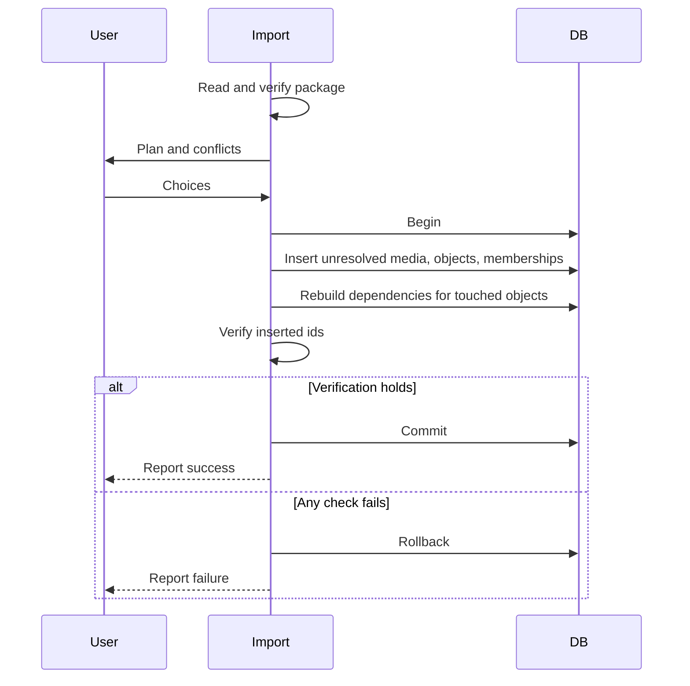

# AETHER bin import and export specification

Status: proposal for review. The transactions below are specified. No import was run.

## Purpose

Specify how a bin package and a share folder enter and leave a project so that object ids survive, media matches on media id, conflicts are explicit, and a failed import leaves the destination unchanged.

## Scope

In scope: export of one bin or a chosen set of sequences, import into a different project, conflict choices, validation, and the report.

Out of scope: the ZIP member bytes (`BIN_FILE_FORMAT_SPECIFICATION.md`) and the share-folder media copy rules (`BIN_PORTABILITY_AND_SHARING.md`). This document calls those and defines the transaction around them.

## Requirements

- Validate the package, the schema, and the origin project id before any destination row is committed.
- Register objects in one transaction.
- Preserve object ids when the destination does not already have them.
- Match media by media id. A filename match is a hint in the report, never a bind.
- Resolve dependencies and list missing media.
- Offer relink, copy, consolidate, or dependency packaging as explicit follow-ups. None of them runs hidden inside a successful editorial import.
- Report incompatible objects.
- An equal display name never replaces an existing object.
- Conflict choices are explicit: keep destination, duplicate incoming as a new id, replace by id after a second confirmation, or cancel.
- A partial import is a rollback unless the person accepted a named retention of unsupported payloads. Accepted retention is still one transaction and still reports every retained id.
- A share folder that fails validation is not imported.

## Verified facts

- Media relink order in `docs/MEDIA_STORAGE_AND_RELINKING.md` ranks media id and checksum ahead of filename. Import uses that order and does not add a name-based shortcut.
- Ingest modes in `docs/MEDIA_MANAGEMENT_PHILOSOPHY.md` are link, copy, consolidate, and transcode, each explicit.
- No cross-project import was executed.

## Engineering recommendations

- Perform validation on a read-only parse. Open the write transaction only after validation returns a plan.
- Write the plan into the report even when the person cancels, so an assistant can see what would have happened. Mark that report `cancelled`.
- Keep origin project id on every imported object. The destination project id is the registry’s `project_id`. Both fields exist. Import does not rewrite history to pretend the object was born in the destination.

## Proposed behaviour

### Export

Input: source project, bin id, optional sequence object ids, mode (`editorial_only`, `dependency_package`, `reference_only`), and options from the portability document.

Steps:

1. Take a read lock or use the writer’s revision if this station holds the write lock.
2. Load the bin and the selected sequences. If no sequence list is given, include every sequence that is a member of the bin, plus sequences reached by nest closure.
3. Run the dependency resolver. Attach the report.
4. Build the `.abin` document from current rows, not from a previous package file.
5. Write the package atomically.
6. If the mode includes bytes, write the share folder. If any file in the manifest fails to copy or fails its checksum, delete the incomplete share folder’s publication name and report failure. A temporary share directory may remain for diagnosis under `LOGS/BIN_OPERATIONS/` and is not a successful export.
7. Record an operation-history row of kind `export` with the package hash.

Export does not change object ids.

### Import plan

Validation produces a plan. The plan is a list of actions. The person sees it before commit when any action is a conflict, an unsupported type, or a missing required dependency. An import with no conflicts and no missing required media may proceed and still writes the report.

| Incoming fact | Plan action |
| --- | --- |
| `format_version` unknown | Stop. No plan |
| Schema migratable | Migrate in memory, then plan |
| Object id absent in destination | Insert with the same id |
| Object id present and payload equal | Add membership if needed. Do not rewrite fields |
| Object id present and payload different | Conflict. No default replace |
| Display name equals a different object id | Insert or conflict on id only. Record a name-collision note. Leave the other object unchanged |
| Media id present and checksum agrees or checksum is still pending on one side | Cite the existing media row |
| Media id present and both checksums exist and differ | Unresolved media conflict. Do not merge rows |
| Media id absent | Insert an unresolved media row, or a full media row when the share includes bytes that verify |
| Unsupported object type | Retain payload or stop, according to the person’s choice |
| Required dependency missing | Report. Editorial rows still import only if the mode is `reference_only` or the person accepts offline references. `editorial_only` imports rows and marks the project not ready for those ids. It does not pretend they are online |

`editorial_only` and `reference_only` both import the full editorial payload of the package. `editorial_only` sets a ready-state of `blocked` on missing required media. `reference_only` sets ready-state `offline_reference` and does not offer consolidate. Neither mode deletes incoming objects to make the report cleaner.

### Conflict options

Shown per object id. The default selection in the dialog is `keep_destination`. Commit with that choice leaves the destination object byte-for-byte as it was and records that the incoming revision was declined.

| Choice | Result |
| --- | --- |
| `keep_destination` | Destination object unchanged. Incoming object is listed as declined |
| `duplicate_incoming` | New object id in the destination. Report maps old id to new id. Instances inside the imported sequences that cited the old id are rewritten only inside the imported copy, and the rewrite is listed |
| `replace` | Allowed only after a second confirmation that names both revision ids. Destination revision is stored in history. The object id stays. Fields become the incoming fields |
| `cancel` | Rollback. Destination unchanged |

Replace is by object id. It is not offered as “replace all clips named A001C001”.

### Transaction



The destination bin id can be an existing bin or a new bin id taken from the package when that bin id is free. If the bin id exists and names a different origin, the plan treats the bin as a conflict with the same four choices applied to bin membership: keep the destination bin and import objects into it only if the person says so, or import as a new bin id, or cancel. A new bin id is the recommendation when the origin project differs and the bin id collides. Recommendation is not an automatic action. The dialog asks.

### Relink, copy, consolidate, dependency packaging

After a committed editorial import, the report can offer:

| Follow-up | Who performs it |
| --- | --- |
| Relink | Media management, using checksum and technical metadata, with path hints as a sort aid |
| Copy | Media management, into a destination role the person names |
| Consolidate | Media management, with a handle length the person confirms |
| Dependency packaging | A new export in `dependency_package` mode |

These follow-ups are new commands. They are not implied by the import’s success status. If the share already contained verified bytes, the import’s media step registers locations inside the same transaction as the objects, because the bytes are part of that package’s success. A checksum failure in that step rolls back objects and media registrations together.

### Interfaces

| Call | Returns |
| --- | --- |
| `import.validate(path)` | Header, errors, or a plan |
| `import.commit(plan, choices)` | Report and revision id, or a rollback report |
| `export.bin(request)` | Package path and report, or failure |
| `export.share(request)` | Share-folder path and report, or failure |

The UI renders the plan. It does not insert rows.

### Operations

Validate, present, commit, roll back, and the four media follow-ups. Re-import of the same package is stable: equal payloads add nothing but a history note, and the object ids stay.

### Failure scenarios

| Failure | Destination state |
| --- | --- |
| Hash mismatch | Unchanged. No transaction opened |
| Disk full during commit | Rollback. Unchanged |
| Process kill during commit | Database rollback. Unchanged |
| Person cancels at the plan | Unchanged. Cancelled report written to the log |
| Name collision on `A001C001` | Both objects exist or the incoming one waits on an id conflict. The older object is not overwritten |
| Unsupported effect | Named in the report. Retained or rolled back |
| Share folder missing `media_manifest.json` | Validation fails. Unchanged |
| Incoming media id checksum conflict | Rows not merged. Report names both checksums |

### Recovery

Rollback is the recovery for a failed import. There is no “repair the half-imported bin” path. A successful import creates a bin revision whose parent is the destination bin’s previous revision, or the first revision of a new bin. Restoring that parent revision returns the destination to the pre-import editorial state. Media files copied by a later follow-up are not deleted by that restore. The restore report lists media files that were copied and left in place, and the person may run a media-management cleanup. Cleanup is explicit because an automatic delete of copied media is a file deletion.

### Performance

Validation streams the package. The plan holds ids and conflict records, not media bytes. Commit inserts in batches inside one transaction. The design target is a 10,000-object bin. Progress is reported by object count. The UI stays responsive because the commit runs off the interface thread. Cancellation before commit is immediate. Cancellation during commit is a rollback request checked between batches; the transaction still ends in commit or rollback, never in a partial commit.

### Compatibility

The import report records source format version, source schema version, destination schema version, migrations applied in memory, unsupported types, retained ids, remapped ids, declined ids, unresolved media ids, and checksum conflicts. A later export of the imported bin writes the destination’s schema version and carries retained payloads forward.

Origin project id is reported and stored. It is not required to match a project the destination can open. A missing source project is a normal import.

### Sample structure

Conflict line inside a plan:

```json
{
  "object_id": "obj_4c2e8a10-22b1-4f03-9d55-18e0a77c0101",
  "display_name": "A001C001",
  "kind": "payload_differs",
  "destination_revision": 4,
  "incoming_revision": 7,
  "name_collision_with": "obj_aaaaaaaa-bbbb-4ccc-8ddd-eeeeeeeeeeee",
  "default_choice": "keep_destination",
  "choices": ["keep_destination", "duplicate_incoming", "replace", "cancel"]
}
```

The name-collision field is informational. The choice keys off `object_id`.

Import report after a clean editorial-only import:

```json
{
  "status": "success",
  "mode": "editorial_only",
  "bin_id": "bin_3b1c0d01-7a10-4e21-9c01-d0a100000001",
  "origin_project_id": "prj_8f1c2a40-6b0e-4a1d-9c33-0a11b2c3d4e5",
  "objects_inserted": 2,
  "objects_preserved_ids": [
    "obj_4c2e8a10-22b1-4f03-9d55-18e0a77c0101",
    "obj_4c2e8a10-22b1-4f03-9d55-18e0a77c0102"
  ],
  "unresolved_media_ids": [
    "med_6f0e2c44-91ab-4d10-8e77-2a9c0b11d001"
  ],
  "ready_state": "blocked",
  "follow_ups": ["relink", "copy", "consolidate", "dependency_package"]
}
```

## Rationale

| Decision | Rationale |
| --- | --- |
| Plan before transaction | A conflict dialog that appears after half the rows are written invites a partial bin |
| Keep destination as the dialog default | Replacing a cut because a package arrived is the dangerous direction. The person can still choose replace |
| Remap only the imported copy | Rewriting the destination’s existing sequence because an import collided would damage work that was not in the package |
| Follow-up media commands | Copy and consolidate move bytes. They do not belong inside a status that means “editorial rows are in” |
| Stable re-import | Assistants re-copy the same package. A second import must not mint a forest of duplicate ids |

## Acceptance criteria

Specified, not executed.

- A valid package from project A imports into an empty project B with the same object ids and the same media ids, and project A can be offline or absent.
- An object in B with the same display name and a different object id is unchanged after the import.
- An object id collision with different payloads does not commit until a choice is recorded. `keep_destination` leaves the destination fields unchanged.
- A filename that matches and a media id that does not match does not bind the incoming clip to the local file.
- A checksum mismatch on the same media id does not merge the media rows.
- Killing the process during commit leaves B without the imported objects.
- A share folder with a missing manifest file is rejected.
- Unsupported types are named in the report. Declining them leaves B unchanged. Accepting them stores payloads that a following export still contains.
- A successful import’s ready-state is `blocked` or `offline_reference` when required media is absent. It is not `online`.

## Unresolved questions

- Whether equal-payload detection compares canonical member fragments or a stored object hash. Recommendation: a canonical hash of the type record plus metadata values, algorithm named, computed during validation.
- Bin-id collision default. Recommendation: ask, with “import as a new bin id” offered first in the list and still unselected until the person chooses. No timer accepts a default.
- How many conflict rows the plan shows inline before it switches to a scrollable list. Recommendation: the UI virtualizes the list from the first row. There is no silent “apply default to the rest” unless the person presses a button that names the choice and the count.
