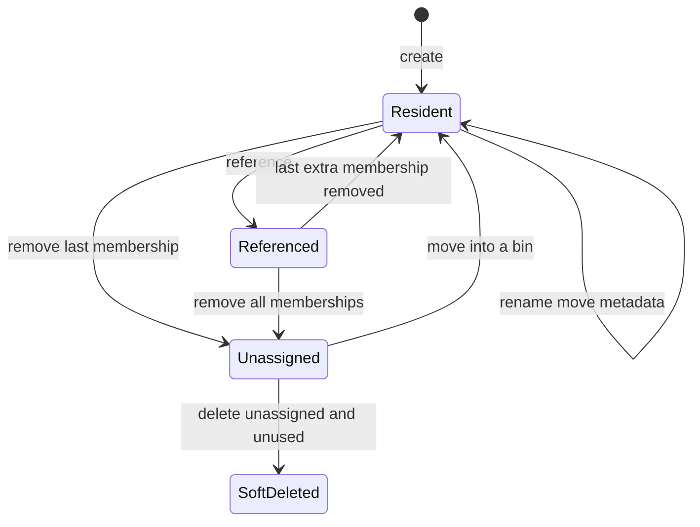

# AETHER bin object lifecycle

Status: proposal for review. The operations below are specified. They are not implemented and they were not executed.

## Purpose

Specify what create, open, close, rename, move, copy, reference, duplicate, delete, metadata edit, lock, and recovery do to object ids, membership, media ids, and revisions.

## Scope

In scope: editorial lifecycle inside a project and across a package import. Physical media operations appear only as the boundary where the bin stops and media management starts.

Out of scope: ZIP bytes, SQL, and widget behaviour, except the commands the UI must call so a drag cannot invent its own semantics.

## Requirements

- Move keeps the object id, the metadata, and the media ids. It updates membership. Sequence dependencies that cite the object id stay valid. The operation writes a revision.
- Reference adds a membership for an existing object id and tells the editor that metadata is shared.
- Duplicate mints a new object id, copies metadata, keeps the media id, and does not copy the file. A duplicated sequence is a new sequence object with its own tracks and instances and the same media ids on those instances.
- Removing an object from a bin removes that membership. It does not delete media. It does not delete the object if another membership or a dependency remains.
- Deleting a bin removes that bin’s memberships. Objects still referenced elsewhere remain. Media files remain.
- Physical deletion is a media-management command. It runs a usage check. It is a different command from bin delete.
- Display name is never a match key during these operations.

## Verified facts

- Media management already treats deletion of a timeline clip as separate from deletion of a media record, and it forbids silent deletion of originals (`docs/MEDIA_MANAGEMENT_PHILOSOPHY.md`).
- The project lock in `docs/PROJECT_ARCHITECTURE.md` is advisory and visible. Bin locks follow that pattern.
- No lifecycle was run against a real project.

## Engineering recommendations

- Implement each operation as one database transaction that also appends operation history. The package rewrite can follow the commit, as the revision document describes, and a crash between them is a detected mismatch.
- Refuse an operation whose base revision is not the current revision. The caller reloads and tries again with an explicit choice.
- Show shared metadata in the command name the UI sends. `referenceObjects` and `duplicateObjects` are different commands. There is no command named `copy` in the core. The UI may show the word Copy only after the person has chosen one of those two commands.

## Proposed behaviour

### States of an object

| State | Membership | Reachable from a sequence | Shown in a bin |
| --- | --- | --- | --- |
| Resident | One resident row | Optional | Yes, in the home bin |
| Referenced | Resident plus one or more reference rows | Optional | Yes, in each bin |
| Unassigned | None | Optional | Only in the unassigned list |
| In use | Any | At least one dependency | Yes, and delete of the object is blocked |
| Soft-deleted | None, `deleted_at` set | None | Recovery only |

### Operations

| Operation | Object id | Media id | Membership | File bytes | Revision |
| --- | --- | --- | --- | --- | --- |
| Create bin | New bin id | None | Empty | None | New revision |
| Create master from a registered media id | New object id | Existing media id | Resident in the chosen bin | Untouched | Object revision 1 and a bin revision |
| Create subclip | New object id | Parent’s media id | Resident in the chosen bin | Untouched | Recorded |
| Rename | Same | Same | Same | Untouched | Object revision increments |
| Move | Same | Same | Resident bin changes. Ordinal changes. Reference rows stay | Untouched | Recorded |
| Reference | Same | Same | New reference row | Untouched | Recorded |
| Duplicate object | New | Same | New resident row. Metadata values copied | Untouched | Recorded on the new object |
| Duplicate sequence | New sequence object id, new instance ids | Same media ids on the new instances | New resident row | Untouched | The new sequence has its own revision chain |
| Remove from bin | Same | Same | That bin’s row deleted | Untouched | Recorded |
| Delete bin | Objects unchanged | Unchanged | That bin’s rows deleted | Package file kept until a separate confirmation | Bin row soft-deleted |
| Delete unassigned object | Soft-deleted when no dependency remains | Unchanged | Already empty | Untouched | Recorded |
| Physical media delete | Unchanged | Media row removed only after usage checks | Unchanged | Media command may delete a managed file the user confirmed | Media log, not a bin revision of identity |
| Metadata edit | Same | Same | Same | Untouched | Object revision increments. Every reference sees the new value |
| Import | Preserved when free. New only under an explicit conflict choice | Matched by media id | Created in the destination bin | Untouched unless a media mode was chosen | New revision in the destination |

Open loads the bin’s membership and object headers into the working set. Close releases the working set and drops the write lock if this session holds it. Close flushes a dirty bin through the save path. A failed flush leaves the bin open and reports the error.

### Move

Move is allowed into another bin in the same project. The resident membership is rewritten to the destination bin. Reference memberships in other bins remain. Instances that cite the object id do not change. The dependency projection is rebuilt and stays equivalent for those edges. Operation history stores the previous resident bin id.

Move of a bin changes `parent_bin_id`. It does not move a directory. If the checkpoint file is also relocated, that is a package-path update performed by serialization after the registry commit, and the bin id stays.

### Reference and duplicate

Reference is the explicit way to see one object in two bins. The inspector states that the object is shared. An edit to the comment or to a metadata value changes the single object, so both bins show it.

Duplicate copies the header fields, the type record, and the metadata values into a new object id. The new master or subclip cites the same media id. The source filename field is copied as a historical label. No file is read or written by this command.

Duplicate of a sequence:

- Allocates a new `object_id` for the sequence.
- Copies timebase, raster, and audio configuration.
- Allocates new track ids and new instance ids.
- Copies record ranges, source ranges, speeds, effects, transitions, markers, and automation.
- Points `source_object_id` and `media_id` at the same sources as the original.
- Does not copy nested sequences. A nest still cites the same child sequence object. The report says so. A deeper duplicate is a separate command, `duplicateSequenceDeep`, which duplicates the child sequences that are inside the selection and rewrites those nest citations. The person chooses shallow or deep. There is no implicit deep copy.

Duplicate of a group, multicam, or sync clip duplicates the container object and keeps member object ids. The report says the members are shared. A follow-up duplicate of members is explicit.

### Delete

Remove from bin:

- Deletes the membership row in that bin.
- If the resident row was removed and reference rows remain, one reference is promoted to resident and the report names it. Promotion is deterministic: the oldest reference by `added_at`, then by bin id.
- If no membership remains, the object becomes unassigned. It stays in the registry.
- Dependencies are untouched. A sequence that uses the object still uses it.

Delete bin:

- Refuses if the bin has child bins. The person moves or deletes child bins first.
- Soft-deletes the bin after memberships are removed under the rules above.
- Does not delete media rows.
- Does not delete objects that gained an unassigned state if something else still depends on them.
- Leaves the `.abin` file in place. A second command, `bin.deletePackageFile`, deletes that file after confirmation. It still does not delete media.

Delete unassigned object:

- Refuses while any dependency or instance cites it.
- Sets `deleted_at`.
- Leaves the media row and the file.

Physical delete:

- Issued to media management with a media id.
- Media management asks the application for usages: master clips, subclips, instances, proxies, transcodes.
- Any remaining usage blocks the delete unless the person confirms a force that is still refused for originals outside the project, matching the media-management rule.
- This command is not bound to the Delete key in a bin. The bin Delete key removes membership.

### Metadata edit

A metadata edit updates `MetadataValues` or the comment, reel, or camera fields. It increments the object revision. It does not write a sidecar next to the media file unless the person runs an export. Shared references observe the new value on the next read. If two sessions hold the object, the save that does not match the base revision fails with a conflict.

### Locking

| Mode | First release | Later collaboration |
| --- | --- | --- |
| Write | One station. Required to save | Same, plus handover |
| Read-only | Open without the write lock. Saves refused | A lock owner can grant this |
| Absent lock | The bin opens read-only and the report says the package is unlocked and local | Unchanged |

A lock record stores lock id, target bin id, owner station, mode, acquire time, and heartbeat time. The first release fills it for the local process. A heartbeat older than a documented threshold is stale. The threshold is unresolved. Recommendation: 60 seconds, and a stale lock is never cleared automatically.

Closing a bin releases the lock if the process still owns it. A crash leaves a stale lock, which recovery reports.

### Diagram



### Sample structure

Operation history row for a move:

```json
{
  "operation_id": "op_00000000-0000-4000-8000-000000000041",
  "bin_id": "bin_3b1c0d01-7a10-4e21-9c01-d0a100000001",
  "kind": "move",
  "object_id": "obj_4c2e8a10-22b1-4f03-9d55-18e0a77c0101",
  "media_id": "med_6f0e2c44-91ab-4d10-8e77-2a9c0b11d001",
  "from_bin_id": "bin_3b1c0d01-7a10-4e21-9c01-d0a100000001",
  "to_bin_id": "bin_3b1c0d01-7a10-4e21-9c01-d0a100000002",
  "base_revision_id": "rev_10000000-0000-4000-8000-000000000001",
  "result_revision_id": "rev_10000000-0000-4000-8000-000000000002",
  "at": "2026-11-20T08:40:00Z"
}
```

The object id and media id in the row match the object after the move.

### Interfaces

The bin core exposes the commands named in the architecture document. Each takes a project handle, a base revision id, and a payload of ids. Each returns the new revision id or a conflict report. The UI sends ids it received from a query. It does not send paths as object identifiers.

### Failure scenarios

| Failure | Behaviour |
| --- | --- |
| Move with a stale base revision | Refused. No membership change |
| Duplicate when the disk is full | Database transaction rolls back. No new object id is visible. No file copy was started |
| Remove an object that a nest still cites | Membership updates. The object remains. The report lists the nest |
| Delete a bin that still has child bins | Refused |
| Reference dropped when the person wanted an independent copy | Cannot happen through `duplicateObjects`. The commands are distinct |
| Physical delete issued with bin delete | Not the same command. Bin delete has no media-id operand for deletion |
| Second workstation saves the same bin | Write lock refused |

### Recovery

Every successful operation stores the inverse in operation history: previous name, previous membership, previous metadata value. Undo of a bin operation applies the inverse if the base revision still matches. Undo of a sequence edit is the timeline undo stack, and the next sequence save writes one bin revision. Undo does not undo a physical media delete. That delete has its own confirmation and, when media management quarantines a file, its own restore.

A crash mid-command leaves the last committed revision. The uncommitted command is absent.

### Performance

Membership updates touch the selected rows and the dependency rows of those objects, not the media files and not unrelated bins. Duplicating a sequence copies its timeline rows inside the database. It does not walk the media tree. A selection of a few thousand objects is one transaction. The design target is the architecture document’s 10,000-object bin.

### Compatibility

Operation history `kind` is a string. An older build that does not recognise a kind reports it and leaves the rows in place. It does not delete history it cannot display.

Lifecycle rules are part of schema version 1. A change to promotion order or to shallow-duplicate nest behaviour requires a schema version bump and a note in the compatibility report.

## Rationale

| Decision | Rationale |
| --- | --- |
| No core command named copy | The word hides the choice between shared metadata and a new object |
| Shallow sequence duplicate by default | A silent deep copy of every nest in a feature is a surprise and a large new identity set. Deep copy stays available and named |
| Promote oldest reference | Move and remove need a deterministic home bin when the resident row disappears |
| Soft delete | A mistaken delete of an unassigned clip is recoverable. The media file was never the thing being deleted |
| Physical delete stays in media management | Usage checks and original-file policy already live there. A second delete path in the bin will eventually skip one of them |

## Acceptance criteria

Specified, not executed.

- After a move, the object id, metadata values, and media id match the pre-move values, the resident bin id is the destination, and a sequence instance that cited the object still cites it.
- After a reference, both bins list the same object id. A comment edit is visible in both.
- After a duplicate, the new object id differs, the media id matches, the file size and path of the asset are unchanged, and a metadata edit on the new object leaves the source object’s metadata unchanged.
- After a sequence duplicate, the new sequence object id differs, instance ids differ, and media ids on the instances match the source sequence.
- After remove-from-bin, the media checksum and path are unchanged.
- After delete-bin, a master that also lives in another bin is still readable there, and its media file is present.
- A physical delete request for a media id that still has a master clip is refused or requires the media-management confirmation path. The bin Delete command does not invoke it.
- A stale revision is refused and leaves memberships unchanged.

## Unresolved questions

- Stale-lock threshold. Recommendation: 60 seconds, manual clear only.
- Whether undo of bin operations and undo of timeline edits share one key. Recommendation: one undo stack per focused surface, with sequence saves as revision boundaries. The key binding is a UI decision.
- Promotion when `added_at` ties. Recommendation: break the tie by ascending bin id.
- Deep duplicate of multicam angles. Recommendation: same rule as nests. Shallow unless the command says deep.
