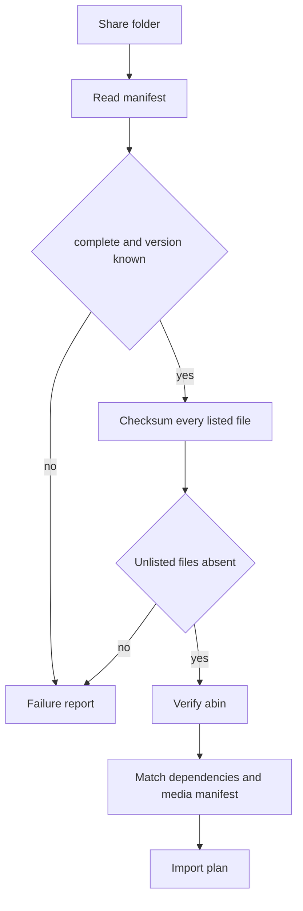

# AETHER bin portability and sharing

Status: proposal for review. Share folders are specified. None was built or tested.

## Purpose

Specify how a bin moves between projects and workstations as a package, including the `DAY_01_SHARE/` example, the three share modes, checksums, and the rule that a partial folder is a failure.

## Scope

In scope: package portability, share-folder layout, scope choices, checksums, and validation before import.

Out of scope: the internal `.abin` member list, except that the share folder contains a finished `.abin`. Multi-writer collaboration remains later work. Sharing in the first release is the exchange of files.

## Requirements

- A bin is identifiable by bin id on the destination workstation without the source project database.
- The share computes the dependency closure for the chosen scope.
- Modes are editorial-only, dependency package, and reference-only.
- Scope choices are bin only, bin and selected sequences, all dependencies, consolidated media, and selected handles. A choice that excludes objects names those objects in the compatibility report.
- The example folder `DAY_01_SHARE/` contains `DAY_01.abin`, `manifest.json`, `dependencies.json`, `media_manifest.json`, `thumbnails/`, `compatibility_report.json`, optional consolidated media, and an optional reference video.
- Every file listed in `manifest.json` has a checksum. Validation reads those checksums before import.
- If a listed file is missing, or a checksum fails, or `complete` is false, the share is a failure. Import does not open it as a success with warnings that hide the gap.
- Original camera files are copied only when the person chose a mode that copies bytes and a destination that is allowed to receive them.

## Verified facts

- The project can already live with media on other volumes. A share folder may therefore be assembled on a travel disk that is not the project disk.
- Relink and checksum rules are already specified for media. This document uses them for `media_manifest.json`.
- No travel-disk rehearsal was run.

## Engineering recommendations

- Build the share in a temporary directory on the destination volume. Publish it by renaming the directory to `DAY_01_SHARE` only after every checksum has been verified. If rename of a directory is not atomic on the filesystem, write `manifest.json` last, with `complete: true`, and treat a folder whose manifest is missing or whose `complete` field is false as unpublished.
- Keep consolidated media and the optional reference video outside the `.abin`. The bin file stays an editorial package.
- Use SHA-256, named in the manifest, for every listed file including the `.abin`.

## Proposed behaviour

### What travels

| Mode | Editorial package | Essence bytes | Missing media in the report |
| --- | --- | --- | --- |
| `editorial_only` | Full selected scope | None | Required. Ready-state `blocked` until the destination resolves media ids |
| `dependency_package` | Full selected scope | Selected media, whole files or consolidated ranges with confirmed handles | A listed file that failed to copy fails the share. A dependency the person excluded is named as excluded by scope |
| `reference_only` | Full selected scope | None | Required. Ready-state `offline_reference`. Consolidate is not offered as part of this mode |

All three modes include the objects in scope, their relationships, and their sequence bodies when sequences are in scope. The modes differ in bytes and in ready-state. They do not differ by quietly dropping markers or effects.

### Scope choices

| Choice | Included |
| --- | --- |
| Bin only | Members of the bin. Sequences that are members include their full saved bodies. Nests pull child sequences into the closure even if the child lives in another bin, and the report lists those child bin ids |
| Bin and selected sequences | The bin’s non-sequence members that the selected sequences depend on, plus the selected sequences. Other sequences in the bin are excluded by scope and named |
| All dependencies | Closure of the selection: masters, subclips, nests, multicam, groups, sync, titles, graphics, effects, transitions, generated media, external refs |
| Consolidated media | New files of used ranges plus handles, registered under new media ids that point at the source media ids. The package records both ids |
| Selected handles | The handle length the person confirmed, stored in the manifest. One length per share, or a map of media id to length when the person overrides a row |

Consolidated media does not replace the source files in the source project. The source project keeps the original media ids.

### Folder

```text
DAY_01_SHARE/
  DAY_01.abin
  manifest.json
  dependencies.json
  media_manifest.json
  compatibility_report.json
  thumbnails/
  MEDIA/
    CONSOLIDATED/
  REFERENCE/
    DAY_01_reference.mov
```

`MEDIA/` and `REFERENCE/` are optional. Their presence without a manifest entry is a failure, because an unlisted file is not part of a verified share. Their absence when the manifest lists them is a failure.

`dependencies.json` is the closure report for the share. It matches the `.abin` dependency member for the objects that were included. A mismatch fails validation.

`media_manifest.json` lists every essence file and the reference video:

| Field | Meaning |
| --- | --- |
| `media_id` | Identity the destination must register |
| `source_media_id` | Set when this file is a consolidate or a proxy of another id |
| `role` | `original`, `proxy`, `transcode`, `consolidated`, `reference_video` |
| `relative_path` | Path inside the share folder |
| `size_bytes` | Integer |
| `checksum_algorithm`, `checksum` | Digest of the file |
| `handle_frames` | Present for consolidated rows |
| `asserted_technical` | Probe summary, labelled unverified until the destination probes |

A reference video has a media id so it can be registered if the person wants to watch it. It is not the master of the sequence. The compatibility report says that. Import does not bind timeline instances to the reference video’s media id.

### manifest.json

| Field | Meaning |
| --- | --- |
| `format` | `aether-bin-share` |
| `format_version` | 1 |
| `schema_version` | 1 |
| `minimum_aether_version` | Writer’s minimum |
| `originating_aether_version` | Writer |
| `bin_id`, `display_name`, `origin_project_id` | Identity |
| `mode` | One of the three modes |
| `scope` | The choices above |
| `complete` | True only after verification |
| `hash_algorithm` | `sha256` |
| `files` | Every file relative path and digest, including itself last |

The manifest’s own digest covers the manifest with the digest field empty, so the file can state its own hash. Validators recompute that digest.

### Validation before import

1. Read `manifest.json`. Refuse a missing manifest, a false `complete`, or an unknown format version.
2. Check that every listed path exists and that no extra file exists outside the list. Extra files fail the share. The sender regenerates a clean folder.
3. Recompute every checksum.
4. Open `DAY_01.abin` with the package reader.
5. Check `compatibility_report.json` against the header.
6. Check `dependencies.json` against the package and against `media_manifest.json`.
7. Only then build an import plan.



### Thumbnails

`thumbnails/` holds optional JPEGs named in the manifest. A missing thumbnail that is listed fails the share. A share may list no thumbnail files. The bin still imports. Thumbnails are aids. They are included when the sender asked to include them, because a listed-and-present thumbnail is convenient for a review, and an unlisted thumbnail would make the folder fail the extra-file check.

### Workstation assumptions

The sender and the receiver may be different machines, operating systems, and volume layouts. Paths inside `media_refs` are hints. Paths inside `media_manifest.json` are relative. Absolute paths on the sender’s edit drive are not required to exist on the receiver. The bin id and the object ids are the identity the receiver stores.

The first release does not lock the destination project across the network. The sender finishes the folder. The receiver imports a copy. If both edit, they hold two projects and later import is the conflict path in the import specification.

### Interfaces

`share.build(request)` returns a folder path and a report, or a failure. `share.validate(path)` returns a plan input or a failure. Both are application use cases over the serializer, the resolver, and the filesystem. The bin core does not copy media. Media management copies or consolidates when the mode asks for bytes, and returns verified files to the share builder.

### Operations

Build, verify, publish, validate, import. Republish replaces a share folder only after the new folder verifies. The builder does not delete the previous published folder until the new folder’s manifest is complete. A failed rebuild leaves the previous published folder in place when one existed.

### Failure scenarios

| Failure | Published folder |
| --- | --- |
| Copy stops at 90 percent | Unpublished. `complete` stays false. Import refuses |
| Checksum mismatch on one consolidated file | Failure. Import refuses |
| `.abin` valid and `dependencies.json` stale | Failure |
| Reference video present and unlisted | Failure |
| Receiver disk cannot hold the media | Import of a `dependency_package` rolls back. The editorial-only alternative is a new share the sender builds, not a partial accept of this folder |
| Two shares of the same bin id with different revisions | Both valid as folders. Import is a conflict under the import specification |

### Recovery

A failed build leaves the source project untouched. The temporary directory is retained under the log path until the person clears logs, and it is marked `complete: false`. A receiver who imported nothing has nothing to roll back. A receiver who hits a checksum error during import rolls back the database transaction and deletes any partial media copy that the transaction had not yet published. Published media copies happen only inside the successful transaction’s file-publish step, which uses temporary names until commit, then rename. If the process dies after file rename and before commit, recovery on next open finds media files whose ids are not committed and quarantines them. It does not register them as online.

### Performance

Checksums stream. The builder does not load a consolidated movie into memory. Editorial assembly is the same cost as writing one `.abin`. Copying essence dominates time when the mode includes media. Progress is bytes and files. The interface stays available. Cancel stops the copy, leaves `complete` false, and does not publish.

### Compatibility

`compatibility_report.json` repeats format version, schema version, minimum version, originating version, supported types, unsupported types, excluded-by-scope ids, missing optional thumbnails that were intentionally omitted, and warnings for effects the sender itself marks as unrendered. The receiver still runs its own compatibility check. The sender’s report is not trusted as a substitute for validation. It is there so a person can read it on a machine that does not have AETHER open.

### Sample structure

`manifest.json`:

```json
{
  "format": "aether-bin-share",
  "format_version": 1,
  "schema_version": 1,
  "minimum_aether_version": "0.1.0",
  "originating_aether_version": "0.1.0",
  "bin_id": "bin_3b1c0d01-7a10-4e21-9c01-d0a100000001",
  "display_name": "DAY_01",
  "origin_project_id": "prj_8f1c2a40-6b0e-4a1d-9c33-0a11b2c3d4e5",
  "mode": "dependency_package",
  "scope": {
    "bin": true,
    "sequence_ids": ["obj_4c2e8a10-22b1-4f03-9d55-18e0a77c0901"],
    "all_dependencies": true,
    "consolidated_media": true,
    "handles": { "default_frames": 48, "rate": "24/1" }
  },
  "complete": true,
  "hash_algorithm": "sha256",
  "files": [
    { "path": "DAY_01.abin", "sha256": "example-digest-abin" },
    { "path": "dependencies.json", "sha256": "example-digest-deps" },
    { "path": "media_manifest.json", "sha256": "example-digest-media" },
    { "path": "compatibility_report.json", "sha256": "example-digest-compat" }
  ]
}
```

Digests in this example are placeholders. A real manifest carries 64 hexadecimal characters. A validator that sees the prefix `example-` fails the file. Production writers do not use placeholder text.

## Rationale

| Decision | Rationale |
| --- | --- |
| Publish only after checksums | A folder on a travel disk is often copied again. An incomplete folder that looks finished will be treated as the cut |
| Extra files fail | A quietly parked movie next to a valid manifest is how the wrong picture gets reviewed |
| Reference video has its own role | Review pictures are useful and they are not camera originals or timeline masters |
| Relative media paths | The receiver’s mount points differ. The media id is what import registers |
| Child nests included and named | A selected sequence that opens onto an empty nest is an incomplete cut. Pulling the child and listing it keeps both completeness and visibility |

## Acceptance criteria

Specified, not executed.

- A bin exported from one project imports on another machine by bin id without the source `project.db`.
- Editorial-only share contains a valid `.abin` and no essence files, and the receiver’s report lists missing media ids.
- Reference-only share does the same with ready-state `offline_reference`.
- Dependency-package share lists every copied file and its checksum. Changing one byte of a consolidated file fails validation.
- A folder with `complete: false` fails validation.
- A folder missing a listed file fails validation and does not create bin rows.
- A folder with an unlisted extra file fails validation.
- Consolidated handles in the manifest equal the confirmed value. The source project’s original files are unchanged.
- The optional reference video is not written into timeline instance `media_id` fields.
- Scope exclusion of a sequence names that sequence id in `compatibility_report.json`.

## Unresolved questions

- Directory rename atomicity on the filesystems editors actually use. The manifest-last rule is the recommendation because it does not depend on directory rename.
- Whether proxies travel inside a dependency package by default. Recommendation: they travel when the person checks “include proxies”. The default check is off, so the package is not silently huge and the original media id remains the required dependency.
- Reference-video codec. Recommendation: a review file the processing layer can already encode, chosen in the export dialog. No default codec is claimed here.
- Share folder name collisions in the destination directory. Recommendation: refuse to publish over an existing folder. The person picks a new name or confirms replace after the new folder verifies.
