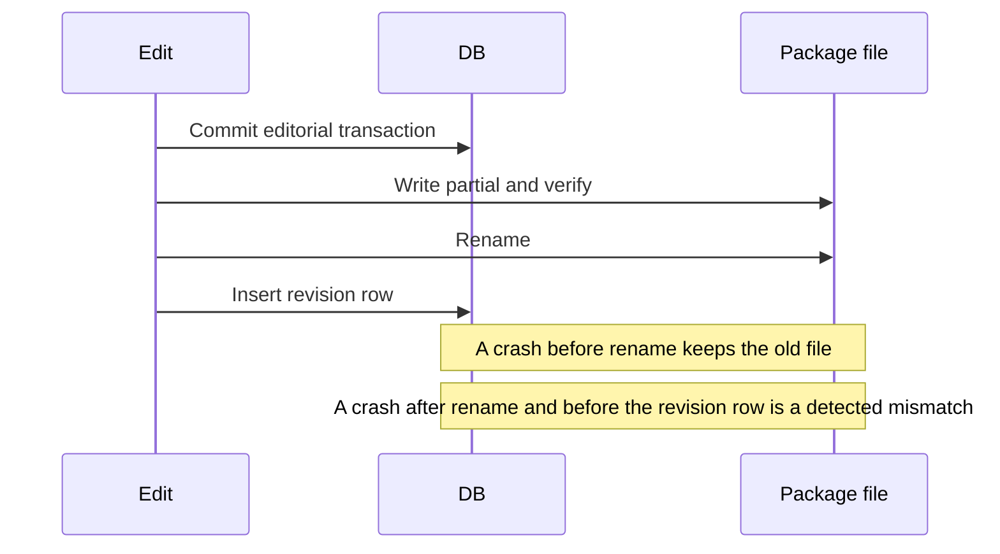
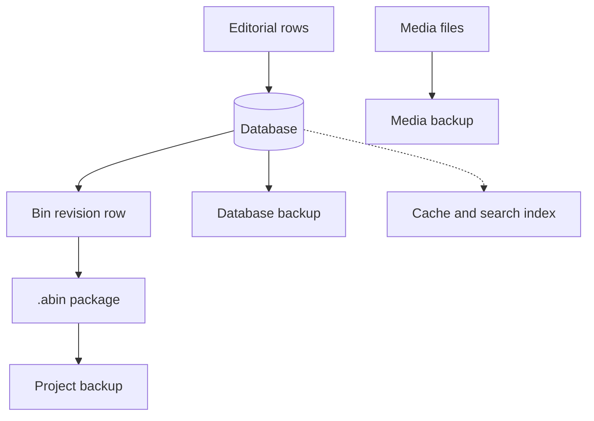

# AETHER bin revision and recovery

Status: proposal for review. Recovery behaviour is specified. No crash was induced and no backup was restored.

## Purpose

Specify atomic save, autosave, history, crash recovery, validation, import rollback, conflict detection, lock ownership, and snapshots, and keep the five backup classes separate.

## Scope

In scope: bin revisions and the project database records that make a bin recoverable. Media backup policy is named so it is not confused with cache. The byte-level media copier remains media management.

Out of scope: the first-release implementation of multi-writer merge. Conflict detection that reports two revisions is in scope. Automatic merge is not.

## Requirements

- A save publishes either a complete new revision or leaves the previous revision current.
- Autosave protects the open project without treating cache as editorial storage.
- History can restore a prior bin revision.
- A crash during save or import does not leave a bin that opens as if the broken write had succeeded.
- Writes are validated before they become current: member hashes, foreign keys, and dependency projection.
- Import rollback returns the destination to the pre-import revision.
- Two revisions of one bin id are a conflict. The application reports both. It does not pick one silently.
- A lock has an owner. A non-owner does not write.
- Snapshots exist for the project database and for bin packages.
- Project backup, bin revision, database backup, media backup, and cache are different stores. Cache is never the only copy of a name, a cut, a comment, or a membership.

## Verified facts

- `docs/SYSTEM_ARCHITECTURE.md` already says a manifest hash and the database cross-check each other, and that disagreement opens recovery.
- `docs/PROJECT_ARCHITECTURE.md` already separates settings from the manifest and treats the lock as visible.
- Cache directories are already defined as regenerable in `docs/PROJECT_FOLDER_SPECIFICATION.md`.
- No recovery drill was run for bins, because no bin writer exists.

## Engineering recommendations

- Autosave the SQLite database on a short interval and at every committed bin command. Rewrite the `.abin` on explicit save and on a longer checkpoint. The interval lengths are unresolved decision 2.
- Store package snapshots by hash under the backup role so identical revisions are stored once.
- After a crash, open read-only until validation finishes. A writable open of a half-checked project is how a second save buries the evidence.

## Proposed behaviour

### Stores

| Store | Holds | Deleting it |
| --- | --- | --- |
| Project backup | A snapshot of the project directory’s editorial control files: database backup, manifest, settings, and the package files that were current | Confirmation. This is the broad safety copy |
| Bin revision | `BinRevisions` rows and the package file each hash names | Old revisions may be pruned by a retention rule the person sets. The current revision is not pruned |
| Database backup | A checkpointed copy of `project.db` | Confirmation. Distinct from deleting a bin inside the live database |
| Media backup | Copies of originals or managed media the person sent to a backup volume | Confirmation. Never an automatic side effect of bin delete |
| Cache | Thumbnails, waveforms, search index, `*.abin.partial` | Safe. The next session rebuilds aids. Partials are junk |

A thumbnail is not a revision. A search index is not a revision. A log file under `LOGS/BIN_OPERATIONS/` is not a revision. The log helps a person. Restore uses the database and the packages.

### Save

1. Refuse if this session does not hold the write lock.
2. Build the package document from the committed database rows of this bin. If the database transaction for the edit has not committed, save commits it first or refuses. Save does not write a package from uncommitted memory that the database does not hold.
3. Write `name.abin.partial`, fsync, verify hashes and the dependency walk.
4. Rename over the checkpoint path.
5. Insert the `BinRevisions` row with parent revision, hash, station, and time, in a short transaction.
6. If step 5 fails, the next open sees a package hash that the database does not list. That is a conflict report, not a corrupt bin. Both the previous database revision and the new file are intact.

### Autosave

Autosave commits dirty sequence and metadata edits to the database and appends a recovery journal the timeline specification already allows. It does not rename the `.abin` on every keystroke. If the process dies, the database contains the autosaved rows and the package file may be one checkpoint behind. Open reports “database is newer than the package” with both times. The person may write the package from the database or restore the package’s revision over the autosave. The dialog has no timeout.

### Validation

Before a revision becomes the current `package_hash` on the bin row:

- ZIP and member hashes match.
- Registry object ids match the typed members.
- Foreign keys hold in the database.
- The dependency walk matches `dependencies.json`.
- Schema version is known.

A failure at validation deletes the partial and leaves the previous current hash. A failure of the database constraints rolls back the editorial transaction before a package is attempted.

### Crash cases

| Crash point | What the next open does |
| --- | --- |
| Inside the editorial transaction | Database rolls back. Package unchanged. Open the previous revision |
| After the database commit, while writing the partial | Ignore the partial. Database is ahead of the package. Report it |
| After a verified rename, before the revision row | Report mismatch. Offer to adopt the verified package hash or to rewrite the package from the database. Show both revision ids |
| During import commit | Database rolls back. Destination bin unchanged |
| During share publish | `complete` is false or the new folder is absent. Previous share, if any, remains |

Open does not delete the unfamiliar file. Adoption and rewrite are commands.

### History and snapshots

`BinRevisions` is a chain via `parent_revision_id`. Restoring an old revision loads that package into a transaction that replaces the bin’s current rows and writes a new revision whose parent is the current one and whose note says which revision was restored. History is not rewritten. The restored content is a new revision that happens to match an old hash.

A project snapshot copies the database through the backup API and copies the current package files by hash. A media snapshot is a separate command with its own volume. The UI names the five stores in the backup dialog so a person can see that “back up project” did not copy camera originals unless they included media backup.

Retention: the current revision, and the revisions a person has pinned, are kept. Unpinned package files older than the retention count may be deleted by a maintenance command. The command lists the hashes it will remove. It does not remove media backups. The default retention count is unresolved. Recommendation: keep 50 bin revisions per bin or 30 days, whichever the person chooses, with 50 as the suggested number in the dialog.

### Conflicts and locks

A conflict exists when any of these differ for one bin id:

- Database `package_hash` and the file at `package_path_hint`.
- Two packages the person imports that share a bin id and differ in revision id.
- A lock owner who is not this station, with a fresh heartbeat.

The report shows both revision ids, both times, and both stations. Choices are: keep local, keep incoming, duplicate the incoming bin under a new bin id, or cancel. There is no merge in the first release. A future collaboration release may add a merge. The revision chain is what that merge will read. The first release already stores parent ids so a later merge has history to stand on.

Lock ownership:

| Field | Use |
| --- | --- |
| `owner_station` | The station name |
| `mode` | `write` or `read` |
| `heartbeat_at` | Freshness |
| Process identity | Stored in the lock note so a local stale lock can be tied to a dead process |

A dead local process is still a stale lock. The person confirms the clear. The confirmation text names the station and the time. It does not clear locks that belong to another station name. Those need the same confirmation plus a typed station name, so a mis-click on a shared folder does not steal a live writer. First release rarely sees a remote lock. The confirmation rule is still specified.

### Import rollback

Specified in the import document. Recovery’s additional rule: if the application cannot prove the import transaction committed, it treats the import as uncommitted. It does not run a forward repair. The person’s next action is to import again.

### Diagram of stores

The dashed line is a rebuild. Cache is not an input to restore.

### Interfaces

| Call | Behaviour |
| --- | --- |
| `revision.save(bin_id)` | The save steps |
| `revision.restore(revision_id)` | New revision with old content |
| `revision.validate(path)` | Hashes and graph |
| `recovery.open(project)` | Read-only check, then a report |
| `lock.acquire`, `lock.release`, `lock.reportStale` | Ownership |

### Operations

Save, autosave, checkpoint, validate, restore, adopt package hash, rewrite package from database, clear stale lock, snapshot, prune unpinned revisions.

### Failure scenarios

| Failure | Editorial data |
| --- | --- |
| Disk full during partial write | Previous package and previous or rolled-back database remain |
| Checksum mismatch on restore source | Restore refuses. Current bin stays |
| Person deletes cache to “clean the project” | Bins and sequences remain |
| Person deletes `project.db` and keeps packages | Open fails as a project. Packages can be imported into a new project. The import report says the database backup is missing |
| Person keeps the database and deletes packages | Open succeeds with “portable copy missing”. A checkpoint can rewrite the packages from the database |
| Two stations save two copies and later both are imported | Conflict dialog. No silent winner |

### Recovery procedure on open

1. Open the database with foreign keys on. If the file is not a database, stop and offer a database backup.
2. Run `integrity_check` when the last session did not close cleanly. A failed check stops and offers a database backup.
3. Compare the manifest project id with the database project id. A mismatch stops.
4. For each bin whose `deleted_at` is null, compare `package_hash` with the file. Record mismatches. Do not overwrite.
5. Rebuild a stale dependency projection or mark it stale if the rebuild fails.
6. Present one recovery report. The person chooses actions. Until they choose, the project stays read-only if any mismatch or failed integrity check exists. A clean open with only offline media is writable. Offline media is not damage.

### Performance

Autosave writes the dirty rows, not a full project dump, on each interval. Package checkpoint writes one bin. Snapshot of the database is a backup-API copy. Hashing a package streams the file. None of these run on the audio callback or on the UI thread. The design target is a feature-length sequence save that does not drop the monitoring stream. That target is a requirement on the scheduler, not a measured latency.

### Compatibility

A revision row stores the schema version of the package it points at. Restore of an older schema migrates in memory through the serializer and writes a new revision at the current schema. The old package file is left unchanged so the chain still verifies. A newer package than this build understands is reported and not restored into the working tables.

Lock rows from a future collaboration build are kept. This build honours `owner_station` and `mode` and ignores unknown lock flags by retaining them in the note field.

## Rationale

| Decision | Rationale |
| --- | --- |
| Database commit before package publish | The working authority has to contain anything the package claims after a successful save. Publishing a package from unsaved memory creates a third store |
| Mismatch is a conflict | Choosing the newer timestamp silently is how an autosave and a careful manual package destroy each other |
| Restore appends a revision | Erasing the chain removes the way back |
| Five named stores | Editors say “backup” and mean different disks. The dialog has to use the same words as the risk |
| Read-only until the report is answered | A writable session on a mismatched bin will checkpoint the wrong winner |

## Acceptance criteria

Specified, not executed.

- A save that is killed while the partial file is being written leaves the previous `.abin` hash unchanged and the bin readable.
- A save that is killed after a verified rename and before the revision insert produces a mismatch report and does not mark the bin corrupt.
- An import killed during commit leaves the destination object count unchanged.
- Restoring an older revision creates a new revision and leaves the older package file in place.
- Deleting the thumbnail cache and the search index leaves display names, comments, memberships, and sequence instances intact.
- A project backup, a bin revision, a database backup, a media backup, and cache are separate actions in the specification and in the recovery report.
- Two different revision ids for one bin id require a choice before either becomes current.
- A session that does not own the write lock cannot save.
- `integrity_check` failure on open does not continue into a normal writable session.
- Cache is not accepted as a restore source for a missing object row.

## Unresolved questions

- Autosave and checkpoint intervals, and revision retention count. Recommendations are in the architecture decision list and in this document.
- Whether the recovery journal for unsaved timeline edits lives inside SQLite or beside it. The timeline specification allows either. Recommendation: inside SQLite so there is not a fourth editorial store.
- How large a package snapshot store may grow before the maintenance command becomes mandatory. Open. The command stays manual in the first release.
- Crash-injection method for the eventual tests. Recommendation: a test double that stops the writer at named steps. That double is part of the test plan and is not a production hook.
