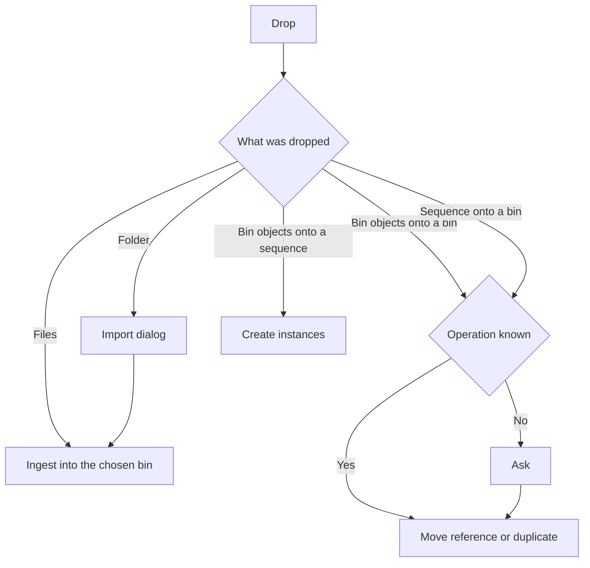

# AETHER bin user interface specification

Status: proposal for review. No window was built. The layout follows `docs/UI_UX_DESIGN_SYSTEM.md`: bins in the left column, inspector under them, dark theme by default, keyboard-first commands. This document specifies bin behaviour. It does not specify another product’s icons, colours, or window chrome.

## Purpose

Specify how editors see and manipulate bins: several bins at once, views, columns, selection, drag and drop, and the status marks a feature cutting room needs.

## Scope

In scope: the bin surface, its commands, and the drag rules that connect bins, media files, and sequences.

Out of scope: timeline drawing, monitor drawing, and the visual design of buttons beyond the states this surface must show. Those stay in the UI design system and the timeline specification.

## Requirements

- More than one bin can be open, as tabs or as separate windows.
- Views: text, thumbnail, and frame. Columns are sortable. Custom columns exist. Columns can be rearranged.
- Search and filter work on the open bin and across the project index.
- Multi-select works with the keyboard and the pointer.
- Drag and drop follows the rules in this document. An ambiguous drop asks.
- Metadata and comments are editable in the inspector.
- Each row shows identity enough to tell a shared reference from a duplicate, plus offline, proxy, usage, dependency, lock, and revision state.
- The view is virtualized. Thumbnails load asynchronously. Queries are indexed. The design target is thousands of objects.
- A filesystem folder dropped on the surface starts import. It does not create a bin.
- The Delete key removes membership. It does not delete media files.

## Verified facts

- The design system places bins above the inspector in the left column and requires the interface to work at laptop width and on a second monitor.
- The design system forbids decorative motion and requires an offline mark that is not colour alone.
- No bin widget was laid out in a running application.

## Engineering recommendations

- The view asks the application for a window of rows: offset, limit, sort, filter. It does not receive the whole bin as a widget model.
- Thumbnails are requested by object id and frame. A missing thumbnail is an empty frame with the display name. The request is cancelable when the row scrolls away.
- Commands come from the command catalogue. The widget does not update membership locally and then “sync”.
- Persist column layout in the bin display config when the person saves the bin. Persist workstation-only scroll and selection outside the package.

## Proposed behaviour

### Surfaces

| Surface | Behaviour |
| --- | --- |
| Bin tabs | One project column can show several bins. The active tab receives paste and delete |
| Bin window | A bin can be torn off to another monitor. Closing the window closes that view. It does not delete the bin |
| Inspector | The selection’s name, object id, media id, comment, metadata, usage, and dependency summary |
| Unassigned list | A project view, not a bin, of objects with no membership |
| Filter editor | A saved query. Saving it does not create a bin |

Empty bin: one line, “This bin is empty”, and the commands to import media or to create a sequence. No illustration.

Loading: the bin name and a progress line if a package is validating.

Error: the recovery wording. Rows are not shown as trustworthy when validation failed.

### Views

| View | Row contents |
| --- | --- |
| Text | Columns |
| Thumbnail | A grid of poster frames, display name, and the status marks |
| Frame | The same grid with a filmstrip for the selected object, frames requested around the source in-point |

Sort applies in every view. The frame view’s filmstrip does not change the object’s in and out. Changing in and out is an explicit command.

### Columns

Factory columns: display name, object type, essence kind, duration, timecode, frame rate, reel, camera, comment, media id, object id, offline state, proxy state, usage count, dependency summary, lock, revision, source filename.

Custom columns are metadata definitions marked visible. The person adds a definition with a name and a value type. The new column appears. Values edit in the cell or in the inspector.

The person reorders columns by dragging the header or by a list in the column chooser. Hide and show are commands. Sort is a header command and a keyboard command. A sort on a custom column uses the index.

Object id and media id are hidden by default and available in the chooser, so the identity is present when an assistant needs it and the default view stays readable.

### Selection and commands

Multi-select is shift for a range and the platform disjoint modifier for individual rows. Select-all respects the current filter. The status line shows the count.

| Command | Gesture | Core command |
| --- | --- | --- |
| Rename | Return on the name, or the inspector | `bin.rename` on a bin, object rename on an object |
| Move | Drag to another bin with the move modifier, or the menu | `bin.moveObjects` |
| Reference | Drag with the reference modifier, or the menu | `bin.referenceObjects` |
| Duplicate | Drag with the duplicate modifier, or the menu | `bin.duplicateObjects` |
| Remove from bin | Delete or Backspace | `bin.removeObjects` |
| Comment | Inspector field | Metadata edit |
| Reveal usage | A command in the inspector | Query instances and memberships |

The modifiers are part of the AETHER shortcut map. This specification does not copy another editor’s modifier list. The factory map is an open item in the design system. Until it exists, the bin menu shows Move, Reference, and Duplicate as separate items so the pointer is never the only way.

If the person drops a selection without a modifier that selects the operation, the UI asks: Move, Reference, or Duplicate. Cancel leaves both bins unchanged. The question names the count and whether a sequence is included.

### Drag rules

| Source | Target | Result |
| --- | --- | --- |
| Media files from a filesystem browser | A bin | Register or relink through media management, then create master clips in that bin. Existing media ids are cited. Files are not moved |
| A storage folder | A bin or the bin column | Start import of the folder’s media into a bin the person confirms. A new bin is created only if the person chooses “New bin” in that dialog. The folder itself is not the bin |
| Objects from one bin | Another bin | Move, reference, or duplicate, by modifier or by the question |
| Objects from a bin | A sequence in the timeline | Create timeline instances on the targeted tracks. The instances cite the object ids and the media ids |
| A sequence object | A bin | Reference or duplicate, by modifier or by the question. Duplicate uses the shallow sequence duplicate unless the person chooses deep |
| A sequence object | A timeline | Nest, using the timeline nest command. The new instance cites the sequence object id |
| A bin tab | A filesystem folder | Export a share or a package into that folder. It does not turn the bin into that folder |

A drop that the UI cannot classify is cancelled with a one-line reason. The model is unchanged.



### Status marks

Each mark has an icon or a word and a text label, so colour is not the only signal.

| Mark | When |
| --- | --- |
| Offline | Required media has no online location |
| Proxy | A proxy is what playback will use, or a proxy is missing while the original is online. The label says which |
| Usage | Count of instances and of other bins. The inspector lists them |
| Dependency | Warning when the closure has missing, unsupported, or stale items |
| Lock | Another station holds the write lock, or this station holds it |
| Revision | The short revision id and the time in the inspector |
| Reference | The row is a reference membership. A duplicate is an ordinary resident row with a different object id |
| Shared metadata | Shown on a reference row so a comment edit is understood to change every membership |

### Search and filter

The find field filters the open view as the person types, against the index: name, comment, reel, camera, metadata values, object id, and media id. A project search opens a result list grouped by bin. Choosing a result reveals the row in that bin. The result list is not a bin.

Filters combine predicates. They can be saved with the bin or kept on the workstation. A filter does not change membership.

### Scale behaviour

The text view recycles row widgets. The thumbnail view recycles cells and cancels thumbnail jobs for cells that leave the window. Sorting and filtering run as indexed queries and return a new window. A 10,000-row bin does not create 10,000 widgets. This is a design constraint. It is not a frame-time measurement.

The UI remains usable while a thumbnail job or a checksum job runs. Those jobs appear in the jobs list. They do not modal-block the bin.

### Keyboard

When the bin has focus, arrow keys move the selection, type-ahead jumps by display name, and the command catalogue handles rename, remove, duplicate, and find. Play on a selected object loads it in the Source Monitor. The Source Monitor receives the object id. Focus return is visible.

### Interfaces

The widget talks to application queries and commands. Queries return row snapshots:

```json
{
  "object_id": "obj_4c2e8a10-22b1-4f03-9d55-18e0a77c0102",
  "display_name": "A001C001_select",
  "object_type": "subclip",
  "media_id": "med_6f0e2c44-91ab-4d10-8e77-2a9c0b11d001",
  "membership_kind": "resident",
  "availability": "proxy_only",
  "usage_count": 1,
  "dependency": "warning",
  "revision": 1
}
```

The snapshot is a view. The widget does not write it back. Edits go through commands.

### Operations

Open view, change view mode, sort, filter, select, rename, drag, drop, ask, edit metadata, reveal usage, save display config. None of these copy a media file. Import and export commands open their own dialogs as specified in the import and portability documents.

### Failure scenarios

| Situation | UI |
| --- | --- |
| Drop a folder | Import dialog. No new bin until the person confirms that choice |
| Drop objects with no modifier | Question. Cancel changes nothing |
| Drop onto a locked bin the station does not own | The drop is refused. The lock owner and time are shown |
| Thumbnail job fails | Empty frame and a jobs-list error. The row remains |
| Search index missing | Name query falls back to a database scan for the open bin, and a job rebuilds the index. Results are labelled “index rebuilding” if they are partial |
| Delete pressed with a selection | Confirmation names the count and says the media files stay. Sequences that still use the objects are named |

### Recovery

A view crash, if the UI process dies, does not write a partial membership. Unsaved cell edits that were not committed through a command are lost, and the recovery open shows the last committed names. The inspector does not keep a private copy of comments.

Display config that failed to save leaves the previous display config in the package. The next open uses that config.

### Performance

Windowed queries, recycled widgets, asynchronous thumbnails, and indexed search are required at the design target of 10,000 objects in a bin. Column resize does not reload the bin. Scroll position is restored per view on the workstation. Thumbnail decode is a processing job and never runs on the UI thread that owns the pointer.

### Compatibility

A display config from a newer schema with unknown column keys shows the known columns and lists the unknown keys in the column chooser as “unsupported column”. It does not delete those keys from the package on save. Custom metadata types the build cannot edit appear read-only with their `value_text`.

### Sample structure

Column layout inside `display.json`:

```json
{
  "view_mode": "text",
  "sort": { "key": "display_name", "direction": "ascending" },
  "columns": [
    { "key": "display_name", "width": 240 },
    { "key": "timecode_start", "width": 120 },
    { "key": "reel", "width": 80 },
    { "key": "comment", "width": 200 },
    { "key": "meta_scene", "width": 80 }
  ]
}
```

## Rationale

| Decision | Rationale |
| --- | --- |
| Ask on an ambiguous drop | A feature cut lost to a shared-metadata surprise is worse than one dialog |
| Folder drop starts import | The assignment’s model says a folder is not a bin. The dialog can still create a bin as a named choice |
| Delete removes membership | The dangerous file delete stays on a media command with a usage list |
| Object id available and hidden | Assistants need it when ids collide. The daily view does not have to lead with UUIDs |
| Virtualized from the first implementation of the view | A bin that works for a hundred clips and stalls on a shoot day will be abandoned |

## Acceptance criteria

Specified, not executed.

- Two bins can be open at once. Closing one view leaves the other bin’s objects in the registry.
- Text, thumbnail, and frame views show the same object ids for the same filter.
- A custom metadata column displays values and survives a package round-trip.
- A folder drop opens an import path and does not create a bin unless the person selects that option.
- A drop of objects between bins without an operation asks, and cancel leaves memberships unchanged.
- A drop onto a sequence creates instances whose object ids and media ids match the dragged objects.
- Delete on a selection leaves the media file’s checksum unchanged.
- A bin of the design-target size requests a row window rather than a full materialised widget list. This is checked by a test of the query interface once it exists.
- Offline rows show a label, not only a colour.
- A locked bin refuses a drop from a station that is not the owner.

## Unresolved questions

- Factory modifiers for move, reference, and duplicate. They wait on the AETHER shortcut map. The menu items are specified now.
- Frame-view filmstrip frame count. Recommendation: the visible width in frames, loaded asynchronously, defaulting to a poster plus neighbours.
- Whether thumbnail and frame views are in the first UI phase or follow a working text view. Recommendation: text view first, then thumbnail, then frame, inside phase 7. The data model does not change between them.
- Touch input. Out of scope. Pointer and keyboard are the specified inputs.
