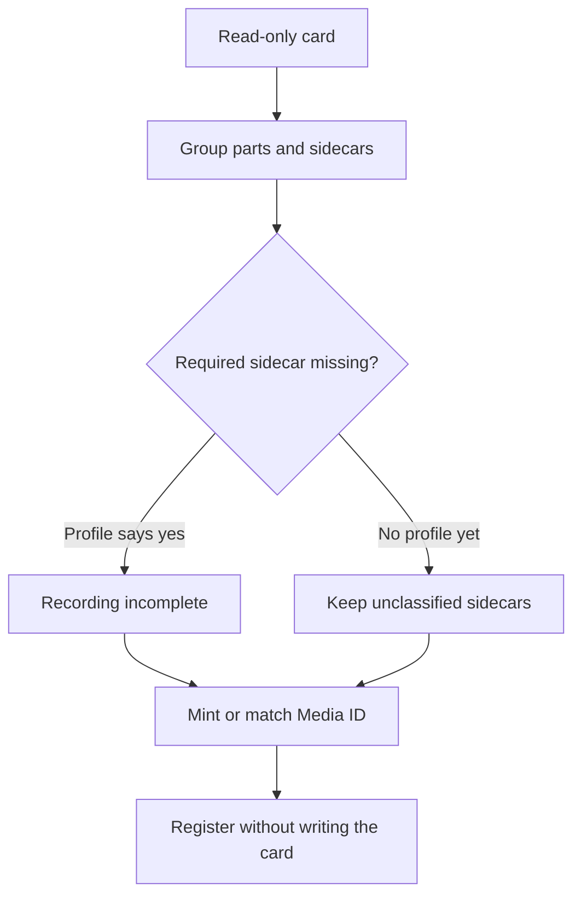

# AETHER camera media ingest

Status: proposal for review. Specification only. No camera card was mounted. No sidecar was parsed. Format names are targets for later readers, not claims that a reader exists.

## Verified facts

- The master ingest pipeline is inspect, metadata, type, Media ID, duplicate check, copy or link, verify, register (`docs/MEDIA_INGESTION_SPECIFICATION.md`). This document specialises that pipeline for camera cards and sound rolls.
- Original camera media named by the brief includes ARRIRAW, R3D, BRAW, X-OCN, ProRes, DNx, H.264, H.265, CinemaDNG, WAV, and BWF, and other containers the user links. None was read.
- BWF is described by EBU Tech 3285. Citing that document is not a parse of a file.
- The prior FFmpeg study is not an ingest test (`docs/MEDIA_INGESTION_SPECIFICATION.md`).

## Engineering recommendations

- Treat a camera card as read-only. Copies and proxies go to managed roles.
- Group spanned parts and required sidecars into one logical recording before minting a Media ID.
- Leave unknown camera fields `unknown` or `absent`. A missing serial is normal for some deliveries and must still ingest the picture if the essence itself is readable, while the camera group records the absence.

## Proposed behaviour

### Scope

Camera ingest creates logical recordings and Media IDs from cards, scanned folders, and sound rolls. It feeds the registry. It does not build sequences. Relink of an already minted id is the relink engine, even when the files came from a card originally.

### Requirements

For each logical recording, store these fields with availability (`MEDIA_IDENTITY_SPECIFICATION.md`):

| Field | Group |
| --- | --- |
| Camera id | Camera |
| Model | Camera |
| Serial | Camera |
| Card id | Camera |
| Reel | Camera |
| Roll | Camera |
| Clip id | Camera |
| Record time | Camera |
| Timecode | Video or audio |
| Filename | Identity, historical |
| Folder | Identity, historical |
| Native metadata | A preserved blob or a list of sidecar references, with availability |

Additional rules:

- Spanned clips are one logical recording, one Media ID, and an ordered list of parts.
- Required sidecars stay on that recording. A copy or consolidate that omits a required sidecar is a failed copy.
- The ingest does not delete, rename, or write onto the card. A marker file on a camera card is forbidden, consistent with the master storage note.
- CinemaDNG and other stills sequences that the user ingested as one clip are one Media ID and a frame pattern, as in the master ingest specification.
- A WAV or BWF beside picture is a separate Media ID unless a trusted camera grouping says they are one recording. Ungrouped neighbours may be offered as sync candidates. They are linked only after confirmation (architecture decision 14).
- Duplicate detection uses the matcher. It does not use filename alone.

Required sidecars are declared by a camera profile. No profile in this document has a frozen file list, because no card was read (architecture decision 13). Until a profile is accepted, ingest records every sibling file the user included as an attached sidecar with requirement `unclassified`, and it does not drop those files. A later profile may mark some of them required. It may not silently discard the ones already stored.

### Data model

```text
logical_recording
  media_id
  family              text
  parts               ordered list of {path, index, size, checksum_state}
  sidecars            list of {path, role, requirement}
  camera              availability group
  native_metadata     availability wrapper

sidecar.requirement   required | optional | unclassified
sidecar.role          metadata | look | audio | unknown
```

`family` is a label such as `arri_raw`, `r3d`, `braw`, `x_ocn`, `prores`, `dnx`, `h264`, `h265`, `cinemadng`, `wav`, `bwf`, or `other`. The label selects a future parser. Unknown labels are `other` and still receive a Media ID if the user links them.



### APIs

| Operation | Contract |
| --- | --- |
| `Ingest.scan(card_path)` | Read-only inventory. Writes nothing. |
| `Ingest.group(inventory)` | Returns proposed logical recordings. |
| `Ingest.commit(recording, mode)` | `mode` is `link` or `copy`. Mint or match happens inside the registry transaction. |
| `Ingest.attachSidecar(media_id, sidecar)` | Adds a sidecar row. Refuses a write that would place the sidecar by modifying the original part. |

`scan` does not call the timeline. `commit` in copy mode writes to a managed destination using the master ingest rules: temporary name, verify, then rename into place.

### Workflow

1. The user selects a card or a folder.
2. Scan lists files without modifying them.
3. Group proposes recordings. The user can split or join before commit when the proposal is wrong.
4. Commit links or copies. Copy verifies size and starts the checksum job.
5. The bin shows the new master clip, the Media ID, and camera fields that are `present`. Absent serials display as absent, not as empty strings that look like “no camera”.
6. Proxy generation is a later request, not an implicit ingest step, unless a project policy asked for a preset.

Spanned parts that are incomplete (a missing middle span) register as `incomplete` and are not a passed original for conform. The Media ID still exists so the editor can offline-cut once a proxy policy exists, or wait. A proxy of an incomplete span is not `passed`.

### Validation

- Ordered parts have unique indexes starting at the camera’s own first index when that index is known. The specification does not assume every camera starts at 1.
- A required sidecar path is recorded and, in copy mode, the copy’s checksum is pending or complete.
- Card path and managed path differ in copy mode.
- No path inside the card root is a write destination.
- Camera fields all have availability.

### Errors

| Error | Result |
| --- | --- |
| Card disappears mid-scan | Inventory marked incomplete. No partial mint. |
| Copy checksum mismatch | Managed copy quarantined. Card untouched. No passed original location for the copy. The link mode is unaffected if the user only linked. |
| Required sidecar missing under an accepted profile | Recording stored as `incomplete`. Conform cannot verify it. |
| Parser not installed for the family | Essence may still be linked if the user confirms “index without playback”, matching the master ingest rule for unknown types. Camera fields stay `unknown`. |
| Attempt to write a metadata file onto the card | Refused. |

### Recovery

An interrupted copy resumes from the job row and the same Media ID, as in the master ingest pause and retry rules. An interrupted scan is discarded and run again. It has no registry effect. Sidecar bytes on the card are the recovery source. AETHER does not need to have rewritten them.

### Performance

Scan lists directory entries and reads headers a probe marks as necessary. It does not transcode during scan. Grouping is in memory over the inventory. No card benchmark was run. Background checksums follow registration and do not block the bin from showing the new id.

### Tests

Specified, not executed, under test A (one Media ID for a spanned fixture and for a stills sequence) and test E (copy to a new volume keeps the id). Additional specified cases: read-only card (no file on the card changes time or size), missing required sidecar once a profile exists, unclassified sidecars retained, and a WAV neighbour left as its own id until confirmation.

### Acceptance

- The camera field list from the brief is in the requirements table.
- Spanned parts and sidecars share one Media ID.
- The card is specified as read-only.
- Parsers and sidecar matrices are not pretended to exist.

## Unresolved questions

- Per-family required sidecar patterns. Architecture decision 13.
- Auto-sync of sound. Architecture decision 14.
- Whether a proprietary camera metadata blob is stored whole or only extracted keys. Recommendation: store the blob in the project’s managed metadata area when the user copied the card, and store extracted keys beside it. A link-only ingest stores paths to sidecars and extracted keys, not a rewrite of the blob.
- Image-sequence audio alignment when the WAV duration and the frame count disagree. Recommendation: register both, set `sync_warning`, and let the user decide. Do not trim either file.
