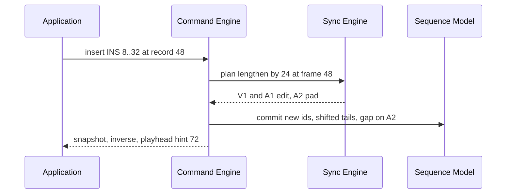

# AETHER Editorial Operations

Status: proposal, awaiting review. No implementation is authorized by this document.

This document specifies the operations named in [EDITORIAL_PHILOSOPHY.md](EDITORIAL_PHILOSOPHY.md). Trim math is in [TRIM_ENGINE_SPECIFICATION.md](TRIM_ENGINE_SPECIFICATION.md). The sync plan is in [TIMELINE_ENGINE_ARCHITECTURE.md](TIMELINE_ENGINE_ARCHITECTURE.md). Time is in [TIMEBASE_AND_FRAME_ACCURACY.md](TIMEBASE_AND_FRAME_ACCURACY.md).

Every operation is one Editorial command. Success replaces the document and returns an inverse. Failure leaves the document unchanged and names the limiting track or item. The Application owns undo. Playhead hints are session policy.

Ranges are half-open. The reel used in the examples is sequence "Reel 1" at 24/1, start frame 0, duration 240.

| Track | Item | Record | Source | Asset | Link |
| --- | --- | --- | --- | --- | --- |
| V1 | A | [0, 48) | [100, 148) | WS | G1 |
| V1 | B | [48, 144) | [10, 106) | WS | G2 |
| V1 | C | [144, 240) | [0, 96) | CU | G3 |
| A1 | A-a | [0, 48) | [100, 148) | WS | G1 |
| A1 | B-a | [48, 144) | [10, 106) | WS | G2 |
| A1 | C-a | [144, 240) | [0, 96) | CU | G3 |
| A2 | Music | [0, 240) | [0, 240) | MX | none |

WS holds `[0, 400)`, CU holds `[0, 200)`, MX holds `[0, 1000)`. All tracks are unlocked and sync-locked. No targets are lit unless an example says so. Patch maps V to V1, A1 to A1, and leaves A2 unpatched from the source.

A second source, INS, holds `[0, 80)`.

## 1. Three-point completion

INSERT and REPLACE take source material and a record destination. Four positions exist. Three are set. Park may supply the missing end on a side that already has one explicit mark.

| Given | Computed |
| --- | --- |
| Source in, source out, record in | Record out = record in + source duration, mapped into the sequence rate. |
| Source in, source out, record out | Record in = record out − source duration. |
| Record in, record out, source in | Source out = source in + record duration, mapped into the source rate. |
| Record in, record out, source out | Source in = source out − the source length the record duration requires. |

The mapping is the integer rule in the timebase document. At matching rates the durations are equal. When all four are set and the durations disagree, the command fails. The first command set does not fit one duration into the other.

A side with neither mark and no parked playhead does not define a span. The command fails. A side with one mark uses the playhead on that side as park. The span is `[min, max)` of the mark and the park.

## 2. INSERT

**Command id.** `insert`

**Summary.** Splice the source span into the targeted tracks at the record in point. The tail moves later. Untargeted sync-locked tracks gain a gap of the same length.

**Preconditions.**

- The source span lies inside the known source duration when one is stored.
- The record in point is a sequence frame inside the sequence or exactly at its end.
- At least one unlocked targeted track is patched from the source. With no targets lit, every unlocked patched track is a target.
- A locked track is not a target. If the patch aimed only at locked tracks, the command fails.

**Affected clips and tracks.**

- Each targeted track is split at the record in point if an item covers that frame.
- A new clip is inserted with the source range. Picture and sound laid by the same command form a new link group.
- Items that started at or after the record in point on targeted tracks shift later by the inserted duration.
- Other sync-locked, unlocked tracks pad a gap of that duration at the same frame and shift their tails.
- Locked tracks and tracks with sync lock off hold. A sync anchor is written at the splice.

**Source in and out.** The new clip stores the source span. The source asset and the source viewer's marks are unchanged.

**Timeline position.** The playhead hint is the record end of the inserted span, the first frame after the new material.

**Sequence duration.** Grows by the inserted duration when the shifted tracks define the end, which they do when every track that previously defined the end participated or was padded. A held track that already ended later can leave the duration unchanged only if it was already longer than the new end. In the reel, an insert in the middle grows the duration.

**Sync.** Pad on sync-locked tracks that did not receive media. Hold and anchor on the others. Linked items that were split keep the link on the left piece; the right piece stays in that group only when it is the continuation of the same item, and the group's record-start difference is updated to the new positions of those continuations. The inserted clips have their own group.

**Undo and redo.** The inverse removes the new ids, restores the split item, shifts the tails back, and removes the pad gaps and the anchors this command wrote. Redo repeats the insert.

**Edge cases.**

- Insert at the sequence end appends. The pad on other sync-locked tracks is a gap at the old end, so those tracks grow too and stay aligned.
- Insert on a single isolated track with sync lock off on every other track shifts only that track and writes anchors. Duration becomes the new maximum end.
- A splice that falls inside a transition fails and names the transition. The editor removes the transition, or inserts on a frame the transition does not occupy.
- Partial source frames at mixed rates use the picture-selection rule in ADR-002. The clip stores the source range the editor marked and the sequence range. The sequence rate does not replace the source timing.

**Example.** Source INS `[8, 32)`, record in 48, targets V1 and A1. Duration of the insert is 24.

| Track | After |
| --- | --- |
| V1 | A `[0, 48)`, new clip `[48, 72)` source `[8, 32)`, B `[72, 168)` source `[10, 106)`, C `[168, 264)` source `[0, 96)` |
| A1 | The same record ranges, linked to the picture, including a new group on the inserted pair |
| A2 | Music `[0, 48)` source `[0, 48)`, gap `[48, 72)`, music `[72, 264)` source `[48, 240)` |

Sequence duration becomes 264. The playhead hint is 72. A2 stayed in sync by the pad. No anchor is written.

## 3. REPLACE

**Command id.** `overwrite`

**Summary.** Cover a record span with the source span. Later items keep their record starts. Sequence duration changes only when the covered span extends past the current end.

**Preconditions.** The three-point rule yields a positive duration. The source span lies inside the known source. Targets exist and are unlocked. A locked track under the span is skipped and reported as held. If every aimed track is locked, the command fails.

**Affected clips and tracks.**

- On each targeted track, items are split at the record in and record out.
- The material strictly inside `[record in, record out)` is retired.
- A new clip occupies that span with the source range.
- Items that began at or after record out keep their ranges.
- Sync-locked tracks that were not targeted are left alone. Replace does not pad and does not close.

**Source in and out.** The new clip stores the source span. A partially covered item keeps the source frames that correspond to its surviving record range. Source marks in the viewer stay.

**Timeline position.** The playhead hint is the record out of the replacement.

**Sequence duration.** Unchanged when record out is at or before the current duration. Grows to record out when the replacement extends past the end. A held track is not shifted; extension is new tail, not drift of existing frames.

**Sync.** Existing alignments are preserved because nothing already on the timeline moves. The new clip links to the other new clips of the same command. A continuation of a split item keeps its previous link, with the record-start difference recomputed.

**Undo and redo.** The inverse restores the retired ids and ranges and removes the new ids.

**Edge cases.**

- Replace of a span that ends in the middle of a clip leaves a continuation. The continuation's source start advances by the covered source length at matching rates.
- Replace that lands exactly on an item retires that item.
- Replace into a gap writes the clip into the gap and leaves any uncovered remainder of the gap.
- A transition inside the span is retired with the span. A transition that only touches the boundary and belongs to a surviving cut stays.
- Backtimed replace uses record out and source out, and computes record in. The frames written are the same as if the ins had been given.

**Example.** Record span `[48, 72)`, source INS in at 8, source out computed as 32. Targets V1 and A1.

| Track | After |
| --- | --- |
| V1 | A unchanged. New clip `[48, 72)` source `[8, 32)`. B continuation `[72, 144)` source `[34, 106)`. C unchanged. |
| A1 | Matching record ranges and a new link on the replacement. B-a continuation keeps G2. |
| A2 | Unchanged `[0, 240)`. |

Duration stays 240. The playhead hint is 72. B gave up source frames `[10, 34)`.

## 4. REMOVE

**Command id.** `lift`

**Summary.** Lift the marked record span off the targeted tracks and leave a gap. Later items stay where they are.

**Preconditions.** The sequence span is non-empty. The aimed tracks are unlocked. With no target, every unlocked track that contains media in the span is aimed. Isolate restricts the command to the single item under the gesture. If the span covers no removable media on an aimed track, the command fails with an empty selection.

**Affected clips and tracks.**

- Items on aimed tracks are split at the span ends.
- The pieces strictly inside the span are retired.
- A gap item occupies the span.
- All other record ranges stay, including on sync-locked tracks.
- Link members are included unless isolate is set. Isolating one member lifts only that member and marks the group drifted when the record-start difference changes.

**Source in and out.** Retired clips take their source ranges with them into the inverse. Surviving continuations keep the source ranges that match their surviving record ranges. The asset is unchanged.

**Timeline position.** The playhead hint is the start of the gap.

**Sequence duration.** Unchanged.

**Sync.** Unchanged. No anchor is written. A gap holds the time, so later picture and sound still meet.

**Undo and redo.** The inverse puts the retired ids back into the span and removes the gap.

**Edge cases.**

- A span in the middle of one clip becomes gap plus continuation, and the continuation keeps the link.
- Remove of a whole linked pair leaves a gap on each of those tracks and leaves music untouched.
- Remove does not cross a locked track. The locked track is reported as held.
- Markers inside the span stay at their sequence frames. They are sequence time, and the time is still there.

**Example.** Remove `[48, 72)` on V1 and A1, link engaged.

| Track | After |
| --- | --- |
| V1 | A unchanged. Gap `[48, 72)`. B continuation `[72, 144)` source `[34, 106)`. C unchanged. |
| A1 | The same shape. |
| A2 | Unchanged. |

Duration stays 240. The playhead hint is 48.

## 5. DELETE

**Command id.** `extract`

**Summary.** Lift the marked span and close it. Sync-locked tracks that were not the editor's target also lose that many frames at that frame, so the tail stays aligned.

**Preconditions.** The span is non-empty and names removable media on the aimed tracks. With no target lit, every unlocked track that contains media in the span is aimed. Every track the sync plan assigns `close` contains that many frames from the span start. A track that does not is the limiting track and the command fails unchanged. Locked tracks are assigned `hold`, not `close`.

**Affected clips and tracks.**

- Aimed tracks lose the span, as in remove, and then the tail shifts earlier by the span duration.
- Other sync-locked, unlocked tracks close the same duration at the span start, splitting whatever occupies that frame.
- Held tracks keep their ranges. An anchor is written at the span start.

**Source in and out.** Removed pieces take their source ranges into the inverse. A close on a sync-locked track shortens or splits the occupant's source range by the same sequence duration, mapped when the rates differ. The asset file is unchanged.

**Timeline position.** The playhead hint is the frame of the join, which is the old span start.

**Sequence duration.** Shrinks by the span duration when every track that defined the end closed or was the target. A held track that still reaches the old end leaves the duration at that end.

**Sync.** Close keeps sync-locked tracks aligned, so no anchor is written for them. Held tracks gain an anchor. Positive anchor delta means the held track lies later than the tracks that closed.

**Undo and redo.** The inverse restores every retired id, shifts the tails back, and removes the anchors this command wrote.

**Edge cases.**

- Delete of a gap on one track, with isolate, closes only that gap when sync lock is off for the others, and records drift. With sync lock on, the other tracks close too.
- Delete that would cut through a transition the survivor still needs fails and names the transition.
- Delete with a sync-locked music bed cuts the bed. Sparing the bed is sync lock off on that track, or lock, before the command. Preview shows the cut.
- Delete of the last frames on every track shortens the sequence. Items are not required to leave a trailing gap.

**Example.** Delete B entirely, span `[48, 144)`, duration 96, link engaged, A2 sync-locked.

| Track | After |
| --- | --- |
| V1 | A `[0, 48)`. C `[48, 144)` source `[0, 96)`. |
| A1 | A-a `[0, 48)`. C-a `[48, 144)` source `[0, 96)`. |
| A2 | Music `[0, 48)` source `[0, 48)`. Music `[48, 144)` source `[144, 240)`. |

Duration becomes 144. The playhead hint is 48. The 96 frames of music that occupied `[48, 144)` are gone from the sequence and remain in the asset.

The same command with A2 sync lock off leaves music at `[0, 240)`, writes an anchor at 48 with delta `+96`, and the sequence duration stays 240 because music still ends there. Picture C now occupies `[48, 144)` while music under that same record range is source `[48, 144)`, which used to sit under B. The header shows `+96`.

## 6. SPLIT

**Command id.** `razor`

**Summary.** Write a cut at one sequence frame. Nothing moves.

**Preconditions.** The frame lies strictly inside at least one aimed item. A frame on a boundary is already a cut and the command fails as empty. Locked tracks are skipped. The default aim is the item under the gesture and its link group. An all-tracks variant aims at every unlocked track that has an interior at that frame.

**Affected clips and tracks.** Each aimed item that contains the frame becomes two items. The left item keeps the id and the link. The right item receives a new id and no link. Record ranges meet at the frame. Source ranges meet at the mapped source frame. Other tracks stay. Gaps split into two gaps only in the all-tracks variant; a gap split is otherwise a no-op and is not aimed by a link.

**Source in and out.** Left source is `[sourceStart, sourceAtFrame)`. Right source is `[sourceAtFrame, sourceEnd)`. The asset is unchanged.

**Timeline position.** The playhead hint is the split frame, the first frame of the right piece.

**Sequence duration.** Unchanged.

**Sync.** Unchanged. No anchor. Track sync does not participate, because the tails do not move.

**Undo and redo.** The inverse removes the right id, extends the left item, and restores the link.

**Edge cases.**

- Split inside a transition fails and names the transition. The editor splits beside it or removes the transition first.
- Split of a nest splits the outer clip. The inner sequence stays whole.
- Keyframes before the frame stay on the left item. Keyframes at or after the frame move to the right item, with the same sequence-frame values.
- Isolate splits one member of a link and leaves the other whole. The group stays on the left piece of the split member. The unsplit member remains in the group. The right piece is unlinked.

**Example.** Split B at frame 96. Link engaged, so B-a splits too.

| Piece | Record | Source | Link |
| --- | --- | --- | --- |
| B left, same id | [48, 96) | [10, 58) | G2 |
| B right, new id | [96, 144) | [58, 106) | none |
| B-a left | [48, 96) | [10, 58) | G2 |
| B-a right, new id | [96, 144) | [58, 106) | none |

A, C, and music are unchanged. Duration stays 240.

## 7. ROLL

**Command id.** `roll`

**Summary.** Move a cut. The left side and the right side change duration by opposite amounts. The sequence does not change length.

**Preconditions.** The edit point is a cut with a left item and a right item, or several such cuts at the same sequence frame. Both sides can absorb the delta under the trim specification. A gap may be one side.

**Affected clips and tracks.** The items that form the opened cuts. Link members at that frame are included unless isolate is set. Other tracks, including sync-locked music, stay. No pad and no close.

**Source in and out.** The left source end and the right source start move by the source delta. The left source start and the right source end stay. At matching rates the source delta equals the sequence delta.

**Timeline position.** The playhead hint is the new cut frame.

**Sequence duration.** Unchanged.

**Sync.** Unchanged when the link group moves together. Isolate rolls one item and marks the group drifted if the stored record-start difference changes.

**Undo and redo.** The inverse is the same roll with the negated delta, restoring source ranges. Ids are unchanged, so the inverse does not allocate.

**Edge cases.**

- Roll into a zero handle stops at the last legal frame on preview, and apply of a greater delta fails.
- Roll across a transition moves the transition with the cut. Insufficient remaining handle fails unchanged.
- Roll at the first frame or the last frame of the sequence, where one side is missing, fails.
- An offset link opens the same side of each member even when the members' boundaries differ, and fails on overlap, as the trim specification states.

**Example.** Roll the cut at 48 by `+4`. Link engaged.

| Item | Record after | Source after |
| --- | --- | --- |
| A, A-a | [0, 52) | [100, 152) |
| B, B-a | [52, 144) | [14, 106) |
| C, music | unchanged | unchanged |

Duration stays 240. The playhead hint is 52.

## 8. RIPPLE TRIM

**Command id.** `ripple`

**Summary.** Lengthen or shorten one side of an item, and move the tail of the sequence with it. Sync-locked tracks pad or close so they stay in step.

**Preconditions.** The opened points are heads or tails at one sequence frame. The delta is inside the legal limit from handles, item length, transitions, and the sync plan. A track assigned close must contain the frames. A track assigned pad must be able to take a gap at that frame.

**Affected clips and tracks.** The opened items, every item on their tracks that starts at or after the moved tail, and every other sync-locked track through the pad or close. Held tracks keep their media and gain an anchor when the duration changes.

**Source in and out.** The opened side's source edge moves by the mapped delta. Pad inserts a gap and does not change source ranges of the media it pushes. Close removes the source frames that occupied the closed record range.

**Timeline position.** The playhead hint is the edit point after the ripple. For a head ripple the cut frame stays and the hint stays on it. For a tail ripple the hint follows the tail.

**Sequence duration.** Changes by the delta, subject to a held track that still defines a longer end.

**Sync.** The plan in the engine architecture. Preview shows which tracks will be cut, padded, or left drifting before join.

**Undo and redo.** The inverse restores ranges, gaps, anchors, and keyframes. Ids of items that were only resized are stable. Ids retired by a close are restored by the inverse.

**Edge cases.**

- Ripple of a head leaves the previous item where it is. The extra frames come from this item's handle, and the later sequence moves.
- Ripple that shrinks an item to zero retires it and leaves the tail closed up.
- A `hold` item can ripple in sequence time and cannot reveal a new source frame.
- Ripple on an offset link moves each member's opened side and applies the sync plan once, for the net change in the maximum track end.

**Example.** Ripple B's tail by `-12`. The tail is frame 144. Link engaged. A2 sync-locked.

| Track | After |
| --- | --- |
| V1 | A unchanged. B `[48, 132)` source `[10, 94)`. C `[132, 228)` source `[0, 96)`. |
| A1 | The same record and source changes. |
| A2 | Music `[0, 144)` source `[0, 144)`. Music `[144, 228)` source `[156, 240)`. |

Duration becomes 228. The playhead hint is 132. Twelve frames were removed from the music bed at the old tail so A2 would not drift.

TRIM, command id `trim`, is the pair that does not move the tail. The same tail delta of `-12` as a trim leaves C at `[144, 240)`, writes a gap `[132, 144)` after B, leaves music whole, and keeps duration 240. The trim specification states the head and tail tables.

## 9. SLIP

**Command id.** `slip`

**Summary.** Move the source window. The clip stays where it is on the sequence.

**Preconditions.** The item is a clip or a nest with source media on the side the delta moves toward. A gap or a `hold` item fails. The delta fits in the handles.

**Affected clips and tracks.** The named item, and its link members unless isolate is set. Each member slips its own source. Neighbours do not change. Other tracks do not change.

**Source in and out.** Both source edges move by the same mapped delta. The record range is unchanged. The source duration of the item is unchanged.

**Timeline position.** The playhead stays on the frame the editor was parked on. The hint is that same frame. The record viewer, if it shows the preview, shows the new source frame under the playhead.

**Sequence duration.** Unchanged.

**Sync.** Unchanged. Slip does not ask tracks to pad or close.

**Undo and redo.** The inverse is the slip with the negated delta.

**Edge cases.**

- Slip of a linked picture and a different dialogue source moves both windows. Isolate slips one and records drift only if the group's record-start difference was defined on record time; source slip does not by itself change record starts, so the record-start difference holds and no drift is written.
- Slip stops at the last source frame. Preview names the item.
- A nest slips along the inner sequence's frames. The inner sequence is unchanged.

**Example.** Slip B by `+5`.

| Item | Record | Source after |
| --- | --- | --- |
| B and B-a | [48, 144) | [15, 111) |
| Everyone else | unchanged | unchanged |

Duration stays 240. Frame 48 of the sequence now resolves to source frame 15.

## 10. SLIDE

**Command id.** `slide`

**Summary.** Move a clip along the track between its neighbours. The clip's source window stays. The neighbours lengthen and shorten.

**Preconditions.** The item has a previous item and a next item on its track. The delta fits the previous item's tail handle and the next item's head, or the reverse, as the trim specification states. A link group's slide requires the same of every member's track.

**Affected clips and tracks.** The sliding item, the previous item, and the next item, on each participating track. Items beyond the next item stay. Sync-locked tracks that are not part of the group stay.

**Source in and out.** The sliding item's source range is unchanged. The neighbour that lengthens gains source at the side facing the slide. The neighbour that shortens loses source at the side facing the slide.

**Timeline position.** The playhead hint follows the sliding item's record start.

**Sequence duration.** Unchanged.

**Sync.** Unchanged when the whole link group slides. Isolate slides one member. If that changes the group's record-start difference, the member is marked drifted.

**Undo and redo.** The inverse is the slide with the negated delta, which restores neighbour source ranges. Ids stay.

**Edge cases.**

- Slide into a gap consumes or grows the gap and needs no source handle on the gap.
- Slide by the entire duration of a neighbour retires that neighbour when the delta equals its duration. A greater delta fails.
- Slide does not jump over a third item.
- An offset group's members each slide by the same record delta. Overlap fails the command.

**Example.** Slide B by `+6`. Link engaged, so B-a slides between A-a and C-a. Music stays.

| Item | Record after | Source after |
| --- | --- | --- |
| A, A-a | [0, 54) | [100, 154) |
| B, B-a | [54, 150) | [10, 106) |
| C, C-a | [150, 240) | [6, 96) |
| Music | [0, 240) | [0, 240) |

Duration stays 240. The same slide by `-6` fails because C has no source frames before 0. Preview's legal delta toward earlier is 0, and C is the limiting item.

## 11. MULTI-TRACK TRIM

**Command id.** The id of its kind: `trim`, `ripple`, `roll`, `slip`, or `slide`.

**Summary.** Apply one kind and one delta to several edit points, under one sync plan, as one undo step.

**Preconditions.** The kind is single. For trim, ripple, and roll, the edit points share a sequence frame. The legal delta is the minimum across the points and across any pad or close. Isolate is off when the points came from a link group the editor wants kept together.

**Affected clips and tracks.** The union of the tracks the kind would affect for each point, with the sync plan applied once. A track is not closed twice because two members were opened at the same frame.

**Source in and out.** Each opened item follows the rule of the kind. Source deltas are per item, so a mixed-rate member can have a different source delta from a matching-rate member while the sequence delta stays one integer.

**Timeline position.** The hint of the underlying kind.

**Sequence duration.** The duration change of the underlying kind, once.

**Sync.** One plan. One anchor write at most per held track.

**Undo and redo.** One inverse restores every track the command touched.

**Edge cases.**

- Two kinds in one gesture are rejected. The editor joins one trim and then starts the next.
- A member whose handle is zero limits the others to zero in that direction. Preview names that member.
- Opening a head on one track and a tail on another at the same frame is a multi-track trim only when both are legal for that kind. A ripple in that arrangement still changes duration once, by the shared delta, and fails if the two content changes would overlap a neighbour.
- The all-tracks form of a roll at one cut opens every unlocked track that has a cut at that frame, and still ignores locked tracks.

**Example.** Roll `+4` at frame 48 on V1 and A1 together. This is the roll example in section 7, committed as one step. A second example is a ripple of B's tail and B-a's tail by `-12`, which is the ripple example in section 8. Music closes once, by 12 frames, not once per track that was opened.

Adding A2's own tail to that ripple is rejected, because A2's tail is frame 240 and the opened picture tail is frame 144. The editor either lets the sync plan close A2 at 144, or opens a separate command on A2.

## 12. Facilities that use these operations

These are not extra operations. They are named because the philosophy depends on them.

| Facility | Owner | Behaviour |
| --- | --- | --- |
| Match frame | Application | Resolve the playhead. Load that asset and source frame in the source viewer. |
| Clip reference search | Editorial query `usages` | Every item that references an asset id, across sequences. The Application adds the catalog name. |
| Clipboard | Application session | Copy stores descriptors. Paste is an insert or a replace. The clipboard dies with the process. |
| Track enable, lock, sync lock | Editorial commands | One undo step each. Lock causes later plans to hold that track. |
| Marker edit | Editorial `marker` | Add, move, or remove a sequence marker or a ranged marker. A marker on the tail shifts with a duration change. |

## 13. What every operation refuses

The following failures are shared. The document is unchanged, and the error names a stable code and the limiting object.

- A stored position would become negative, or an addition would overflow.
- A source range would leave the known source duration.
- Record ranges on a track would overlap, other than a transition lying on its cut.
- A transition would lose the cut or the handles it names.
- A link group would overlap another group.
- The sync plan cannot close or pad the full delta on a track it assigned that effect.
- The command names a locked track as a target.

Playback, thumbnails, and waveforms are not consulted. An offline asset accepts the same commands as an online one. The picture updates when the Application next resolves the snapshot.
