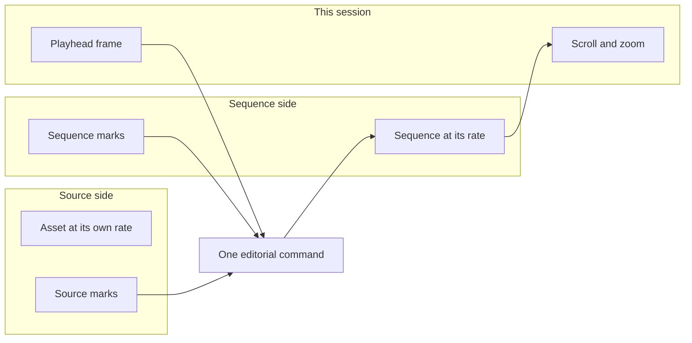

# AETHER Editorial Philosophy

Status: proposal, awaiting review. No implementation is authorized by this document.

AETHER is the product name of this editor. [ARCHITECTURE.md](../ARCHITECTURE.md), [MODULES.md](../MODULES.md), and [DEVELOPMENT_ROADMAP.md](../DEVELOPMENT_ROADMAP.md) call the same system SISE Editor. The workstation those documents sit in is specified in [UI_ARCHITECTURE.md](../UI_ARCHITECTURE.md).

This document states how a feature-film cut is made in AETHER. The engines that carry it are specified in [TIMELINE_ENGINE_ARCHITECTURE.md](TIMELINE_ENGINE_ARCHITECTURE.md). Time is specified in [TIMEBASE_AND_FRAME_ACCURACY.md](TIMEBASE_AND_FRAME_ACCURACY.md). Operations are specified in [EDITORIAL_OPERATIONS.md](EDITORIAL_OPERATIONS.md). Trims are specified in [TRIM_ENGINE_SPECIFICATION.md](TRIM_ENGINE_SPECIFICATION.md). The timeline surface is specified in [TIMELINE_UI_SPECIFICATION.md](TIMELINE_UI_SPECIFICATION.md). Scale is specified in [TIMELINE_PERFORMANCE.md](TIMELINE_PERFORMANCE.md).

## 1. Who the cut is for

AETHER is a professional nonlinear editor for feature-film editorial, assistant editorial, and long-form post. A session is a film: many reels or one long sequence, picture and dialogue and music on separate tracks, hours of source, and a cut that must reopen on the same frame months later.

The person at the machine works for long stretches. The timeline is the centre of that work. Viewers and bins exist so the timeline can be cut accurately. The machine is the editor's own computer. The project is a directory. Nothing in the editorial model requires an account or a network.

The editorial quantum is the sequence frame. Stored time is an integer frame at a rational rate. Timecode on screen is a label for that integer. The rules for that statement are in the architecture's time model and are expanded in [TIMEBASE_AND_FRAME_ACCURACY.md](TIMEBASE_AND_FRAME_ACCURACY.md).

## 2. Research basis

The workflow described here was checked against public Lightworks documentation only. No proprietary source, private build, or internal design was used. The documents consulted:

- Lightworks Knowledge Base, "Basic Editing", "Trimming", "Glossary", "Sequences and Timelines", "Selecting and moving material", "Timeline Tools and Commands", "Keyboard Shortcut Tables", "Reviewing Source Clips", "Clip Information and Metadata", and "Keyboard, mouse and control surfaces", public pages current as of their stated update of 16 October 2026, on lwks.com.
- *Lightworks 2020.1 User's Guide*, published PDF, in particular Mark and Park and the replace methods.

Those sources describe a timeline-centred, keyboard-driven cutting style: source and sequence are both first-class; a mark plus the parked playhead defines a span; insert lengthens and replace covers in place; remove leaves a gap and delete closes one; a cut is opened, moved, and joined; slip and slide preserve duration; track targets aim an edit; lock keeps a track still; sync keeps other tracks in step; linked picture and sound travel together; cues mark a frame; match frame and a clip-reference search return to the source and to every use of it.

AETHER takes that *kind* of work as the problem to solve. AETHER's layout, type, colour, key bindings, control shapes, and module boundaries are its own, and they follow [UI_ARCHITECTURE.md](../UI_ARCHITECTURE.md) and [MODULES.md](../MODULES.md). Published keyboard tables are evidence of which actions must be reachable from the keyboard. They are not AETHER's key map. Published colours, console hardware, track-count caps, and on-screen trim ornaments are outside this design.

Where a published product offers two behaviours and AETHER must choose one, the choice is written in these documents and collected for review at the end of [TIMELINE_ENGINE_ARCHITECTURE.md](TIMELINE_ENGINE_ARCHITECTURE.md).

## 3. Two sides and one timeline

A cut is a relationship between source time and sequence time, looked at from a timeline position.

| Name | What it is | Where it lives |
| --- | --- | --- |
| Source time | An integer frame at the source rate, inside one asset or one nested sequence. | The clip's source range, in the editorial document. |
| Sequence time | An integer frame at the sequence rate. | Record ranges, markers, and sequence marks, in the editorial document. |
| Timeline position | The playhead frame, the scroll, and the zoom with which this session is looking at sequence time. | Session state in the Application. The view may also remember zoom locally as presentation state. |

The source viewer shows source time. The record viewer shows the sequence frame the Application has presented. The timeline shows sequence time, drawn at the session's zoom. A gesture on the timeline names a sequence frame. The Editorial module decides what that gesture did to the document. The view then draws the snapshot.

Import places an asset in the catalog. It does not place a clip on a sequence. A clip exists on a sequence only after an editorial command. The clip stores an asset id and a source range. That asset id is the Media ID (ADR-005). It does not store a file path. Offline media stays in the cut. Relink is a catalog concern, does not move an edit point, and does not silently replace the Media ID.

A project holds many sequences. Each sequence has its own rate, start frame, and tracks. Nested sequences are clips whose source rate is the inner sequence's rate. An outer trim changes the outer clip's source range. It leaves the inner sequence as it was.

## 4. Marks and the parked playhead

A span is a half-open range of frames: the start frame is inside, the end frame is outside. Duration is end minus start, in frames of that range's rate.

AETHER uses two explicit marks, In and Out, and the playhead as a park.

- On the source side, In and Out are session marks for the clip loaded in the source viewer. Making a subclip is a separate act, which stores a named source range in the catalog.
- On the sequence side, In and Out are document state, as the architecture already requires.
- The playhead is session state. When one end of a span is marked and the other is not, the playhead parks the missing end. The marked range is half-open from the earlier of the two frames to the later. Parking before the mark is ordinary.
- When both ends are explicit, the playhead is only a position. It does not secretly shorten the mark.
- Clearing marks clears the explicit marks. The playhead stays.

Three-point editing is the normal way material moves from source to sequence. Four positions exist: source in, source out, record in, record out. The command is given three, and the fourth is computed in integer frames. Park may supply a missing end on the side that already has one mark. The duration rule, including a backtimed record or a backtimed source, is specified in [EDITORIAL_OPERATIONS.md](EDITORIAL_OPERATIONS.md).

When all four positions are present and the two durations disagree, the command is refused and the document is unchanged. The first command set has no fit-to-fill. Fitting would be a rate change, and a rate change is a stored conform, reviewed on its own.

Typed timecode and typed frame counts are ways to name a frame. They parse to an integer. They are never written back as a seconds value.

## 5. A small set of operations

The spoken names below are the ones these documents use. The Editorial command identifiers already listed in [MODULES.md](../MODULES.md) stay the identifiers. This proposal adds only the identifiers named in [TIMELINE_ENGINE_ARCHITECTURE.md](TIMELINE_ENGINE_ARCHITECTURE.md).

| Spoken name | Command id | What changes |
| --- | --- | --- |
| INSERT | `insert` | Splices source into the sequence. The tail moves later. Duration grows. |
| REPLACE | `overwrite` | Covers a record span with source. Later items keep their places. |
| REMOVE | `lift` | Lifts a record span out and leaves a gap. Duration stays. |
| DELETE | `extract` | Lifts a record span out and closes it. Duration shrinks when sync allows the close. |
| SPLIT | `razor` | Writes a cut. Nothing moves. |
| TRIM | `trim` | Moves one side of a clip and leaves a gap or consumes a gap. Duration stays. |
| RIPPLE TRIM | `ripple` | Moves one side of a clip and moves the tail with it. Duration changes. |
| ROLL | `roll` | Moves a cut. One side lengthens, the other shortens, by the same number of frames. Duration stays. |
| SLIP | `slip` | Moves the source window. The record range stays. |
| SLIDE | `slide` | Moves a clip along the sequence between its neighbours. Its source window stays. Duration stays. |
| MULTI-TRACK TRIM | one of the trim ids, with several edit points | The same kind, the same delta, several tracks, one undo step. |

TRIM is included because the Editorial module already names it. RIPPLE TRIM is the duration-changing pair. They are different commands, so the document records the result and does not depend on a hidden mode bit to explain a later undo.

INSERT and DELETE change how later picture meets later sound. REPLACE, REMOVE, ROLL, SLIP, and SLIDE leave the sequence the same length. SPLIT changes identity and leaves time alone. Choosing among these is the editor's judgement. The machine's job is to make the choice do exactly one thing, on the tracks the editor aimed at, and to show the sync consequence before the edit is joined.

Clipboard, match frame, and "where is this clip used" are session and query facilities. They are built from the operations above. They are not extra ways to change time.

## 6. How a trim is made

A trim has three beats.

1. **Open.** The editor names one or more edit points: the head of an item, the tail of an item, or a cut between two items. Linked items open on the same side. The document is still the saved model.
2. **Move.** Nudges, typed frame counts, and drags propose a delta in integer frames. A preview snapshot shows the legal result. The preview stops at the handle, the neighbour, the transition, or the sync limit. The document is still unchanged.
3. **Join.** One command is applied. One undo step is pushed. The playhead rests on the edit point that was just joined.

Opening the last joined trim again is a new preview of those same edit points, for one more correction. Abandoning a preview leaves the document as it was.

The pointer is for aiming at a frame and for dragging a delta. The keyboard can open, nudge, play, and join without the pointer. A clip that is only a few pixels wide is still trimmable from the keyboard. Zoom is how the pointer becomes frame-accurate. The keyboard is already frame-accurate at any zoom.

During an open trim the record viewer can show the frames on either side of each opened cut, through the ordinary resolve path. That preview is specified with the trim engine. It is a picture of a snapshot. It is not a second timeline.

## 7. Tracks, sync, links, and groups

A sequence is a stack of tracks. Video tracks are ordered above audio tracks. Higher video covers lower video in the resolver. Audio tracks are heard together. Track enable is document state and already an Editorial command: a disabled track remains in the cut and is omitted from the resolved picture or sound.

Four controls are easy to confuse. They are different:

| Control | State | Meaning |
| --- | --- | --- |
| Track target | Session | This record track may receive the edit the editor is about to issue. |
| Patch | Session | This source track feeds this record track. |
| Track lock | Document | This track accepts no edit, no trim, and no split. It is not dragged along to preserve sync. |
| Sync lock | Document | When a command changes duration, this track takes the same frame delta at the same sequence frame, so later material stays in step. |
| Enable | Document | This track contributes to the resolved picture or sound. |

With no target lit, insert and replace aim at every unlocked track the current patch maps a source track onto. Remove and delete aim at every unlocked track that contains media in the marked span. A trim with no target opens the item under the playhead on the focused track, together with its link group. Lighting a target narrows the aim. A locked track cannot be targeted.

Sync is a property of the tail of the film, not a colour on a header. A duration-changing command asks the track synchronisation engine for a plan: which tracks edit, which tracks are padded with a gap, which tracks lose the same number of frames, and which tracks hold still. Holding still is how a music bed is spared. The plan records a sync anchor so the timeline can show the signed frame offset from that point onward. The recommended plan is specified in [TIMELINE_ENGINE_ARCHITECTURE.md](TIMELINE_ENGINE_ARCHITECTURE.md) and applied in [EDITORIAL_OPERATIONS.md](EDITORIAL_OPERATIONS.md). Slip, slide, and roll do not change sequence duration, so they do not ask other tracks to pad or close.

A link group is a flat set of items that are one editorial object: picture and its dialogue, or a pair of stereo items, or any set the editor links by hand. Items laid down from one source in one command start linked. Selecting, removing, deleting, splitting, and opening a trim act on the group. **Isolate** is a gesture modifier that aims at the single item under the pointer or the focused track. A link stores the expected difference of record starts. When a later command leaves a member off that difference, the member is drifted and the timeline says so.

SPLIT keeps the link on the piece before the cut. The piece after the cut is a new item with a new id and no link. Merge of a redundant cut, if a later command adds one, is the inverse: it restores the left item and the link. The first command set specifies split. It does not yet specify a separate merge command beyond undo of split.

Groups do not nest. An item belongs to at most one link group.

## 8. Keyboard, navigation, and timecode

Every operation in section 5, every transport control, every track-rail control, and every navigation jump has a keyboard path. The pointer is available. The film can be cut when the pointer is put down.

Navigation is by frames and by events, not by pixels.

- Step one frame, or ten frames, or a typed count.
- Next and previous cut, on the focused track or across targeted tracks.
- Next and previous marker.
- Go to sequence start, sequence end, In, and Out.
- Type a sequence timecode or a source timecode and land on that frame.

Cuts and markers are the map of a long sequence. Scrubbing is for judgement inside a shot. Jumping is for moving through a reel.

The transport bar shows sequence timecode and source timecode together, as [UI_ARCHITECTURE.md](../UI_ARCHITECTURE.md) already places them. The timeline ruler shows sequence timecode. A selected clip shows its source timecode as a readout. Drop-frame counting changes the label. It does not skip a frame in the model.

## 9. Markers and clip references

A sequence marker names a sequence frame, or a half-open sequence range, with text. It is document state. A duration-changing edit moves markers that sit on the tail by the same delta as that tail. A marker that sits on an edit point stays with the cut.

A marker may hold a clip reference: an asset id and a source frame. That pin is a note that points at a take. It is not a clip on the timeline.

A source cue belongs to the asset. It is catalog metadata, joined into the source viewer and into any timeline item that uses that source frame. It is not sequence structure, and Media Management still does not store tracks.

Two queries make the reference useful.

- **Match frame.** From the sequence playhead, the Application asks Editorial which asset and source frame that sequence frame resolves to, then loads that frame in the source viewer.
- **Clip reference search.** Editorial answers, for an asset id, every sequence item that uses it, with record range and source range. The Application adds the catalog name. This is how an assistant finds every use of a take. The catalog does not learn the sequence in order to answer it.

## 10. What the engines owe this philosophy

The philosophy is met only if the engines keep the following promises. The placement of each engine is in the next document.

- A gesture becomes one command that names integer frames. The view does not invent a second result.
- A command either changes the document completely or leaves it as it was.
- Preview of a trim does not decode media and does not push undo.
- Sync consequences are part of the command's plan, visible before join.
- The picture path consumes a resolved snapshot. It does not move a cut.
- Waveforms, thumbnails, and zoom are views of the document. Deleting them changes no frame.

## 11. Choices that keep AETHER independent

These choices are deliberate. They are the design a reviewer is asked to accept.

- A sequence is created at a declared rational rate. The first clip does not silently adopt a rate for the film.
- Duration follows the operation. There is no separate setting that makes a ripple keep the old duration, and no separate setting that makes a slip ripple.
- The key map will name AETHER's actions. It will be published with the shell that binds it. This document lists the actions by name and assigns no product's keys.
- The timeline's colour, density, trim terminals, and sync marks follow the AETHER roles in [UI_ARCHITECTURE.md](../UI_ARCHITECTURE.md) and the timeline specification. They are not taken from another product's pictures.
- Track count is whatever the performance plan can keep interactive. A copied numeric cap is not a requirement.
- Audio edits fall on sequence frames. Subframe slip stays outside the first model, as the architecture already decided.
