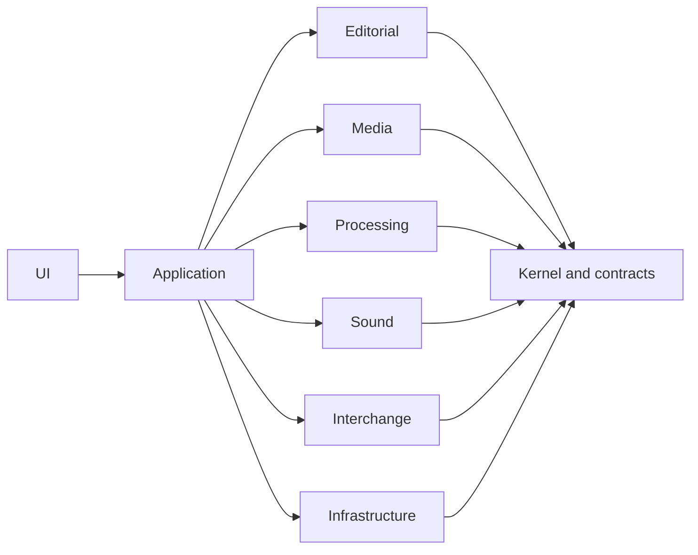

# Engineering interfaces

Status: architecture preparation. This document authorises no headers.

Two module catalogues exist and both are **PROPOSED**:

- `MODULES.md` — Kernel, Platform, Contracts, Plugin SDK, Editorial, Media Management, Interchange, Project Storage, Processing, Plugin Host, Application, UI. Project Storage does not depend on Contracts. Payloads can be opaque bytes.
- `docs/SOFTWARE_MODULES.md` — `aether_ui`, `aether_commands`, `aether_app`, `aether_editorial`, `aether_media`, `aether_process`, `aether_sound`, `aether_avx`, `aether_aaf`, `aether_adapters`, `aether_db`, `aether_fs`, `aether_jobs`, `aether_recovery`, `aether_platform`.

`docs/BIN_ARCHITECTURE.md` also names `aether_model`, `aether_bin`, `aether_abin`, and `aether_depend`. Those are a refinement of editorial and infrastructure, not a third product.

The joiner decision is `architecture/decisions/ADR-006-application-joiner.md`, status **PROPOSED**.

## 1. Mapping

| Later name | Early module | Notes |
| --- | --- | --- |
| `aether_editorial`, `aether_model`, `aether_bin`, `aether_depend` | Editorial, plus Contracts for the passive structs | Bin core links neither Qt nor FFmpeg |
| `aether_media` | Media Management | Registry, relink, ingest state |
| `aether_process` | Processing | Picture. Backend **OPEN** |
| `aether_sound` | Part of Processing in the early file | Separate layer in the later file. **OPEN** as a link target |
| `aether_avx`, `aether_aaf`, `aether_adapters` | Interchange | OTIO is one adapter, not the database |
| `aether_db`, `aether_fs`, `aether_jobs`, `aether_recovery`, `aether_platform` | Project Storage and Platform | SQLite stays here |
| `aether_app` | Application | The only joiner |
| `aether_ui`, `aether_commands` | UI | Qt stays here, after review |
| Plugin host | Plugin Host | **OPEN** whether phase 1 includes it. The milestone excludes it |

**OPEN.** Opaque blobs (early Project Storage) versus normalised tables (later `aether_db`). ADR-003. Interfaces below talk about documents. They do not require a particular SQL shape.

## 2. Documents that cross the seam

**PROPOSED.** Types are passive. Names match `MODULES.md` and `docs/SYSTEM_ARCHITECTURE.md`.

| Type | From | To |
| --- | --- | --- |
| `EditCommand` | UI | Application, then Editorial |
| `CompositionSlice` | Editorial | Application |
| `MediaRecord`, `MediaLocation` | Media | Application |
| `PictureRequest`, `PresentedFrame` | Application / Processing | Processing / Application |
| `AudioGraphRequest` | Application | Sound |
| `ExchangeDocument`, loss report | Interchange | Application |
| Timeline and catalog documents | Owning domain | Storage as bytes or as rows the infrastructure writes and the domain validates |

Kernel types (`Ratio`, `FrameRate`, `Range`, ids, result codes) are the only types every domain may include. Errors are result codes across a module boundary. Exceptions stay inside a module (`MODULES.md` rule 5).

Stored time that crosses a module boundary follows ADR-002, **ACCEPTED — INITIAL EDITORIAL TIME AUTHORITY**. A position is an `int64` frame index at a reduced rate. A float second is not a stored clock. A sample index is not a second stored clock. This document still authorises no headers. ADR-006 remains **PROPOSED**. Acceptance of ADR-002 does not authorise playback wiring.

## 3. Forbidden edges

**PROPOSED.**

- UI does not include SQLite, codec, or audio-callback headers, and does not compute trim results.
- Editorial does not open files, sockets, devices, or decoder contexts.
- Media management does not call the timeline command API and does not store sequence structure as its own authority.
- Processing does not push undo and does not classify originals.
- Sound does not move files and does not take the database lock on the callback.
- Interchange does not update live rows in place.
- Plugins do not receive the database path.
- No module silently deletes an original.

Domain boxes do not connect to each other. That absence is the interface.

## 4. Workflow: resolve one frame

1. Application asks Editorial for slices from frame F.
2. Application asks Media for locations of the Media IDs in those slices.
3. Application builds picture and audio requests.
4. Results return on a queue. The UI thread paints. It does not decode a file (`ARCHITECTURE.md` §10).

Failure: if Editorial is handed a path, the call is a boundary violation. The type does not have a path field.

## 5. Failure cases

| Case | Result |
| --- | --- |
| A convenience include of FFmpeg in Editorial | Review defect. The link line fails the milestone |
| Storage interpreting timeline overlap rules | Review defect. Storage is opaque or is a schema the editorial migration owns, not a second resolver |
| Two writers | Lock refuses the second. Specified in the bin architecture |
| Test double for `IMediaProbe` | Allowed. A double is how phase 3 and the milestone avoid a codec |

## 6. Acceptance criteria

- The Foundation Prototype’s link line shows no Qt and no codec library on the test targets (`docs/18_BUILD_AND_RELEASE.md`).
- A header review finds third-party types only inside the module allowed to use them, once those modules exist.
- A test resolves a transition with no media library linked, and a media test relinks with no editorial command library required for the classifier itself. The application test is the one that joins them.
- **CONFIRMED.** No public header exists to review. `src/` has no files.
