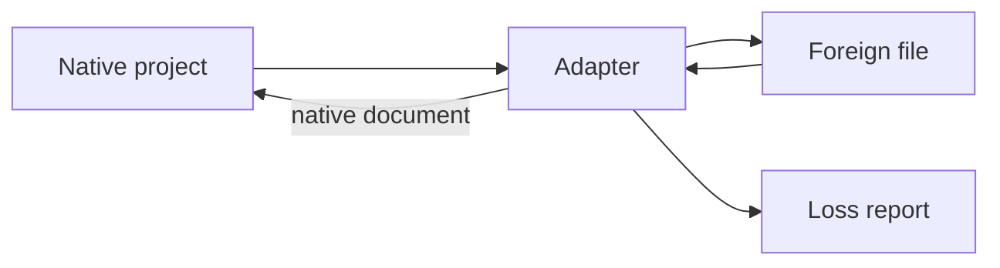

# Exchange compatibility matrix

Status: architecture preparation. This matrix records specification status. It is not a test report.

**CONFIRMED.** No package was imported into DaVinci Resolve, Avid Media Composer, Adobe Premiere Pro, Avid Pro Tools, or any other application. Tested version for each is none. No AVX, AAF, OTIO, FCP XML, FCPXML, or EDL file was written by AETHER, because AETHER has no writer in this tree.

The behaviour of each adapter is specified in:

- `docs/INTERCHANGE_ADAPTER_ARCHITECTURE.md`
- `docs/AVX_FORMAT_SPECIFICATION.md`
- `docs/AVX_OFFLINE_ONLINE_EXCHANGE.md`
- `docs/AAF_AUDIO_EXCHANGE_PROFILE.md`
- `docs/AAF_MEDIA_REFERENCE_PROFILE.md`
- `docs/EXTERNAL_APPLICATION_COMPATIBILITY.md`
- `docs/BIN_IMPORT_EXPORT_SPECIFICATION.md` for `.abin`, which is AETHER-to-AETHER

`architecture/decisions/ADR-007-relink-conform-exchange.md` is **PROPOSED**.

## 1. How to read a cell

| Word | Meaning |
| --- | --- |
| Specified | A document describes the bytes or the fields. **PROPOSED** |
| Not executed | No AETHER run produced or consumed the file. **CONFIRMED** |
| Not claimed | Compatibility with a named application is not asserted. **CONFIRMED** as the evidence gap |
| Native | The working project. Not an exchange format |

A loss report is part of every foreign write and read: items preserved, items kept only in an AETHER namespace or manifest, items dropped. Round-trip equality means equality of preserved native fields. It does not mean byte equality of the foreign file (`docs/SYSTEM_ARCHITECTURE.md`).

## 2. Matrix

| Format | Role | AETHER write | AETHER read | Resolve | Media Composer | Premiere Pro | Pro Tools | Label |
| --- | --- | --- | --- | --- | --- | --- | --- | --- |
| `project.db` | Working project | Specified | Specified | Not a target | Not a target | Not a target | Not a target | **PROPOSED** store. **CONFIRMED** not created |
| `.abin` | One bin, public JSON in a ZIP | Specified, format 1 | Specified | Not claimed | Not claimed | Not claimed | Not claimed | **PROPOSED**. **CONFIRMED** no sample |
| AVX | Picture exchange between AETHER projects, proposal | Specified | Specified | Not claimed. No second implementation | Not claimed | Not claimed | Not a picture target | **PROPOSED**. **CONFIRMED** not executed |
| AAF audio profile | Audio composition and locators | Specified as a profile | Specified as a profile | Not executed | Not executed | Not executed | Not executed | **PROPOSED**. Legal route **OPEN**. **CONFIRMED** not executed |
| OTIO | Editorial structure for tools that read OTIO | Specified as an adapter | Specified as an adapter | Not executed | Not executed | Not executed | Not executed | **PROPOSED**. Library **OPEN**. **CONFIRMED** not executed |
| FCP XML | Legacy XML | Specified as an adapter | Specified as an adapter | Not executed | Not executed | Not executed | Not a target | **PROPOSED**. **CONFIRMED** not executed. Not the same document as FCPXML |
| FCPXML | A different Apple XML | Specified as an adapter | Specified as an adapter | Not executed | Not executed | Not executed | Not a target | **PROPOSED**. **CONFIRMED** not executed |
| CMX 3600 EDL | Reduced event list | Specified as a reduced list | Specified as a reduced list | Not executed | Not executed | Not executed | Not a target | **PROPOSED**. Never the only save |
| MXF OP1a profiles | Media, not the cut | Specified. Not validated | Specified. Not validated | Not executed | Not executed | Not executed | Not a target | **OPEN** until a suite passes. Prior FFmpeg 9.0.2 notes are not this cell |
| MXF OP-Atom | Optional export | Specified as unavailable until a validated writer exists | Not a native open path | Not executed | Not executed. No Media Composer test | Not executed | Not a target | **OPEN**. **CONFIRMED** not a proven writer |

Path strategies an exchange may record, from `docs/EXTERNAL_APPLICATION_COMPATIBILITY.md`: `absolute`, `relative`, `volume_relative`, `roll_and_clip_id`, `media_id`, `consolidated`. The `media_id` strategy still emits a standard source reference (filename, reel, roll, clip id, timecode, duration, rate, path, relative path) because the receiver may ignore the id. Checksum stays in the AETHER manifest.

## 3. Data contract

An exchange result the application may store:

```text
adapter_id
format_name
format_version
direction              export | import
preserved[]
aether_namespace_only[]
dropped[]
media_ids_offline[]
tested_against         application name and version, or "not tested"
```

`tested_against` is `not tested` for every row in this matrix. Filling a version number from memory is forbidden by `docs/EXTERNAL_APPLICATION_COMPATIBILITY.md`.

Import constructs a native document or refuses with the report. It does not fix up the live model inside the adapter.

## 4. Workflows

### 4.1 Export picture

1. Read the native sequence and the registry.
2. Write AVX (when that writer exists) and the report.
3. Leave `project.db` as the authority.

Failure: an effect that AVX cannot carry remains in the native project and appears in `dropped` or in the namespace list. The writer does not delete the effect row.

### 4.2 Export a reduced list

An EDL write always shows that the list is reduced. If the only requested output is an EDL, the project database is still saved as the project. The EDL is not a substitute.

### 4.3 Import

1. Parse to documents plus a report.
2. Media management creates or matches Media IDs, including offline rows for missing files.
3. Editorial validates the timeline document.
4. The application commits only the accepted documents.

Failure: a path hint in the foreign file is untrusted. The import does not overwrite that path (`docs/SECURITY_AND_FILE_SAFETY.md`).



## 5. Failure cases

| Case | Result |
| --- | --- |
| Receiver drops AETHER metadata | The report is how the loss stays visible. A foreign tool is allowed to drop it. The native project still has the data |
| Missing media path on import | Offline media row. The cut remains. Relink may run later. Relink’s result is not an import success flag |
| Claim “Premiere compatible” without a recorded version | Rejected as a product statement. The cell stays Not claimed |
| Prior FFmpeg mux used as the interchange cell | Rejected. That study is a media warning list |

## 6. Acceptance criteria

- Every adapter fixture asserts the report’s preserved set and asserts that a second AETHER-to-AETHER cycle matches the first on those fields.
- A fixture with a missing path imports as offline and keeps the instance’s Media ID.
- The matrix in this file gains an “executed” cell only when a log names the application version and the fixture id. This preparation adds no such cell.
- **CONFIRMED.** All vendor columns are Not executed and Not claimed.
