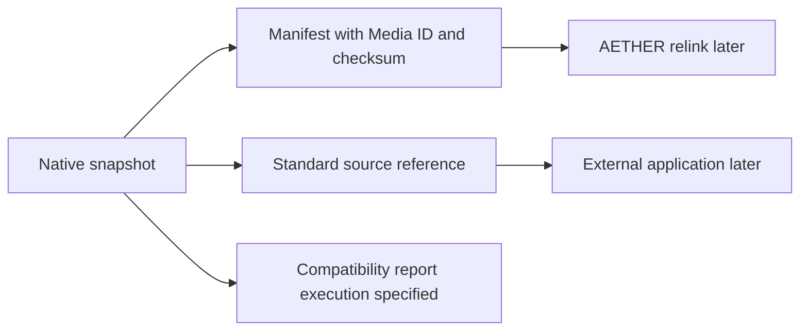

# AETHER external application compatibility

Status: proposal for review. Specification only. No package was imported into DaVinci Resolve, Avid Media Composer, Adobe Premiere Pro, or any other application. Tested version for each is none. Every external case in the test plan is `specified`, not `executed`.

## Verified facts

- The master interchange set names AVX, an AAF profile, FCP XML, FCPXML, OpenTimelineIO, and CMX 3600 EDL as adapters. It states that no adapter was tested against another application (`docs/INTERCHANGE_ADAPTER_ARCHITECTURE.md`).
- Apple controls FCP XML and FCPXML. CMX 3600 is a legacy list. OTIO is an Academy Software Foundation project. Naming them does not prove a file was exchanged.
- AETHER Media IDs are understood by AETHER. They are not assumed to be understood by Resolve, Media Composer, or Premiere unless a tested integration exists. None exists.
- The prior FFmpeg 9.0.2 study remains a reconcile list for MXF essence limits. It is not an interoperability test against those applications.

## Engineering recommendations

- Always write a standard source reference a receiver can use without a Media ID: filename, reel, roll, clip id, timecode, duration, rate, path, and relative path, plus checksum in the AETHER manifest.
- Keep unsupported fields in the manifest and in the compatibility report.
- Say, in the report, which application and version were not tested. Do not fill a version number from memory of a product the author has used.

## Proposed behaviour

### Scope

This document defines AETHER’s export obligations toward external applications and the checks a future test must run. It is not a vendor manual and it does not record results. Adapter structure is in `docs/INTERCHANGE_ADAPTER_ARCHITECTURE.md`. AVX and AAF media rules are in `AVX_OFFLINE_ONLINE_EXCHANGE.md` and `AAF_MEDIA_REFERENCE_PROFILE.md`.

### Requirements

Formats AETHER may write, each with a compatibility report:

| Format | Role in this set | Known limit, as a specification |
| --- | --- | --- |
| AVX 1.1.0 proposal | AETHER-to-AETHER picture, original and playback | Other applications are not specified to read it |
| AAF audio profile plus media references | Audio composition and locators | Consumers differ. Manifest required. |
| OTIO | Editorial structure for tools that read OTIO | Adapter must carry rational rates and source ranges or report the loss |
| FCP XML | Legacy XML interchange | Not the same document as FCPXML |
| FCPXML | A different Apple XML | Not assumed equivalent to FCP XML |
| CMX 3600 EDL | Limited list | The UI and the report say the list is reduced. It is never the only automatic save. |

Path strategies for every format that carries files: `absolute`, `relative`, `volume_relative`, `roll_and_clip_id`, `media_id`, `consolidated`. The `media_id` strategy still emits the standard source reference, because the receiver may ignore the id.

Shared export rules:

- Include the sequence, the manifest, original references, timecode, reel and camera fields with availability, source in and out, rational rates, the speed map, audio references, the proxy-to-original map, and the compatibility report.
- The camera-original slot receives the original filename and path hint. The proxy filename stays in the playback slot.
- EDL export writes source timecode, reel, and record timecode as separate fields when the line format allows, and the report repeats the source range because an EDL cannot hold a ramp, a Media ID, or a full effect.
- A successful write sets an export event. It does not set conform state.
- Fields the format cannot hold remain in the manifest and are enumerated in the report.

### Data model

Compatibility report fields, in addition to the conform report when both exist:

| Field | Content |
| --- | --- |
| `target_app` | `resolve`, `media_composer`, `premiere`, `aether`, or `unspecified` |
| `target_version` | Empty string until a test names a build |
| `execution` | `specified` or `executed`. This document’s profile rows are `specified`. |
| `formats` | List of files written |
| `path_strategy` | One of the six |
| `losses` | Preservation states from the AVX vocabulary |
| `user_actions` | What a person must do in the other application |
| `ffmpeg_reconcile` | Pointer to the unreconciled MXF limits when the package contains MXF. Not a test result. |

Profiles below are checklists for the future tester and obligations for the exporter. Sentences about receiver behaviour are hypotheses to verify, not findings.

### Resolve profile

| Topic | AETHER obligation | To verify later, not verified |
| --- | --- | --- |
| Formats | Offer AAF, OTIO, FCP XML, EDL, plus the manifest. Do not require AVX. | Which of those a given Resolve build imports |
| References | Original filename, reel, timecode, path strategy, checksum in the manifest | How that build’s relink chooses among duplicates |
| Timecode | Write source timecode and record timecode as distinct values | Whether the build displays drop-frame as stored |
| Reel mapping | Write reel and roll separately in the manifest. Put reel in the format’s reel or tape field when it has one. | Whether the build uses reel for relink |
| Relink steps | Report tells the user to relink in Resolve with the package paths and to confirm ambiguous names by timecode and reel | The actual menu path in a named version |
| Speed | Write the map in OTIO or AVX. In EDL, report ramps as unsupported. | Whether the build preserves a constant speed and a ramp |
| Mixed rate | Write each source rational in the manifest | Whether the build keeps mixed rates or conforms them |
| Audio | WAV/BWF locators by default | Channel layout and 29.97 sample alignment on that build |
| Transitions | Write them in the richer formats. List EDL losses. | Whether a dissolve survives |
| Limits | No claim of colour, OpenFX, or title fidelity | — |
| User actions | Relink, check a known source timecode against the manifest, run AETHER conform separately | — |
| Tested version | None | — |

### Media Composer profile

| Topic | AETHER obligation | To verify later, not verified |
| --- | --- | --- |
| Formats | AAF as the structured exchange. EDL as a reduced list. Manifest always. | Import behaviour of a named Media Composer build |
| References | Original locators, not Avid MediaFiles writes. OP-Atom remains governed by `docs/AVID_MEDIA_COMPATIBILITY.md` and is not enabled by this profile. | Linked versus managed media on that build |
| Timecode | Source and record, rational in the manifest | Start-of-day timecode other than zero |
| Reel mapping | Reel written for tape-style matching. Camera serial and clip id stay in the manifest even if the AAF only had a short reel field. | Reel length and character limits on that build |
| Relink steps | The report says the user relinks in Media Composer and confirms by reel and source timecode, then returns to AETHER for sequence conform | Menu path and failure texts |
| Speed | Constant and reverse written when the AAF writer can. Ramps reported when it cannot. | Timewarp support |
| Mixed rate | Manifest lists each rate. The writer does not resample in secret to a single rate. | Whether the build accepts mixed-rate AAF |
| Audio | Multitrack as in the audio profile. Layout in the AAF and the manifest. MXF layout not claimed. | Track mapping |
| Transitions | Dissolves written when the audio profile can. Video transitions listed. | Survival |
| Limits | No write into Avid media databases. No claim of bin fidelity. | — |
| User actions | Relink, compare one instance’s source in with the manifest, ignore proxy names | — |
| Tested version | None | — |

### Premiere Pro profile

| Topic | AETHER obligation | To verify later, not verified |
| --- | --- | --- |
| Formats | FCP XML and FCPXML as separate adapters, plus EDL, OTIO if useful, and the manifest | Which formats a named Premiere build imports |
| References | Path and filename, plus reel and timecode in the manifest | Path-only relink and name collisions |
| Timecode | Distinct source and record values. Rationals in the manifest. | Display of 23.976 and 29.97 DF |
| Reel mapping | Reel and roll in the manifest. The XML receives reel when that format has a published place for it. | Whether the build shows it |
| Relink steps | The report tells the user to relink offline media in Premiere and to use the manifest when names collide | Menu path |
| Speed | Write the map in the XML when the adapter can represent it. Otherwise a loss entry. No silent average speed. | Time remapping |
| Mixed rate | Per-clip rates in the manifest and in the XML when supported | Sequence rate conversion |
| Audio | Channel count and layout availability. WAV/BWF preferred. | Interpretation of layout |
| Transitions | Written or reported per transition | Survival |
| Limits | FCP XML is not FCPXML. The report names which one was written. | — |
| User actions | Relink, confirm a collision with timecode, do not treat a Premiere save as an AETHER conform | — |
| Tested version | None | — |

### APIs

| Operation | Contract |
| --- | --- |
| `Interchange.export(sequence_id, format, target, strategy)` | Writes files, manifest, and compatibility report. `execution` is `specified` until a test harness records `executed`. |
| `Interchange.report(package)` | Returns the report. Does not open the foreign application. |
| `Interchange.import(package)` | Proposes a native document. Does not mark conform. |

### Workflow

1. The user chooses format, target label, and path strategy.
2. The exporter writes originals into the camera slot and derivatives into the playback slot.
3. The report lists losses and user actions, and leaves tested version blank.
4. The other application is used by a person, later, on a machine where it is installed. That work updates a test record. It does not rewrite this specification in place.
5. Back in AETHER, relink and conform run if the package returns. Their success conditions stay in their own documents.

### Validation

A package is internally valid when the manifest and the standard references agree on filename, reel, timecode, duration, and rate for each original; the compatibility report’s `execution` matches the evidence (no version string while `specified`); proxy names are absent from original slots; and EDL packages include a loss report that states the format is limited.

### Errors

| Error | Package |
| --- | --- |
| Target version filled without an execution record | Writer defect. The field stays empty. |
| Format write fails | No complete package. Project unchanged. |
| Manifest omitted | Package invalid. The format file alone is not delivered as complete. |
| User treats the foreign save as conform | Out of AETHER’s control. The AETHER UI, when reimporting, shows `not_run` until conform runs. |

### Recovery

Failed exports leave the sequence alone. The user exports again. A foreign application’s project file is outside AETHER recovery. Reimport starts a new proposal.

### Performance

Export is a document write. Essence copy happens only when the user also consolidates. No interchange timing was measured.

### Tests

Test H. All rows `specified`, `executed` false. The FFmpeg 9.0.2 notes are a `reconcile` input when MXF is in the package, not a row that passed or failed in Resolve, Media Composer, or Premiere.

### Acceptance

- Three application profiles exist and each has formats, references, timecode, reel, relink, speed, mixed rate, audio, transitions, limits, user actions, and tested version.
- Tested version is none.
- Media ID is not the only reference.
- EDL is marked limited.
- The document does not contain a pretended test result.

## Unresolved questions

- Which format is the default suggestion for each target. Recommendation: AAF for Media Composer, FCP XML for Premiere until a named Premiere build is shown to prefer FCPXML, and AAF plus the manifest for Resolve. The recommendation is not a test.
- OTIO library choice. Already open in the master interchange document. This profile only requires the logical fields.
- A character limit for reel names in EDL. Recommendation: write the full reel in the manifest, write the EDL reel using the format’s traditional short field, and report the truncation. The exact width is part of the CMX adapter and was not measured here.
