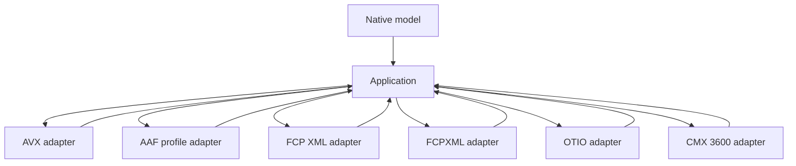

# AETHER interchange adapter architecture

Status: proposal for review. No adapter was coded or tested against another application.

## Verified facts

- The native editorial model is the source of truth.
- AVX is the open video exchange. AAF under the AETHER profile is the primary audio composition exchange.
- Additional adapters required by the brief: FCP XML, FCPXML, OpenTimelineIO, and CMX 3600 EDL.
- OpenTimelineIO is a candidate library for the OTIO adapter, not the internal timeline.
- No published FCP XML, FCPXML, OTIO, or EDL document was used as a fixture here.
- Apple’s FCP XML and FCPXML formats are controlled by Apple. CMX 3600 is a legacy edit-decision list. Citing the names does not prove interchange.

## Engineering recommendations

- Each adapter translates between a foreign document and a neutral exchange document that the application can apply to the native model.
- Adapters do not open the database and do not call decoders.
- Every adapter returns a loss report using the same preservation states as AVX.
- EDL export is a reduced view. The UI says so before writing. It is never the only automatic save.

## Proposed AETHER behaviour

### Place in the system

Import path: bytes to adapter to neutral document plus report to user confirmation to application commit into a new sequence. Export path: application extracts a native snapshot to adapter to bytes plus report. The adapter never “fixes” the live sequence in place.

### Neutral document

The neutral document is the in-memory structure AVX already describes: sequence, media identities, tracks, clips, transitions, effects with preservation states, markers, and a loss report. AAF-specific mix data that the neutral picture document cannot hold rides in an audio attachment the AAF adapter understands. That attachment is still not the project database.

OTIO objects, XML DOM nodes, and EDL lines do not escape their adapters.

### Adapter duties

| Adapter | Read | Write | Known structural limit, as a specification not a test |
| --- | --- | --- | --- |
| AVX | Yes | Yes | Versioned JSON. Defined in `AVX_FORMAT_SPECIFICATION.md`. |
| AAF audio profile | Yes | Yes | Audio composition. Picture is not the payload. Cross-application results are not guaranteed. |
| FCP XML | Best effort | Best effort | Legacy Final Cut Pro 7 era XML. Effects beyond cuts, dissolves, and basic geometry are likely `unsupported` or `metadata_only`. |
| FCPXML | Best effort | Best effort | Final Cut Pro X era XML. Roles, multicam, and compound clips need explicit maps. Unmapped items are reported. |
| OTIO | Best effort | Best effort | Candidate library. AETHER nests, ramps, and gains map only where OTIO has a public schema. Otherwise `unsupported` with the definition retained in an AETHER sidecar next to the `.otio`, not silently dropped. |
| CMX 3600 EDL | Read as events | Write as events | Reel, track, source in/out, record in/out, and a small comment set. No transforms, nests, automation, or multitrack mixes. The report lists everything omitted. |

“Best effort” means the adapter is allowed to exist. It does not mean a file from a named application was opened.

### Sidecar rule

When the foreign format cannot hold a definition, the adapter writes the foreign file and an `.aether-loss.json` sidecar unless the user turns the sidecar off. Default is on. The sidecar contains the unrepresentable native fragments and the loss report. The foreign file remains valid for that format only to the extent the adapter’s own writer is later tested. The sidecar is how AETHER avoids silent discard.

### Media

Adapters emit media identities. They do not copy essence unless the user invoked a delivery preset (for example AAF with WAV copies). Paths are hints.

### CMX 3600 notes

A 3600-style list is line oriented, with event numbers, reel names, edit type, and timecodes. Timecode cannot represent every rational speed ramp. The specified behaviour is to refuse a silent speed conversion: either emit a cut that matches the record range and report `speed_not_represented`, or refuse the whole export if the user asked for a strict list. Default: emit cuts for normal speed events and report the rest. Drop-frame flags are written only when the sequence timecode mode is drop-frame. 23.976 and 24 are not written as if they were 30.

### FCP XML and FCPXML

These adapters exist because facilities still send them. They are not documentation of Apple’s software and not a promise that Final Cut will open the result. Effect maps are tables reviewed with the loss report. An empty map means the effect is `unsupported`, definition retained in the sidecar.

### OTIO

If the OTIO library is not accepted in the licence audit, the adapter is specified but not built, and export is disabled. The native model does not change. OTIO is not read by editorial code as a project file.

### Specified tests, not executed

- Round-trip AVX through the neutral document preserves rational speeds.
- EDL export of a sequence that contains a transform produces a sidecar entry and does not claim the EDL contains the transform.
- Import of an unknown adapter version refuses.
- A failure in the OTIO library, if ever linked, does not leave a half-written native sequence. Commit is after the adapter returns.

## Rationale

| Decision | Rationale |
| --- | --- |
| Neutral document | Six formats cannot be allowed to define six timelines. |
| Sidecar | The open formats AETHER does not control cannot be forced to keep every field. The sidecar is the retention mechanism. |
| EDL is reduced on purpose | Assistants still need EDLs for conform. Pretending an EDL is a project would violate the source-of-truth rule. |
| OTIO confined to an adapter | The candidate library is useful and must not become the database. |
| Commit after success | A thrown error mid-import must not delete the sequence the editor already has open. Imports create new sequences. |

## Unresolved questions

- Normative references for FCP XML and FCPXML versions to target. Open. Pick one published DTD or schema version at implementation time and name it in the loss report. Not chosen here.
- Whether CMX 3600 comments may carry AETHER media ids. Recommendation: yes, as comments, and still treat them as hints.
- OTIO custom schema for AETHER extensions versus sidecar only. Recommendation: sidecar only in the first version, so a strict OTIO reader does not fail on unknown schema unless the library requires otherwise. Unverified against a library version.
- Translation of AAF automation into AVX keyframes and back. Recommendation: do not cross-translate automatically. The user exports the format they mean. Open.
- Character set and line endings for EDL. Recommendation: ASCII timecode, UTF-8 comments only if the chosen EDL dialect allows them, otherwise transliterate and report. Open until a dialect note is fixed.
