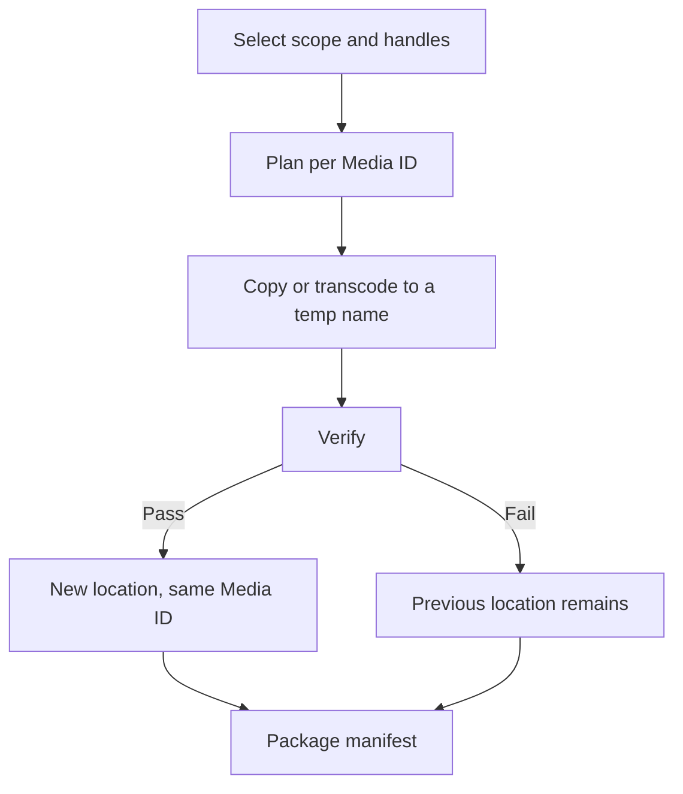

# AETHER media consolidation specification

Status: proposal for review. Specification only. No media was copied or transcoded. Handle lengths in examples are illustrative policy, not a facility standard.

## Verified facts

- The master proxy note defines consolidate as a new file of used ranges plus handles, distinct from a proxy (`docs/PROXY_AND_TRANSCODE_SYSTEM.md`).
- Storage roles already include managed editorial and originals (`docs/MEDIA_STORAGE_AND_RELINKING.md`).
- This set requires consolidation onto a new volume to keep the Media ID (`MEDIA_RELINK_ENGINE.md`).

## Engineering recommendations

- Consolidate by explicit scope and explicit handle length.
- Verify the new files before the registry treats them as a passed location.
- Leave camera originals in place. A person may delete them later with the master purge rules. The consolidate command does not.

## Proposed behaviour

### Scope

Consolidation writes a new package of media the user needs for a cut, a bin, or a selection, and points the same Media IDs at the new locations after verification. It is a copy or a transcode, plus a manifest. It is not a proxy job and not an online conform.

### Requirements

Scopes:

| Scope | What is included |
| --- | --- |
| `project` | Originals referenced by the project |
| `bins` | Originals referenced by the selected bins |
| `sequences` | Originals referenced by the selected sequences |
| `used_only` | Source ranges actually used by the selected sequences, no extra handles |
| `used_with_handles` | Those ranges plus an explicit integer count of source frames on each side |
| `selected_originals` | The selected original representations |
| `selected_editorial` | The selected editorial transcodes |

Modes: `copy` or `transcode`. Transcode names a profile. A profile that cannot hold the source frame rate is refused before any write, the same rule as proxies.

Rules:

- The Media ID is unchanged.
- New paths are new representation locations or a consolidated role that still references that Media ID.
- A manifest travels with the package.
- Verification passes before the new location is `passed`.
- Originals are not deleted, moved, or trimmed in place. `used_only` writes a new file. The camera file stays whole.
- A failed item does not roll back items that already passed, and it does not mark the package complete. The transaction is per Media ID. The package manifest lists failures.
- Handles are source frames, not sequence frames and not float seconds. The command `used_with_handles` requires the integer. There is no hidden default (architecture decision 12). `used_only` means zero extra frames.
- If a handle would extend past the source, the package includes the available frames and the manifest records a truncated handle. It does not invent black frames inside the consolidated essence unless the user chose a transcode profile that explicitly pads. Default: no padding. The instance’s source range is unchanged, so a handle shortfall is a package limit, not a cut change.

### Data model

```text
consolidation_job
  job_id
  scope
  mode                  copy | transcode
  profile_id            NULL for copy
  handle_frames         int
  destination_volume
  media_ids

consolidation_record
  consolidation_id
  media_id
  mode
  scope
  handle_frames
  source_range          half-open, or whole-file
  new_path
  checksum_state
  validation_state
  manifest_id
```

Package manifest entries: Media ID, original filename, reel, roll, clip id, timecode, rate, source range included, handle frames requested, handle frames achieved, checksum, relative path inside the package, role `consolidated`.



### APIs

| Operation | Contract |
| --- | --- |
| `Consolidate.plan(scope, handles, mode)` | Lists Media IDs, ranges, and bytes estimate. Writes nothing. |
| `Consolidate.run(plan, destination)` | Per-id copy or transcode. |
| `Consolidate.commit(id, result)` | Registry transaction after validation. |
| `Consolidate.manifest(job_id)` | Writes the package manifest. Does not delete sources. |

### Workflow

1. The user chooses scope, mode, handles, and a destination that is not an original camera card.
2. Plan shows what will be written, including truncated handles.
3. The job runs in the background, with pause, resume, retry, and cancel using the same meanings as ingest.
4. Each verified file is committed as a consolidated representation of the same Media ID.
5. Relink on another machine can use the manifest’s Media IDs and checksums.
6. Conform is still a separate command. A finished package is not a verified sequence.

Cancel leaves completed ids committed and uncompleted temp files quarantined or removed. It never removes originals.

### Validation

For copy: size and checksum against the source range’s bytes. For a whole-file copy, the checksum matches the original’s file checksum when that checksum is complete. For a used-range copy, the checksum is of the new file, and the frame count equals the planned range.

For transcode: the proxy validation list applies (duration, frame count, rate, timecode, audio duration, channel map, sync, start timestamp, source relationship), restricted to the planned range rather than the whole original when the scope is a used range. A mismatch fails the item.

The new path is recorded only after that pass.

### Errors

| Error | Originals | New files |
| --- | --- | --- |
| Destination full | Untouched | Temp quarantined, item failed |
| Rate not preservable | Untouched | Job refused before write |
| Checksum mismatch | Untouched | Not registered |
| User cancel | Untouched | Incomplete temps removed or quarantined |
| Destination is the camera card | Refused | Nothing written |

### Recovery

The plan can be re-run. Committed ids are skipped when the destination file still validates, so retry does not mint a Media ID and does not duplicate a passed copy. The manifest is rewritten at the end of a retry to include the full set. Previous manifests remain in the log.

### Performance

The plan is a database query over instances and a byte estimate. The copy is I/O bound and yields to playback. No throughput was measured. Used-range extraction must not decode the whole feature into memory; the processing request names a source range. That is a constraint on a future implementation, not a measured property.

### Tests

Specified, not executed. Covered by tests A, C, and E: same Media ID after copy to a new volume; handles in source frames; zero handles for `used_only`; refusal to delete originals; a transcode that cannot keep the rate refused; a truncated handle recorded; package manifest present while conform state remains unrun.

### Acceptance

- All seven scopes and both modes are specified.
- Media IDs persist, and originals are outside the delete set.
- Handles are integer source frames with an explicit count.
- The package is specified as unverified-as-a-conform until the conform engine runs.

## Unresolved questions

- Default handle count. Decision 12: no implicit handles.
- Whether a consolidated used-range file may replace the playback original while the camera original is still online. Recommendation: it is an additional representation, role `consolidated`. The original role remains the camera file. Conform to camera still asks for the original role.
- Partial-file checksum method for a byte range inside an MXF or an image sequence. Recommendation: checksum the new file, and also store the source range. Do not claim it equals the camera-file checksum.
