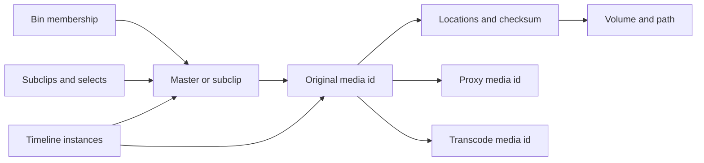

# AETHER media identity and bin relationship

Status: proposal for review. This document joins the bin model to the media rules in `docs/MEDIA_IDENTITY_AND_METADATA.md`, `docs/MEDIA_MANAGEMENT_PHILOSOPHY.md`, `docs/MEDIA_STORAGE_AND_RELINKING.md`, and `docs/PROXY_AND_TRANSCODE_SYSTEM.md`. It does not replace those documents.

## Purpose

State how a bin refers to media, how one camera original becomes one master and many editorial descendants, and how a path change stays a media-management event.

## Scope

In scope: the contract between editorial objects and media ids, including proxies, transcodes, relink, duplicates, and physical delete.

Out of scope: codec profiles, ingest job scheduling, and the probe field list. Those stay in the media documents. Where a field is mentioned here, the media document is the authority for its meaning.

## Requirements

- Bins store media ids. They do not store the current path as identity and they do not move, rename, copy, or delete files.
- Media management registers assets, assigns media ids, records locations, checksums, proxies, transcodes, and status, and performs relink, consolidate, verify, and physical delete.
- Ingest and import of a media id create at most one master clip for that id. Subclips, selects, and timeline instances may cite it. An explicit duplicate may mint a second master that keeps the same media id. A database unique constraint on `MasterClips.media_id` is therefore wrong.
- A duplicated editorial object keeps the media id and does not copy the file.
- A proxy has its own Representation ID and the original’s Media ID (ADR-005). It does not have a second media id. The master clip continues to cite the original. Playback may use the proxy through a quality policy.
- A transcode is a representation of the same Media ID, with its own Representation ID. It is not a second master unless the person creates one with an explicit command.
- If the file moves, the media id stays. After relink updates the location, bins and sequences resolve it.
- Filename is a hint for sorting and for display of `source_filename`. It is not a match key.
- Physical delete runs a usage check through the inverse dependency graph and follows the media-management confirmation rules.

## Verified facts

- The media id is permanent, unguessable, and not derived from the path or the checksum. A proxy is not a separate media id. ADR-005 is the decision. `docs/MEDIA_IDENTITY_AND_METADATA.md` keeps the descriptor study.
- Relink prefers an unchanged path with a size match, then a full checksum, then technical metadata as a candidate the person confirms. Filename alone is insufficient. This is specified in `docs/MEDIA_STORAGE_AND_RELINKING.md`.
- Link, copy, consolidate, and transcode are explicit ingest or job modes.
- The bin schema’s `MediaAssets`, `MediaLocations`, `ProxyAssets`, and `TranscodeAssets` tables are the working-store shape of those rules.
- No relink was executed for this document.

## Engineering recommendations

- When import meets an unknown media id, insert an unresolved `MediaAssets` row rather than leaving a dangling id. The foreign key stays on.
- When a local file’s checksum matches an unresolved row, relink binds the location to that media id. It does not mint a new id.
- Show package-asserted technical fields with an unverified label until a local probe writes the registry fields.
- Keep `source_filename` on the master as a historical label. Display the live filename from the current location when one exists.

## Proposed behaviour

### Ownership

| Question | Owner |
| --- | --- |
| What is the clip called in the bin? | Editorial object |
| Which asset is it? | `media_id` |
| Where are the bytes? | `MediaLocations` |
| Is a smaller file available for playback? | `ProxyAssets` |
| May this file be deleted? | Media management, after an inverse-usage query |
| Which bin lists the clip? | `BinMemberships` |



### One original, many editorial objects

Registration of a camera file creates one media id and, when the person is importing into a bin, one master clip. The master cites that media id.

Further editorial work creates:

| Descendant | New id | Media id |
| --- | --- | --- |
| Subclip or select | New object id | Same |
| Second bin reference | None | Same |
| Duplicate master or subclip | New object id | Same |
| Timeline instance | New instance id | Same |
| Proxy | New media id linked as proxy | Original unchanged on the master |
| Transcode | New media id linked as transcode | Original unchanged on the master |
| Consolidate for a share | New media id for the new file, `source_media_id` pointing at the original | Original unchanged in the source project |

A second ingest of the same bytes asks the question the media philosophy already specifies: link to the existing id, add a location, or cancel. Ingest does not create a second master. A second editorial name is a subclip, a rename, or an explicit duplicate. Duplicate is allowed to insert another `MasterClips` row with the same `media_id` and a new object id.

The ingest rule is per project. Another project may hold its own master for a media id it imports. The object id of that master is preserved when the package is the source of the import and the id is free. The media id is the same if the package says so.

### Paths

An instance row has no path column. A master has `source_filename` and `media_id`. The application resolves a frame in this order:

1. Read `media_id` from the instance, or from the source object when the instance stores it.
2. Ask media management for a location under the quality policy.
3. Media management may return the proxy location while still reporting the original media id as the identity.
4. If no location is online, the picture is offline. The ids stay.

When a volume returns at a new mount point, relink updates `MediaLocations`. It does not update object ids, instance ids, or bin ids. `source_filename` stays as recorded. The live path changes on the location row. `original_path` history stays on the media record as the media document already requires.

### Proxies and transcodes

Playback policy is the existing one: `proxy_if_available`, `master`, or offline. Switching policy does not rewrite `source_in`, `source_out`, or `media_id` on the instance.

The bin shows proxy state by joining `ProxyAssets`. The join is a view. Saving the bin writes a `proxy_hint` dependency so a share can include the proxy when asked. The required dependency remains the original media id.

Deleting a proxy file is a media operation on the proxy media id. The master and the sequences remain. Deleting cache thumbnails does not delete the proxy. These separations are already required by the proxy specification and are restated because the bin UI must not offer “delete” as one action that hits all of them.

### Relink and the bin

Relink’s result is a location change and a status change. The bin core listens for a media-status change and refreshes availability. It does not receive the new path into the object record. Search can find the historical `source_filename` and the live filename. Both are displayed in the inspector, labelled so the person can tell them apart.

A checksum mismatch against a completed checksum refuses the bind, as the relink specification requires. The bin stays offline for that media id. The report names the media id and the object ids that cite it.

### Duplicates of files

Two files with the same filename and different checksums are two media ids and two masters if both are imported. The bin may show the same display name twice. The object ids differ. The UI can show the media id in the chooser for that reason.

A duplicated editorial object does not create a file duplicate. Disk use is unchanged. The usage count of the media id increases.

### Physical delete

The command is `media.deletePhysical(media_id)`.

1. Inverse closure lists masters, subclips, instances, proxies, and transcodes.
2. If the list is non-empty, the confirmation lists it. The bin Delete key never calls this command.
3. Originals that are only linked, and were not copied into the project, are not deleted by this command. The media philosophy already refuses that. The bin relationship does not weaken it.
4. A managed file the person confirms is a media-management delete, followed by a status change. Editorial rows that still cite the id become unresolved rather than being deleted with the file, unless the person also runs delete-unassigned-object on each of them. File delete and object delete stay two steps so a mistake in one does not imply the other.

### Interfaces

| Caller | Call | Receives |
| --- | --- | --- |
| Bin core | `media.attach(media_id)` | Status and proxy link, or unresolved |
| Application, for a monitor | `media.locate(media_id, policy)` | A location or offline. No permission to delete |
| Import | `media.ensureId(media_id, asserted)` | Existing row or a new unresolved row |
| Share builder | `media.exportBytes(media_id, mode)` | Verified files or a failure |
| UI delete key | Bin remove command | Membership change. The media interface is not called |

### Operations

Attach, locate, ensure id, relink, record proxy, record transcode, usage query, physical delete. The bin operations that cite media ids are create-master, duplicate, import, and save. None of those call the filesystem except through the media interface, and only the media commands that are defined to touch bytes do so.

### Failure scenarios

| Failure | Ids |
| --- | --- |
| Drive unmounted | Media status offline. Object ids and media ids unchanged. Bin opens |
| File renamed on disk | Offline until relink. Media id unchanged |
| Relink to a file with a different checksum | Bind refused. Bin remains offline for that id |
| Proxy job fails | Original unchanged. No online proxy row |
| Person deletes a proxy | Original media id on the master unchanged |
| Import of a package whose media id already exists with the same checksum | The existing row is cited. No second master is created for that media id |
| Import whose media id exists with a different checksum | Unresolved conflict. Rows are not merged |

### Recovery

Locations are registry data. A database backup restores them. A package restore restores media ids and hints, not the bytes. Bytes return through media backup or through relink to a volume that still has them. Cache is not a media backup. If only a proxy file remains, status is proxy-available and the original is offline. The application does not promote the proxy media id onto the master.

### Performance

Locate is an indexed read by media id. Usage before delete is the inverse graph query. Availability for a bin window is one join, not a stat of every path on every repaint. Path existence is checked by a job and cached as `online` with a generation. A stale online flag is corrected when playback fails to open the file: status becomes offline and the ids stay. The design target is the same 10,000-object bin.

### Compatibility

Media ids that enter through AVX or AAF follow `docs/MEDIA_IDENTITY_AND_METADATA.md`: the AETHER media id is carried when the exchange has it, and the filename is a hint. A foreign file with no AETHER media id receives a new media id at ingest. The bin then cites that new id. Exchange does not reuse a display name to find a master.

Package-asserted metadata uses the same field names as the media record and a verification flag. A future probe overwrites the technical fields and records that they are probed. Editorial reel and camera on the master are left as the editor set them.

### Sample structure

Inspector’s media block for a master whose file moved and was relinked:

```json
{
  "object_id": "obj_4c2e8a10-22b1-4f03-9d55-18e0a77c0101",
  "display_name": "A001C001",
  "media_id": "med_6f0e2c44-91ab-4d10-8e77-2a9c0b11d001",
  "source_filename": "A001C001.mov",
  "live_filename": "A001C001.mov",
  "location": {
    "volume_id": "vol_edit_22",
    "path": "/edit/Monsoon/MEDIA/ORIGINALS/A001C001.mov",
    "online": true
  },
  "proxy": {
    "media_id": "med_6f0e2c44-91ab-4d10-8e77-2a9c0b11d002",
    "online": true
  },
  "availability": "online"
}
```

The object id and the original media id match the values from before the move.

## Rationale

| Decision | Rationale |
| --- | --- |
| Ingest creates one master | A second automatic master for one asset splits comments and makes relink ambiguous. A deliberate duplicate is a different command and keeps the media id |
| Descendants share the media id | Subclips and instances are editorial. The file is not |
| Proxy link stays on the media side | The bin then inherits proxy behaviour for free and cannot disagree with the playback policy |
| Unresolved rows | Import can keep foreign keys and still open a bin whose drive is at the lab |
| Two-step physical delete | Editors use Delete to tidy a bin. The file should still be there afterwards |

## Acceptance criteria

Specified, not executed.

- A master, two subclips, and two instances can cite one media id. A proxy cites a different media id linked to the first. There is still one master.
- Renaming the file on disk and relinking leaves the media id, the master object id, and the instance ids unchanged. The sequence resolves the new location.
- Duplicating the master creates a new object id, the same media id, and no second file.
- A bin command test double records no filesystem move, rename, or delete of media.
- Physical delete of a cited media id returns the usage list and does not run from the bin Delete command.
- An offline volume leaves the bin and the sequence open, with availability offline.
- A checksum conflict does not retarget the master to the other file.
- Import of a known media id does not create a second master clip for that id.

## Unresolved questions

- How the usage query distinguishes an ingested master from a later duplicate of that master. Recommendation: order by `created_at` of the object and list every master. Do not add a unique index on `media_id`.
- How a person intentionally splits one file into two media ids after a bad ingest. Recommendation: a media command `media.reidentify` that mints a new id and leaves the old id on existing objects unless the person also chooses “retarget masters”. It is not a bin rename.
- Cross-project shared media libraries. The media philosophy leaves this out of scope. A second project’s copy of a media id is specified here as import behaviour, not as a live shared library.
