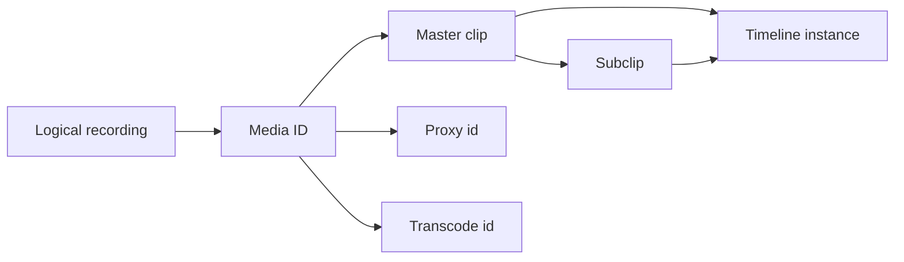

# AETHER media identity specification

Status: identity specification. The editorial rule is **ACCEPTED** in ADR-005: one stable Media ID per logical Media Asset. Representations (`ORIGINAL`, `PROXY`, `TRANSCODE`, `CONSOLIDATED`, and other validated roles) have their own Representation IDs. Location is separate. This file remains the field specification. It does not weaken the Media ID. No file was hashed for this document. Sample identifiers are illustrative.

## Verified facts

- The master set already requires a media id that survives filename and path changes, explicit unknown metadata, and separate picture and audio durations (`docs/MEDIA_IDENTITY_AND_METADATA.md`).
- The master schema stores checksum state, timecode, drop-frame, rational rate, and channel layout as data (`docs/PROJECT_DATABASE_SCHEMA.md`).
- The prior FFmpeg 9.0.2 study reported MXF channel layout absent, ProRes 4444 alpha descriptors incomplete, and a 29.97 audio sample-count mismatch. Those are reasons for explicit availability and `sync_warning`. They are not observations of an AETHER ingest.
- Cameras do not share one metadata set. ARRIRAW, R3D, BRAW, X-OCN, ProRes, DNx, H.264, H.265, CinemaDNG, WAV, and BWF are named formats in the brief. None was opened for this document.

## Engineering recommendations

- Mint the Media ID once, as a UUID, when a logical recording is first accepted. Keep it across move, rename, drive change, proxy regeneration, transcode, consolidation, project migration, bin import and export, interchange, offline, and online.
- Store identity, video, audio, and camera groups as values with an availability state. Absence is a stored fact.
- Keep camera-native identifiers as extra keys. They are evidence. They are not a replacement Media ID, because many files have none and some collide across cameras.

## Proposed behaviour

### Scope

This document defines the persistent identity of original camera media and the editorial objects that point at it. Representation files, match classes, and registry columns are detailed in `PROXY_AND_ORIGINAL_MEDIA_RELATIONSHIP.md`, `MEDIA_FINGERPRINTING_AND_MATCHING.md`, and `MEDIA_REGISTRY_SCHEMA.md`.

### Requirements

- `media_id` is a persistent UUID. It is not derived from the path, the filename, the checksum, or the timecode.
- The same id is used after the file moves or the proxy is regenerated. A move is a location event. It is not a minting event.
- A retired id is never assigned to a later recording.
- Original camera media is the authoritative essence and is never modified (integrity rule 3).
- The master clip stores `media_id`. The timeline instance stores the editorial object id and the same `media_id`. Neither stores a proxy path as identity (integrity rule 11).
- Each field in the four groups has `value`, `availability`, and `source`.
- Availability is one of `present`, `absent`, `unknown`, `not_applicable`, `unverified`, `conflict`.
- `source` is one of `container`, `camera_native`, `sidecar`, `manifest`, `user`, `probe`, `aether`, or null when unknown.
- A reader that does not see a field writes `unknown` or `absent`. It does not invent drop-frame, a start timecode of `00:00:00:00`, a channel layout, or a reel.
- User metadata (scene, take, description, department) is a separate map. It can change without changing `media_id` or technical availability.

### Data model

Availability wrapper, used for every field below except `media_id`, which is present once the row exists:

```json
{
  "value": null,
  "availability": "unknown",
  "source": null
}
```

Illustrative only. Not a probed file.

| Group | Fields |
| --- | --- |
| Identity | Original filename, relative path, absolute path at ingest, size in bytes, checksum algorithm, checksum value, checksum state, container, camera-native clip UID, SMPTE UMID when a reader actually found one |
| Video | Frame-rate numerator and denominator, frame count, width, height, pixel aspect, start timecode, drop-frame flag, codec, colour primaries, transfer, matrix, range, alpha state, scan type, first-frame timestamp as a rational timescale |
| Audio | Sample rate, sample count, bit depth, channel count, channel layout, audio start offset in samples, sync warning |
| Camera | Camera id, model, serial, card id, reel, roll, clip id, record time, filename, folder, lens, shoot day |

Checksum state is `pending`, `complete`, `mismatch`, or `unavailable`, matching the master identity note. `mismatch` means the bytes no longer match a completed checksum. That is a verification failure. It does not mint a new Media ID and it does not retarget the master clip.

A catalog may record the frame count and the sample count a probe read from a file. Those measurements are not the editorial clock. ADR-002 derives sample positions and does not store a sample-time domain. A fractional-sample mapping is not an error. A sync warning is only when a source offset or an operation cannot be represented in the frame-only model. The MXF 12813-against-12812 result remains the failed encoder test in its own validation report. This sentence does not rewrite that report.

Channel layout uses `unknown` when the container omits it. The prior MXF note means an MXF reader must be allowed to return `absent` for layout-in-container while AETHER still stores a user or project layout with source `aether` and a separate flag `container_stored: false`. Export must not claim the container holds the layout unless a later validation says so.

Alpha uses `unverified` when a descriptor is incomplete. The prior ProRes 4444 note is why “alpha preserved” is not implied. No alpha claim is made for any file here.

Colour tags that were not read are `unspecified`, availability `absent` or `unknown` as appropriate. The reader does not fill Rec.709 by default.



### APIs

| Operation | Behaviour |
| --- | --- |
| `Identity.mint(recording)` | Allocates one UUID if this recording is new. Returns the existing id if the registry already committed this recording in the same transaction. |
| `Identity.read(media_id)` | Returns the four groups and availability. Missing id is an error. Offline files still return the record. |
| `Identity.noteChecksum(media_id, algo, value, state)` | Updates checksum state. A `mismatch` does not change `media_id`. |
| `Identity.setUserMetadata(media_id, key, value)` | Writes the user map. Technical fields stay unchanged. |
| `Identity.retire(media_id)` | Sets retired after a validated purge policy. Refuses while any instance, master clip, or unretired representation references it. |

Mint is refused if the caller asks to “regenerate because the path changed”.

### Workflow

1. Ingest proposes a logical recording (`CAMERA_MEDIA_INGEST.md`).
2. Duplicate policy runs (`MEDIA_FINGERPRINTING_AND_MATCHING.md`). A confirmed duplicate adopts the existing Media ID. A new recording receives a new UUID inside the registry transaction that also writes the first location.
3. The bin creates a master clip that stores that id.
4. Later proxies, transcodes, and consolidated copies store their own record ids and the same Media ID.
5. Exchange writes the Media ID into the AETHER manifest. Foreign applications also receive filename, reel, roll, clip id, timecode, duration, rate, path, relative path, and checksum, because they do not understand the UUID unless a tested integration exists. None exists today.

### Validation

A Media ID record is internally valid when:

- the id parses as a UUID;
- every required group is present as a structure, even if every field in it is `unknown`;
- video rate, when `present`, is a pair of positive integers;
- audio sample count, when `present`, is an integer;
- checksum state `complete` includes an algorithm id and a value;
- `sync_warning` is explicit;
- the master clip’s `media_id` equals this id.

Validation of bytes against the checksum is a location and match concern. The identity row can be valid while every location is offline.

### Errors

| Error | Outcome |
| --- | --- |
| Mint requested from a path change | Refused. Location update is a different operation. |
| Field written without availability | Refused. |
| Guessed timecode or layout with source `probe` when the probe reported nothing | Refused. Source `user` is allowed and stored as `unverified` until a reader confirms it. |
| Retire while referenced | Refused. |
| Two availability values for one field in one commit | `conflict`, commit refused until one source wins by an explicit user choice. |

### Recovery

If mint crashes before commit, no id is published. Retry mints again only when no row exists. If the row exists, retry returns it. Identity rows are not reconstructed from filenames during recovery.

### Performance

Identity reads are indexed by `media_id`. Building a bin page reads identity rows and cached online state. It does not hash. Checksum work is a background job referenced by the identity row’s checksum state. No throughput number was measured.

### Tests

Test A in `OFFLINE_ONLINE_INTEROPERABILITY_TEST_PLAN.md`, specified and not executed. Cases include move, rename, drive change, proxy regeneration, project migration, and bin round-trip, each asserting the same UUID, plus a camera record with video fields `present` and camera serial `absent`.

### Acceptance

- UUID persistence rules cover every survival case in the requirements list.
- The four groups and the availability enum are complete enough for an implementer to store “not supplied” without a null meaning three things.
- Proxy paths are excluded from the identity of the master clip.
- The FFmpeg notes are cited as reconcile input for layout, alpha, and sample count, and are not described as a test of this specification.

## Unresolved questions

- UUID version 4 versus version 7. Recommendation: version 7 for time-ordered minting, stored lowercase. Either version is acceptable if it is never regenerated. The choice is open.
- Display prefix `med_` versus raw UUID. See unresolved decision 1 in `OFFLINE_EDITING_ARCHITECTURE.md`.
- Whether UMID, when present, is shown as a primary label in the inspector. Recommendation: show it as a camera-native key, secondary to Media ID.
- How large the free-form user map may be. Recommendation: a fixed editorial set plus a versioned string map, aligned with the open question in `docs/MEDIA_IDENTITY_AND_METADATA.md`.
