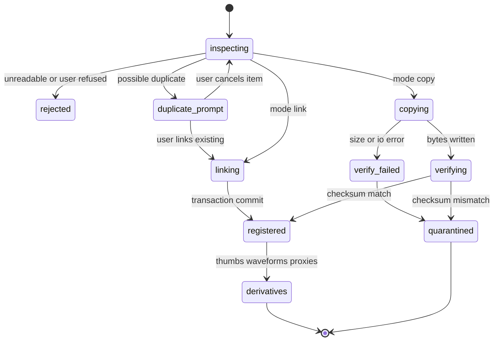

# AETHER media ingestion specification

Status: proposal for review. No ingest tool is implemented here. Tests below are specified, not executed.

## Verified facts

- The pipeline order is required by the brief.
- Codec inspection depends on a processing backend that has not been selected or run.
- A prior local FFmpeg 9.0.2 study is not an ingest test. It does not prove that AETHER can read a given camera file.

## Engineering recommendations

- Model ingest as a state machine with a durable job row so a crash can resume or quarantine.
- Inspect before copy so the user can refuse an unknown file before a multi-gigabyte write.
- Register only after verification for copy mode. Register after a successful stat and identity allocation for link mode, with checksum state `pending` or `complete`.
- Run thumbnails, waveforms, and proxies after registration, as cancellable jobs. A missing thumbnail does not unregister the media.

## Proposed AETHER behaviour

### Pipeline

For each source the user included:

1. **Inspect.** Open read-only. Record container, streams, and any probe error. Do not write beside the source.
2. **Metadata.** Extract timecode, duration, rate, raster, codec names, colour tags, audio rate, bit depth, channel count, and any layout the container actually stores. If layout is absent, store `unknown`, not a guess presented as fact.
3. **Type.** Classify as picture, audio, still, image sequence, or unknown. Unknown can be linked only with an explicit “index without playback” confirmation.
4. **Media ID.** Allocate a permanent id before the file is considered imported.
5. **Duplicate detection.** Compare checksum if already known, otherwise the weak fingerprint. Ask the user. Do not delete.
6. **Destination.** For copy, transcode, or consolidate, show the role path and the free space. Refuse if the destination is inside an original path that would overwrite a source file.
7. **Copy or link.** Link records the path. Copy writes to a temporary name in the destination role, then verifies, then atomically renames into place. A failed copy leaves no valid media record and does not leave the temp name looking like a master.
8. **Verify.** Size match. Checksum job starts immediately. For copy, the record stays `verifying` until the checksum matches. Playback may be allowed while `verifying` if the user opts in, and the UI shows that state. The record is not `online-verified` until the hash matches.
9. **Register.** Commit the media row and the location row in one database transaction. Then update the manifest identity hash on a checkpoint. If the transaction fails, delete the new copy from the managed role (it is not an original) and log the failure.
10. **Thumbnails and waveforms.** Background. Failures are logged and retried. They do not roll back registration.
11. **Proxies.** Only if the user requested a proxy profile and the profile is in the capability list.
12. **Browser update.** The bin shows the new media id, name, status, and type.
13. **Ingest log.** Append a line or row for every state change, including cancel and failure.



### Cancel, pause, resume, retry

| Control | Behaviour |
| --- | --- |
| Cancel item | Stop work. If a copy is incomplete, quarantine or delete the incomplete new file. No valid record. |
| Cancel batch | Cancel queued items. In-flight item follows cancel-item. Completed items stay. |
| Pause | Stop starting new copies and new derivative jobs. In-flight write finishes or checkpoints if the filesystem copy supports it. Pause is required where practical. A codec that cannot pause a transcode may only cancel. The UI says which. |
| Resume | Continue from the job row. Do not allocate a second media id. |
| Retry | Re-enter from the failed state. A retry after a checksum mismatch does not invent a new id unless the user starts a new ingest. |

### Image sequences

A sequence of stills is one media id plus a frame pattern, not thousands of unrelated clips, when the user ingested them as a sequence. The pattern, start frame, and padding are metadata. Missing frames are a verification warning.

### Logs

`LOGS/ingest/` receives a session file. The database holds the same events so a log delete does not erase provenance. The database is the authority. The text log is for people.

### Sample job row

```json
{
  "job_id": "job_100",
  "media_id": "med_01J",
  "state": "verifying",
  "mode": "copy",
  "source": "/volumes/card/A001C001.mov",
  "destination": "/edit/Monsoon/MEDIA/ORIGINALS/med_01J/A001C001.mov",
  "checksum": null,
  "checksum_state": "running",
  "error": null
}
```

### Specified tests, not executed

- Copy that fails at 50 percent leaves no `online` row and no file at the final name.
- Two different files named `A001C001.mov` receive two media ids.
- Cancel during thumbnail generation keeps the media row.
- Link to a path that later disappears sets `offline` and does not delete the row.
- Proxy job failure leaves the master row `online` and the proxy link `failed`.
- Ingest of a file that the processing backend cannot probe is rejected or indexed only with confirmation, and is not given a false duration.

## Rationale

| Decision | Rationale |
| --- | --- |
| Temporary name then atomic rename | Readers should not open a growing file as a finished master. |
| Checksum mismatch quarantines a copy | The copy is not an original. Keeping it as online would spread a corrupt duplicate. The source is untouched. |
| Derivatives after commit | Editors need the clip in the bin. Waiting for every waveform delays the cut and couples catalogue correctness to a decoder. |
| Durable job row | Crash recovery of ingest is a requirement. Memory-only progress cannot resume. |
| Same events in database and text log | People read logs. The project must still recover if a log was cleaned up. |

## Unresolved questions

- Whether playback during `verifying` is on or off by default. Recommendation: off for copy, on for link, because a link does not claim AETHER wrote the bytes.
- Checksum algorithm. Recommendation: SHA-256. Confirm cost on the Linux reference machine later. Not measured here.
- Parallel copy count. Recommendation: one writer per destination volume, multiple readers for inspect. Untested.
- Camera-card vendor plugins. Out of scope. Ingest reads files the user can already see.
