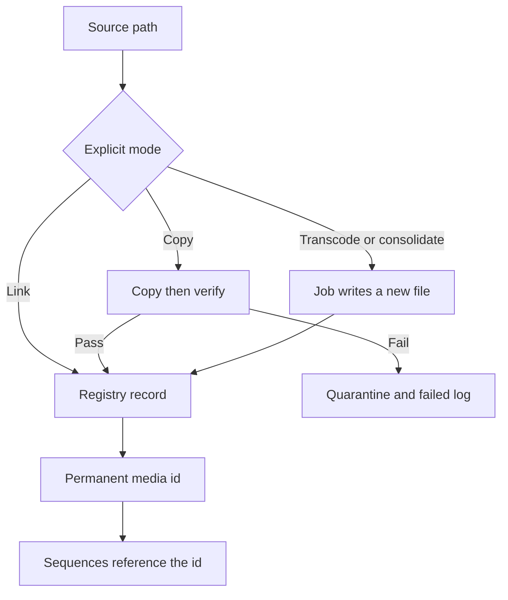

# AETHER media management philosophy

Status: proposal for review.

Media management exists so the editor can cut. It is a catalogue of identity, provenance, and storage role. It is not a file tidier and it is not a decoder.

## Verified facts

- The brief requires that original media is never silently moved, overwritten, or deleted.
- The brief requires an explicit choice among link, copy, consolidate, and transcode.
- No ingest session was run for this document.

## Engineering recommendations

- Separate identity from location. A file rename is a location event. It is not a new asset unless the bytes changed.
- Separate the catalogue from playback. The registry is meaningful if no decoder loads.
- Prefer link when the source is already on a managed volume. Copy is a user decision with a visible size. Never duplicate large sources as a convenience.
- Treat checksums as identity evidence, computed in the background, and do not block the first edit on a full hash of a camera magazine if the user chose link and a faster fingerprint is still pending. The record must show that the checksum is pending. It must not show a fake hash.
- Keep virtual bins as queries.

## Proposed AETHER behaviour

### Principles

1. The user chooses how media enters: link, copy, consolidate, or transcode. The default button is not “import and copy everything”.
2. A failed copy does not leave a valid media record. Partial files go to a quarantine area under cache or a temp role and are listed as failed. They are not clips.
3. A proxy never replaces an original path and never inherits the original’s role.
4. Offline is a status, not damage. Unplugging a drive marks records offline and leaves sequences, ids, and checksums intact.
5. Relink uses checksum and technical metadata before it uses a filename.
6. Organisation axes (camera, reel, card, date, scene, source type, audio category, department) are fields. They do not create mandatory folders.
7. Another application’s folders are not writable as a side effect of ingest. Avid delivery is a separate, confirmed export.
8. The ingest log is part of the project history. It records who-or-which-station, source path, destination, mode, checksum state, and errors. “Who” is a local station name, not an account.

### What the catalogue stores

Identity, original name and path, managed path if any, checksum and checksum state, size, dates, timecode, duration, frame rate, raster, codec, colour tags, sample rate, bit depth, channel layout, camera, reel, proxy links, transcode links, status, and the list of timeline usages. Field definitions are in `MEDIA_IDENTITY_AND_METADATA.md`.

Timeline usage is a query from editorial clip records back to media ids. Media management does not own the clips. It may ask the application for “where is this media id used” before a destructive confirmation.

### Modes

| Mode | Bytes | When it is honest |
| --- | --- | --- |
| Link | Not copied | Source stays where it is. Project stores the path and identity. |
| Copy | Duplicated to a chosen role path | User saw the size and the destination. Verification compares size and checksum. |
| Consolidate | New file containing used ranges plus handles | User named handles and destination. Sources remain. |
| Transcode | New file in a chosen codec profile | Profile is in the capability list. Source remains. |

Consolidate and transcode are explicit jobs. They are not synonyms for “make it work”.

### Duplicate detection

A duplicate is a matching checksum, or, while the checksum is pending, a matching size plus a matching fast fingerprint plus matching technical metadata. The UI offers link-to-existing, import-as-additional-location, or cancel. It does not auto-delete the incoming file.

Filename collisions are not duplicates. Two cards can both contain `A001C001.mov` with different bytes. They receive different media ids.

### Relationship to the cut

Deleting a clip from a timeline does not delete media. Deleting a media record is a separate command, refused while a checksum is unverified or while the record is the last online master, unless the user confirms a specific destructive action that still does not delete originals outside the project. Unvalidated record deletion is forbidden.

## Rationale

| Decision | Rationale |
| --- | --- |
| Link is a first-class mode | Feature media is large. Silent copies fill editorial drives and create two masters with no provenance. |
| No valid record on failed copy | A half-written file that looks online will be cut, then fail in the online. |
| Pending checksum is visible | Blocking ingest on a multi-terabyte hash stops the cutting room. Hiding an unfinished hash makes relink a lie. |
| Bins do not move files | Moving files to match a bin rename breaks paths and other applications watching those folders. |
| Usage query before destructive confirmation | Editors think they are deleting a clip. The confirmation must say if the file is still the master. |

## Unresolved questions

- Fast fingerprint algorithm while a full checksum is pending. Recommendation: a size plus a hash of the first and last 1 MiB plus the container duration, labelled as weak, never as the media checksum.
- Whether consolidate is in the first prototype. Recommendation: no. Link, and a tested copy path, come first.
- Shared media libraries across projects. Out of scope until a single project is safe. A later library would still use the same media id rules.
- Antivirus and indexer locks during copy. Specified as retryable I/O errors, not handled against a named product.
