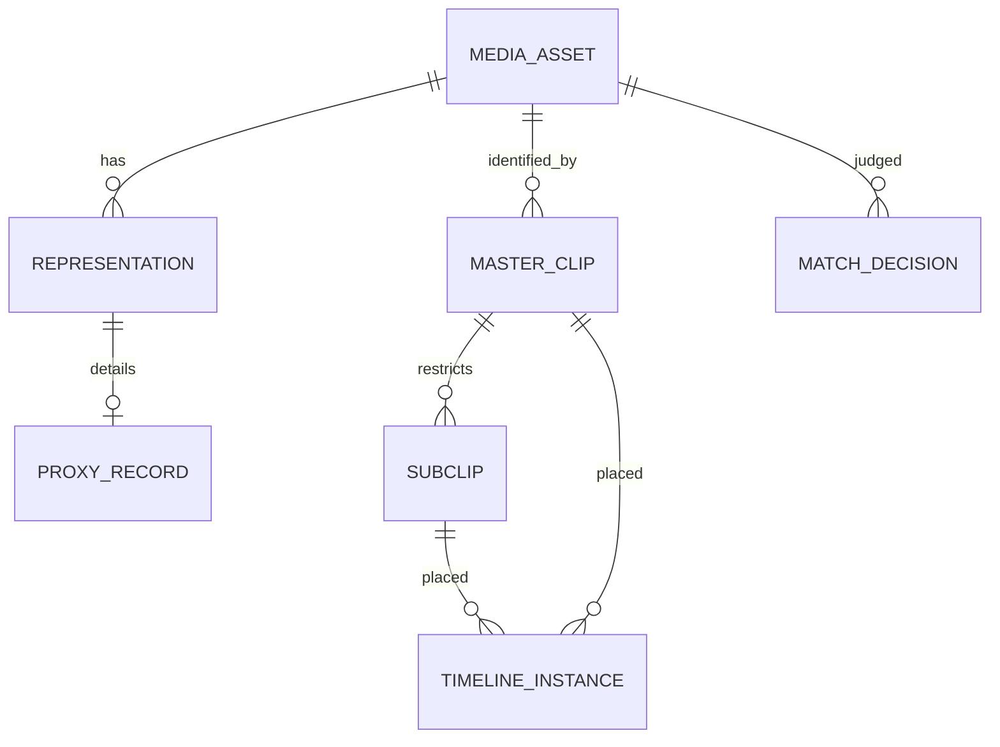

# AETHER media registry schema

Status: proposal for review. Specification only. This document does not migrate `docs/PROJECT_DATABASE_SCHEMA.md` and does not create a database.

## Verified facts

- The master logical schema has `media`, `media_location`, `media_link`, and `clip.media_id` (`docs/PROJECT_DATABASE_SCHEMA.md`).
- That schema already forbids a proxy link whose parent and child ids are equal, and it retires media instead of silently deleting referenced rows.
- This offline set requires a Media ID that timeline instances share with the original, plus distinct proxy, transcode, and consolidation records. The mapping is proposed below. Applying it to the master schema is future work and an unresolved decision in `OFFLINE_EDITING_ARCHITECTURE.md`.
- No database was created or queried for this document.

## Engineering recommendations

- Keep the registry as plain records and transactions. Probe code lives in processing and returns data. The registry module does not link FFmpeg or GStreamer.
- Store availability beside every technical and camera field so “unknown” survives a schema round-trip.
- Commit relationship changes and their decision rows in one transaction. Append the log even when the transaction rolls back, using a log that is allowed to commit independently. The relationship itself rolls back.

## Proposed behaviour

### Scope

The registry is the durable map from original asset to Media ID, and from that id to proxy, editorial transcode, consolidated asset, master clip, and locations. Master clips map to subclips and timeline instances. This document is the column contract for that map. Match policy is in `MEDIA_FINGERPRINTING_AND_MATCHING.md`. Relink’s procedure is in `MEDIA_RELINK_ENGINE.md`.

### Requirements

- `media_asset.media_id` is the original’s UUID and the source identity on `master_clip`.
- A representation row references `media_id` and has its own primary key (`proxy_id`, `transcode_id`, `consolidation_id`, or `location_id` for an original location).
- `timeline_instance.media_id` equals the master clip’s `media_id`. A writer that sets it to a `proxy_id` is refused.
- Filename columns are historical labels. They are not unique keys.
- Checksum, duration, and size are stored. None of them is a primary key. Duration equality is not uniqueness (integrity rule 7).
- The registry answers reads when `online` is false for every location.
- Schema version is an integer on the project, migrated only by an explicit migration in a later phase. This document is version proposal `offline-registry-1`.

### Data model

Types: `uuid`, `int`, `text`, `bool`, `rational` as two ints, `availability` as the wrapper in `MEDIA_IDENTITY_SPECIFICATION.md`. Time-of-day labels are timecode structures (`SOURCE_TIMECODE_AND_FRAME_ACCURACY.md`), not float seconds.

```text
media_asset
  media_id              uuid PK
  minted_utc            text
  retired               bool
  identity              group of availability fields
  video                 group of availability fields
  audio                 group of availability fields
  camera                group of availability fields
  checksum_algo         text
  checksum_value        text NULL
  checksum_state        text
  sync_warning          bool
  alpha_state           text
  schema_note           text

representation
  representation_id     uuid PK
  media_id              uuid FK -> media_asset
  role                  text
  path                  text
  relative_path         text
  volume_id             text
  file_name             text
  size_bytes            int NULL
  checksum_algo         text NULL
  checksum_value        text NULL
  checksum_state        text
  online_state          text
  validated_utc         text NULL
  validation_state      text

proxy_record
  proxy_id              uuid PK FK -> representation
  media_id              uuid FK
  codec                 text
  container             text
  raster_w, raster_h    int
  rate_n, rate_d        int
  duration_frames       int
  start_timecode        text
  audio                 group
  settings              group
  software_version      text
  generated_utc         text
  validation            group

transcode_record
  transcode_id          uuid PK FK -> representation
  media_id              uuid FK
  profile_id            text
  same technical columns as proxy_record

consolidation_record
  consolidation_id      uuid PK FK -> representation
  media_id              uuid FK
  mode                  text
  scope                 text
  handle_frames         int
  source_manifest_id    uuid

master_clip
  master_clip_id        uuid PK
  media_id              uuid FK -> media_asset
  name                  text
  source_rate_n, source_rate_d

subclip
  subclip_id            uuid PK
  master_clip_id        uuid FK
  source_in, source_out int

timeline_instance
  instance_id           uuid PK
  sequence_id           uuid
  track_id              uuid
  master_clip_id        uuid FK NULL
  subclip_id            uuid FK NULL
  media_id              uuid FK
  record_in, record_out int
  source_in, source_out int
  speed_map_id          uuid

match_decision
  decision_id           uuid PK
  media_id              uuid NULL
  candidate_path        text
  class                 text
  evidence              group
  policy_id             text
  accepted              bool
  actor                 text
  created_utc           text

registry_log
  log_id                uuid PK
  action                text
  subject_id            uuid
  outcome               text
  detail                text
  created_utc           text
```

`role` is `original`, `proxy`, `editorial_transcode`, `consolidated`, or `sidecar`.

`online_state` uses the states in `OFFLINE_EDITING_ARCHITECTURE.md`.

`validation_state` is `not_run`, `passed`, `failed`, or `incomplete`.

A master clip has either ongoing use or is retired. It does not require a representation row to exist. `timeline_instance` has exactly one of `master_clip_id` or `subclip_id`, and `media_id` must match that object’s original.

Mapping to the current master logical schema, for a later migration:

| This proposal | Current logical schema |
| --- | --- |
| `media_asset` | `media` row of the original |
| `representation` role `proxy` | `media` child row plus `media_link.relation = proxy` |
| `proxy_id` | Child `media.media_id`, forbidden as `clip.media_id` |
| `master_clip` | New. Not in the current table list. |
| `timeline_instance` | `clip`, plus required `master_clip_id` or `subclip_id` |
| `match_decision` | New. |
| `registry_log` | Near `ingest_event`, extended to relink and conform attempts |



### APIs

| Operation | Contract |
| --- | --- |
| `Registry.getAsset(media_id)` | Returns the asset or not-found. Works offline. |
| `Registry.listRepresentations(media_id, role)` | Returns rows. Empty is a normal offline or not-generated result. |
| `Registry.commitRelationship(before, after, decision)` | Single transaction. `before` must still match. Otherwise the commit aborts and the log records a conflict. |
| `Registry.rollbackMarker(transaction_id)` | Used internally on validation failure. Restores `before`. |
| `Registry.appendLog(entry)` | Append-only. |
| `Registry.queryInstances(media_id)` | Derived from instances. Not a stored counter. |

No operation accepts a decoder handle, a widget, or a GStreamer element name.

### Workflow

Writers are ingest, proxy completion, relink, and consolidation. Each calls `commitRelationship` only after its own validation function returns passed. Readers are bins, the timeline resolver, conform, and interchange. Interchange reads a snapshot. It does not hold a write transaction open across a user prompt.

### Validation

Schema validation rejects:

- a representation whose `media_id` does not exist;
- a proxy record whose file name is copied into `media_asset.identity.original_filename`;
- a timeline instance whose `media_id` differs from its master clip;
- a match class outside `exact`, `strong`, `probable`, `ambiguous`, `mismatch`, `missing`;
- a `commitRelationship` without a decision row;
- float columns for time. There are none in this schema. A migration that adds one is a defect.

### Errors

| Error | Result |
| --- | --- |
| Optimistic `before` mismatch | Abort. Log `conflict`. |
| Foreign key unknown | Abort. |
| Disk full during commit | Abort. Previous rows remain. Log `commit_failed` if the log store is still writable. If the log store is the same database, the whole transaction including the log attempt rolls back, and the caller records the failure in the session log file named in `docs/MEDIA_INGESTION_SPECIFICATION.md`’s logging approach. |
| Read of retired id | Returns the row with `retired` true. New links to it are refused. |

### Recovery

Backup and manifest cross-check stay as in `docs/PROJECT_DATABASE_SCHEMA.md` and `docs/RECOVERY_AND_BACKUP.md`. On disagreement, recovery does not synthesise a Media ID from a filename. It reports the two identities and waits.

### Performance

Primary key lookup by UUID. Secondary indexes, when implemented: `representation.media_id`, `representation.checksum_value`, `master_clip.media_id`, `timeline_instance.media_id`, `timeline_instance.sequence_id`. Checksum values are indexed for match level 2. Path columns are not the unique index. No query benchmark was run. Bin views must be satisfiable from these rows plus cached online flags.

### Tests

Specified, not executed. Schema fixtures in tests A, B, and E: offline asset with zero representations; proxy row that cannot become `timeline_instance.media_id`; transaction abort that preserves the previous path; two files with the same name and different checksums as two `media_id` values.

### Acceptance

- The original-to-representation-to-master-clip-to-instance chain is fully columned.
- The no-decoder rule is visible in the API list.
- The mapping to the current master schema is explicit, and this file does not pretend the master schema was already changed.
- Rollback and log behaviour are specified for both success and failure.

## Unresolved questions

- Whether `representation` is a single table with role-specific detail tables, as drawn here, or three physical tables. Recommendation: one location table plus detail tables, so relink has one path to update.
- Manifest duplication of these columns. Recommendation: the manifest carries identity, checksum, and location summary; the database remains authoritative on open when they disagree, and recovery is mandatory rather than a silent pick. This matches the master architecture and should be confirmed for the new decision rows.
- Encryption at rest. Still open in the master schema. This proposal does not add it.
