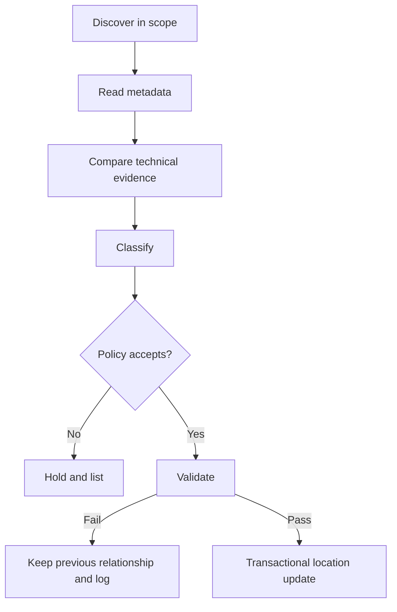

# AETHER media relink engine

Status: proposal for review. Specification only. No volume was mounted or unmounted. No relink was executed.

## Verified facts

- The master storage note requires relink by checksum and technical metadata, and it requires offline volumes to leave the project intact (`docs/MEDIA_STORAGE_AND_RELINKING.md`).
- This set tightens the match order to the six levels in `MEDIA_FINGERPRINTING_AND_MATCHING.md`.
- The engine is required to be independent of the UI and to serve open, relocation, bin import, sequence import, proxy switch, conform, interchange, and batch.

## Engineering recommendations

- One engine, many callers. A dialog is a caller that displays `Match.explain`. It is not where the class is decided.
- Replace a location only inside a registry transaction after validation.
- Keep sequence rows out of the write set. Relink updates locations and decision rows.

## Proposed behaviour

### Scope

Relink finds candidate files for known Media IDs and, when policy and validation allow, records a new location. It covers originals, proxies, editorial transcodes, and consolidated copies. It does not retarget a master clip to a different Media ID, and it does not edit timeline instances.

### Requirements

Scenarios the engine must handle with the same classifier:

| Scenario | What changes in the world | What the registry may change |
| --- | --- | --- |
| Mount-point change | Volume path prefix | Location path and volume id, same Media ID |
| Directory move | Parent directories | Location path |
| Rename | File name | Location file name and path. Historical original filename stays in identity. |
| Other workstation | Paths differ, files were copied or mounted | New location after class and validation |
| Originals and proxies on separate drives | Either volume absent | Only the representation that was found |
| Consolidation onto a new volume | New files, same pictures | New location of the same Media ID |
| Reorganised hierarchy | Relative layout changed | Path update after match. Relative path is evidence, not a key. |

Procedure, in order:

1. Discover candidates in the requested scope.
2. Read metadata as data from a probe result.
3. Compare size, duration, frame count, timecode, camera or reel, clip id, and checksum or fingerprint.
4. Classify.
5. Accept or hold according to policy.
6. Record the location intended.
7. Validate the candidate against the expected record.
8. Commit the registry transaction.

The relationship in step 8 is written only when step 7 passes. A failure leaves the previous location and logs the attempt (integrity rule 10).

Search scopes: one folder, one volume, or all known volumes. The user, or a headless caller, names the scope. “All volumes” means volumes the project has registered or the caller listed. It does not mean an unbounded scan of every network address.

Actions: relink the selected Media IDs that classified as acceptable, relink all verified (`exact` and validation passed) inside the scope, or manual acceptance of one candidate. The result lists unmatched and ambiguous items. Those lists are part of the result object, not a widget.

Filename-only candidates stay unaccepted.

A proxy switch may call relink to refresh a proxy path. The switch still must not change instance identity or source range. If the proxy file fails validation, the switch does not bind it.

Conform may call relink to locate originals, then runs its own checks. A relink result of “location committed” is not a sequence conform.

### Data model

```text
relink_request
  request_id
  caller            open | relocation | bin_import | sequence_import
                    | proxy_switch | conform | interchange | batch | manual
  scope             folder | volume | volumes
  scope_paths       list
  media_ids         list
  policy_id

relink_result
  request_id
  committed         list of decision ids
  held              list of decision ids
  unmatched         list of media ids
  ambiguous         list of decision ids
  failed_validation list of decision ids
```

Expected-versus-candidate rows, for any caller including a UI:

| Column | Content |
| --- | --- |
| Expected Media ID | UUID |
| Expected technical summary | Rate, duration frames, timecode, reel, size, checksum state |
| Candidate path | Path |
| Candidate summary | The same fields as read |
| Class | Six-class enum |
| Confidence | The class, not a float score. No hidden percentage. |
| Validation | `not_run`, `passed`, `failed` |
| Accepted | Bool |



### APIs

| Operation | UI required |
| --- | --- |
| `Relink.discover(scope)` | No |
| `Relink.classifyRequest(request)` | No |
| `Relink.accept(decision_id, actor)` | No. `actor` may be `user` or `policy`. |
| `Relink.commit(request_id)` | No |
| `Relink.result(request_id)` | No |

A UI may display the result. The engine does not import a UI module. Callers in the application layer translate the result into bin icons and lists.

`Relink.commit` calls `Registry.commitRelationship`. It does not write `timeline_instance` rows.

### Workflow

1. On project open, the application may call discover on last-known paths. A miss sets `relink_required` or `both_offline` and still opens the sequence.
2. The user, or a batch caller, chooses a scope and a subset of Media IDs.
3. The engine returns classes.
4. Policy auto-marks unique `exact` rows as accepted, subject to validation.
5. A person resolves `ambiguous`, `strong`, and `probable` rows when they want a relationship change. Critical conform will still apply its own gate.
6. Commit updates locations for accepted and validated rows only.
7. The cut’s record positions and source ranges are the same as before the call.

Imports of bins and sequences call the same engine with the ids inside the imported document. They do not create a second matcher.

### Validation

Before commit, for the role being linked:

- size, when both sides are known;
- frame count and rational rate for picture;
- sample count and sample rate for audio;
- start timecode when availability is `present` on the expected row;
- checksum when both checksums are `complete`;
- Media ID agreement when level 1 was the reason for `exact`;
- the candidate path is readable;
- the destination is not a request to overwrite original camera bytes.

Validation failure sets `validation_failed` on the clip state for that role and does not clear a previously good location.

### Errors

| Error | Outcome |
| --- | --- |
| Scope path missing | Result `unmatched` for ids that had no other candidate. Request still returns. |
| Probe error on one file | That candidate is listed with the probe error. Other candidates continue. |
| Policy absent | Commit refuses. Classify may still run. |
| Attempt to change `media_id` | Refused. |
| Attempt to write source in or out | Refused. |
| Two accepts for one Media ID and role | Refused until one remains. |

### Recovery

A failed commit leaves the last committed location. The user may point at a different folder and run again. Quarantine is not used for originals. A bad candidate is simply not linked. If a consolidate copy was being registered, the new copy stays unregistered until validation passes, and the previous location remains the online path if it was online.

### Performance

Discovery is cancellable and reports progress as data. It does not run on a UI thread; the application puts it on a worker if a UI exists. The engine itself is synchronous per call so tests can run it headless, and a caller may slice the work. Checksums are not computed inside `classify` if they are already stored; missing checksums are separate jobs. No scan rate was measured. Indexes on checksum and Media ID are the registry’s responsibility.

### Tests

Test E, specified and not executed. One headless case per scenario in the table. Additional cases: commit abort, ambiguous left unlinked, filename-only left unlinked, proxy and original on different volumes, and a caller list that includes `conform` and `bin_import` with the same results as `manual` for the same files.

### Acceptance

- The eight-step procedure and seven scenarios are specified.
- The API table shows no UI dependency.
- Commit is after validation, and sequence rows are outside the write set.
- Unmatched and ambiguous are first-class result fields.

## Unresolved questions

- Automatic discover on every open versus only when a volume id reappears. Recommendation: stat last-known paths in the background on open; run a wider search only when the user or a caller asks.
- Network volumes without a stable volume id. Open in the architecture decisions. Until a platform id exists, the last path and the checksum remain the evidence, and a path prefix change is a normal mount-point scenario.
- Whether `all volumes` includes unreadable network mounts in the unmatched report. Recommendation: list them as not scanned, so a failure to connect is visible.
