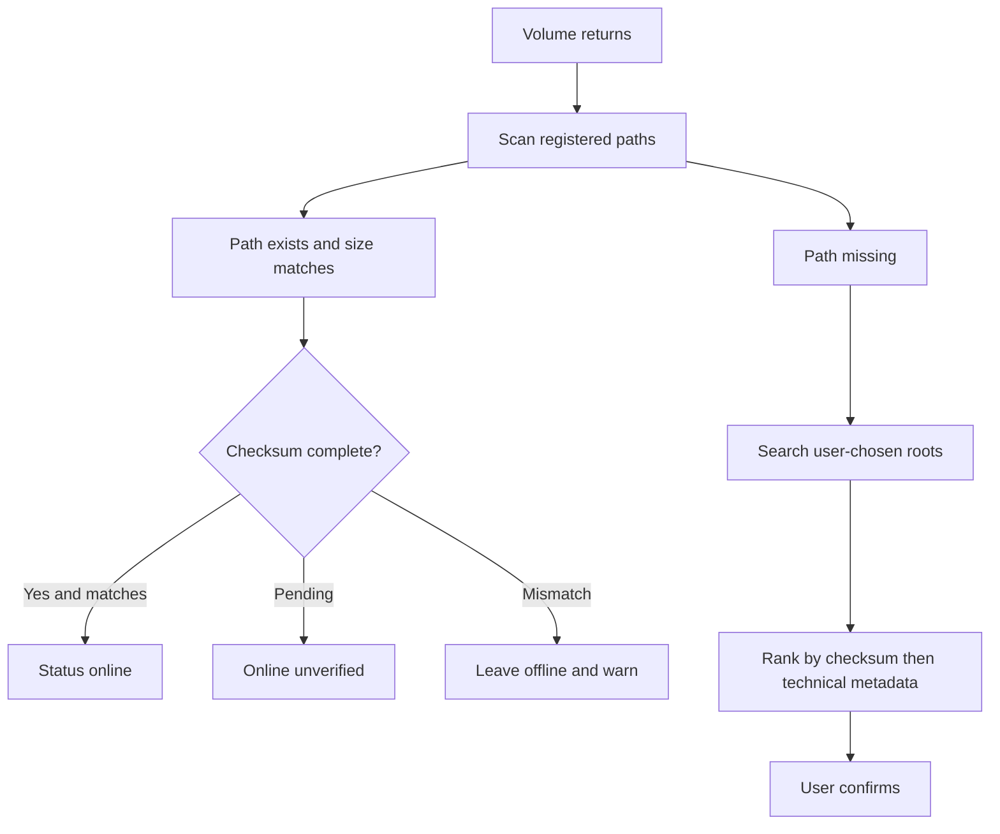

# AETHER media storage and relinking

Status: proposal for review.

## Verified facts

- Storage roles required by the brief: project, originals, managed editorial, proxy, cache, render, backup.
- Offline volumes must not damage the project.
- Relink by checksum and technical metadata is required. Filename-only relink is insufficient.
- No volume-removal test was executed.

## Engineering recommendations

- Persist a volume id that is not only the mount path. On Linux this may later be a filesystem UUID. The exact source is platform work and is unresolved. Until then, store both a volume id and the last path.
- Never rewrite a path inside an original as part of relink without confirmation. Relink updates the registry. It does not move bytes unless the user chose copy.
- Rank candidates. Do not auto-bind two checksum collisions. Stop and ask.

## Proposed AETHER behaviour

### Roles

| Role | Contents | If the volume is absent |
| --- | --- | --- |
| Project | Database, manifest, settings, lock | Project does not open as writable. Recovery may open a backup. |
| Originals | Linked sources or approved copies | Those media ids go `offline` |
| Managed editorial | Mezzanine files AETHER wrote under an explicit job | Those ids go `offline`. Proxies may still play. |
| Proxy | Proxy files | Playback falls back to managed or original if online, else offline. The cut remains. |
| Cache | Thumbnails, waveforms, indexes | UI shows placeholders. Jobs refill the cache. |
| Render | Exports and intermediate renders the user requested | Export items missing. Timeline unaffected. |
| Backup | Snapshots | Restore source missing. Live project unaffected. |

An offline volume does not delete rows, does not clear checksums, and does not substitute proxies into the master role.

### Relink order

When the user asks to relink, or when a volume returns and its id matches:

1. Match media id if the path is unchanged and size matches.
2. Match full checksum.
3. Match technical metadata: size, duration, rate, raster or audio format, and a weak fingerprint. Present as a candidate, not as an automatic bind, unless the user has enabled “auto-relink unique technical matches” in preferences. Default is ask when the checksum is still pending.
4. Filename is a sort hint inside a folder the user pointed at. It is never sufficient alone.

A match updates the location row and the volume id. The media id stays. A checksum mismatch against a previously complete checksum refuses the bind and logs it.

### Path updates

Relink stores the new path. It keeps `original_path` as history. `managed_path` changes only when the managed file itself was found elsewhere.

### Renders and cache

Cache paths are not relinked as masters. If a cache file is all that remains, the media stays offline and the UI says the master is missing. Render files have their own ids if they were ingested back. An export sitting in `EXPORTS/` is not automatically the master of the timeline.

### Specified tests, not executed

- Unmount the proxy volume: sequences still open, proxy items offline, originals play if linked.
- Unmount originals: clips show offline, undo history still opens, no row deleted.
- Two files with the same name and different checksums: both remain distinct, relink does not cross them.
- Restore a volume at a new mount path with the same volume id: paths update after confirmation or after an automatic path rewrite that the user enabled. Recommendation: automatic path rewrite only when volume id and checksum match.

## Rationale

| Decision | Rationale |
| --- | --- |
| Role-based offline | “Missing file” is not one state. A missing proxy is a convenience failure. A missing database is a project failure. |
| Checksum before name | Camera files reuse names every card. Name matching corrupts the cut. |
| Keep original_path | Assistants need the card path months later, even after a managed copy exists. |
| Do not promote cache | Promoting cache to master is a silent quality loss and violates media safety. |

## Unresolved questions

- Volume id source on Linux, Windows, and macOS. Unmeasured. Design stores an opaque string the platform module fills.
- Network shares that do not provide a stable UUID. Recommendation: hash of the user-declared volume name plus a marker file AETHER writes only on volumes the user designates as managed. Do not write a marker onto a camera card.
- Automatic relink when checksums are pending. Default remains conservative: do not bind on name.
- Cross-project relink of the same camera file into a second project. Allowed as a new location of a new project-local media id, unless a future shared library exists. The second project does not rewrite the first project’s database.
