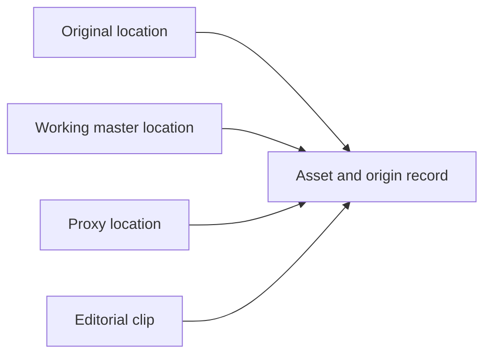

# AETHER Native Media Architecture

Status: profile proposal. No implementation is authorized by this document.

FFmpeg is the mandatory core media framework (ADR-001). GStreamer is not a mandatory dependency. The 19 November 2026 FFmpeg study in this file is kept. It is not deleted and it is not reclassified as a pass. A later CLI session recorded the same 30000/1001 disagreement: eight picture frames, 12813 audio samples, editorial `sampleIndex(8) = 12812` (`docs/validation/FFMPEG_MXF_ROUNDTRIP_TEST.md`, `docs/validation/AUDIO_FRAME_SAMPLE_BOUNDARY_VALIDATION.md`). The integer rule was not changed. Library integration is a separate, blocked test.

AETHER is a feature-film nonlinear editor. This document chooses the native media the catalog keeps and the file a finished picture is written to. It sits on the media rules in [ARCHITECTURE.md](../ARCHITECTURE.md): the catalog identifies assets, Processing probes and encodes through FFmpeg, and a clip stores an asset id rather than a path. Time stays the integer model in [TIMEBASE_AND_FRAME_ACCURACY.md](TIMEBASE_AND_FRAME_ACCURACY.md). Sound stays on the sequence sample boundary in [AUDIO_TIMEBASE_AND_SYNC.md](AUDIO_TIMEBASE_AND_SYNC.md).

The companion documents are the container, the two picture profiles, the identity record, and the tests:

- [MXF_CONTAINER_SPECIFICATION.md](MXF_CONTAINER_SPECIFICATION.md)
- [PRORES_PROFILE_SPECIFICATION.md](PRORES_PROFILE_SPECIFICATION.md)
- [DNXHR_PROFILE_SPECIFICATION.md](DNXHR_PROFILE_SPECIFICATION.md)
- [MEDIA_IDENTITY_AND_METADATA.md](MEDIA_IDENTITY_AND_METADATA.md)
- [MEDIA_INTEROPERABILITY_TESTS.md](MEDIA_INTEROPERABILITY_TESTS.md)

## 1. Recommendation

The native working file is one MXF Operational Pattern 1a file. Picture and sound live in that file, frame-wrapped, so a take opens as one playable item.

| Role | Container | Picture | Sound |
| --- | --- | --- | --- |
| Primary working master | MXF OP1a | Apple ProRes 422 HQ | 48 kHz, 24-bit little-endian PCM, source channel order preserved in the catalog |
| Alternative working master | MXF OP1a | DNxHR HQX | The same PCM rule |
| Proxy | MXF OP1a | ProRes 422 Proxy, or DNxHR LB | The same channel count, channel map, frame rate, frame count, and timecode label as the master |
| High-end master | MXF OP1a | ProRes 4444, or DNxHR 444 | The same PCM rule |
| Camera original | Left as received | Whatever the camera or scanner wrote | Whatever the original carried |

OP-Atom is an optional compatibility export. It is one essence track in one file. It is not the file the timeline opens by default.

A generic MXF file that FFmpeg can open is not, on that evidence, a file another editorial application can relink. The tests that would show DaVinci Resolve, Avid Media Composer, and Adobe Premiere Pro are specified in [MEDIA_INTEROPERABILITY_TESTS.md](MEDIA_INTEROPERABILITY_TESTS.md) and were not run.

## 2. Where the bytes sit

Media Management owns the asset and the locations. Editorial owns the clip, which names the asset id and a source range. Processing probes, verifies, and writes files. The Application is the only module that joins them. This document adds no library to the approved stack. FFmpeg remains private to Processing. MediaInfo is a test tool used on this machine. It is not a runtime dependency.

The architecture already stores locations with roles `master` and `proxy`. This proposal adds a third role, `original`, for the untouched camera or scanner file. That addition is decision 1 below. Until it is accepted, the original file is the master, and a later transcode replaces the master path only by an explicit relink.

## 3. What was checked

Checked on this machine on 19 November 2026:

| Tool | Reported identity |
| --- | --- |
| `/usr/bin/ffmpeg` | FFmpeg 9.0.2, libavformat 63.1.102. Built with `--enable-gpl`. An LGPL build was not measured. |
| `/usr/bin/ffprobe` | The same binary's probe. |
| `/usr/bin/mediainfo` | MediaInfoLib 26.05 |

The muxer and encoder behaviour was also read from the FFmpeg 9.0.2 sources `libavformat/mxfenc.c` and `libavformat/mxf.c` at tag `n9.0.2`. Short synthetic files were written with `testsrc2` and `anullsrc`, eight frames unless a test says otherwise, then read back with ffprobe, MediaInfo, and a byte inspection of the KLV keys. Those files are not camera media and they are not a picture-quality test.

Published documents used for the target, as distinct from what this FFmpeg writes:

- SMPTE RDD 44:2022, *Material Exchange Format — Mapping and Application of Apple ProRes*. Approved 1 June 2022. It maps ProRes bitstreams, which it says are specified by SMPTE RDD 36, into a subset of the MXF Generic Container. RDD 36 itself was not obtained. RDD 44 normatively cites SMPTE ST 377-1:2019 and SMPTE ST 379-2:2010.
- SMPTE ST 377-1:2019 scope: the MXF file structure, partitions, header metadata, primer, random index pack, and index tables. A DOI record also lists a later ST 377-1 dated 22 January 2026. That text was not obtained. This design follows the 2019 edition RDD 44 names.
- SMPTE ST 379-2:2010: frame wrapping. One content package lasts one edit unit. Picture and sound in that package share that duration.
- SMPTE ST 378:2004, operational pattern 1a: one item, one file package, one internal essence container that may interleave picture and sound.
- SMPTE ST 390:2011, OP-Atom: one essence track and one essence container in the file. The header is closed and complete. A full index sits in the footer. The pattern is a poor fit for reading a file while it is still being recorded.
- SMPTE ST 2019-1 and ST 2019-4: VC-3 picture coding and its MXF mapping. A 2016 mapping sample was read for scope. A DOI record lists ST 2019-4:2026, and Avid's public DNx 4 notes describe a 2026 VC-3 revision with wider bit depths, RGB on every level, and custom bit rates. Those 2026 texts were not obtained. The profiles below are the five levels this FFmpeg encodes, under the names DNxHR LB, SQ, HQ, HQX, and 444.
- SMPTE ST 382:2023: mapping of AES3 and Broadcast Wave audio into the Generic Container. The target audio mapping is the wave essence element in that standard.
- Apple's ProRes white paper, for sample depth, alpha, and the four-character codes. Its published target rates at 1920×1080 and 29.97 fps differ from the informative 24 fps rates in RDD 44 Table 2. Both are targets. Frame size follows the picture.

## 4. Supported picture and sound on this FFmpeg

The `mxf` muxer writes OP1a. Its operational-pattern label, read back by ffprobe from a file this muxer wrote, is `060e2b34.04010101.0d010201.01010900`. MediaInfo reported `OP-1a` and `Closed / Complete`. The `mxf_opatom` muxer writes OP-Atom. MediaInfo reported `OP-Atom` on those files.

Encoders present in `ffmpeg -encoders`: `prores_ks`, `prores`, `prores_aw`, `prores_ks_vulkan`, and `dnxhd`. PCM encoders present include `pcm_s16le`, `pcm_s24le`, `pcm_s24be`, and `pcm_s32le`. The muxer's own help lists default codecs `mpeg2video` and `pcm_s16le`. AETHER names the codec on every write. The unconfigured defaults are not a native profile.

`prores_ks` is the profile-selectable encoder. Its help lists pixel formats `yuv422p10le`, `yuv444p10le`, and `yuva444p10le`, and profiles `proxy`, `lt`, `standard`, `hq`, `4444`, and `4444xq`. `prores` and `prores_aw` expose no profile option. Both wrote ProRes 422 (`apcn`) when asked to encode. `prores_ks_vulkan` was not run.

`dnxhd` lists profiles `dnxhr_lb`, `dnxhr_sq`, `dnxhr_hq`, `dnxhr_hqx`, and `dnxhr_444`, and pixel formats `yuv422p`, `yuv422p10le`, `yuv444p10le`, and `gbrp10le`.

### 4.1 Combinations that muxed, opened in ffprobe, and decoded in FFmpeg

Each row was an OP1a file with the named picture and, where sound is listed, PCM at 48 kHz. FFmpeg decoded the file with an empty error log. That is a local round trip. It is not an interchange result.

| Picture | Pixel format this encoder accepted | Sound in the same file | Identifiers read back |
| --- | --- | --- | --- |
| ProRes 422 Proxy | `yuv422p10le` | `pcm_s24le` and, separately, `pcm_s16le` | Four-character code `apco`. MediaInfo profile `422 Proxy`. |
| ProRes 422 LT | `yuv422p10le` | `pcm_s24le` | `apcs` |
| ProRes 422 | `yuv422p10le` | `pcm_s24le` | `apcn` |
| ProRes 422 HQ | `yuv422p10le` | `pcm_s24le` | `apch`. MediaInfo `422 HQ`, 10 bits, 4:2:2, progressive. |
| ProRes 4444 | `yuv444p10le` | `pcm_s24le` | `ap4h`. MediaInfo 10 bits, 4:4:4. ffprobe reported the decoder buffer as 12-bit `yuv444p12le`. |
| ProRes 4444 XQ | `yuv444p10le` | `pcm_s24le` | `ap4x`. The same 10-bit encode and 12-bit decoder report as 4444. |
| ProRes 4444 with alpha | `yuva444p10le`, `alpha_bits` 16 | `pcm_s24le` | ffprobe pixel format `yuva444p12le`. MediaInfo did not report an alpha channel. |
| DNxHR LB | `yuv422p` | `pcm_s24le` | Compression ID 1274 in the VC-3 header. ffprobe profile `DNXHR LB`, 8 bits. |
| DNxHR SQ | `yuv422p` | `pcm_s24le` | Compression ID 1273. |
| DNxHR HQ | `yuv422p` | `pcm_s24le` | Compression ID 1272. 8 bits. |
| DNxHR HQX | `yuv422p10le` | `pcm_s24le` | Compression ID 1271. MediaInfo `VC-3`, `RI@HQX`, 10 bits, 4:2:2. |
| DNxHR 444 | `yuv444p10le` | `pcm_s24le` | Compression ID 1270. MediaInfo `RI@444`, matrix BT.709 when the encoder was given BT.709. |
| DNxHR 444 | `gbrp10le` | `pcm_s24le` | Compression ID 1270. MediaInfo matrix `Identity`. |

Channel counts that muxed in one OP1a sound element: 1, 2, 6, and 8, all `pcm_s24le` at 48 kHz. Eight separate mono sound elements in one OP1a file also muxed and decoded. ffprobe reported a channel count and reported `channel_layout` as empty on every one of those files.

Frame rates that the muxer accepted without `-strict unofficial`, and that were written here: 24/1, 24000/1001, 25/1, 48/1, and 30000/1001. The rate table in FFmpeg 9.0.2 also lists 30/1, 48000/1001, 50/1, 60/1, 60000/1001, and several higher rates. Those extra rates were not written in this probe. 18/1 was rejected until `-strict unofficial`, and then it wrote. Native media uses the rates in section 6 and does not pass `-strict unofficial`.

Rasters that muxed for both ProRes 422 HQ and DNxHR HQX: 1920×1080, 1998×1080, and 2048×858. On the DNxHR files the descriptor's stored rectangle is padded up to a multiple of 16. 1998×1080 is stored as 2000×1088, with 1998×1080 also present as the sampled and display rectangle. 2048×858 is stored with height 864. ffprobe and MediaInfo reported the display size. A reader that displays the stored rectangle would add a padded edge. ProRes files reported the requested size with no padded stored rectangle in the same check.

Timecode. `-timecode 01:00:00:00` at 24/1 and at 24000/1001 was read back by ffprobe and by MediaInfo as the first frame of the material package, the source package, and the system-item timecode. `-timecode 01:00:00;00` at 30000/1001 was read back with the semicolon, which is the drop-frame label. MediaInfo also reported `Time code, stripped: Yes` on these files. The label was still present. What a given application does with a stripped timecode track is one of the tests, and it was not run outside FFmpeg and MediaInfo.

Package names. On one Proxy file, `material_package_name`, `file_package_name`, and `reel_name` were set. MediaInfo showed all three in `Package name`. ffprobe showed `material_package_name` and a `comment_reel` user comment. It did not show `file_package_name` or `reel_name` as their own tags. The identification set read back was FFmpeg's: company `FFmpeg`, product `OP1a Muxer`. The material-package UMID and the product UID are values this muxer generates. They are location hints. They are not the asset id.

OP-Atom files that FFmpeg wrote and read back:

| File | Result |
| --- | --- |
| DNxHR HQX, picture only | OP-Atom, Closed/Complete. One picture element. Element key ended `15010600`. FFmpeg's source comment says byte value `0x06` is its clip-wrap choice. MediaInfo still reported wrapping mode `Frame`. Both observations stand. |
| ProRes 422 HQ, picture only | OP-Atom. Element key ended `15011700`. One element, a 9-byte BER length, the whole clip in that element. |
| `pcm_s24le`, mono, 48 kHz, `-t` about a quarter second | OP-Atom, wrapping reported as `Frame (BWF)`, codec id `0D01030102060100`. One element held the whole clip. With no `-mxf_audio_edit_rate`, MediaInfo reported the timecode at 25 fps. The same muxer with `-mxf_audio_edit_rate 24/1` reported 24 fps. |
| `pcm_s24le`, stereo | Rejected. The muxer log: `MXF OPAtom only supports single channel audio`. |

### 4.2 Combinations this FFmpeg rejected

| Attempt | Result |
| --- | --- |
| `pcm_s24be` in OP1a | `could not find essence container ul, codec not currently supported in container` |
| `pcm_s32le` in OP1a | The same rejection |
| 96 kHz `pcm_s24le` | `only 48khz is implemented` |
| 44.1 kHz `pcm_s24le` | The same rejection |
| DNxHR HQX with `yuv422p` | Encoder closed with invalid argument. Nothing was written. |
| DNxHR HQ with `yuv422p10le` | `pixel format is incompatible with DNxHR LB/SQ/HQ profile` |
| 18/1 without `-strict unofficial` | `Unsupported frame rate 18/1` |
| OP-Atom stereo PCM | Rejected, as above |

`prores_ks` has no 12-bit pixel format. ProRes 4444 and 4444 XQ were encoded from 10-bit frames. The profile label is 4444 or XQ. The sample depth of the encoded source is 10 bits. Apple's white paper says those two profiles can accept sources up to 12 bits per image channel and an alpha of up to 16 bits. This FFmpeg cannot be the writer of a 12-bit source.

## 5. What a successful open does not show

These are properties of the files this FFmpeg wrote. They are why a native master is specified as a descriptor set, not as "whatever `ffmpeg -f mxf` emits".

- OP1a sound uses the AES3 element key `060e2b34010201010d01030116010300` and an AES3 descriptor. The value is the `pcm_s16le` or `pcm_s24le` packet, written through unchanged. MediaInfo calls that `PCM`, `Little`, `Frame (AES)`. ST 382 wave essence is a different element. OP-Atom mono audio is the file that MediaInfo called BWF. OP1a audio from this muxer is not that mapping.
- The catalog's channel map is not in the file. Count survives. Names do not.
- ProRes picture KLV length is a 4-byte BER. RDD 44 section 6.2.2 requires a five-byte length. The short HQ frame measured here had a 4-byte length and value length 315210.
- The partition KAG size field is 512. RDD 44 section 5.6 says a KAG of 1 should be used, and that other values may be used inside the range ST 377-1:2019 allows. This probe did not check 512 against that range.
- The MXF descriptor for ProRes 4444 does not carry an alpha sample depth. The alpha file's bitstream was still decoded by FFmpeg as `yuva444p12le`. A reader that trusts the descriptor can miss the matte.
- DNxHR 444 is described with the RGBA picture descriptor. The pixel layout written by this muxer is R, G, B and does not include an alpha code. Alpha on DNxHR was not encoded. The 2026 public Avid notes describe alpha on DNx levels. This encoder does not offer it.
- Setting the ProRes vendor id to `apl0` made MediaInfo report `Writing library: Apple`. The default `prores_ks` vendor string is `Lavc`, and the `prores` encoder's default is `fmpg`. AETHER does not write `apl0`. A vendor id is not authorship.
- At 30000/1001, eight frames of picture have duration timestamp 8. The audio in that file has duration timestamp 12813 samples at 48 kHz. Eight frames at that rate span 12812.8 sample periods. MediaInfo reported `1601.6 SPF`. The integer `sampleIndex` rule in the timebase document and this muxer's sample count are not the same quantity. At 24/1 the file had 2000 samples per frame and the durations matched. At 24000/1001 MediaInfo reported 2002 samples per frame, which is the exact product `48000 * 1001 / 24000`.
- Files written without a creation time read back as encoded date `0-00-00`. The muxer will take a creation time from metadata. The native writer supplies one.
- Index layout for a program-length file was not measured. The muxer source keeps a variable-size index and starts a body partition every 250 edit units. RDD 44 section 5.3.3 describes about ten seconds per body partition for segmented files, and section 5.3.2 allows one partition of any duration. The eight-frame files are the short case.

## 6. Native profile set

A new AETHER master uses one row of this table. The frame rate is one of 24/1, 25/1, 24000/1001, 30000/1001, 48/1, and 60000/1001, which are the sequence rates the timebase document already stores. 60000/1001 is in FFmpeg's MXF rate table and was not written in this probe. A verification failure on that rate blocks the master.

Sound, when the take has sound, is 48 kHz and 24-bit little-endian PCM. 16-bit PCM muxes, and it is a legacy read. It is not the default write. Channel count follows the source, from 1 through 32, which is the range the audio architecture already allows. The order is the channel map in [MEDIA_IDENTITY_AND_METADATA.md](MEDIA_IDENTITY_AND_METADATA.md).

| Profile | Use | Picture | Encoder on this machine | Pixel format |
| --- | --- | --- | --- | --- |
| `prores-422-hq` | Primary master | ProRes 422 HQ | `prores_ks` profile `hq` | `yuv422p10le` |
| `dnxhr-hqx` | Alternative master | DNxHR HQX, CID 1271 | `dnxhd` profile `dnxhr_hqx` | `yuv422p10le` |
| `prores-422-proxy` | Proxy | ProRes 422 Proxy | `prores_ks` profile `proxy` | `yuv422p10le` |
| `dnxhr-lb` | Proxy | DNxHR LB, CID 1274 | `dnxhd` profile `dnxhr_lb` | `yuv422p` |
| `prores-4444` | High-end | ProRes 4444, opaque | `prores_ks` profile `4444` | `yuv444p10le` |
| `dnxhr-444` | High-end | DNxHR 444, CID 1270 | `dnxhd` profile `dnxhr_444` | `yuv444p10le`, or `gbrp10le` when the source is RGB |

ProRes 422 LT, ProRes 422, ProRes 4444 XQ, DNxHR SQ, and DNxHR HQ mux on this machine. They are readable profiles, not default masters. A source that arrives in one of them can stay the master when the rest of the identity matches. AETHER does not transcode a matching master just to change profile.

The target MXF mapping for every row is in the container specification. Where this FFmpeg diverges from that target, the file is a local mezzanine this FFmpeg can read, and the interchange tests decide whether it may leave the machine.

## 7. Preservation, proxies, and relink

The original file is hashed and then left where it is. A transcode is a new file. Export uses the master. The architecture already refuses a silent fallback to the proxy when a master is offline. A proxy is a location on the same asset: same origin, same frame count, same rate, same timecode label, same channel map. Deleting `proxies/` changes no cut.

Relink compares a candidate with the stored identity. The path is a hint. The comparison list is duration in frames, frame rate, display rectangle, sample rate, channel count, channel map, reel, camera roll, timecode label, file size, and the SHA-256 of the file when one has been stored. Codec and profile are recorded and shown. A profile difference is a visible mismatch, not an automatic rejection of a camera original that is being linked as `original` while a mezzanine remains the master.

## 8. Unresolved decisions for review

The documents in this set specify one recommendation for each item. Acceptance of the set accepts the recommendations, or sends back the items that should change. Implementation stays stopped either way.

1. **Original as its own location.** Recommended: a location role `original` beside `master` and `proxy`. The original is never rewritten and is not the export file when a working master exists. [ARCHITECTURE.md](../ARCHITECTURE.md) section 5.3 names only `master` and `proxy`. Confirm the third role, or keep the original as the master and treat a transcode as a new asset.

2. **OP1a audio mapping.** Recommended: the target file uses ST 382 wave PCM, 48 kHz, 24-bit, little-endian, frame-wrapped to the picture edit unit. FFmpeg 9.0.2 writes AES3-labeled PCM on OP1a and wave PCM only on mono OP-Atom. Confirm that an interchange master must meet the wave target, and that an AES-labeled file may be used only as a local mezzanine this FFmpeg can read.

3. **One sound element or one element per channel.** Recommended: one interleaved sound element, plus the channel map stored on the asset. Eight mono elements also muxed. Confirm the single element. A map that the file does not carry has to live in the catalog either way.

4. **OP-Atom in the first delivery.** Recommended: OP-Atom is specified and is not a default export. Picture-only OP-Atom for DNxHR HQX and ProRes 422 HQ, and mono 24-bit OP-Atom audio, are the only shapes this muxer produced. Stereo OP-Atom is unavailable here. Confirm that the export exists only after the tests in [MEDIA_INTEROPERABILITY_TESTS.md](MEDIA_INTEROPERABILITY_TESTS.md) have been run, and that the audio edit rate is the picture rate rather than the muxer's 25/1 default.

5. **Alpha.** Recommended: opaque ProRes 4444 and opaque DNxHR 444 are the high-end masters. ProRes 4444 with alpha muxes in this FFmpeg and is not a supported interchange profile until the descriptor carries alpha sample depth and an application test reads the matte. Confirm.

6. **DNxHR stored rectangle.** Recommended: film rasters that are not a multiple of 16 are legal. The identity stores both the stored rectangle and the display rectangle. Verification fails if a reader would present the pad as picture. The alternative is to refuse those rasters for DNxHR and letterbox into a multiple of 16 before encode. Confirm the display-rectangle rule.

7. **12-bit ProRes sources.** Recommended: out of scope for the native writer. This `prores_ks` accepts 10-bit frames only. A 12-bit source stays in the original file. Confirm.

8. **Checksum required for relink.** Recommended: SHA-256 of the file bytes when the file has been read to the end, compared when both sides have a hash, and skipped with a visible "hash absent" state when either side lacks one. A size or duration match without a hash does not count as verified. Confirm.

9. **Proxy channel map.** Recommended: a proxy that drops or reorders channels is rejected. The proxy keeps the master's map and frame count. Confirm.

10. **Rates outside the editorial set.** Recommended: native masters use the six rates in section 6. 18/1 and any rate that needs `-strict unofficial` are refused for a master. Confirm.

11. **Vendor and identification strings.** Recommended: do not write the ProRes vendor id `apl0`. Leave the encoder's own vendor id until AETHER has a writer that can put its own company and product name in the MXF identification set. Confirm.

12. **Non-integer samples per frame.** Recommended: at 30000/1001 and 60000/1001 the native file's audio sample count for a frame span equals `sampleIndex(end) - sampleIndex(start)` from the timebase document. This FFmpeg wrote 12813 samples for eight frames at 30000/1001, against a picture span of 12812.8 sample periods. A file that disagrees fails verification. Confirm the floor rule as the native audio contract.
