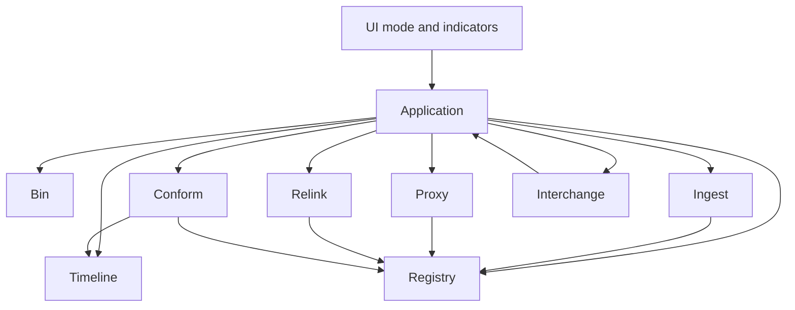

# AETHER offline editing architecture

Status: proposal for review. Specification only. This document authorises no implementation, no schema migration, and no test run.

This is the index for the offline-editing and online-conform set in this directory. The broader master set lives in `docs/`. Where a rule here is tighter than an earlier master note, this set is the proposal for offline and online work, and the conflict is listed under unresolved decisions. No file in `docs/` is edited by this proposal.

## Verified facts

- AETHER is specified as an offline-first feature-film editor. The native editorial model is the authority. Playback files, AVX, AAF, and other exchange documents are not the project (`docs/SYSTEM_ARCHITECTURE.md`, `docs/EDITORIAL_PHILOSOPHY.md`).
- The master schema stores rational rates as integer pairs and forbids floating-point accumulation as the stored timebase (`docs/TIMELINE_ENGINE_ARCHITECTURE.md`, `docs/PROJECT_DATABASE_SCHEMA.md`).
- A prior local study of FFmpeg 9.0.2, not run for this document, reported that OP1a ProRes and DNxHR profiles muxed, that PCM was exercised only at 48 kHz 24-bit little-endian, that channel layout was not stored in MXF, that a ProRes 4444 alpha descriptor was incomplete, and that a 29.97 case showed an audio sample-count mismatch. Those notes are to be reconciled. They are not results of this specification.
- No camera card, no external application, and no conform were executed for this document. Numbers in sibling examples are illustrative.

## Engineering recommendations

- Treat original-camera identity, the source relationship, and the editorial timebase as durable records. Representation files are replaceable. Those three records are not.
- Keep the registry free of decoder libraries. Keep the relink engine free of widgets. Keep conform on the editorial model. Keep interchange as a document adapter.
- Ship implementation later, in the seven phases below, after this set is reviewed. This document does not start those phases.

## Proposed behaviour

### Scope

Offline editing is the mode in which a feature is cut against durable editorial objects while the bytes being played may be proxies, editorial transcodes, or absent. Online conform is a later verification that those objects still describe the original camera media. This document defines the boundaries, the states, the representation modes, the integrity rules, and the later implementation order. Sibling documents define identity, the registry, proxies, matching, relink, time, source mapping, conform, reporting, camera ingest, consolidation, and exchange.

In scope:

- Original camera media, editorial transcodes, proxies, master clips, subclips, and timeline instances as distinct objects.
- Persistence of Media ID, source range, and sequence timing across move, rename, unmount, proxy regeneration, and project migration.
- Visible offline states that leave the cut editable.
- A UI-independent relink engine and a registry with no decoder dependency.

Out of scope:

- Decoder implementation, a chosen FFmpeg or GStreamer build, and any claim that a profile is validated.
- Vendor compatibility results. Profiles in `EXTERNAL_APPLICATION_COMPATIBILITY.md` are specified and not executed.
- Colour science, audio mixing, and trim mathematics except where they must not disturb source identity. Those remain in the master set.

### Requirements

Integrity rules. These are normative for every sibling document.

| # | Rule |
| --- | --- |
| 1 | No silent source substitution. A different file becomes the source only through a classified match that policy accepts and validation passes. |
| 2 | No automatic acceptance of an ambiguous relink. |
| 3 | Original camera media is never modified. Jobs write new files in managed roles. |
| 4 | A proxy, editorial, or original switch does not change source in or source out. |
| 5 | Relink does not change sequence timing, instance identity, or the speed map. |
| 6 | A filename is support evidence. It is never identity by itself. |
| 7 | Equal duration does not prove identity. |
| 8 | No silent discard of a clip, effect, transition, speed map, or unsupported item. The report lists it. |
| 9 | A conform is not `verified` while a critical dependency is unresolved. |
| 10 | A relationship is overwritten only after validation. Failure rolls the relationship back. The attempt remains in the log. |
| 11 | A proxy filename is never recorded or exported as the camera original. |
| 12 | Time authority is rational integers and integer frames or samples. Floating-point seconds are a display format only. |

Additional requirements:

- A successful export is not a verified conform.
- A successful relink is not a verified sequence conform.
- A master clip stays valid when every file for it is offline.
- Registry updates that change a relationship are transactional.
- The log of a decision is append-only. Rollback restores the relationship and keeps the log entry.

### Boundaries

| Boundary | Owns | Does not own |
| --- | --- | --- |
| Project | Project id, settings, manifest hash, open and save | Match decisions, decode |
| Bin | Master clips, subclips, organisation, display columns | File bytes, conform verdicts |
| Registry | Media ID, availability, representations, locations, checksums, transactions | FFmpeg, GStreamer, widgets, timeline mathematics |
| Ingest | Read-only intake, logical recordings, required sidecars | Modification of camera cards, editorial decisions |
| Proxy | Proxy jobs, proxy records, proxy validation | Master-clip id, source range, instance id |
| Relink | Discover, classify, policy, commit of locations | Widgets, sequence timing, filename-only acceptance |
| Timeline | Instances, tracks, rational positions, speed maps | Paths, conform approval, decode |
| Conform | Read the editorial model and the registry, verify, report | Preview pixels as identity, exchange files as the live project |
| Interchange | AVX, AAF, OTIO, FCP XML, FCPXML, CMX 3600, loss reports | Authority for an open project |
| UI | Global status, bin columns, non-blocking indicators, representation mode | Hidden rewrites of relationships |

Dependency rules:

- Relink has no UI dependency. Open, relocation, bin import, sequence import, proxy switch, conform, interchange, and batch call the same engine.
- Registry has no FFmpeg or GStreamer dependency. Probe results arrive as data.
- Conform uses the editorial model. It does not use a preview file as the source of record.
- Interchange is not the project authority. Import proposes a document. The application commits it. Export reads a snapshot.

Forbidden edges: UI to the registry transaction log as a writer; Relink to a widget toolkit; Registry to a decoder library; Conform to “whatever file is currently playing”; Interchange to an in-place rewrite of a sequence; any boundary to a write into original camera media.

### Object model

| Object | Identity | Relationship |
| --- | --- | --- |
| Original camera media | `media_id` UUID | Authoritative essence. Unmodified. |
| Editorial transcode | `transcode_id` | References `media_id`. ProRes Proxy, ProRes LT, DNxHR LB, DNxHR SQ, or a later validated profile. |
| Proxy | `proxy_id` | References `media_id`. Those editorial codecs, plus H.264, or a custom preset. |
| Consolidated asset | `consolidation_id` | Same `media_id`, new location, copy or transcode. |
| Master clip | `master_clip_id` | References `media_id`. Never a proxy filename. |
| Subclip | `subclip_id` | References `master_clip_id` and a source range. |
| Timeline instance | `instance_id` | Position, source in and out, duration, speed, track, effects, audio. Resolves through the master clip or subclip. |

Playback chooses a representation. The instance continues to name the editorial object.

### Data model

The durable records are the objects in the table above, plus a representation-selection record (global, batch, or per instance) and an append-only decision log. Column detail is `MEDIA_REGISTRY_SCHEMA.md`. Time fields are integer frames, integer samples, and rational pairs. A path is a location attribute. It is not a key. The selection record is not part of the timeline instance.

### APIs

Cross-boundary operations. Each sibling specifies the full contract. None of these operations is a UI call.

| Operation | Boundary | Effect |
| --- | --- | --- |
| `Registry.getAsset` / `commitRelationship` | Registry | Read identity. Commit a location only with a decision row. |
| `Relink.commit` | Relink | Update locations. Does not write instances. |
| `Playback.select` | Proxy | Change representation choice. Does not write source ranges. |
| `Conform.run` | Conform | Write a report for a pinned revision. Does not write the cut. |
| `Interchange.export` | Interchange | Write a package and a loss report. Does not become the project. |

### Offline states

Each master clip exposes one primary state, computed from representation records.

| State | Meaning |
| --- | --- |
| `online_original` | A validated original location is readable. |
| `online_proxy` | A validated proxy is readable. |
| `online_editorial` | A validated editorial transcode is readable. |
| `original_offline_proxy_online` | Original location is unavailable. A validated proxy is readable. |
| `proxy_offline_original_online` | Proxy is unavailable. Original is readable. |
| `both_offline` | Known locations are unavailable. The master clip remains. |
| `missing` | No location record exists for a required role the user asked to resolve. |
| `relink_required` | A path failed, or a volume returned with an unclassified candidate. |
| `validation_failed` | A candidate or a derivative failed validation. The previous relationship stands. |
| `incompatible` | The file’s rate, raster policy, or audio map cannot be used for the requested role. |

Originals and proxies may live on different volumes. Unmounting originals leaves editing available on a validated proxy. Reopen restores the same states from the registry. It does not require the original volume. Relink runs later, and a later conform is still required before anyone calls the sequence verified.

Bins, the source viewer, and the timeline show the state. Timeline indicators do not block edits, trims, or playback of an available representation.

### Representation modes

| Mode | Selection |
| --- | --- |
| `offline_proxy` | Prefer a validated proxy, then a validated editorial transcode. |
| `original` | Prefer the original camera representation. |
| `automatic` | Use the project preference order among representations that passed validation. |

The mode is global, and it can be overridden per clip or as a batch. Switching mode, clip, or batch does not change `master_clip_id`, source in, source out, timeline position, sequence duration, metadata, or `instance_id`.

A file that exists and failed validation is not a candidate. A failed proxy is not a trusted conform source. Conform of picture and sound to camera originals uses the original role. The proxy mode is for editorial playback.

### Transaction, log, rollback

A relationship change (location, proxy link, consolidation location, match acceptance) is one registry transaction:

1. Read the current relationship.
2. Validate the candidate.
3. Commit the new relationship and the decision row together.
4. On validation failure or commit failure, leave the previous relationship in force.
5. Append a log row for the attempt in either outcome.

Original bytes are outside the transaction. Rollback never writes them.

### Later implementation order

These phases are a proposed build order for a future implementation. They are not started.

| Phase | Work | Exit, still to be demonstrated |
| --- | --- | --- |
| 1 | Registry and Media ID, with availability and transactions. No decoder library. | A master clip reopens with every path offline and the same Media ID. |
| 2 | Rational source time and sequence-source mapping, including speed maps. | The illustrative source-versus-timeline example round-trips on paper fixtures, then on a later engine test. |
| 3 | Camera ingest records, spanned clips, required sidecars, fingerprint records as data. | A missing required sidecar stays on the recording as incomplete. |
| 4 | Relink engine and match classes, callable with no UI. | Filename-only and ambiguous cases stay unaccepted. |
| 5 | Proxy and editorial records, job controls, validation, representation switch. | Switch leaves instance identity and source range unchanged. A failed proxy cannot be selected for conform. |
| 6 | Conform engine and JSON plus HTML report. | Export success and relink success are separate states from sequence conform. |
| 7 | AVX and AAF profiles, other adapters, consolidation, external profiles. | Packages name originals. External tests remain specified until someone runs them. |

### Workflow

1. Ingest records a Media ID and availability. Camera cards stay read-only.
2. The editor cuts master clips and instances. Proxies may be generated in the background.
3. Volumes come and go. States update. The cut stays.
4. Relink classifies candidates and commits only what policy and validation allow.
5. Conform, when requested, reads instances and originals and writes a report.
6. Exchange writes a package and a compatibility report. The package is not itself a conform pass.

### Validation

Review validation for this architecture is a document check: every sibling states the twelve integrity rules by reference, the four dependency rules hold in its API table, and phases stay marked as later work. Runtime validation belongs to the siblings. No runtime check was executed.

### Errors

| Condition | Result |
| --- | --- |
| Decoder library referenced by a registry operation | Specification defect. The operation stays a data contract. |
| UI required to classify a match | Specification defect. Relink remains callable headless. |
| Mode switch request includes a source-range edit | Rejected as a combined command. The two edits are separate, and only the editorial command may change the range. |
| Commit fails after validation | Previous relationship remains. Log records the commit failure. |

### Recovery

Open compares the project database with the manifest, as in `docs/RECOVERY_AND_BACKUP.md`. Disagreement opens recovery. It does not pick a Media ID or a source range by guessing. Offline media is a normal state, not a recovery event.

### Performance

No measurement was taken. The design constraints are: the timeline becomes editable from the editorial model without hashing media; bin painting does not read essence; location probes run off the caller’s interactive thread when a UI exists; the registry answers a Media ID lookup from an index. Numeric budgets are an unresolved decision.

### Tests

Specified in `OFFLINE_ONLINE_INTEROPERABILITY_TEST_PLAN.md`. Not executed. This document is covered by the traceability matrix there, and by tests A, D, and G for identity, offline reopen, and the export-versus-conform distinction.

### Acceptance

- A reviewer can name the ten boundaries and the four dependency rules.
- Integrity rules 1–12 are the rules cited by the other sixteen documents.
- Representation mode is specified as a selector, and the identity fields it must leave unchanged are listed.
- Phases 1–7 are present and marked as later work.
- Unresolved decisions below are the open list for this set.

## Rationale

| Decision | Rationale |
| --- | --- |
| Separate instance from file | Feature cuts outlive drives, proxy generations, and conform passes. |
| Registry without a decoder | Identity has to be testable, and reviewable, before a codec build is chosen. |
| Conform after relink, as its own act | Finding a file and proving a sequence are different claims. Assistants already lose work where those claims are collapsed. |
| Indicators that do not block | Offline is the normal condition during a cut, not an error dialog. |

## Unresolved decisions

1. **Media ID text form.** This set persists a lowercase UUID (RFC 4122). `docs/MEDIA_IDENTITY_AND_METADATA.md` and `docs/AVX_FORMAT_SPECIFICATION.md` illustrate `med_` prefixed ids that are not UUIDs. Decision: one canonical text form, and whether `med_` is only a display prefix. Recommendation: persist the UUID; accept a single `med_` prefix on read when the remainder is a UUID; stop minting non-UUID ids.
2. **Proxy catalogue id versus proxy id.** The master schema gives a proxy its own `media` row and a `media_link`. This set requires `clip` and master-clip source identity to be the original Media ID, with `proxy_id` as a representation id. Decision: confirm the link direction and that no timeline instance stores the proxy row id as its source. Recommendation: keep the extra row for the file, and forbid it as `clip.media_id`.
3. **Trust root for a manifest or sidecar.** Match level 1 needs a rule for what makes a manifest valid so a planted sidecar cannot assert someone else’s Media ID. Recommendation: a Media ID in a sidecar is exact only together with a matching full-file checksum already stored for that id, or a manifest content hash the project can verify. A new ingest may allocate a new id. It may not adopt an existing id on a checksum mismatch.
4. **Unique strong match while checksum is pending.** Critical conform stays exact-only unless a person validates the candidate. Decision: whether playback may show `online` unverified for a unique strong path restore. Recommendation: yes for playback, labelled unverified; no for conform and no for relationship replacement.
5. **Fingerprint algorithm.** The record can store an algorithm id and version. The sample positions and hash are not chosen. No fingerprint was computed for this set.
6. **Volume identity** on local disks and on network shares. Already open in `docs/MEDIA_STORAGE_AND_RELINKING.md`. This set stores an opaque volume id plus the last path and does not pretend the platform source is chosen.
7. **Displayed out-point versus stored range.** Recommendation: store half-open frame ranges, as the timeline engine does, and display an inclusive out-point one source frame earlier. Reports must show which form a number uses. Confirmation is still open because assistants read inclusive outs.
8. **Audio position domain.** The timeline master spec leaves samples versus a common rational tick open. This set requires integer audio samples and a rational map, and forbids float seconds. The single storage domain is still open.
9. **Proxy profile availability.** Presets are named. None is validated. The FFmpeg 9.0.2 study is a reconcile list, not a pass. Decision: which preset may be offered after a future suite, and the default. Recommendation: offer none as a default until a suite passes; prefer an intra-frame preset for scrubbing once licence and behaviour both pass.
10. **Partial proxies.** Recommendation: proxies are whole-file. Used ranges with handles are consolidation, specified separately. Confirm that a partial proxy is out of the first implementation.
11. **Speed-ramp fallback.** When a receiver cannot reproduce a ramp, the report must say so. Decision: whether a user may then choose a rendered fallback. Recommendation: keep the original map in the project and in the manifest; render only on an explicit command; never simplify the stored map.
12. **Default consolidation handles.** Recommendation: the “used with handles” command requires an explicit integer count of source frames. Zero is the only implicit length, and only for “used only”.
13. **Camera sidecar matrices.** Families are named. The exact required sidecar patterns are not fixed, because no card was read. They belong in later camera profiles grounded in public documentation and fixtures.
14. **Automatic sound sync at ingest.** Recommendation: timecode-adjacent picture and sound are candidates. They become linked recordings only after confirmation. Confirm the policy.
15. **AVX version.** Dual original and playback references are proposed as AVX 1.1.0. `docs/AVX_FORMAT_SPECIFICATION.md` says a newer version is refused by an older reader. Decision: adopt 1.1.0 in that specification, or fold the fields into 1.0.0 before any file exists.
16. **PDF reports.** HTML is the readable conform report. PDF is a later render of that HTML. No PDF renderer is chosen or implied.
17. **External versions.** Resolve, Media Composer, and Premiere profiles name no tested version, because none was run. The first execution has to name the build before any result is recorded.
18. **Performance numbers.** Constraints are stated. Frame budgets, hash throughput, and project-size targets are not measured and are not invented here.
19. **Checksum agility.** Recommendation: SHA-256 is the required algorithm, the algorithm id is stored, and a completed checksum is not replaced silently by another algorithm.
20. **Who may loosen match policy.** Recommendation: a recorded project policy, with critical conform remaining exact-only unless a named user validates a candidate. A hidden application preference is insufficient.
